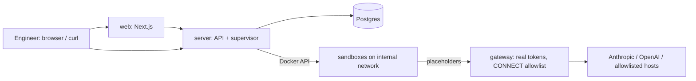

# Terrarium

## About

Terrarium is a learning example for understanding how to build a remote coding-agent platform.
Its purpose is to make the essential building blocks and their trade-offs concrete:

- **Isolated sandboxes:** run agents in disposable Docker environments with controlled network access.
- **Agentic gateway:** keep real credentials outside sandboxes while managing access to model providers
  and allowed external services.
- **Sandbox lifecycle management:** provision and monitor sessions, recover from failures, enforce
  timeouts, and clean up resources.
- **Multi-harness support:** run Claude Code and Codex through a shared platform with harness-specific
  adapters.
- **Session orchestration and interaction:** coordinate agent runs and follow-up prompts through an
  HTTP API, MCP, and a web UI.

> **For learning and demos only—not for production deployment.** This project deliberately makes
> trade-offs to stay understandable and simple to run on a local machine. Use it to explore the
> design, not as a production-ready platform.

The research behind this project was influenced by
[OpenSandbox](https://github.com/opensandbox-group/OpenSandbox),
[Google AX](https://github.com/google/ax), and [Omnigent](https://github.com/omnigent-ai/omnigent).

## Architecture

A single-machine prototype of an internal platform for remote coding-agent sessions. An engineer
starts Claude Code or Codex sessions in isolated, disposable Docker sandboxes, then monitors them,
sends follow-up prompts, attaches to the live stream and stops them, over an HTTP API, MCP or a
web UI. Sessions run on your own Claude or ChatGPT subscription (one of the two is enough), and
the real credentials never enter a sandbox.

- Plan and architecture: `docs/plan/local-prototype-plan.md`
- Threat model (demonstrated vs design-only controls): `docs/threat-model.md`
- Contracts: `docs/contracts/` (API, sandboxd, gateway)



## Prerequisites

**Install yourself** (everything else comes from mise):

- macOS (credentials are kept in the macOS keychain)
- [Docker Desktop](https://www.docker.com/products/docker-desktop/), running
- [mise](https://mise.jdx.dev) (`brew install mise`)

Then, in the repository, let mise install the pinned tools: Go, Node, jq, yq, and Claude Code and
Codex at the same versions as the sandbox image:

```bash
mise trust && mise install
```

**Accounts.** Terrarium runs both Claude Code and Codex, but one of them is enough; configure only
what you have. GitHub is optional.

| Account | Enables | Without it |
|---|---|---|
| Claude subscription (Max) | Sessions with `"harness": "claude-code"` | Those sessions fail; Codex sessions still work |
| ChatGPT subscription (Plus or higher) | Sessions with `"harness": "codex"` | Those sessions fail; Claude Code sessions still work |
| GitHub (`gh` logged in, or a fine-grained token), optional | Agents pushing branches and opening PRs on your behalf; private repositories | Public repositories still clone; pushes and PRs are refused |

`mise run credentials` (next step) lets you pick just the accounts you have.

## Setup (once)

```bash
mise run credentials
```

Pick the accounts you have, then follow each login. The Claude and GitHub tokens go to the macOS
keychain; the Codex login goes to `~/.terrarium/codex`, separate from your own `~/.codex`.

## Run

```bash
mise run up
```

This builds the images, applies migrations and starts Postgres, the server, the gateway and the web
UI. `mise run down` stops everything and keeps the data; `mise tasks` lists the other commands.

- Web UI: http://127.0.0.1:3000. Log in with a user name; a new name creates the user. The user
  menu (top right) copies your API token.
- API: http://127.0.0.1:8080 (`Authorization: Bearer <token>`), see `docs/contracts/api.md`.
  Interactive docs: http://127.0.0.1:8080/docs (also **API** in the web UI's top bar); spec at
  `/openapi.yaml`. A token is also returned by
  `curl -s -XPOST localhost:8080/login -d '{"name":"alice"}'`.
- Login has no password, so it only works on `localhost` (`TERRARIUM_LOGIN_ALLOWED_HOSTS`, a
  comma-separated list for the server). Never publish the ports on a public interface.

## Try it

The web UI's **Examples** page has ten ready-to-run scenarios: exploring a repository, running its
tests, a follow-up conversation, forbidden egress, the prompt-injection tripwire, looking for
credentials, other repositories being off limits, a locked-down preset, an agent reporting failure
and opening a draft PR. Each one is a single paste for bash or zsh that starts a session, waits for
the agent and prints the result. Pick Claude Code or Codex, depending on the subscription you have.

## Use it from another agent (MCP)

Terrarium is also an MCP server at `http://127.0.0.1:8080/mcp` with tools to list presets, create,
wait for, inspect, follow up and terminate sessions (`docs/contracts/mcp.md`). The web UI's **MCP**
page has copy-paste setup commands with your token filled in (shown masked, copied in full).

## Tests

```bash
mise run test
```

This starts Postgres, runs `go vet` and `go test` in `platform/`, and lints and typechecks the web
UI. The Go suite covers the state machine and supervisor (crash and reattach, stop, TTL, idle
timeout, lost sandbox, orphan cleanup, advisory lock), the gateway (token swap, route allowlist,
budget, usage accounting, Codex refresh, CONNECT allowlist, GitHub repository and branch checks),
sandboxd and the API (auth, ownership, limits, SSE).

## What was built vs reused

| Built | Reused |
|---|---|
| Go control plane: API, reconcile-loop supervisor, Docker provider, harness adapters (`platform/internal/`) | Claude Code, Codex CLI, yq, jq in the sandbox image (pinned) |
| Credential-swapping gateway + CONNECT allowlist proxy (`platform/internal/gateway`) | Docker Engine, Postgres, Docker Compose |
| `sandboxd` in-sandbox exec daemon (`platform/cmd/sandboxd`) | Next.js, pgx, Go stdlib HTTP |
| Web UI (`web/`) | |

## Layout

| Path | Contents |
|---|---|
| `mise.toml` | Required tools (pinned) and every developer command: `mise tasks` |
| `platform/` | Go module: API server, gateway, sandboxd, credentials CLI (`cmd/`, `internal/`), runtime config (`config/`: presets, prices), sandbox image (`images/agent`) and a Go-only `Makefile` |
| `web/` | Next.js web UI |
| `deploy/` | `compose.yaml` and the control-plane `Dockerfile` |
| `docs/` | Contracts, plan, threat model, drills |
