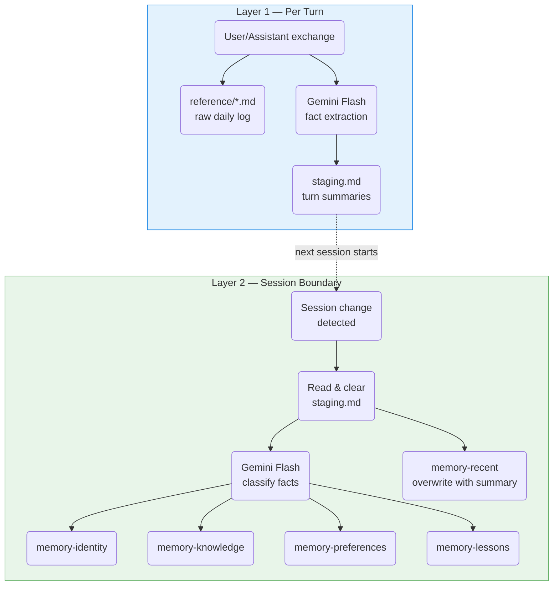

# agent-memory

Agent reads, plugin writes. Fully automatic long-term memory for AI agents. No database. No embeddings. No agent participation required. A plugin extracts, classifies, and stores memories from conversations — the agent just talks.

## The Problem

Most agent memory systems require the agent to *decide* what to remember. That's unreliable — agents forget to write, write to the wrong place, break formats, or introduce duplicates. The agent is busy solving the user's problem; memory management is a distraction.

Meanwhile, agents like [OpenCode](https://github.com/nicepkg/opencode) and Claude Code already have a built-in **skill system**: markdown files with YAML frontmatter that agents load on demand based on relevance. That's a retrieval mechanism — it just isn't called one.

This project uses that mechanism for retrieval, and moves all write operations to a background plugin. The agent becomes a pure consumer of memory: it reads skill files when relevant, but never writes them.

## How It Works

A plugin hook fires on every conversation turn. It calls a lightweight LLM (Gemini Flash) to extract facts from the exchange, stages them, and — at session boundaries — classifies and merges them into four category-specific skill files. The agent loads these skills on demand via frontmatter descriptions. No embedding search. No re-ranking. The agent *is* the retrieval engine.

### Architecture

Two layers, one pipeline. Every turn is recorded; session boundaries trigger classification and distribution.



**Layer 1 (every turn):** The plugin appends the raw exchange to a date-partitioned log (`reference/YYYY-MM-DD.md`) and calls Gemini Flash to extract facts into `staging.md`.

**Layer 2 (session boundary):** When a new session starts, the plugin reads and immediately clears `staging.md` (preventing race conditions), then fires classification in the background. Gemini Flash routes each fact to the appropriate category skill. A second LLM call per category merges new facts with existing ones — deduplicating, resolving contradictions, and updating the frontmatter description.

```
skills/
  memory-identity/SKILL.md       # Who the user is
  memory-knowledge/SKILL.md      # What the user's domain looks like
  memory-preferences/SKILL.md    # How the agent should behave
  memory-lessons/SKILL.md        # What went wrong and why
  memory-recent/
    SKILL.md                     # Last session summary (sliding window)
    staging.md                   # Turn buffer (cleared on swap)
    reference/*.md               # Raw daily conversation logs

plugins/
  memory.js                      # Plugin that drives everything above
  memory-state.json              # Session tracking state
```

### Four Categories

| Category | What it stores | Examples |
|----------|---------------|----------|
| **Identity** | Objective facts about the user | "Operations manager at Acme Corp", "Team of 5 in Guangzhou" |
| **Knowledge** | Business domain knowledge | "Pricing formula: cost * 2.5 + shipping + 15% platform fee" |
| **Preferences** | Instructions to the agent | "Show data in tables", "Use USD for all amounts" |
| **Lessons** | Failures and insights | "Always test samples before bulk orders — got burned by defective batch" |

Plus **Recent** — a sliding-window summary of the last session, overwritten on each session boundary. For historical detail, grep `reference/`.

### Agent Reads, Plugin Writes

The agent is explicitly forbidden from writing to memory files:

```markdown
<!-- Do NOT edit this file directly! Memory is maintained automatically
by a dedicated plugin. Direct edits will cause duplicates and conflicts. -->
```

This is the core design choice. The plugin owns all writes: extraction, classification, deduplication, contradiction resolution, and frontmatter updates. The agent owns all reads: deciding which skills to load based on their descriptions.

### Concurrency Safety

- `swapInProgress` flag in `memory-state.json` prevents concurrent swaps
- Stale lock detection (5 min timeout) recovers from crashes
- Staging is cleared immediately after reading, before async classification begins
- Classification and distribution run as fire-and-forget background tasks

## Installation

Copy `skills/` and `plugins/` to your agent's config directory:

```bash
# OpenCode
cp -r skills/* .opencode/skill/
cp -r plugins/* .opencode/plugin/

# Claude Code (skills only — see note below)
cp -r skills/* .claude/skills/
```

Set `GEMINI_API_KEY` in your environment. Without it, raw conversation logs are still written — only fact extraction and classification are skipped.

> **Important:** Add the following to your agent's instructions (e.g. `CLAUDE.md`, system prompt, or equivalent):
>
> *Memory files are automatically extracted, classified, and written by the plugin at session boundaries. Direct writes by the agent will cause duplicate content, format corruption, and classification conflicts. The agent should simply converse as normal — the plugin handles all memory extraction and storage automatically.*

### Claude Code Adaptation

Claude Code doesn't support JS plugin hooks natively. To use this system with Claude Code, adapt `memory.js` into a `SessionEnd` hook script that:

1. Reads the session transcript
2. Calls Gemini Flash for fact extraction
3. Writes to `staging.md` and `reference/`
4. Runs classification against the four category skills

## Design Decisions

**Why not a vector database?**
Skill descriptions serve as a lightweight index. For personal memory (hundreds of entries, not millions), the agent's own comprehension of frontmatter descriptions is sufficient retrieval. No embedding pipeline needed.

**Why does the plugin write instead of the agent?**
Agents are unreliable writers. They forget, they misclassify, they break formats, they duplicate. Moving all writes to a deterministic plugin eliminates an entire class of failure modes. The agent's job is to think, not to maintain a filing system.

**Why Gemini Flash?**
Fact extraction and classification are high-volume, low-stakes tasks — perfect for a fast, cheap model. The primary agent (which may be expensive) is never burdened with memory management overhead.

**Why four categories instead of three?**
The previous design merged preferences and lessons into a single "directives" category. In practice, "reply in Chinese" (a preference) and "don't skip backup before migration" (a lesson) have different retrieval patterns and lifetimes. Splitting them improves precision.

**Why a sliding window for recent memory?**
Accumulating session summaries indefinitely creates an ever-growing file that degrades retrieval quality. Overwriting with only the last session keeps `memory-recent` small and highly relevant. Historical context lives in `reference/` logs, accessible on demand.

## Compatibility

The skill files work with any agent that supports markdown with YAML frontmatter — including [OpenCode](https://github.com/nicepkg/opencode), Claude Code, and their forks. The plugin uses OpenCode's `chat.message`, `experimental.text.complete`, and `event` hooks.

## License

MIT
