<div align="center">


[](LICENSE)
[](https://kind.sigs.k8s.io/)
[](https://ollama.com/)
[](https://prometheus.io/)
[](https://grafana.com/oss/loki/)
[](https://grafana.com/oss/tempo/)
[]()


</div>

---

## What is AegisOps?

AegisOps is an **open, reproducible research testbed** for investigating how Large Language Models (LLMs) and classical ML can make DevOps pipelines and cloud infrastructure *self-observing, self-diagnosing, and self-healing*—**safely**.

Unlike AI-DevOps tools that demonstrate automation in isolation, AegisOps provides a **controlled experimental environment** where every claim about an agent's diagnostic accuracy or remediation safety can be reproduced from a clean `git clone`:

- **Standardized failure injection** — Chaos Mesh with a three-tier taxonomy and ground-truth labels
- **Full-stack observability** — Prometheus, Loki, Tempo, and Grafana, all provisioning-first
- **Pluggable LLM backends** — Ollama for zero-cost local inference, with an abstract interface for frontier-model baselines
- **Reproducible benchmarks** — deterministic event IDs, timestamped injection windows, and schema-versioned datasets

The project is structured around three research thrusts:

| Thrust | Focus | Key Question |
|---|---|---|
| **Aegis-CI** | Intelligent CI/CD remediation | Can hybrid ML–LLM pipelines fix build failures with high precision and low cost? |
| **Aegis-Observe** | LLM-driven root-cause analysis | How far can agentic LLMs go in correlating logs, metrics, and traces—and where do they fail? |
| **Aegis-Heal** | Safe self-healing Kubernetes | What architectural patterns make autonomous remediation *provably safe*? |

> **Research context.** This repository is the artifact companion to a PhD thesis on AI-augmented DevOps automation. All code, datasets, benchmarks, and experiment scripts are released open-source to maximize reproducibility and community adoption.

---

## Phase 1 Progress

The current milestone is **Phase 1: Instrumentation** (Months 1–6). The four foundational deliverables are complete:

| # | Deliverable | Status | Artifact |
|---|---|---|---|
| 1 | One-command testbed (`make up`) | ✅ Complete | Kind · Prometheus · Loki · Tempo · Grafana |
| 2 | Target app + OpenTelemetry export | ✅ Complete | Online Boutique → OTEL Collector → backends |
| 3 | Telemetry normalization layer | ✅ Complete | `TelemetryEvent` schema · normalizer · `aegisops-collect` CLI |
| 4 | Failure injection library | ✅ Complete | 3-tier taxonomy · Chaos Mesh · ground-truth JSON |
| 5 | Baseline RCA agent | 🔄 Next | Ollama-backed agentic loop |
| 6 | Evaluation harness | ⏳ Planned | Detection latency · RCA accuracy · tool-call efficiency |
| 7 | Workshop paper draft | ⏳ Planned | Phase 1 writeup |

---

## Architecture

The full system spans three layers—the Kubernetes testbed, the Python telemetry runtime, and the ground-truth storage that anchors every experiment. The diagram is **clickable**: each node opens the corresponding file in this repository.

> **Color legend:** blue = application services · orange = observability backends · red = chaos injection · cyan = telemetry runtime · gray dashed = Phase 2+ components.

```mermaid
flowchart TB
    %% External actors
    LoadGen["🌐 Load Generator\n(Online Boutique · 10 users)"]:::external
    Operator["👤 Researcher / Operator\n(Grafana · kubectl · aegisops-collect)"]:::client
    ChaosRunner["🎯 Chaos Runner\nchaos/runner/inject.py"]:::cli
    click ChaosRunner "https://github.com/JawherKl/aegisops/blob/main/chaos/runner/inject.py"

    subgraph Kind["☸️ Kind Cluster: aegisops — 1 control-plane + 2 workers"]
        direction TB

        subgraph App["📦 Namespace: online-boutique"]
            direction TB
            Frontend["frontend\n(Go · :8080)"]:::service
            Cart["cartservice\n(C# · :7070)"]:::service
            Checkout["checkoutservice\n(Go · :5050)"]:::service
            Product["productcatalogservice\n(Go · :3550)"]:::service
            Currency["currencyservice\n(Node · :7000)"]:::service
            Payment["paymentservice\n(Node · :50051)"]:::service
            Shipping["shippingservice\n(Go · :50051)"]:::service
            Email["emailservice\n(Python · :8080)"]:::service
            Ads["adservice\n(Java · :9555)"]:::service
            Recommend["recommendationservice\n(Python · :8080)"]:::service
            Redis["redis-cart\n(Redis · :6379)"]:::datastore
        end

        subgraph Obs["📊 Namespace: observability"]
            direction TB
            OTel["OTEL Collector\n:4317 (gRPC) · :4318 (HTTP)"]:::collector
            click OTel "https://github.com/JawherKl/aegisops/blob/main/infra/helm/otel-collector.yaml"
            Prom["Prometheus\n:30090 → :9090"]:::backend
            click Prom "https://github.com/JawherKl/aegisops/blob/main/infra/helm/prometheus-stack.yaml"
            Alertmgr["Alertmanager"]:::backend
            Loki["Loki Gateway\n:30310 → :80"]:::backend
            click Loki "https://github.com/JawherKl/aegisops/blob/main/infra/helm/loki.yaml"
            Tempo["Tempo\n:30320 → :3200"]:::backend
            click Tempo "https://github.com/JawherKl/aegisops/blob/main/infra/helm/tempo.yaml"
            Grafana["Grafana\n:30300 → :3000"]:::dashboard
        end

        subgraph ChaosNs["💥 Namespace: chaos-mesh"]
            direction TB
            ChaosCtrl["chaos-controller-manager"]:::chaos
            ChaosDaemon["chaos-daemon (DaemonSet)"]:::chaos
        end
    end

    subgraph Aegis["🐍 AegisOps Python Runtime"]
        direction TB

        subgraph TelNorm["📥 Telemetry Normalization Layer ✓"]
            direction TB
            Models["models.py\nTelemetryEvent · Alert\nMetricSample · Incident"]:::aegis
            click Models "https://github.com/JawherKl/aegisops/blob/main/src/aegisops/telemetry/models.py"
            Backends["backends/\nPrometheusClient · LokiClient"]:::aegis
            click Backends "https://github.com/JawherKl/aegisops/tree/main/src/aegisops/telemetry/backends"
            Normalizer["normalizer.py\nTelemetryNormalizer"]:::aegis
            click Normalizer "https://github.com/JawherKl/aegisops/blob/main/src/aegisops/telemetry/normalizer.py"
            CollectCLI["aegisops-collect\n(unified event stream)"]:::cli
            click CollectCLI "https://github.com/JawherKl/aegisops/blob/main/src/aegisops/cli/collect.py"
        end

        subgraph LLMLayer["🤖 LLM Abstraction Layer (next)"]
            direction TB
            LLMBase["base.py\nLLMProvider interface"]:::future
            Ollama["ollama_provider.py\n(qwen2.5:7b · local · free)"]:::future
        end

        subgraph Agents["🧠 Agents (Phase 2+)"]
            direction TB
            AegisCI["Aegis-CI\ngatekeeper + remediator"]:::future
            AegisObserve["Aegis-Observe\nagentic RCA"]:::future
            AegisHeal["Aegis-Heal\nsafety-gated executor"]:::future
        end

        subgraph Eval["📈 Evaluation Harness (Phase 1 finish)"]
            direction TB
            Metrics["metrics.py\nlatency · RCA accuracy"]:::future
            Runner["runner.py\norchestrator"]:::future
            Scorers["scorers.py\nscoring functions"]:::future
        end
    end

    subgraph GT["💾 Ground Truth Storage ✓"]
        direction TB
        Scenarios["scenarios.yaml\n(named scenarios)"]:::datastore
        click Scenarios "https://github.com/JawherKl/aegisops/blob/main/chaos/runner/scenarios.yaml"
        ChaosExp["chaos/experiments/*.yaml\n(Chaos Mesh CRDs)"]:::datastore
        click ChaosExp "https://github.com/JawherKl/aegisops/tree/main/chaos/experiments"
        ChaosGT["benchmarks/chaos-ground-truth/\ninj-*.json\n(window + labels)"]:::datastore
    end

    LoadGen -->|HTTP| Frontend
    Frontend -->|gRPC| Cart
    Frontend -->|gRPC| Product
    Frontend -->|gRPC| Currency
    Frontend -->|gRPC| Ads
    Frontend -->|gRPC| Recommend
    Checkout -->|gRPC| Payment
    Checkout -->|gRPC| Shipping
    Checkout -->|gRPC| Email
    Checkout -->|gRPC| Product
    Cart --> Redis

    App -.->|"OTLP gRPC :4317"| OTel
    OTel -->|OTLP| Tempo
    OTel -->|remote-write| Prom
    OTel -->|OTLP HTTP| Loki
    Prom --> Alertmgr
    Grafana -->|PromQL| Prom
    Grafana -->|LogQL| Loki
    Grafana -->|TraceQL| Tempo
    Operator -->|browse| Grafana

    Operator -->|"make chaos SCENARIO=…"| ChaosRunner
    ChaosRunner -->|kubectl apply| ChaosExp
    ChaosRunner -->|writes| ChaosGT
    ChaosExp --> ChaosCtrl
    ChaosCtrl --> ChaosDaemon
    ChaosDaemon -.->|"injects faults T1/T2/T3"| App

    Prom -.->|"/api/v1/alerts · /api/v1/query"| Backends
    Loki -.->|"/loki/api/v1/query_range"| Backends
    Tempo -.->|"trace search"| Backends
    Models --> Normalizer
    Backends --> Normalizer
    Normalizer --> CollectCLI
    Operator -->|run| CollectCLI

    CollectCLI -.->|"List[TelemetryEvent]"| AegisObserve
    AegisCI -.-> AegisObserve
    AegisObserve -.-> AegisHeal
    AegisObserve -.->|prompts| LLMBase
    LLMBase --> Ollama
    AegisObserve -.-> Scorers
    Scorers --> Metrics
    Runner -->|orchestrates| ChaosRunner
    ChaosGT -->|ground truth| Scorers

    classDef client fill:#f9f,stroke:#333,color:#000
    classDef service fill:#bbf,stroke:#333,color:#000
    classDef collector fill:#ffd,stroke:#333,color:#000
    classDef backend fill:#fdc,stroke:#333,color:#000
    classDef dashboard fill:#dfd,stroke:#333,color:#000
    classDef chaos fill:#fbb,stroke:#333,color:#000
    classDef aegis fill:#cdf,stroke:#333,color:#000
    classDef cli fill:#ffc,stroke:#333,color:#000
    classDef datastore fill:#fcf,stroke:#333,color:#000
    classDef external fill:#bfb,stroke:#333,color:#000
    classDef future fill:#ececec,stroke:#999,color:#555,stroke-dasharray: 5 5
```



---

## What's Working Now

Everything below is runnable **today**, from a fresh clone, without paid services.

### 1. Spin up the full testbed

```bash
make up
```

Brings up a three-node Kind cluster with Prometheus, Loki, Tempo, and Grafana, then verifies each backend's readiness with in-cluster health checks. Ends with the access summary:

```
✅ AegisOps testbed is ready.
   Grafana:    http://localhost:30300
   Prometheus: http://localhost:30090
   Loki:       http://localhost:30310
   Tempo:      http://localhost:30320
```

### 2. Deploy the target application

```bash
make deploy-app
```

Deploys Online Boutique with OpenTelemetry export wired through the OTEL Collector. After the pods are ready, open Grafana → **Explore → Tempo → Search** and select the `frontend` service to see live traces.

### 3. Inspect the unified telemetry stream

```bash
aegisops-collect --namespace online-boutique --lookback-minutes 5 --limit 20
```

Prints a chronological stream of `TelemetryEvent` objects—Prometheus alerts, Loki log lines, and metric samples—all in the same schema, regardless of source.

### 4. Inject a labeled failure

```bash
python chaos/runner/inject.py --scenario frontend-pod-kill --clean
```

Applies a `PodChaos` experiment to the frontend deployment, waits for the injection window, and writes a timestamped ground-truth JSON record to `benchmarks/chaos-ground-truth/`. That record is what an RCA agent will later be scored against.

---

## Quick Start

### Prerequisites

| Tool | Minimum version | Purpose |
|---|---|---|
| Docker | ≥ 20 | Kind runs Kubernetes inside containers |
| [Kind](https://kind.sigs.k8s.io/) | ≥ 0.20 | Local Kubernetes cluster |
| [kubectl](https://kubernetes.io/docs/tasks/tools/) | ≥ 1.27 | Cluster interaction |
| [Helm](https://helm.sh/) | ≥ 3.13 | Chart installation |
| [Ollama](https://ollama.com/download) | latest | Local LLM inference (Phase 1 Step 5) |
| Python | ≥ 3.10 | AegisOps runtime |
| `make`, `curl` | — | Orchestration and readiness checks |

Docker Desktop must have **≥ 8 GB RAM** allocated for the multi-node Kind cluster and the observability stack.

### Steps

```bash
# 1. Clone and bootstrap
git clone https://github.com/JawherKl/aegisops.git
cd aegisops

# 2. Create the Python environment
python3 -m venv .venv
source .venv/bin/activate
pip install -e ".[dev]"

# 3. Bring up the testbed (Kubernetes + observability)
make up

# 4. Deploy the target application
make deploy-app

# 5. Verify traces are flowing
make verify-otel-env
# then open http://localhost:30300 → Explore → Tempo
```

The LLM and agent layers are installed in Phase 1 Step 5 (see the roadmap below).

---

## Project Structure

```
aegisops/
├── README.md
├── LICENSE
├── Makefile                          # make up / down / deploy-app / verify-otel-env
├── pyproject.toml                    # Python packaging + dev extras
│
├── infra/                            # Everything that runs in the cluster
│   ├── kind/
│   │   └── cluster.yaml              # 1 control-plane + 2 workers, NodePort mappings
│   ├── helm/
│   │   ├── prometheus-stack.yaml     # kube-prometheus-stack values
│   │   ├── loki.yaml                 # Loki single-binary, filesystem storage
│   │   ├── tempo.yaml                # Tempo with OTLP receivers + metrics generator
│   │   └── otel-collector.yaml       # OTLP → Tempo / Prometheus / Loki fan-out
│   └── apps/
│       └── online-boutique/
│           └── online-boutique.yaml  # patched with OTEL env vars
│
├── src/
│   └── aegisops/
│       ├── __init__.py
│       ├── telemetry/                # ✅ Phase 1 Step 3 (complete)
│       │   ├── models.py             # TelemetryEvent · Alert · MetricSample · Incident
│       │   ├── normalizer.py         # TelemetryNormalizer
│       │   └── backends/
│       │       ├── base.py           # BackendClient ABC
│       │       ├── prometheus.py     # alerts + metric samples
│       │       └── loki.py           # log range queries
│       ├── llm/                      # 🔄 Phase 1 Step 5 (in progress)
│       │   ├── base.py               # LLMProvider interface
│       │   └── ollama_provider.py
│       ├── agents/                   # ⏳ Phase 2+
│       │   ├── ci/
│       │   ├── observe/
│       │   └── heal/
│       ├── eval/                     # ⏳ Phase 1 Step 6
│       │   ├── metrics.py
│       │   ├── runner.py
│       │   └── scorers.py
│       └── cli/
│           └── collect.py            # aegisops-collect entry point
│
├── chaos/                            # ✅ Phase 1 Step 4 (complete)
│   ├── taxonomy.yaml                 # T1 / T2 / T3 failure classes
│   ├── experiments/
│   │   ├── pod-kill-frontend.yaml
│   │   ├── network-delay-frontend-to-cartservice.yaml
│   │   └── stress-cpu-productcatalogservice.yaml
│   └── runner/
│       ├── inject.py                 # injects + labels + cleans up
│       └── scenarios.yaml            # named scenarios with expected symptoms
│
├── benchmarks/
│   └── chaos-ground-truth/           # inj-<timestamp>.json records
│
├── scripts/
│   ├── preflight.sh                  # tool-version checks
│   ├── wait-for-observability.sh     # in-cluster readiness probes
│   └── patch-online-boutique-otel.py # idempotent manifest patch
│
├── tests/
│   └── unit/                         # schema determinism, normalizer mapping
│
└── docs/
    ├── architecture.md
    ├── research-agenda.md
    ├── benchmark-spec.md
    └── phase1-roadmap.md
```

---

## Roadmap

### Phase 1 — Instrumentation (Months 1–6)

| Sub-deliverable | Status | Description |
|---|---|---|
| 1. One-command testbed | ✅ Complete | Kind + Prometheus + Loki + Tempo + Grafana via `make up` |
| 2. Target application + OTEL | ✅ Complete | Online Boutique with OTLP export through the Collector |
| 3. Telemetry normalization | ✅ Complete | Pydantic schemas + normalizer + `aegisops-collect` CLI |
| 4. Failure injection library | ✅ Complete | 3-tier taxonomy + Chaos Mesh + ground-truth JSON |
| 5. Baseline RCA agent | 🔄 Next | Ollama-backed agentic loop over `TelemetryEvent` stream |
| 6. Evaluation harness | ⏳ Planned | Detection latency · RCA accuracy · tool-call efficiency |
| 7. Workshop paper draft | ⏳ Planned | "AegisOps: A Reproducible Testbed for AI-Augmented DevOps" |

### Later Phases

| Phase | Timeline | Focus |
|---|---|---|
| **Phase 2: Aegis-CI** | Months 7–12 | Hybrid ML–LLM pipeline for CI failure remediation; benchmark paper |
| **Phase 3: Aegis-Observe** | Months 13–20 | Agentic RCA benchmark; hallucination study; full paper |
| **Phase 4: Aegis-Heal** | Months 21–30 | Safety-gated remediation executor; chaos evaluation; systems paper |
| **Phase 5: Synthesis** | Months 31–36 | Thesis · unified framework · v1.0 open-source release |

See [`docs/phase1-roadmap.md`](docs/phase1-roadmap.md) for the detailed six-month plan.

---

## Contributing

This is a **research-first** repository. Contributions are welcome in the following forms:

- New failure scenarios for the injection library
- Additional `BackendClient` implementations (Tempo trace search, Kubernetes events, cloud providers)
- Benchmark dataset extensions
- Reproducibility bug reports

Please read [`CONTRIBUTING.md`](CONTRIBUTING.md) before submitting a PR. For research collaboration inquiries, open a GitHub Discussion.

---

## Citation

If you use AegisOps in your research, please cite:

```bibtex
@software{aegisops2026,
  title   = {AegisOps: A Reproducible Research Testbed for Safe, LLM-Augmented DevOps Automation},
  author  = {<Your Name>},
  year    = {2026},
  url     = {https://github.com/JawherKl/aegisops},
  note    = {PhD research artifact}
}
```

---

## License

MIT License. See [LICENSE](LICENSE) for details.

---

**Built with:** Kubernetes · Kind · Prometheus · Loki · Tempo · Grafana · OpenTelemetry · Chaos Mesh · Ollama · Python · GitHub Actions
