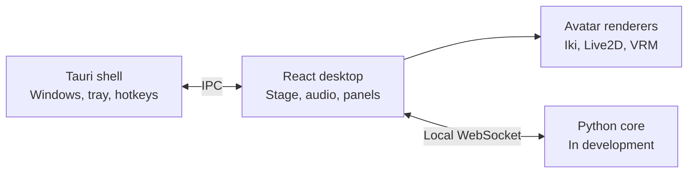

<div align="center">


# 光 Hikari

**A local-first anime companion for your Mac's desktop.**

She stands beside your windows, talks with you in English, हिंदी and Hinglish with lip sync that follows every sound, and keeps what she learns on your Mac.

[](https://github.com/JayDev-27/Hikari/actions/workflows/checks.yml)
[](https://github.com/JayDev-27/Hikari/actions/workflows/rust.yml)
[](https://github.com/JayDev-27/Hikari/actions/workflows/codeql.yml)
[](https://hikari-companion.vercel.app)
<br>
[](https://woc.codesocial.tech)

[](LICENSE)

**[Website](https://hikari-companion.vercel.app)** · [Quick start](#quick-start) · [Gallery](#gallery) · [The cast](#the-cast) · [Architecture](#architecture) · [Contributing](#contributing)

<a href="https://hikari-companion.vercel.app"></a>

<sub>The <a href="https://hikari-companion.vercel.app">website</a> blooms as you scroll: a three.js sakura in the app icon's colours.</sub>

</div>

> [!NOTE]
> Hikari is in early development. The desktop app runs from source and includes a scripted lip-sync demo. The production voice and language pipeline, long-term memory service, voice training, and Mac automation are still in development.

## Quick start

You’ll need macOS 13 or later on Apple Silicon, Xcode Command Line Tools, Node 24, pnpm 12, and Rust 1.100 or later. The Rust checks pin 1.100. [Rustup](https://rustup.rs) · [CI configuration](.github/workflows/rust.yml)

```bash
git clone https://github.com/JayDev-27/Hikari.git
cd Hikari
pnpm install
VITE_CHARACTER=reze pnpm dev
```

This starts the native app with Reze, one of the bundled Iki characters. Double-click the avatar or press and release <kbd>⌥ Space</kbd> with no core connected to play the built-in demo. Use the Hikari menu-bar icon to open Chat, Character Studio, or Settings.

<details>
<summary><b>Try Live2D models</b></summary>

Download the Cubism SDK for Web and accept Live2D's licence. Then run the following with the path to your ZIP and launch with `pnpm dev`. [Cubism SDK for Web](https://www.live2d.com/en/sdk/download/web/)

```bash
pnpm -F desktop fetch:assets --sdk ~/Downloads/CubismSdkForWeb-5-r.5.zip
```

</details>

<details>
<summary><b>Try the development voice loop</b></summary>

With Hikari running, start the fake core in a second terminal. It echoes mic input and uses macOS speech synthesis for text. The console can send a text prompt from another terminal.

```bash
pnpm -F desktop fake-core
```

```bash
pnpm -F desktop console --say "Hello Hikari"
```

Push to talk with <kbd>⌥ Space</kbd>, mute with <kbd>⌘ ⇧ M</kbd>, or stop the current interaction with <kbd>⌘ ⇧ Esc</kbd>. To try always-listening, launch with `VITE_MIC_MODE=open pnpm dev`.

</details>

## Why Hikari

|  |  |
| --- | --- |
| 🪟 **Lives on your desktop** | A transparent stage above every app and Space. Clicks pass through everywhere except her, and she rests while your Mac sleeps. |
| 🗣️ **Speaks your language** | English, हिंदी and Hinglish, switching mid-sentence. The lip-sync engine maps Hindi and English phonemes to mouth shapes. |
| 🎭 **A real cast** | Five hand-rigged Iki characters with personas and signature moves, plus Live2D samples and any `.vrm` you import. |
| 🔒 **Local first** | Provider keys live in the macOS Keychain; voice, memory and the brain are designed to run on your Mac. |
| ✋ **Asks before it acts** | Every action on your Mac waits for an approval dialog and lands in an Activity log. |
| 🧩 **Open and hackable** | Tauri, React, Rust and a versioned protocol. Build your own character from a picture with the [Iki guide](docs/IKI.md). |

<details>
<summary><b>What works in the app today</b></summary>

- **Desktop stage.** The transparent avatar follows you across Spaces, with clicks passing through the areas around it. Rendering pauses while the screen is locked or the display sleeps.
- **Character Studio.** Browse the cast, play signature moves and everyday gestures, and import your own Iki, Live2D, or VRM model. Character details include model and licence information.
- **Chat and voice input.** Type or use push-to-talk and follow both kinds of turns in the transcript.
- **Setup and Settings.** Choose a character, check permissions, and review microphone, performance, and provider settings.
- **Tools for core integration.** A Memories browser, consent and evaluation screens in Voice Lab, and approval dialogs with an Activity log. End-to-end memory, training, and automation depend on the core. [Development plan](docs/PLAN.md)

</details>

## Gallery


<p align="center"><b>Character Studio</b> · browse the cast, play moves, import your own model.</p>

<table>
  <tr>
    <td width="50%" valign="top">
      
      <p><b>Memories</b><br>See what she remembers, then search, correct or forget it. <sub>(sample data)</sub></p>
    </td>
    <td width="50%" valign="top">
      
      <p><b>Voice Lab</b><br>Consent, record, train, then score the voice and compare it blind. <sub>(sample data)</sub></p>
    </td>
  </tr>
  <tr>
    <td width="50%" valign="top">
      
      <p><b>Settings</b><br>Set how Hikari starts, listens, and speaks.</p>
    </td>
    <td width="50%" valign="top">
      
      <p><b>Welcome</b><br>Pick a character, check permissions, and try push-to-talk.</p>
    </td>
  </tr>
</table>

<details>
<summary><b>Chat and Activity</b></summary>

<table>
  <tr>
    <td width="40%" valign="top">
      
      <p><b>Chat</b><br>Start a text or push-to-talk conversation.</p>
    </td>
    <td width="60%" valign="top">
      
      <p><b>Activity</b><br>What Hikari asked to do, what you decided, and what happened.</p>
    </td>
  </tr>
</table>

</details>

Screens come from the desktop interface in the development browser preview; panels marked *sample data* use made-up content.

## The cast

Five hand-rigged Iki characters come with the app. Each has a persona, breathing and blinking, and its own signature moves.


| Character | Renderer | Featured moves |
| --- | --- | --- |
| Makima | Iki | Finger-gun bang |
| Reze | Iki | Offers a flower |
| Rize Kamishiro | Iki | Opens her book and switches to ghoul eyes |
| Cheng Xiaoshi | Iki | Palm-to-palm clap, photo dive, and sheepish neck rub |
| Lu Guang | Iki | Studies a photo with glowing blue eyes, folds his arms and nods, and pauses to think |
| Hiyori, Haru, Mao, Rice | Live2D | Motions supplied by the sample models |
| Imported `.vrm` models | VRM 0.x and 1.0 | Idle animation, lip sync, expressions, and everyday gestures |

<details>
<summary><b>See the rigs and signature moves</b></summary>

<table>
  <tr>
    <td width="50%" valign="top">
      
      <p><b>Rize</b> switches to ghoul eyes.</p>
    </td>
    <td width="50%" valign="top">
      
      <p><b>Cheng Xiaoshi</b> performs his photo dive.</p>
    </td>
  </tr>
</table>


</details>

Build and rig your own model from a reference picture using the [Iki character guide](docs/IKI.md).

## The website

<a href="https://hikari-companion.vercel.app"></a>

The [website](https://hikari-companion.vercel.app) lives in [`website/`](website) (Vite, React, three.js, GSAP) and deploys to Vercel from `main`. The sakura is procedural: real petal geometry, a cloud-filled sky shader, and a water-like wake that follows your cursor.

```bash
cd website
npm ci
npm run dev
```

## Architecture



The TypeScript types and Pydantic model definitions come from a versioned JSON Schema in the shared protocol package. The stage owns the core connection and coordinates audio playback, expressions, and lip sync. [Protocol package](packages/protocol) · [Architecture notes](docs/ARCHITECTURE.md) · [Decision log](DECISIONS.md)

## Roadmap

- [x] Desktop stage, Character Studio, Chat, and Iki, Live2D, and VRM rendering
- [x] First-run setup, Settings, Memories and Voice Lab panels, and the approval and Activity UI
- [ ] Integrate the production voice, language, memory, and automation services with the desktop
- [ ] Sign and notarise the macOS build and verify a fresh installation

See the [phased plan](docs/PLAN.md) for desktop and core milestones and the [bundle check guide](docs/RELEASE-CHECK.md) for packaging.

## Contributing

Hikari is a **[Winter of Code Social 2026](https://woc.codesocial.tech)** project ❄️. New contributors are very welcome, including first-timers.

1. Read **[CONTRIBUTING.md](CONTRIBUTING.md)**: setup, how to claim an issue, the pull-request steps, WOCS labels and points, and our AI policy (AI-assisted work is allowed if you understand it, test it and say so).
2. Pick an [open WOCS issue](https://github.com/JayDev-27/Hikari/issues?q=is%3Aissue+is%3Aopen+label%3Awocs); [`level 1`](https://github.com/JayDev-27/Hikari/issues?q=is%3Aissue+is%3Aopen+label%3A%22level+1%22) issues are the best place to start.
3. Comment to claim it, wait to be assigned, then open a pull request that closes it.

For larger ideas, [open an issue](https://github.com/JayDev-27/Hikari/issues/new) first so we can agree on scope. If you change the wire schema, run `pnpm gen:protocol` and commit the generated types.

```bash
pnpm install --frozen-lockfile
pnpm check:protocol
pnpm -F desktop lint --max-warnings 0
pnpm typecheck
pnpm -F desktop test
pnpm -F desktop build
```

| Command | What it checks or runs |
| --- | --- |
| `pnpm -F desktop avsync` | Audible lip-sync regression check |
| `pnpm -F desktop audit:models` | Live2D rig audit when Cubism Core is available |
| `pnpm -F desktop console` | Protocol console for a connected core |
| `pnpm build` | Local `Hikari.app` and DMG build |
| `pnpm -F desktop check:bundle` | Built app contents and signing checks |

Every pull request is checked automatically, so you get feedback before a maintainer looks:

| Check | What it does |
| --- | --- |
| **Code checks** | Protocol types, lint, typecheck, tests and builds for the desktop app and the website ([workflow](.github/workflows/checks.yml)) |
| **Rust checks** | Formatting, Clippy and tests on macOS when the Tauri shell changes ([workflow](.github/workflows/rust.yml)) |
| **CodeQL** | Security analysis of the TypeScript and the workflows ([workflow](.github/workflows/codeql.yml)) |
| **Dependency review** | Blocks new packages with known high-severity vulnerabilities or MIT-incompatible licences ([workflow](.github/workflows/dependency-review.yml)) |
| **Community bots** | Conventional PR titles (`fix(website): …`), size labels, area labels and a welcome for first-time contributors ([workflow](.github/workflows/community.yml)) |
| **Vercel preview** | A live preview link for any change to `website/` |

<a href="https://github.com/JayDev-27/Hikari/graphs/contributors">
  
</a>

## Assets and licences

Hikari's code is MIT-licensed. Third-party character art, models, runtimes, and SDKs retain their own terms. [MIT License](LICENSE) · [Third-party licences](docs/LICENSES.md)

- **Live2D Cubism Core** is proprietary and comes from the official SDK.
- **Hiyori, Haru, Mao, and Rice** use Live2D sample material. This content uses sample data owned and copyrighted by Live2D Inc.
- **Makima, Reze, Rize Kamishiro, Cheng Xiaoshi, and Lu Guang** are fan rigs with original personas. Character designs belong to their rights holders. The project includes no franchise voice recordings.
- **Voice Lab** requires a recorded consent file for another person's voice.

<div align="center">

If Hikari made you smile, a ⭐ helps other people find her.

<a href="#光-hikari">Back to top ↑</a>

</div>
