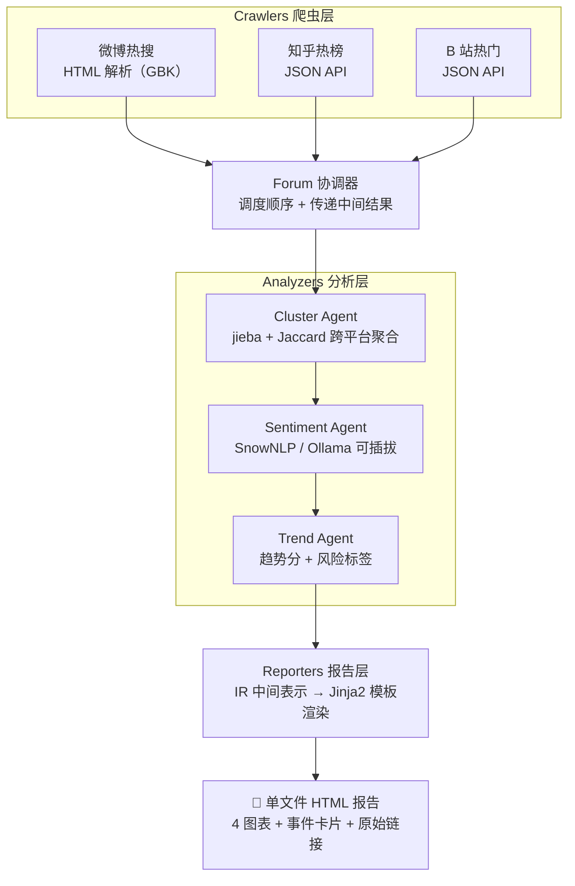

<div align="center">

# 📡 TrendRadar · 热点雷达

**跨平台热点聚合 + 情感趋势分析 —— 一行命令把微博、知乎、B 站的热点拉到一起看**

[](https://www.python.org/)
[](LICENSE)
[](https://github.com/JingHao-Leon/TrendRadar/commits/main)
[](https://github.com/JingHao-Leon/TrendRadar)

借鉴 [BettaFish（微舆）](https://github.com/666ghj/BettaFish) 与 [MiroFish](https://github.com/666ghj/MiroFish) 的多智能体架构思想实现

</div>

---

做自媒体 / 内容运营 / 品牌公关的同学经常遇到一个问题：同一个热点在**微博、知乎、B 站**叫三个名字、三套评论、三个走向，光切换平台就耗掉半小时。`TrendRadar` 一条流水线完成 **抓 → 聚 → 判 → 评 → 出**：并发拉取三个平台的公开榜单，把"同一件事"聚合成事件，给每条标题打情感分、算趋势分，最后生成一份**单文件 HTML 报告**——浏览器打开就能看，发给同事直接能用。

## 🖼️ 真实运行效果

<div align="center">

<br><em>2026-06-15 03:03 真实运行：微博 50 + 知乎 30 + B 站 50 = 130 条，聚合为 126 个事件</em>
</div>

> 更多示例：[`examples/report-real.html`](examples/report-real.html)（真实数据完整报告）、[`examples/report-demo.html`](examples/report-demo.html)（mock 演示）、[`examples/terminal-output.txt`](examples/terminal-output.txt)（终端日志）

## ✨ 核心亮点

<table>
<tr>
<td width="50%">

### 🕸️ 三平台并发抓取
微博热搜（HTML/GBK 解析）、知乎热榜、B 站热门（JSON API）各自独立成模块，统一 `BaseCrawler` 接口——**单平台失败不影响整体**，失败细节进日志，成功部分照常出报告。

</td>
<td width="50%">

### 🧩 跨平台事件聚合
jieba 分词 + 关键词集合 Jaccard 相似度（阈值 0.35 可调），把三个平台叫法不同的"同一件事"合并为一个**事件**——`事件` 取代 `话题`，才是看热点的正确粒度。

</td>
</tr>
<tr>
<td width="50%">

### 🎭 情感 + 趋势双评分
每条标题打情感分（正/负/中），每个事件算趋势分 = 热度归一化 × (0.6 + 0.4 × |情感强度|) + 平台覆盖加成，并自动打风险标签：🔴 负面预警 / 🟢 全网好评 / 🟡 全网热议 / ⚪ 一般热点。

</td>
<td width="50%">

### 📊 单文件 HTML 报告
情感饼图、平台分布柱图、TOP10 横向柱图、关键词云 4 张图全部由 matplotlib 服务端渲染为 base64 PNG 内嵌——**零 JS 依赖**，一个文件发哪儿都能开。

</td>
</tr>
<tr>
<td width="50%">

### 🔌 情感后端可插拔
默认 SnowNLP（离线、零费用）；一行配置切换 Ollama + 本地 LLM（如 qwen2:7b），准确率更高、依然零 API 费用。

</td>
<td width="50%">

### 🧪 离线 demo 模式
`python -m trendradar demo` 用内置 mock 数据生成演示报告——没外网、被限流、CI 环境下都能先看效果。

</td>
</tr>
</table>

## 🏗️ 架构：多 Agent + 论坛协作



**与 BettaFish 的对应关系**（借鉴架构思路，代码全部自写）：

| BettaFish 模块 | TrendRadar 对应 | 说明 |
|---|---|---|
| `MindSpider/` 多平台爬虫 | `crawlers/` | 每个平台一个独立模块，统一 `BaseCrawler` 接口 |
| 5 个 Engine Agent | `analyzers/` 三 Agent | cluster / sentiment / trend，单一职责 |
| `ForumEngine/` 协调 | `analyzers/forum.py` | 调度先后 + 传递中间结果 |
| 多种情感后端并存 | `analyzers/backends/` | snownlp / ollama 可插拔 |
| ReportEngine IR 渲染 | `reporters/ir.py` + `renderer.py` | IR 中间表示 → 模板渲染 |

**降复杂度**：BettaFish 是产品级项目（1000+ commits、多 Agent 论坛辩论、PostgreSQL + Docker + Streamlit）。TrendRadar 只保留核心架构思想，控制到课程作业可交付的规模（约 1700 行 Python，单文件 HTML 报告）。

## 🚀 5 分钟上手

```bash
# 1. 装环境
pip install -r requirements.txt

# 2. 跑一次（默认配置：3 个平台、每平台 50 条）
python -m trendradar run

# 3. 看报告
open reports/latest.html   # macOS
# 或直接双击 reports/ 下最新生成的 .html 文件
```

**没外网？想先看效果？**

```bash
python -m trendradar demo    # 用 mock 数据生成演示报告
open reports/report-demo.html
```

跑完终端会打印抓取汇总和 TOP 5 事件：

```
🏆 TOP 5 事件：
   #1 [🟢 全网好评] 2026 年世界杯小组赛 E 组，德国 vs 库拉索，如何评价本场比赛？
        平台：微博,知乎 · 声量：129.9 · 情感：+0.66
   #2 [⚪ 一般热点] 我们几千年前就蒸馒头蒸饭，为什么蒸汽机是外国人发明的呢？
        平台：知乎 · 声量：100.0 · 情感：-1.00
   ...
```

## 🔧 进阶用法

### 改关键词 / 加平台

编辑 `config.yaml`：

```yaml
keywords:
  - 比亚迪
  - 高考
  - 618

platforms:
  weibo_hot: true
  zhihu_hot: true
  bilibili_hot: true
```

### CLI 参数覆盖（CLI > config.yaml）

```bash
# 只跑某个平台
python -m trendradar run --platforms weibo_hot

# 临时关键词
python -m trendradar run --keywords 比亚迪,高考

# 同时导出原始数据 CSV
python -m trendradar run --export-csv data/raw-2026-06-15.csv
```

### 切换情感分析后端

默认用 `SnowNLP`（离线、零费用，短文本约 70-75% 准确率）。想用更强的模型？装 `ollama` 后：

```bash
ollama pull qwen2:7b
python -m trendradar run --config config.ollama.yaml
```

## ⚙️ 配置项一览

完整配置见 [`config.yaml`](config.yaml)，所有字段带中文注释：

| 字段 | 默认 | 说明 |
|------|------|------|
| `keywords` | `[]` | 只聚合标题包含这些关键词的事件；留空聚合所有 |
| `platforms` | 三平台全开 | 单个 platform 设 `false` 即跳过 |
| `time_window_hours` | `24` | 时间窗口（仅占位，当前版本未做时序过滤） |
| `max_items_per_platform` | `50` | 每平台最多抓多少条 |
| `request_timeout_sec` | `10` | 单个 HTTP 请求超时 |
| `retry_times` | `2` | 失败重试次数 |
| `sentiment_backend` | `snownlp` | `snownlp` / `ollama` |
| `ollama.base_url` / `ollama.model` | `localhost:11434` / `qwen2:7b` | ollama 后端生效时的地址与模型 |
| `report_title` | `TrendRadar 热点雷达` | 报告标题 |
| `output_dir` | `reports/` | 报告输出目录 |
| `open_report_after_run` | `false` | 跑完自动打开浏览器（默认关，CI 友好） |
| `log_level` / `log_file` | `INFO` / `logs/trendradar.log` | 日志级别与输出文件 |

## 📁 仓库结构

```
├── config.yaml                  # 默认配置（关键词 / 平台 / 情感后端 / 报告）
├── requirements.txt             # 最小依赖集
├── pyproject.toml               # 打包配置（含 [llm] / [dev] extras，pip 安装后可直接 `trendradar run`）
├── trendradar/
│   ├── cli.py / __main__.py     # CLI 入口：run / demo 子命令
│   ├── config.py / models.py / logger.py
│   ├── crawlers/                # 爬虫层：base + weibo / zhihu / bilibili
│   ├── analyzers/               # 分析层：forum 协调器 + cluster / sentiment / trend 三 Agent
│   │   └── backends/            # 情感后端：snownlp / ollama 可插拔
│   ├── reporters/               # 报告层：ir.py（中间表示）+ renderer.py + charts.py
│   └── tests/mock_data.py       # demo 模式用的 mock 数据
├── examples/                    # 真实报告 / demo 报告 / 截图 / 终端日志
├── reports/ logs/ data/         # 运行时输出目录（报告 / 日志 / 导出 CSV）
├── screenshot.png               # 真实运行报告截图（本 README 引用）
├── PROJECT_REPORT.md            # 课程项目报告（选题、成果、指标）
└── LICENSE                      # MIT
```

## ❓ 常见问题

**Q: 抓取失败怎么办？**
A: 单平台失败不影响其他平台。失败的平台在日志里能看到，原始数据 CSV 仍会导出成功部分。

**Q: 情感分析准吗？**
A: SnowNLP 对短文本约 70-75%。需要更高准确率，把后端换成 `ollama` + qwen2:7b，本地跑、无费用。

**Q: 聚合怎么实现的？**
A: jieba 分词 + 关键词集合的 Jaccard 相似度。阈值 0.35 可调。两个标题关键词 ≥ 35% 重合 → 合并。

**Q: 能商用吗？**
A: MIT 协议，可以。但请遵守各平台的 `robots.txt` 和 ToS，本工具仅用于学习和研究。

**Q: 和 BettaFish / MiroFish 是什么关系？**
A: **借鉴架构思路，不抄代码**。BettaFish 是产品级项目（GPL-2.0，1000+ commits），TrendRadar 是课程作业规模的开源复刻（MIT）。代码全部自己写，但保留了"多 Agent + 论坛协作 + IR 报告"的核心架构思想。

## ⚠️ 已知局限

- **情感准确率**：SnowNLP 对短文本约 70-75%，结论应视为方向性参考；要更准请切 Ollama 本地 LLM 后端。
- **时序过滤未实现**：`time_window_hours` 目前是占位字段，抓到的是榜单当下快照，不做时间窗过滤。
- **聚合是启发式的**：Jaccard 相似度对"同义不同词"的标题（如绰号、缩写）可能漏聚合，阈值需按场景调。
- **榜单口径**：三个平台均为公开榜单（非全量数据），且平台可能随时改接口——单平台失败时其余平台照常工作。
- **使用边界**：仅供学习与研究，请遵守各平台 `robots.txt` 与 ToS。

## 🙏 致谢

- [BettaFish（微舆）](https://github.com/666ghj/BettaFish) —— 多 Agent 舆情分析系统，架构设计参考
- [MiroFish](https://github.com/666ghj/MiroFish) —— 群体智能预测引擎，Agent 协作思想参考
- 本项目基于"人工智能课程理论作业"中的**新闻文本情感分析**模块发展而来

---

<div align="center">
<sub>
TrendRadar · 跨平台热点聚合 + 情感趋势分析 ｜ 借鉴 BettaFish / MiroFish 架构思想，代码全部自写<br>
License: <a href="LICENSE">MIT</a> · 仅供学习与研究，请遵守各平台 robots.txt 与 ToS
</sub>
</div>
