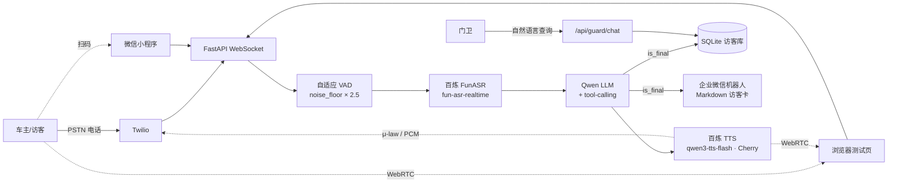

<div align="center">

# Voice Agent · 园区访客登记系统

**打一通电话、打开浏览器或扫小程序码 —— AI 自然对话采集车牌 / 公司 / 事由 / 手机号，25 秒内把结构化访客卡片推到门卫的企业微信**

[English README](README_EN.md) | 中文文档

[](https://www.python.org/)
[](https://fastapi.tiangolo.com/)
[](LICENSE)
[](https://github.com/JingHao-Leon/blue-whale-voice-agent/commits/main)
[](https://github.com/JingHao-Leon/blue-whale-voice-agent)

</div>

---

面向真实园区门卫场景的端到端落地项目。三个入口（PSTN 电话 / 浏览器 WebRTC / 微信小程序）**共用同一套 STT → LLM → TTS 管线**，仅音频 transport 不同：阿里云百炼 FunASR 流式识别 → 通义千问 tool-calling 增量采集 → 百炼 TTS 拟人播报，对话收口后 1 秒内推送 Markdown 访客卡到门卫企业微信群，并落库 SQLite 供门卫事后查询。

## 🎬 演示视频

<div align="center">

点击下方缩略图在浏览器播放（36 MB · QuickTime）

[](docs/demo.mov)

</div>

视频随仓库分发于 `docs/demo.mov`（点击缩略图直接播放）｜ 📖 [实战测试指南](docs/TESTING.md)

## ✨ 核心亮点

<table>
<tr>
<td width="50%">

### 🎙️ 三条入口，一套后端
PSTN 电话（Twilio）、浏览器 WebRTC 测试页、微信小程序扫码——只换音频 transport，STT / LLM / TTS 完全同源，一处优化三端生效。

</td>
<td width="50%">

### 🧠 多字段一次性采集
LLM 支持任意顺序提取车牌 / 公司 / 事由 / 手机号 / 联系人；开场白主动引导访客一口气报全字段，text-parser 作为 LLM 不调工具时的兜底。

</td>
</tr>
<tr>
<td width="50%">

### 👂 自适应 VAD
每 3 秒采样 noise floor × 2.5 动态调阈值，低音量笔记本麦克风也能稳定断句，不靠固定音量门限碰运气。

</td>
<td width="50%">

### 💬 秒推企业微信卡片
`send_to_guard_and_end_call` 是挂断的唯一收口点：标记完成 → 发 webhook → 挂断，保证**永远不可能挂了电话却没通知门卫**。

</td>
</tr>
<tr>
<td width="50%">

### 🔍 门卫对话式查询
`/api/guard/chat` 让门卫用自然语言查历史访客（「今天有谁来过」「尾号 1234 的车登记过吗」），配套 `/dashboard` 实时看板每 10 秒自动刷新。

</td>
<td width="50%">

### 📊 压测有证据
内置 25 秒达标测量（`scripts/measure_25s.py`）与并发压测脚本，实测报告见 `scripts/stress_report.md` 和 `docs/evidence/`。

</td>
</tr>
</table>

## 🏗️ 架构



交互式架构图（可点击缩放）见 `docs/architecture.html`。

## 🚀 快速开始

```bash
# 1. 装依赖（uv）
uv sync

# 2. 配环境变量
cp .env.example .env
# 编辑 .env：填 DASHSCOPE_API_KEY + WECHAT_WEBHOOK_URL

# 3. 起服务（本地）
./scripts/run_server.sh

# 4. 浏览器实测（需公网入口给浏览器麦克风权限）
cloudflared tunnel --url http://localhost:8000
# 打开 https://<随机>.trycloudflare.com/browser-test
```

可选 Docker：`docker compose up --build`（含 healthcheck，SQLite 挂卷持久化）。

> 小程序入口与电话入口的完整配置步骤见 [docs/TESTING.md](docs/TESTING.md)；阿里云部署与 ICP 备案 SOP 见 `docs/deploy/`。

## ⚙️ 环境变量

| 变量 | 必填 | 说明 |
|---|---|---|
| `DASHSCOPE_API_KEY` | ✓ | 阿里云百炼 API Key（LLM + STT + TTS 同源） |
| `WECHAT_WEBHOOK_URL` | ✓ | 企业微信群机器人 webhook |
| `LLM_MODEL` | | 未显式设置且有 `DASHSCOPE_API_KEY` 时自动使用低延迟的 `qwen3.6-flash` |
| `BAILIAN_STT_MODEL` | | 默认 `fun-asr-realtime` |
| `BAILIAN_TTS_VOICE` | | 默认 `Cherry`（配合 `qwen3-tts-flash`） |
| `TWILIO_ACCOUNT_SID` | PSTN 必填 | Twilio 控制台获取 |
| `TWILIO_AUTH_TOKEN` | PSTN 必填 | 同上 |
| `TWILIO_PHONE_NUMBER` | PSTN 必填 | E.164 格式 |
| `PARK_NAME` | | 园区名，默认 `蓝色鲸鱼科技园` |
| `DATABASE_URL` | | 默认 SQLite；可换 MySQL/Postgres |

> 百炼是国内推荐方案；国际备用栈（Deepgram + OpenAI）的配置模板同样写在 `.env.example` 里，开箱即换。

## 📁 目录结构

```
├── app/
│   ├── main.py                 # FastAPI 入口：路由 / WebSocket / dashboard / guard chat
│   ├── agent.py                # LLM agent：tool-calling 增量采集 + 挂断收口
│   ├── prompts.py              # 系统提示词（引导一次性报全字段）
│   ├── config.py               # pydantic-settings 环境变量与默认值
│   ├── schemas.py              # VisitorInfo 数据模型
│   ├── database.py / sql.py    # SQLModel + SQLite（可换 MySQL/Postgres）
│   ├── plate.py                # 车牌号归一化
│   ├── tools/                  # update_visitor_info / send_to_guard_and_end_call
│   ├── services/
│   │   ├── twilio_handler.py      # PSTN 电话通道（μ-law ↔ PCM 转码）
│   │   ├── browser_session.py     # 浏览器 / 小程序共用的 WebSocket 会话
│   │   ├── stt.py / tts.py        # 百炼 FunASR / qwen3-tts-flash 封装
│   │   ├── wechat.py              # 企业微信 webhook 推送
│   │   └── guard_agent.py         # 门卫自然语言查询 agent
│   └── cli/wechat_test.py      # 命令行测试企业微信推送
├── static/                     # 浏览器测试页 + 声音克隆页
├── wechat-miniprogram/         # 微信小程序入口（含 drop-in 复用组件）
├── scripts/                    # 压测、25s 达标测量、隧道启动、声音克隆等
├── docs/                       # TESTING.md · demo.mov · 部署 SOP · 压测证据
├── tests/                      # pytest：agent / wechat / 车牌 / schema / Twilio 音频
├── Dockerfile · docker-compose.yml
├── pyproject.toml · uv.lock
└── .env.example
```

## 🧪 测试与压测

```bash
# 单元测试
uv run pytest

# 25 秒达标测量（从开口到门卫收到卡片）
uv run python scripts/measure_25s.py

# 并发压测（报告见 scripts/stress_report.md）
uv run python scripts/stress_test.py
```

三种实测方式（WebRTC 浏览器 / 小程序 / Bash 自动测）的逐步指引见 [docs/TESTING.md](docs/TESTING.md)。

## ❓ FAQ

**Q：必须用 Twilio 吗？**

不用。三个入口共用同一套 STT → LLM → TTS 管线，浏览器（WebRTC）与微信小程序入口完全不依赖 Twilio；只有 PSTN 电话入口需要 Twilio 账号。国内落地推荐浏览器/小程序入口，避开国际长途限制。

**Q：只能配阿里云百炼吗？**

默认栈是百炼（FunASR 流式识别 + Qwen tool-calling + qwen3-tts-flash，一个 Key 走通三件事）；`.env.example` 里附带 Deepgram + OpenAI 的国际备用栈模板，改环境变量即可切换。

**Q：访客的手机号会泄露吗？**

数据只落在本机 SQLite（docker-compose 已挂卷持久化），访客卡只推送到你自己配置的企业微信群机器人 webhook；语音识别与大模型调用走你自己的百炼账号。仓库内压测报告里的号码均为脚本随机生成的测试数据。

**Q：「25 秒达标」怎么验证？**

`uv run python scripts/measure_25s.py` 测量从访客开口到门卫企微群收到卡片的全链路耗时；并发压测报告见 `scripts/stress_report.md` 与 `docs/evidence/`。

**Q：微信小程序入口怎么接入？**

需要自己的小程序 AppID 并开通录音权限；`wechat-miniprogram/drop-in/voice-checkin/` 是可直接复用的语音登记组件，接入步骤见 [INTEGRATE.md](wechat-miniprogram/drop-in/voice-checkin/INTEGRATE.md) 与 [docs/TESTING.md](docs/TESTING.md)。

## ⚠️ 局限

- Twilio 海外号码拨打中国大陆有国际长途限制（详见 `docs/TESTING.md`；实测期 Twilio 账号曾被关闭，浏览器 / 小程序入口不受影响）
- FunASR streaming 单次静音超过 23 s 服务端会超时（已在 prompt 引导 LLM 主动收束）
- 浏览器入口需公网 tunnel（cloudflared / nginx）才能拿到麦克风权限

---

<div align="center">
<sub>
PSTN · WebRTC · 小程序三入口同源 ｜ LLM: Qwen · STT: FunASR · TTS: qwen3-tts-flash<br>
测试指南：<a href="docs/TESTING.md">docs/TESTING.md</a> ｜ 部署 SOP：<a href="docs/deploy/">docs/deploy/</a> ｜ MIT License
</sub>
</div>
