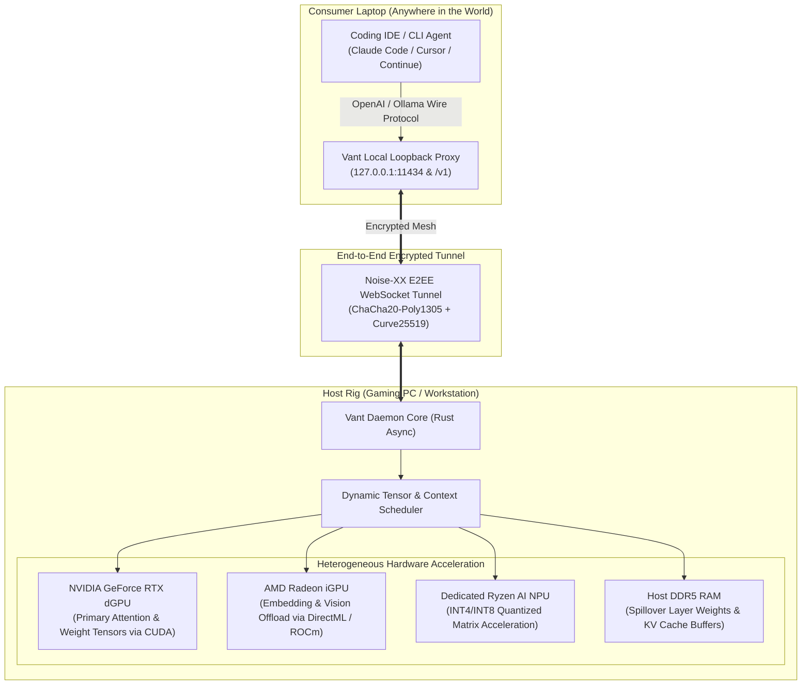
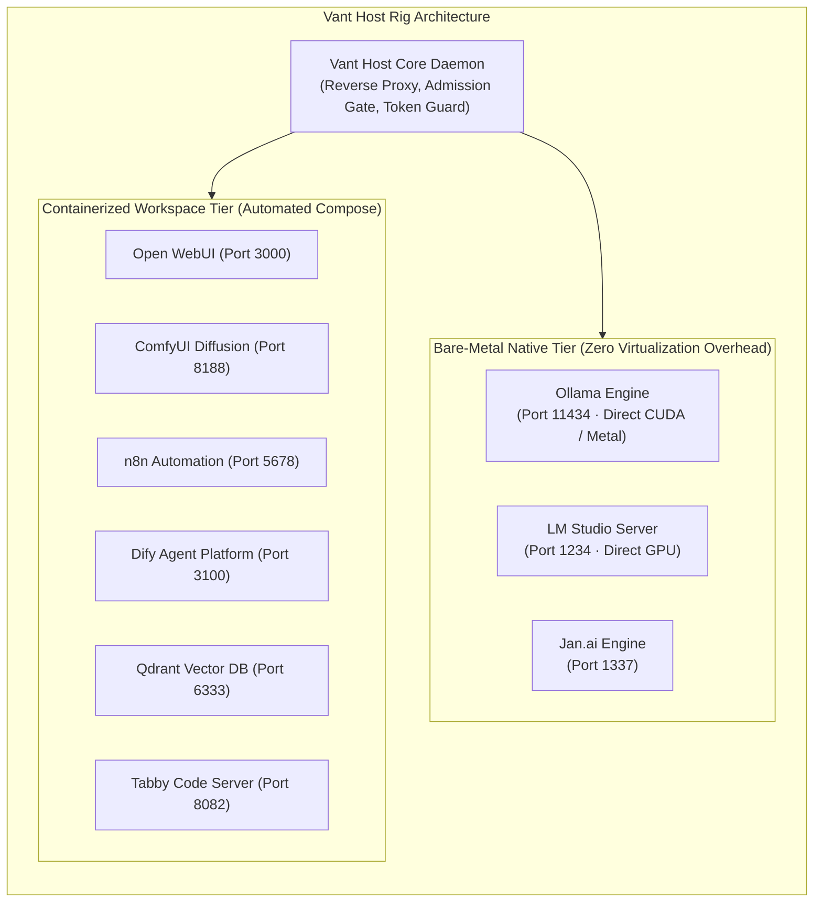

<div align="center">

  
 
 ### P2P Distributed GPU & AI Compute Mesh
  **Transform any GPU workstation or gaming PC into a private, encrypted AI supercomputer accessible from any client laptop.**

  <br />

  [](LICENSE)
  [](https://tauri.app/)
  [](https://react.dev/)
  [](https://www.rust-lang.org/)
  [](https://noiseprotocol.org/)
  [](https://developers.cloudflare.com/cloudflare-one/connections/connect-networks/)

  <br />

  <p align="center">
    <b>Stop paying exorbitant monthly cloud GPU bills.</b><br />
    Unleash the full compute power of your home workstation, your dedicated gaming laptop, or a peer's GPU rig (with mutual cryptographic consent) while coding from a coffee shop with a silent, lightweight MacBook or ultrabook.
  </p>

</div>

---

## The Vision Behind Vant

High-performance AI inference and heavy generative models require substantial dedicated memory bandwidth and tensor acceleration. But carrying a 6-pound gaming laptop with roaring fans and a 90-minute battery life is impractical, and renting cloud GPUs costs hundreds of dollars every month while exposing private codebases and confidential conversations to third-party providers.

**Vant delivers total computational sovereignty:**
1. **Zero Cloud Costs:** Run 70B LLMs, ComfyUI diffusion matrices, and autonomous coding agents entirely on bare-metal hardware you already own.
2. **Infinite Portability:** Code, debug, and design on an ultra-thin laptop with all-day battery life anywhere in the world.
3. **P2P Resource Sharing with Consent:** Turn any idle workstation or a trusted friend's laptop into a shared private node with Short Authentication String (SAS) confirmation and revocable bearer tokens.
4. **Seamless Developer Drop-in:** Silently routes IDE extensions (Claude Code, Cursor, Continue.dev, Antigravity) through a background loopback daemon (`127.0.0.1:11434`) without changing a single configuration key.
5. **Zero-Trust Hardened Cryptography:** Built on Noise-XX mutual handshake encryption (Curve25519, ChaCha20-Poly1305, BLAKE2s) and zero-config Cloudflare Tunnels without port-forwarding or public IP exposure.

---

## Two Roles, One Single Binary

Vant compiles into a self-contained, high-performance binary that seamlessly transitions between two operational roles:

| Feature | 🖥️ Server Role (Host Node) | 💻 Client Role (Consumer Node) |
|:---|:---|:---|
| **Target Hardware** | NVIDIA GeForce RTX rig, AMD Radeon workstation, or NPU laptop | MacBook, ThinkPad, Surface, Chromebook, or travel laptop |
| **Primary Function** | Drives bare-metal GPU/NPU acceleration, manages 16 AI containers, and orchestrates encrypted tunnels | Silently forwards inference requests on `127.0.0.1:11434` to your remote GPU rig with sub-millisecond local proxy overhead |
| **Supported Engines** | Ollama, LM Studio, ComfyUI, Open WebUI, n8n, Tabby, Dify | Claude Code, Cursor, Antigravity IDE, Continue.dev, Web Browsers |
| **Networking** | Zero-config Cloudflare Quick Tunnel or automatic LAN mDNS (`_vant._tcp.local.`) | One-click pairing with Short Authentication String (SAS) cryptographic verification |

---

## Heterogeneous Hardware Acceleration: RTX + Radeon + NPU

Modern gaming laptops and workstations often pack diverse computational silicon:
- **Discrete GPU:** e.g. NVIDIA GeForce RTX 4050 / 3060 / 4080 (Dedicated high-speed VRAM).
- **Integrated GPU:** e.g. AMD Radeon 780M / 680M (Shared high-bandwidth unified RAM).
- **Neural Processing Unit (NPU):** e.g. AMD Ryzen AI / Intel NPU (Ultra-efficient INT8/INT4 matrix acceleration).
- **Host CPU & RAM:** Fast DDR5 system memory for layer offloading.



### Optimizing Heterogeneous Silicon in Vant
1. **CUDA VRAM Pinning:** Vant requests persistent model memory locks (`"keep_alive": "30m"`) to eliminate cold-start DMA latency across queries.
2. **Context Layer Offloading:** When dedicated VRAM fills up, GGUF models automatically split layer weights across dedicated VRAM and host RAM without crashing the process.
3. **NPU & DirectML Offloading:** Lightweight embedding models (e.g. `nomic-embed-text`, `bge-small`) and whisper transcription can run concurrently on integrated NPUs and Radeon iGPUs, freeing 100% of discrete RTX VRAM for 14B+ parameter reasoning engines.

---

## Architecture: Hybrid Runtime Model

Vant uses a dual-layer runtime model designed to extract maximum bare-metal throughput while maintaining container isolation:



### 1. Bare-Metal Native Tier
Heavy inference engines (Ollama, LM Studio) run directly on the host operating system. This ensures direct access to CUDA/ROCm drivers, maximum memory bus bandwidth, and zero container virtualization overhead.

### 2. Containerized Application Tier
Full-stack web suites (Open WebUI, ComfyUI, AnythingLLM, n8n, Dify, Qdrant) are managed through declarative Docker Compose blueprints with isolated storage directories and health checks.

---

## 16 Supported AI Engines & Services

Vant includes ready-to-run deployment profiles for 16 leading open-source AI tools:

| Category | Supported Services | Deployment Mode | Primary Capability | Default Port |
|:---|:---|:---|:---|:---|
| **Local LLM Engines** | Ollama, LM Studio, Jan.ai | Native Binary | GGUF model execution, bare-metal GPU passthrough, OpenAI `/v1` compatibility | `11434`, `1234`, `1337` |
| **AI Chat & Knowledge** | Open WebUI, AnythingLLM | Docker Container | Multi-user chat workspaces, retrieval-augmented generation (RAG), document ingestion | `3000`, `3001` |
| **Media Generation** | ComfyUI, Whisper ASR | Docker / Native | Node-based Stable Diffusion workflows, GPU speech-to-text transcription | `8188`, `9000` |
| **Workflow Automation** | n8n, Dify, Activepieces | Docker Compose | Low-code workflow automation, agent orchestration, 400+ API integrations | `5678`, `3100`, `8080` |
| **Visual Agent Builders** | Flowise, Langflow, Open Interpreter | Docker Compose | Drag-and-drop LLM pipelines, autonomous computer execution | `3002`, `7860`, `8000` |
| **Coding & Vector Stores** | Tabby, Twinny Backend, Qdrant | Docker / Native | Self-hosted code completion for IDEs, high-performance vector search engine | `8082`, `11434`, `6333` |

---

## Defense-in-Depth Security Protocol

- **End-to-End Encryption (Noise-XX):** All sessions establish authenticated, end-to-end encrypted tunnels using Curve25519 key exchange, ChaCha20-Poly1305 AEAD, and BLAKE2s hashing. Intermediate relays terminate only the outer transport TLS and cannot view inner payloads.
- **Short Authentication String (SAS):** During initial pairing, both devices generate an identical cryptographic verification string derived from ephemeral keys, providing guaranteed protection against Man-in-the-Middle (MITM) tampering.
- **Role-Based Access Control (RBAC):**
  - **Admin:** Complete system configuration, service lifecycle, and peer admission.
  - **Developer:** Unlimited access to AI inference endpoints and local loopback proxies.
  - **Viewer:** Read-only access with rate-limited quotas.
- **Cryptographic Bearer Tokens:** Hosts issue revocable `vant_live_*` bearer tokens with configurable requests-per-minute (RPM) limits.
- **Hardware Telemetry Guard:** Real-time hardware monitors track GPU temperature, VRAM allocation, and memory pressure to prevent host overheating.

---

## Getting Started

### Prerequisites
- **Host Rig:** Windows 10/11 (64-bit) or Linux (x86_64) with dedicated GPU (NVIDIA CUDA recommended).
- **Client Laptop:** macOS, Linux, or Windows (any lightweight hardware).
- **Toolchain:** Node.js 18+ and Rust (stable) installed.

### Build and Launch

```bash
# Clone repository
git clone https://github.com/John-Varghese-EH/GhostCompute.git
cd GhostCompute

# Install frontend dependencies
npm install

# Run in development mode
npm run tauri dev

# Compile production release binary
npm run tauri build
```

---

## Quick Connection Walkthrough

### 1. Starting the Host (Server)
1. Launch Vant and choose **Server Role (Host)**.
2. In the console, verify the host daemon is running on port `8384`.
3. Vant automatically broadcasts its identity via local mDNS (`_vant._tcp.local.`) and establishes an encrypted Cloudflare Tunnel for WAN access.
4. Copy the quick pairing link or display the 6-digit PIN.

### 2. Connecting from the Client (Laptop)
1. Launch Vant on your laptop and choose **Client Role (Consumer)**.
2. Nearby hosts appear automatically in the **Nearby Discovery** tab. Click **Connect**.
   *(If across different networks or remote Wi-Fi, paste the Host Cloudflare Tunnel URL into the Direct IP tab).*
3. Verify the Short Authentication String matches between both screens and click **Confirm Match**.
4. Your client proxy is now live at `http://127.0.0.1:11434`.

---

## Developer IDE Integration

Vant acts as a transparent, zero-latency drop-in proxy for all major AI coding tools.

### Claude Code CLI
```bash
export OLLAMA_HOST=http://127.0.0.1:11434
claude --provider ollama --model <model-name>
```

### Cursor & Antigravity IDE
Configure custom OpenAI or Ollama provider:
- **Base URL:** `http://127.0.0.1:11434/v1`
- **API Key:** `sk-vant` (or any string)
- **Model Name:** Any model loaded on your host (e.g. `qwen2.5-coder:7b`, `llama3.3:70b`, `deepseek-r1:14b`)

### Continue.dev (VS Code & JetBrains)
```json
{
  "models": [
    {
      "title": "Vant Remote Compute",
      "provider": "ollama",
      "model": "qwen2.5-coder:7b",
      "apiBase": "http://127.0.0.1:11434"
    }
  ]
}
```

---

## Default Network Ports

| Port | Service Name | Protocol | Exposure Scope |
|:---|:---|:---|:---|
| `8384` | Vant Core Host Daemon | TCP / WebSocket | LAN / Cloudflare Tunnel |
| `11434` | Ollama Engine (Host) & Local Proxy (Client) | HTTP / REST | Host Internal & Client Localhost |
| `1234` | LM Studio Inference Server | HTTP / REST | Host Localhost |
| `3000` | Open WebUI Dashboard | HTTP | Host / Tunnel |
| `5678` | n8n Automation Engine | HTTP | Host / Tunnel |
| `6333` | Qdrant Vector Database | HTTP / REST | Host / Docker Internal |
| `8188` | ComfyUI Workspace | HTTP / WebSocket | Host / Tunnel |

---

## Author Credits

**John Varghese (J0X)**  
*Principal Systems Architect & Lead Engineer*

- **GitHub:** [https://github.com/John-Varghese-EH](https://github.com/John-Varghese-EH)
- **LinkedIn:** [https://linkedin.com/in/John--Varghese](https://linkedin.com/in/John--Varghese)

---

<div align="center">
  <sub>© 2026 John Varghese (J0X) • Vant • Licensed under GPLv3</sub>
</div>
