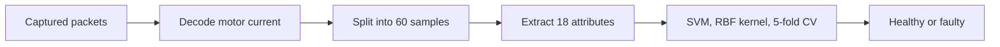

<!-- brand:header:start -->
<picture>
  <source media="(prefers-color-scheme: dark)" srcset="assets/brand/header-82f8f0ad-dark.svg">
  
</picture>
<!-- brand:header:end -->

<!-- badges:start -->
[](https://www.repostatus.org/#inactive)
[](https://github.com/JonathanTSilva/research-pump-cavitation/actions/workflows/ci.yml)
[](https://github.com/JonathanTSilva/research-pump-cavitation/releases)
[](https://scorecard.dev/viewer/?uri=github.com/JonathanTSilva/research-pump-cavitation)
[](LICENSE)
[](https://codespaces.new/JonathanTSilva/research-pump-cavitation)
<!-- badges:end -->

**Diagnose a hydraulic pump from the electric current of its motor.** Cavitation and dry running leave a signature in the current. This project captures it on an experimental bench, turns it into 18 numeric attributes and classifies it with a support vector machine: about 97% accuracy for cavitation and 99.6% to 100% for running empty, against a healthy pump.

<p align="center">
  <picture>
    <source media="(prefers-color-scheme: dark)" srcset="assets/results/accuracy-dark.png">
    
  </picture>
</p>

*Mean cross-validated accuracy of the classifier for each setup, from [`resultSVM.xlsx`](resultSVM.xlsx). Each setup was run in two batches and the bars show their mean.*

## What it is

A scientific initiation project in electrical engineering at the Federal Institute (IFSP), Sertãozinho campus. Condition monitoring helps industry catch failures early, cutting downtime and raising plant availability. Here a prototype hydraulic system was built to collect data, and the code extracts what matters from the motor's current and tests whether a classifier can tell a healthy pump from a failing one.

- **Three operating conditions.** The raw captures cover a pump running normally, with cavitation and empty (see [`Dataset/`](Dataset)).
- **Current decoded from network packets.** The code reads the captured packets from the motor starter and the PLC and decodes the motor's maximum current from two bytes of each.
- **18 attributes per sample.** Standard deviation, maximum, peak-to-peak, two entropy measures, kurtosis, RMS and skewness, plus the amplitudes of the first 10 harmonics from an FFT.
- **An SVM with tuned hyperparameters.** An RBF-kernel SVM, with the box constraint and kernel scale chosen by Bayesian optimization and the result checked with 5-fold cross-validation.

The experiments also ask how few attributes are enough. With only the 3 or 5 most correlated attributes, cavitation accuracy falls by about 12 points, from 94.9% to roughly 83%, while detecting the empty condition stays at 100%.



## Quick start

```sh
git clone https://github.com/JonathanTSilva/research-pump-cavitation.git
cd research-pump-cavitation
```

The code is a set of MATLAB scripts. It needs MATLAB with the Statistics and Machine Learning Toolbox and the Wavelet Toolbox (for `wentropy`). I could not run MATLAB while preparing this README, so the notes below come from reading the scripts. You can also open the repository in a dev container or GitHub Codespaces to lint the documentation with `pre-commit run --all-files`.

## Usage

Set `fileName` in `Main.m` to `normal`, `cavitation` or `empty`, then run it. It loads that capture from `Dataset/`, decodes the current, splits it into 60 samples, extracts the attributes and writes them to a CSV file. `SVM_CrossValidation.m` then trains and evaluates the classifier on the attribute tables.

| File | What it does |
|---|---|
| `Main.m` | Runs the whole extraction pipeline for one capture |
| `PacketRawDataConversion.m` | Turns the raw comma-separated packet text into byte arrays |
| `GetActualCurrent.m` | Joins two packet bytes into the motor's maximum current, as a percentage of nominal |
| `aSplitSamples.m` | Splits the current into 60 equal samples |
| `aAttributesExtraction.m` | Computes the 18 attributes of each sample |
| `GetHarmonics.m` | Returns the first 10 harmonic amplitudes through an FFT |
| `aGenerateFigures.m` | Plots the signals and attributes |
| `SVM_CrossValidation.m` | Optimizes and cross-validates the SVM |

The data are the raw captures in `Dataset/` (about 59,000 to 61,000 packets each) and the attribute tables `dataCav.mat`, `dataEmp.mat` and `dataCorr.mat`. The scripts are kept as they were during the research, so two details need adjusting to run them in this layout: `Main.m` loads from `..\Dataset\`, a Windows path one level up, and `SVM_CrossValidation.m` loads `dataCav2.mat`, which is not in the repository (`dataCav.mat` is).

## Docs

The conventions this repository follows are in the [handbook](https://github.com/JonathanTSilva/.github/blob/main/handbook/README.md). The chart above is drawn from the results workbook by [`scripts/accuracy_chart.py`](scripts/accuracy_chart.py): run `uv run --with openpyxl --with matplotlib python scripts/accuracy_chart.py` from the repository root. The original contributing notes, in Portuguese, are in [`Docs/CONTRIBUTING.md`](Docs/CONTRIBUTING.md).

## Contributing

See the [contributing guide](https://github.com/JonathanTSilva/.github/blob/main/CONTRIBUTING.md). Branches are named `<type>/<issue>-<slug>`, commits and PR titles follow Conventional Commits, and PRs are squash-merged. The project is inactive, so changes are unlikely to be reviewed quickly.

## License

MIT. See [LICENSE](LICENSE).

Author: [Jonathan T. da Silva](https://www.linkedin.com/in/JonathanTSilva/).

<!-- brand:footer:start -->
<p align="right"><a href="https://www.jontobias.com"><picture>
  <source media="(prefers-color-scheme: dark)" srcset="https://raw.githubusercontent.com/JonathanTSilva/.github/main/assets/brand/jontobias-dark.svg">
  
</picture></a></p>
<!-- brand:footer:end -->
