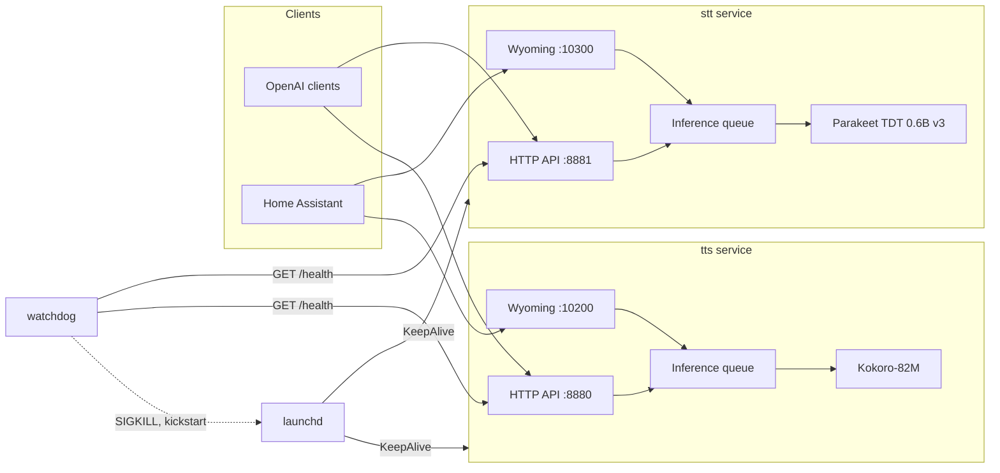

# voiced

[](https://github.com/JulianBeaulieu/voiced/releases/latest)
[](https://github.com/JulianBeaulieu/voiced/actions/workflows/ci.yml)
[](LICENSE)

Run speech-to-text and text-to-speech on your Mac for Home Assistant voice
control or any app that speaks the OpenAI audio API. Models stay loaded on
the Apple Silicon GPU, so with the default voice the first audio of a reply
arrives about 100 ms after the request. voiced runs as two services, one for
each direction, under launchd plus a watchdog: they run as you while you
are logged in, start again when you log in, and restart themselves after a
crash or a hang. Nothing needs an administrator password, except once
when moving from 0.4.0 or earlier. Home
Assistant talks to it over Wyoming, the protocol its Assist pipelines use
for local speech services.


The recording's timings are curl fetching a WAV, slower than the streamed benchmark (94 ms median first audio on the same Apple M1 Max, 64 GB; see [Benchmarks](#benchmarks)).

voiced 0.5.0 is the current release. It transcribes with Parakeet TDT 0.6B
v3 and speaks with Kokoro-82M. Other models are a download away, from the
menu bar app or `voiced models download`: Qwen3-ASR for files and languages
beyond Parakeet's, the streaming Nemotron ASR, Moonshine on the CPU, and
Whisper large-v3-turbo in 100 languages for speech to text; Phonon on the
CPU, Pocket TTS, Chatterbox Turbo, Soprano-80M, Marvis in English, French
and German and, in 646 languages but slowly, OmniVoice for text to speech.
The numbers below come from two machines, both named under
[Benchmarks](#benchmarks).
The HTTP and Wyoming API and the config file are stable; see
[CONTRIBUTING.md](CONTRIBUTING.md#what-is-stable). Breaking changes are
listed in [CHANGELOG.md](CHANGELOG.md).

## Install

You need an Apple Silicon Mac with macOS 14 or newer. The first install
downloads about 4.5 GB, mostly the two default models, and takes several
minutes; less with one service or smaller models. Any other model is
downloaded only when you choose it
([Models and licenses](#models-and-licenses)).

Most people want the menu bar app, from [Homebrew](https://brew.sh):

```sh
brew install --cask julianbeaulieu/voiced/voiced
```

Open voiced.app. Its first screen asks what to install: speech to text, text
to speech or both, each with its model, the recommended ones already chosen,
and shows what that downloads. A service you switch off downloads nothing;
you can turn it on later in Settings. Install then does the rest without
asking for a password, and Homebrew asks for none either. The menu bar icon
then shows whether the services are up. The app also restarts them, opens
the logs and changes the common settings; see
[menubar/README.md](menubar/README.md).

The app updates itself: it checks for a new version when it opens and once
a day, and **Install and Relaunch** on the card in its menu installs it,
opens it again and then brings the services to the same version, without a
password ([docs/operations.md](docs/operations.md#the-menu-bar-app)). With
Homebrew, `brew update` and `brew upgrade --cask voiced` work too: from
0.5.0 on the services keep running and Homebrew asks for no password; on
its next launch the app offers **Update voiced**, which asks for none
either. 0.5.0 is the first version that updates itself: install it by hand
once, with Homebrew or the DMG; later versions arrive in the app.

Updating from 0.4.0 or earlier asks for a password once more, the last
time: those releases installed the services as system-wide LaunchDaemons,
which only an administrator can remove. With the DMG, the app asks to
"remove the old background services (the last time a password is
needed)", and if you cancel, the services keep running the old way until
you accept. With `brew upgrade --cask voiced`, Homebrew asks instead, since
it runs the old version's uninstall step, which removes the old services;
voiced is then down until you open the app, which installs the new
services without asking.

Moving the app to the Trash, or `brew uninstall --cask voiced`, leaves the
services running: to remove voiced, use Settings > About > Uninstall
voiced in the app, or `brew uninstall --zap --cask voiced` to remove the
services but keep the models and config.

Using Home Assistant? Continue with
[docs/home-assistant.md](docs/home-assistant.md).

Without Homebrew, download the DMG from the
[release page](https://github.com/JulianBeaulieu/voiced/releases/latest),
drag voiced.app to Applications and open it. Apple has notarized the app,
so macOS only asks once whether to open an app downloaded from the
internet.

For a headless Mac or terminal use, install the formula instead:

```sh
brew install julianbeaulieu/voiced/voiced
voiced install
```

`voiced install` downloads the configured models and starts the services
as your LaunchAgents, with no `sudo`;
[docs/operations.md](docs/operations.md#commands) says what it does. Both
the cask and the formula come from the
[tap](https://github.com/JulianBeaulieu/homebrew-voiced).

Check the services from the terminal. The formula puts `voiced` on your
`PATH`; after an install by the app, the command is `~/.voiced/bin/voiced`.

```sh
voiced status                  # formula
~/.voiced/bin/voiced status    # app
```

Both services report `ok` once their model is warm, a few seconds after the
models are on disk. Try them:

```sh
curl -s http://127.0.0.1:8880/v1/audio/speech \
  -H 'Content-Type: application/json' \
  -d '{"model": "kokoro", "input": "Hello from voiced.", "voice": "af_heart"}' \
  -o hello.wav

curl -s http://127.0.0.1:8881/v1/audio/transcriptions \
  -F file=@hello.wav -F model=parakeet
```

To remove a formula install, run `voiced uninstall --yes`
([docs/operations.md](docs/operations.md#commands)). All three ways of
installing set up the same `~/.voiced` and the same launchd services
([ADR 0017](docs/decisions/0017-homebrew-packaging.md)), so you can switch
between them.

### voiced runs while you are logged in

The services are LaunchAgents of the user who installed them: they start
when that user logs in and stop when they log out. Locking the screen,
letting the display sleep or switching to another user keeps them running.
After a reboot:

- with FileVault on, voiced starts when you unlock the disk at boot: the
  unlock logs in the account that unlocked it, so on a Mac with several
  accounts, unlock as the one that installed voiced;
- with FileVault off and automatic login on (System Settings > Users &
  Groups), voiced starts at the automatic login;
- otherwise voiced waits at the login window until you log in.

A Mac that serves Home Assistant unattended keeps its user logged in, or
has automatic login on. `voiced doctor` says which case applies
([ADR 0035](docs/decisions/0035-launch-agents.md)).

## What you get

| Endpoint | Service | Port | Purpose |
|---|---|---|---|
| `POST /v1/audio/transcriptions` | stt | 8881 | Transcribe a file (json, text, verbose_json, srt, vtt) |
| `WS /v1/audio/transcriptions/stream` | stt | 8881 | Live transcription with partial and final events |
| `POST /v1/audio/speech` | tts | 8880 | Synthesize text as wav, pcm, mp3 or opus; every format streams |
| `GET /v1/audio/voices` | tts | 8880 | List voices |
| `GET /v1/models` | both | | The model this service runs, its languages and license |
| `GET /health` | both | | Model loaded, queue depth, last inference |
| `GET /` and `GET /metrics.json` | both | | Status page and its data |
| Wyoming STT | stt | 10300 | Home Assistant speech-to-text |
| Wyoming TTS | tts | 10200 | Home Assistant text-to-speech, streaming |

Every port is configurable. The full reference, including the WebSocket
messages, the error shapes and the Wyoming behaviour, is in
[docs/api.md](docs/api.md). The Home Assistant walkthrough is in
[docs/home-assistant.md](docs/home-assistant.md).

Works unmodified with the official `openai` clients, LiteLLM, Open WebUI and
anything else that speaks the OpenAI audio API. With `pip install openai`
(or `uv run --with openai python`):

```python
from openai import OpenAI

client = OpenAI(base_url="http://127.0.0.1:8880/v1", api_key="unused")
audio = client.audio.speech.create(model="kokoro", voice="af_heart", input="Hello.")
audio.write_to_file("hello.wav")
```

## Architecture



Two services, one package. Each service is one process that loads one
model, serves it over HTTP and Wyoming from the same event loop, and
serializes GPU work through a bounded queue. launchd restarts a service that
exits; the watchdog restarts one that is alive but stuck. Engines are
entry-point plugins behind a
[stable interface](CONTRIBUTING.md#what-is-stable). Details, including the audio
conventions and how to add an engine, are in
[docs/architecture.md](docs/architecture.md).

## Configuration

One file, `~/.config/voiced/config.toml`, plus environment variables that
override it. `voiced install` creates the file from
[`config.example.toml`](config.example.toml), which lists every key with its
default and a comment. Every key has a default, so the services also start
with no file at all.

Environment variables are named `VOICED_<SECTION>__<KEY>`:

```sh
VOICED_SERVER__BIND=0.0.0.0
VOICED_TTS__DEFAULT_VOICE=bf_emma
VOICED_STT__LANGUAGES='["en"]'    # lists are JSON
VOICED_CONFIG=/path/to/other.toml # use a different config file
```

`voiced config` prints the effective configuration as JSON. Unknown keys are
errors, so a typo stops the service with a message instead of being ignored.

### Voice and speed

`[tts] default_voice` and `speed` are what a request that names no voice or
speed gets, Home Assistant's included. In the app, Settings > Text to Speech
has the voice, with a play button that speaks a short line in it ("Hi, I'm
Heart.", in the voice's language) at the current speed, and the speed, from
0.5x to 2x. A new speed applies at once; a new voice when the service
restarts. From the command line:

```sh
voiced settings set tts.speed=1.2           # no restart needed
voiced settings set tts.voice=bf_emma
voiced restart tts
```

### Memory: unload when idle, or switch a service off

Each service keeps its model loaded, about 1.5 GB for Parakeet and 0.5 to
0.7 GB for Kokoro. Two settings per service, under `[stt]` and `[tts]`,
change that, from the app's Speech to Text and Text to Speech settings
(Service section) or the command line:

```sh
voiced settings set tts.idle_unload_s=300   # unload after 5 minutes unused
voiced settings set stt.enabled=false       # another app does the listening
voiced restart all
```

- `idle_unload_s` unloads the model after that many seconds without a
  request, which frees nearly all of it (Parakeet's service drops from
  1.5 GB to 0.12 GB). The next request waits while it loads again, about
  0.4 s for Parakeet and 0.25 s for Kokoro, and is then answered as usual.
  `0`, the default, keeps the model loaded.
- `enabled = false` switches the service off: it loads no model, opens no
  port and is not announced to Home Assistant. Its LaunchAgent still
  starts it at login, so turning it back on is one restart, and the
  process waits, holding about 30 MB. `voiced status`
  and the app say "off".

Both take effect when the service restarts. For Home Assistant, leave
`idle_unload_s` at 0: the first command after a quiet spell would wait for
the reload. See [ADR 0033](docs/decisions/0033-model-residency.md).

### Security note on `bind`

Both services bind to `127.0.0.1` by default and are reachable only from the
Mac itself. Home Assistant on another machine needs `bind = "0.0.0.0"`, which
exposes the services to your whole network:

- The HTTP API has no authentication unless `api_key` is set. Set it before
  you bind to the LAN. `/health`, `/`, `/metrics.json` and `/docs` stay open
  either way. The first three show latencies, error counts and recent error messages; with
  `api_key` set the error messages are left out, since they can echo what a
  client sent. Without a key, a web page you open can also send requests to
  the services on your own Mac.
- The Wyoming protocol has no authentication at all. Only expose it on a
  network you trust. Anyone who can reach the ports can use the models and
  keep them busy; the listeners bound what one client can make them buffer
  or hold open, but they cannot tell Home Assistant from anyone else. The
  same is true of the HTTP API without a key.
- The config file is created readable only by you (0600), because the API
  key goes there. Other accounts on the Mac can read files in your home
  directory that are not, so keep it that way if you edit it by hand.
- With the macOS firewall on (System Settings > Network > Firewall),
  macOS asks on the Mac, when the services start listening on the network,
  whether voiced's Python (`python3.12`) may accept incoming connections,
  and asks again after an update that changes that Python. Until someone
  answers at the Mac, devices on the network are blocked, so on a Mac
  nobody sits at, allow the Python in System Settings > Network > Firewall
  > Options after an update. `voiced install` and `voiced doctor` remind
  you while the firewall is on.
- Home Assistant finds voiced through Bonjour (`zeroconf`). macOS's Local
  Network privacy applies to the services, and on macOS 15 it blocked
  their Bonjour announcements on the network when measured, so Home
  Assistant may not discover voiced by itself. `voiced doctor` checks; if
  it warns, add the Wyoming integrations by the Mac's address and port
  ([docs/home-assistant.md](docs/home-assistant.md)). Connections to voiced
  are not affected.
- voiced does no TLS. Put a reverse proxy in front if you need HTTPS.
- Settings and restarts go through a Unix socket that only your user can
  open (`voiced settings`, `voiced restart`). The status page's settings
  form is off unless `browser_settings = true`, and even then works only
  with an API key set.

## Models and licenses

Weights are not vendored. They come from Hugging Face into the local cache,
each at the revision voiced pins: `voiced install` fetches the configured
models, and `voiced models download <model>` any other (`voiced models list`
shows them all, with their licence, size and state). The services never
download; a service whose model is missing stays up and reports
`missing_model` with the command that fetches it. `voiced models delete
<model>` removes a model voiced pins and nothing else in the cache, which
other tools share ([docs/operations.md](docs/operations.md#models)). The menu
bar app does the same from its Speech to Text and Text to Speech panes, with
Use to switch to a model. Silero
VAD is the exception: it ships inside the `pysilero-vad` wheel.

| Model | Role | Default | License |
|---|---|---|---|
| [Parakeet TDT 0.6B v3](https://huggingface.co/mlx-community/parakeet-tdt-0.6b-v3) | STT | yes | CC-BY-4.0 |
| [Qwen3-ASR 0.6B](https://huggingface.co/mlx-community/Qwen3-ASR-0.6B-8bit) and [1.7B](https://huggingface.co/mlx-community/Qwen3-ASR-1.7B-8bit), with [Qwen3-ForcedAligner 0.6B](https://huggingface.co/mlx-community/Qwen3-ForcedAligner-0.6B-8bit) | STT | no, opt-in | Apache-2.0 |
| [Nemotron 3.5 ASR streaming](https://huggingface.co/mlx-community/nemotron-3.5-asr-streaming-0.6b) | STT | no, opt-in | OpenMDW-1.1 |
| [Nemotron ASR streaming, English](https://huggingface.co/nvidia/nemotron-speech-streaming-en-0.6b) | STT | no, opt-in | NVIDIA Open Model License |
| [Moonshine Streaming](https://huggingface.co/moonshine-ai/moonshine-streaming-small) Small, [Tiny](https://huggingface.co/moonshine-ai/moonshine-streaming-tiny) and [Medium](https://huggingface.co/moonshine-ai/moonshine-streaming-medium), English | STT | no, opt-in, macOS 15 and later | MIT |
| [Whisper large-v3-turbo](https://huggingface.co/openai/whisper-large-v3-turbo), as the MLX [8-bit](https://huggingface.co/mlx-community/whisper-large-v3-turbo-asr-8bit) and [fp16](https://huggingface.co/mlx-community/whisper-large-v3-turbo-asr-fp16) conversions | STT | no, opt-in | MIT |
| [Kokoro-82M](https://huggingface.co/mlx-community/Kokoro-82M-bf16) | TTS | yes | Apache-2.0 |
| [Soprano-80M](https://huggingface.co/mlx-community/Soprano-80M-bf16) | TTS | no, opt-in | Apache-2.0 |
| [Phonon 31M](https://huggingface.co/gradium/phonon-31m-en) and its [voices](https://huggingface.co/gradium/phonon-voices) | TTS | no, opt-in | Apache-2.0 |
| [Phonon 40M](https://huggingface.co/gradium/phonon-40m-en), English | TTS | no, opt-in, gated | CC-BY-NC-4.0 |
| [Pocket TTS](https://huggingface.co/mlx-community/pocket-tts) and six of its [voices](https://huggingface.co/kyutai/pocket-tts-without-voice-cloning) | TTS | no, opt-in | CC-BY-4.0 (voices CC-BY-4.0 or CC0) |
| [Chatterbox Turbo](https://huggingface.co/ResembleAI/chatterbox-turbo), as the MLX [4-bit](https://huggingface.co/mlx-community/chatterbox-turbo-4bit) and [fp16](https://huggingface.co/mlx-community/chatterbox-turbo-fp16) conversions | TTS | no, opt-in | MIT |
| [OmniVoice](https://huggingface.co/k2-fsa/OmniVoice) and its HiggsAudio v2 codec | TTS | no, opt-in | CC-BY-NC; codec: Boson Higgs Audio 2 Community License |
| [Marvis 100M](https://huggingface.co/Marvis-AI/marvis-tts-100m-v0.2-MLX-8bit) and [250M](https://huggingface.co/Marvis-AI/marvis-tts-250m-v0.2-MLX-8bit), with its [voices](https://huggingface.co/Marvis-AI/marvis-tts-250m-v0.2) and Kyutai's [Mimi codec](https://huggingface.co/kyutai/moshiko-pytorch-bf16) | TTS | no, opt-in | Apache-2.0; codec: CC-BY-4.0 |
| Silero VAD v6.2 via `pysilero-vad`, bundled | speech detection | yes | MIT |

CC-BY-4.0 requires attribution to NVIDIA when you redistribute the Parakeet
weights. It says nothing about the transcripts you produce.

NVIDIA relicensed Nemotron 3.5 under OpenMDW-1.1 on 2026-06-05; the MLX
conversion's model card still names the earlier licence but defers to the
original's terms. The English Nemotron model is under the NVIDIA Open Model
License, which allows commercial use; redistributing its weights needs
NVIDIA's notice. voiced redistributes neither
([ADR 0025](docs/decisions/0025-stt-nemotron.md)).

Phonon is Gradium's. It builds on Kyutai's Pocket TTS and Mimi codec, both
released under CC-BY-4.0; Gradium releases Phonon 31M's weights, tokenizer
and voices under Apache-2.0, and its runtime, the `ptts` package, under MIT
or Apache-2.0. The Phonon 40M models are CC-BY-NC-4.0: non-commercial use
only. They are gated on Hugging Face, so using one means accepting its terms
on the model page and giving the services a token (see
[Using Phonon](#using-phonon)). voiced never uses them unless the config
names one, and `/v1/models` reports the licence of the model in use.

Pocket TTS is by Kyutai ([kyutai/pocket-tts](https://huggingface.co/kyutai/pocket-tts)),
released under CC-BY-4.0, converted for MLX by mlx-community; its tokenizer
and voice embeddings come from
[kyutai/pocket-tts-without-voice-cloning](https://huggingface.co/kyutai/pocket-tts-without-voice-cloning)
(CC-BY-4.0). Of its voices, voiced offers the six whose recordings allow
commercial use ([kyutai/tts-voices](https://huggingface.co/kyutai/tts-voices)):
`alba` by Alba MacKenna (CC-BY-4.0), `marius` and `javert` from the Unmute
Voice Donation Project (CC0), and `fantine`, `eponine` and `azelma` from
the VCTK corpus, University of Edinburgh (CC-BY-4.0). Kyutai's `cosette` and
`jean` are CC-BY-NC and are not offered. Kyutai's card prohibits voice
impersonation without consent, deception (including passing generated
audio off as a real recording) and unlawful or harmful content.

Moonshine's code and English streaming models are MIT. voiced downloads the
files its runtime loads from the publisher's Hub mirror,
[moonshine-ai/moonshine-voice-assets](https://huggingface.co/moonshine-ai/moonshine-voice-assets),
at a pinned revision. That repository also holds other languages' models,
whose licence is stated two ways (MIT in the code's `LICENSE`, the
non-commercial Moonshine Community License in the repository's README);
voiced does not use them.

Chatterbox Turbo is Resemble AI's, MIT for the weights, the default voice and
the code. The cards of the mlx-community conversions voiced loads say
Apache-2.0, but Resemble AI released the weights under MIT, which is the
licence voiced reports. Resemble's own package watermarks its output
(PerTh); the MLX port voiced runs does not.

OmniVoice is k2-fsa's; its code is Apache-2.0 and its weights are CC-BY-NC
"due to constraints from its training data": non-commercial use only. The
audio codec it decodes with, in the same repository, is under the Boson
Higgs Audio 2 Community License, which is based on the Meta Llama 3
Community License: products with over 100,000 annual active users need an
expanded licence from Boson AI, the codec's output may not be used to
improve another large language model, and Llama 3's acceptable use policy
applies. Built with Higgs Materials licensed from Boson AI USA, Inc.,
Copyright Boson AI USA, Inc., All Rights Reserved, and Meta Llama 3
licensed under the Meta Llama 3 Community License, Copyright Meta
Platforms, Inc., All Rights Reserved. voiced never uses OmniVoice unless
the config names it, and redistributes none of it: each Mac downloads it
from Hugging Face. (The `mlx-community` conversions are tagged Apache-2.0
on the Hub; the original model card's licence is the one that applies.)

Marvis is by Marvis-AI (Prince Canuma and Lucas Newman), built on Sesame's
CSM design. Its weights, tokenizer and voice clips are Apache-2.0, not
gated. It speaks in Mimi codes, and the Mimi weights voiced downloads for
it come from Kyutai's
[kyutai/moshiko-pytorch-bf16](https://huggingface.co/kyutai/moshiko-pytorch-bf16),
released under CC-BY-4.0. Marvis's card asks users to obtain consent before
cloning a voice and to follow local law on voice synthesis; voiced offers
only the four clips Marvis publishes and no cloning.

Kokoro reads phonemes produced by espeak-ng, which is GPL-3. voiced does not
vendor or redistribute it, and the voiced code stays MIT. The engine loads
espeak-ng at run time as a shared library. The `tts` extra pulls in, as
dependencies of `kokoro-onnx`, the `phonemizer` package (GPL-3.0-or-later),
which the Kokoro engine imports, through `kokoro_onnx.tokenizer`, to drive
espeak-ng in the tts process, and the `espeakng-loader` wheel, which carries
its own GPL-3 copy of espeak-ng. voiced loads that wheel's copy, so every
install runs the version in the lock and needs nothing from Homebrew; if it
does not work, Homebrew's (`brew install espeak-ng`) is tried next, and the
path in `[tts] espeak_library` replaces both when set. The engine fails at
startup with the remedies if none works. With `[tts] espeak_library` set
and `espeak_data` unset, the wheel's espeak-ng data files are used. Anyone
redistributing a tts environment redistributes these GPL-3 packages with
it: shipping a built tts environment (a venv, an app bundle, an image)
means meeting the GPL-3 terms for it.

Libraries: `zeroconf` is LGPL-2.1-or-later and is imported as an installed
package, not vendored; `soxr` and the `libsndfile` build inside `soundfile`
(both pulled in by `librosa`, a `parakeet-mlx` dependency) are
LGPL-2.1-or-later; `certifi` and parts of `tqdm` are MPL-2.0; `parakeet-mlx`
is Apache-2.0; `mlx-audio`, `wyoming`, `pysilero-vad` and `kokoro-onnx` are
MIT. ffmpeg runs as a separate program: the static ffmpeg 7.1 inside the
`imageio-ffmpeg` wheel (the package BSD-2-Clause, the binary
GPL-2.0-or-later), installed from PyPI like the rest and preferred over any
ffmpeg on `PATH`, so every Mac runs the build voiced was tested with
(`voiced doctor` names the one in use).

### Third-party software

[NOTICE](NOTICE) lists every third-party component with its SPDX licence and
a link to its source: the Python packages in `src/voiced/requirements.lock`,
the CPython that installs use, uv, and the native code some wheels carry
(espeak-ng in `espeakng-loader`, GPL-3.0-or-later; the ffmpeg build in
`imageio-ffmpeg`, GPL-2.0-or-later). `scripts/notice.py`
writes it from the lock and a test keeps the two in step. The menu bar app
shows the same file under Settings > About.

The menu bar app carries only voiced's own MIT code and uv (MIT or
Apache-2.0). The GPL and LGPL components (phonemizer, espeak-ng, ffmpeg,
soxr, zeroconf and the rest NOTICE names) are downloaded from PyPI by your
own Mac when voiced is installed. voiced never distributes them: they are
not in the app, the cask or any release asset (ADR 0018, "Licences").

### Using Soprano

Soprano-80M is installed with the `tts` extra but is opt-in. Download it,
then switch to it (`settings set` picks the engine's model and voice):

```sh
~/.voiced/bin/voiced models download mlx-community/Soprano-80M-bf16
~/.voiced/bin/voiced settings set tts.engine=soprano
~/.voiced/bin/voiced restart tts
```

Or press Use on its row in the menu bar app's Text to Speech pane.

Know its limits before you switch. Its first audio varies more than
Kokoro's from run to run (it samples its tokens); the current numbers are in
[docs/benchmarks.md](docs/benchmarks.md). It has no rate control, so `speed` is
accepted and ignored. It has one voice, `default`. It sometimes runs on past
the end of a sentence; voiced cuts each sentence at a length bound with a
short fade and logs `soprano: runaway generation`, which can clip the last
word, most often on one- and two-word replies. The details are in
[ADR 0010](docs/decisions/0010-tts-soprano.md).

### Using Phonon

Phonon is a small text-to-speech model that runs on the CPU, so it leaves
the GPU to speech-to-text. It is installed with voiced but is opt-in. To use
it, download the model and its voices (about 75 MB) and switch to it:

```sh
~/.voiced/bin/voiced models download gradium/phonon-31m-en
~/.voiced/bin/voiced settings set tts.engine=phonon
~/.voiced/bin/voiced restart tts
```

`default` is the model's own voice. The other 37 are Gradium's English
presets, named as Gradium names them (`Easton`, `Maeve`, `The Snow Queen`);
`/v1/audio/voices` and the menu bar app list them. Like Soprano, it has no rate
control, so `speed` is accepted and ignored. Voice cloning needs Gradium's
hosted service and is not supported.

The larger `gradium/phonon-40m-en` works the same way (`tts.model=` in the
`settings set`), under its non-commercial licence; the other Phonon 40M
models are not in voiced's catalogue and are refused. It is gated: accept
the terms on the model's Hugging Face page while signed in, then run `hf
auth login` with `HF_HOME` set to the Hugging Face home voiced uses
(`[install] hf_home`, or `~/.cache/huggingface` when unset) before `voiced
models download gradium/phonon-40m-en`.
The details are in [ADR 0021](docs/decisions/0021-tts-phonon.md).

### Using Pocket TTS

Pocket TTS is Kyutai's small streaming model, the one Phonon builds on. It
runs on the GPU, waits for speech-to-text between 80 ms frames, and is
opt-in. To use it, download the model and its voices (about 240 MB) and
switch to it:

```sh
~/.voiced/bin/voiced models download mlx-community/pocket-tts
~/.voiced/bin/voiced settings set tts.engine=pocket
~/.voiced/bin/voiced restart tts
```

The voices are `alba` (the default), `marius`, `javert`, `fantine`,
`eponine` and `azelma`. It speaks English only: Kyutai's other languages
have no MLX conversion yet. Like Phonon, it has no rate control, so `speed`
is accepted and ignored. Choose Pocket TTS over Phonon 31M for Kyutai's own
model and its CC0 and CC-BY voices on the GPU; choose Phonon to keep the GPU
for speech-to-text. See [ADR 0028](docs/decisions/0028-tts-pocket.md).

### Using Chatterbox Turbo

Chatterbox Turbo is a 350M text-to-speech model from Resemble AI that runs
on the GPU. It is installed with voiced but is opt-in. To use it, download
the model (about 420 MB) and switch to it:

```sh
~/.voiced/bin/voiced models download mlx-community/chatterbox-turbo-4bit
~/.voiced/bin/voiced settings set tts.engine=chatterbox
~/.voiced/bin/voiced restart tts
```

Know its limits before you switch. Its first audio takes about 310 to
340 ms, against Kokoro's 95 ms, and the tts service holds about 0.9 GB. It
has one voice, `default`, the one the model ships with; cloning a voice
from your own clip is not supported yet. It has no rate control, so `speed`
is accepted and ignored. It performs tags such as `[laugh]`, `[chuckle]`,
`[sigh]` or `[whispering]` in the text instead of reading them.
`mlx-community/chatterbox-turbo-fp16` works too (`tts.model=` in the
`settings set`): it scored level for naturalness here (UTMOS 4.17 and
4.01 in two runs, against 4-bit's 4.03 and 4.14), is no faster and holds
about 3 GB. The details are in
[ADR 0029](docs/decisions/0029-tts-chatterbox-turbo.md).

### Using Qwen3-ASR

Qwen3-ASR is the engine for transcribing files and for languages Parakeet
does not cover: 30 of them, Chinese, Cantonese, Japanese, Korean, Arabic and
Hindi among them, detected when the request names none. It writes sentence
timestamps for `verbose_json`, `srt` and `vtt` with a second model, the
forced aligner, in 11 of those languages. It cannot stream: a live stream is
buffered and transcribed when it ends, with no partial transcripts, so
Parakeet stays the engine for Home Assistant and push-to-talk. It is
installed with voiced but is opt-in. Download it (the aligner comes
with it: 2.3 GB for the 0.6B, 3.7 GB for the 1.7B):

```sh
~/.voiced/bin/voiced models download mlx-community/Qwen3-ASR-0.6B-8bit
```

Then set, under `[stt]`:

```toml
[stt]
engine = "qwen3-asr"
model = "mlx-community/Qwen3-ASR-0.6B-8bit"
languages = ["en", "de", "zh", "ja"]
```

`languages` lists what the service advertises and accepts as a hint; the
engine's 30 are in `voiced.engines.qwen3_asr.LANGUAGES`. The detected
language comes back as a BCP-47 code. `mlx-community/Qwen3-ASR-1.7B-8bit` is
the more accurate model at about twice the memory. Then run
`~/.voiced/bin/voiced restart stt`. The details and measurements are in
[ADR 0027](docs/decisions/0027-stt-qwen3-asr.md).

### Using Moonshine

Moonshine Streaming is a speech-to-text model that runs on the CPU through
ONNX Runtime, so it leaves the GPU to text-to-speech. It is English only and
needs macOS 15 or later (its runtime has no wheel for macOS 14, where voiced
installs without it). To use it, set both keys under `[stt]`:

```toml
[stt]
engine = "moonshine"
model = "moonshine-ai/moonshine-streaming-small"
```

`moonshine-ai/moonshine-streaming-tiny` and `moonshine-ai/moonshine-streaming-medium`
work as `model` too. Download the model first (45 MB for Tiny, 142 MB for
Small, 269 MB for Medium), then restart the service:

```sh
~/.voiced/bin/voiced models download moonshine-ai/moonshine-streaming-small
~/.voiced/bin/voiced restart stt
```

It finalizes more slowly than Parakeet, because its last decoding pass runs
after the client's `end`. Small and Medium miss the 50 ms median target, and
the 150 ms worst case: Medium always, Small in some runs and for
push-to-talk. Tiny meets both after 200 ms of trailing silence (see
[Benchmarks](#benchmarks)). Segments are Moonshine's phrases, with their
times; word timestamps are not used. The details are in
[ADR 0026](docs/decisions/0026-stt-moonshine.md).

### Using Whisper

Whisper large-v3-turbo is the engine for languages: 100 of them, detected
when the request names none. It transcribes after you stop speaking, about
half a second later; no live partial text. That is 524 ms median and 542 ms
worst against voiced's 50 and 150 ms finalize targets (about 0.9 s without a
language hint), so Parakeet stays the engine for Home Assistant and
push-to-talk. While it finalizes, Kokoro's first audio can wait up to 542 ms
(target 200 ms), and longer after a long stretch of continuous speech: the
GPU stays with Whisper for about 0.1 s per second of it. Uploads get
segments timed by Whisper's word timestamps and take about 1 s for 10 s of
audio (target 300 ms). It is installed with voiced but is opt-in. Download
it (0.87 GB) and set, under `[stt]`:

```sh
~/.voiced/bin/voiced models download mlx-community/whisper-large-v3-turbo-asr-8bit
```

```toml
[stt]
engine = "whisper"
model = "mlx-community/whisper-large-v3-turbo-asr-8bit"
languages = ["en", "de", "uk", "vi"]
```

Then run `~/.voiced/bin/voiced restart stt`. `languages` lists what the
service advertises and accepts as a hint; the engine's 100 are in
`voiced.engines.whisper.LANGUAGES`. `mlx-community/whisper-large-v3-turbo-asr-fp16`
works as `model` too: a little faster, 0.75 GB more memory. Input in which
the speech detector hears no speech is an empty transcript, since Whisper
writes "Thank you." for silence and room noise. The details are in
[ADR 0032](docs/decisions/0032-stt-whisper-turbo.md).

### Using OmniVoice

OmniVoice speaks 646 languages and dialects, Levantine Arabic (`apc`) among
them. It is the engine for languages Kokoro does not speak, not a real-time
one: it cannot start speaking until a whole sentence is done, which takes
about 0.8 s on an M1 Max, four times voiced's 200 ms first-audio target
(Kokoro takes a tenth of a second), and it needs more memory than
voiced's 3 GB budget for both services. Its weights are for non-commercial
use only (see [Models and licenses](#models-and-licenses)). It is installed
with voiced but is opt-in. To use it, download the model (3.3 GB) and
switch to it:

```sh
~/.voiced/bin/voiced models download k2-fsa/OmniVoice
```

```toml
[tts]
engine = "omnivoice"
model = "k2-fsa/OmniVoice"
default_voice = "en-US-female"
languages = ["en", "de", "apc", "es", "fr", "zh"]
```

Its six voices are designed from attributes, one per language:
`en-US-female`, `de-DE-male`, `apc-female`, `es-ES-male`, `fr-FR-female` and
`zh-CN-male`. A voice is served when its language is in `languages`; the
text should be in the voice's language, whose digits and symbols voiced
leaves for the model to read
([ADR 0023](docs/decisions/0023-text-pipeline-languages.md)). Then run
`~/.voiced/bin/voiced restart tts`. `speed` works. The details are in
[ADR 0030](docs/decisions/0030-tts-omnivoice.md).

### Using Marvis

Marvis is a small model of Sesame's CSM design that speaks English, French
and German on the GPU, streaming each 80 ms of audio as it is made. Choose
it for French or German voices under Apache-2.0; for English, Kokoro sounds
more natural and does less work. The tts service holds about 1.2 GB with it,
3.04 GB together with Parakeet, just over voiced's 3 GB budget for both
services.
It is opt-in. To use it, download the
model, its voices and its codec (about 850 MB) and switch to it:

```sh
~/.voiced/bin/voiced models download Marvis-AI/marvis-tts-100m-v0.2-MLX-8bit
```

```toml
[tts]
engine = "marvis"
model = "Marvis-AI/marvis-tts-100m-v0.2-MLX-8bit"
default_voice = "conversational_a"
languages = ["en", "fr", "de"]
```

Its voices are the clips Marvis publishes: `conversational_a` (the default)
and `conversational_b` in English, `conversational_fr` and
`conversational_de`. Each speaks its own language, and a voice is served
when its language is in `languages`. Then run `~/.voiced/bin/voiced restart
tts`. It has no rate control, so `speed` is accepted and ignored. The 250M
model (`Marvis-AI/marvis-tts-250m-v0.2-MLX-8bit`) works too, but scored no
better here and takes more memory. Now and then, a few sentences in a
hundred, the model keeps making sound after a sentence; voiced cuts it at a
bound set by the sentence's length, so such a sentence ends with a few
seconds of extra sound. With the 250M, one French sentence in testing
did this every time. The details are in
[ADR 0031](docs/decisions/0031-tts-marvis.md).

## Benchmarks

Every engine and model is measured the same way, one command each, and
rated 1 to 5 for quality and speed:
[docs/benchmarks.md](docs/benchmarks.md) has every number, the machine and
commit behind it, and how to rerun it
([ADR 0024](docs/decisions/0024-engine-benchmarks.md)). On an Apple M1 Max
with 64 GB, each service alone, 2026-10-21:

- **Parakeet** (speech to text, default): 2.0% word error rate on 24
  LibriSpeech clips, batch at 0.023 of real time (about 230 ms for 10 s of
  audio); streaming finalize 6 ms worst after the endpointer's 200 ms of
  silence, 115 ms median and 129 ms worst for a push-to-talk client that
  stops at the last word, which misses the project's 50 ms median target
  ([ADR 0008](docs/decisions/0008-stt-engine-parakeet.md)). 1.52 GB
  footprint; MLX peaks at 3.4 GB once while loading.
- **Nemotron** (speech to text, opt-in, streaming): 2.5% word error rate
  (2.0% with the English model); finalize 54 ms median and 65 ms worst after
  200 ms of silence, 60 and 72 ms at the last word, and the cost of a chunk
  stays flat however long the utterance; batch is slow, about 800 ms for
  10 s, so Parakeet stays the engine for uploads
  ([ADR 0025](docs/decisions/0025-stt-nemotron.md)). 1.44 GB footprint,
  2.2 GB with Kokoro.
- **Moonshine** (speech to text, opt-in, on the CPU): 3.8% word error rate
  for Small (3.4% Medium, 7.0% Tiny); finalize 74 ms median after 200 ms of
  silence, over the 50 ms target, which only Tiny meets
  ([ADR 0026](docs/decisions/0026-stt-moonshine.md)). 0.32 GB footprint.
- **Kokoro** (text to speech, default): first audio 94 ms median, 98 ms
  worst; 0.73 GB footprint. **Phonon** (opt-in, on the CPU): 27 ms median,
  0.26 GB. **Pocket TTS** (opt-in): 45 ms median, 0.67 GB. **Soprano**
  (opt-in): 97 ms median, 156 ms worst. **Chatterbox Turbo** (opt-in, 4-bit):
  317 ms median, over the 200 ms target; 0.90 GB.
  **OmniVoice** (opt-in, 646 languages): 797 ms median, 806 ms worst, four
  times the 200 ms target; 2.13 GB footprint, 3.87 GB beside Parakeet, over
  the 3 GB budget.
  **Marvis 100M** (opt-in, English, French and German): 89 ms median, 89 ms
  worst; 1.23 GB footprint, 3.04 GB beside Parakeet, over the 3 GB budget
  ([ADR 0031](docs/decisions/0031-tts-marvis.md)).
- **Qwen3-ASR 0.6B** (speech to text, opt-in, for files and languages):
  1.8% word error rate, batch at 0.056 of real time. It does not stream:
  finalize is a decode of the whole turn, 184 ms median for a 3.4 s turn
  and longer for longer turns, which misses ADR 0008's 50 ms target. With
  the forced aligner loaded for subtitles, it and Kokoro take 3.21 GB, past
  the project's 3 GB for the two services
  ([ADR 0027](docs/decisions/0027-stt-qwen3-asr.md)). The 1.7B: 1.6%,
  3.95 GB alone.
- **Whisper large-v3-turbo 8-bit** (speech to text, opt-in, 100
  languages): 1.4% word error rate on these clips (higher than Parakeet on
  the Open ASR Leaderboard's English sets), batch at 0.14 of real time,
  about 1 s for 10 s of audio against the 300 ms target. It does not
  stream: finalize is about half a second whatever the turn's length
  (529 ms median, 557 ms worst after 200 ms of silence, against 50 and
  150 ms), and about 0.9 s without a language hint. While it finalizes,
  Kokoro's first audio can wait up to 542 ms, against 200 ms. 1.01 GB
  footprint, 1.75 GB with Kokoro
  ([ADR 0032](docs/decisions/0032-stt-whisper-turbo.md)).

Known limits of streaming transcription: partial transcripts trail the
speaker by about 0.7 s, and a pause of about one second inside an utterance
can repeat a short word ("set the the thermostat"). Batch transcription is
not affected.

The assembled server, both services and an LLM measured as one system with
`scripts/bench.py` on the laptop and on a Mac Studio (M1 Max, 32 GB), is in
[ADR 0015](docs/decisions/0015-integration-results.md): idle after use the
two services take about 2.2 GB together, over 3 GB for a moment during a
long reply, and on the Studio the end of speech reached the first audio of
the reply in 436 ms median with `ministral-3:8b` on Ollama, the LLM taking
217 ms of it. Finalize is slower while Kokoro synthesizes, most on the
Studio (510 ms worst at the last word); while Phonon synthesizes, on the
laptop, the worst was 115 ms ([ADR 0021](docs/decisions/0021-tts-phonon.md)).
Moonshine Small, on the CPU, finalized in 66 ms median after 200 ms of
trailing silence and 105 ms median at the last word
([ADR 0026](docs/decisions/0026-stt-moonshine.md)).

## Troubleshooting

Start with `voiced doctor`. It checks Apple Silicon, the macOS version,
Python, espeak-ng, ffmpeg, memory, port conflicts, whether voiced starts
after a reboot, the installed LaunchAgents, the firewall when voiced is on
the network, and Metal access, including from a LaunchAgent as the services
run it with `voiced doctor --metal-probe`.

| Symptom | Likely cause and fix |
|---|---|
| `/health` returns 503 with `"status": "starting"`, `/v1` returns 503 `server_busy` | The model is still loading, which takes seconds; watch `voiced logs`. |
| `/health` returns 503 with `"status": "missing_model"`, `/v1` returns 503 `model_not_downloaded` | The configured model is not in the Hugging Face cache (a hand-edited config, a cache another tool cleared). `last_error` and `voiced doctor` name the command: `voiced models download <model>`, then `voiced restart`. The watchdog leaves the service alone meanwhile. |
| `/health` says `"idle"` or `"loading"` | Not a problem: `idle_unload_s` unloaded the model, and the next request loads it again (`loading`) before it is answered. |
| `voiced status` says a service is `off` | `enabled = false` for it. Turn it on with `voiced settings set stt.enabled=true` (or `tts`) and `voiced restart stt`. |
| `/health` says `"degraded"` | The last inference failed. The error is in `last_error` and on the status page; the watchdog restarts the service if it stays degraded for two minutes. |
| HTTP 503 `server_busy` while the model is loaded | The inference queue is full. Raise `queue_depth` or send fewer concurrent requests. |
| HTTP 401 `auth_error` | `api_key` is set; send `Authorization: Bearer <key>`. |
| tts exits at startup with `EspeakNotFound` | Neither the espeak-ng in voiced's environment nor Homebrew's works; the message names each copy tried. Run `voiced doctor`, reinstall voiced, or `brew install espeak-ng` (if Homebrew's old `espeak` formula is installed, `brew unlink espeak` first). |
| HTTP 500 `ffmpeg_missing` | Uploads and mp3 or opus output need ffmpeg, which comes with voiced's `imageio-ffmpeg` dependency: reinstall voiced. |
| HTTP 400 `invalid_audio` | ffmpeg could not decode the upload. |
| Soprano clips the last word; the log shows `soprano: runaway generation` | The model ran past the sentence and was cut at its length bound. Expected now and then, mostly on one- and two-word replies; Kokoro does not do this. |
| `voiced models download gradium/phonon-40m-en` fails with `is gated` | The model needs its licence accepted and a Hugging Face token; the message says how. See [Using Phonon](#using-phonon). |
| Streamed transcript repeats a short word after a pause | A known limit of streaming with Parakeet around one-second pauses; batch transcription of the same audio is not affected. |
| A service exits at startup with `unknown stt engine` or `unknown tts engine` | `engine` in the config names an engine that is not installed; the message lists the installed ones. |
| ERROR log line `ASGI callable returned without completing response` | Expected; see [Logs](docs/operations.md#logs). |
| `voiced install`, `status` or `doctor` prints a `sudo /bin/sh -c '/bin/launchctl bootout system/...'` line | voiced 0.4.0 or earlier installed the services as LaunchDaemons, which only an administrator can remove. Run that line once (the last time voiced needs a password), then `voiced install`. |
| `voiced install`, `stop`, `start` or `uninstall` refuses to run under `sudo` | The services are your LaunchAgents, and under `sudo` the command would address root's. Run it as yourself, without `sudo`. |
| Home Assistant does not discover voiced | `bind` is still `127.0.0.1`, mDNS does not cross your VLAN, or macOS keeps the services' Bonjour announcements on the Mac (`voiced doctor`: Discovery). Add the integrations by the Mac's address and port; see [docs/home-assistant.md](docs/home-assistant.md). |
| Services do not come up after a reboot | They start when you log in; without FileVault or automatic login the Mac waits at the login window. See [voiced runs while you are logged in](#voiced-runs-while-you-are-logged-in). |
| Home Assistant cannot reach voiced on the network, with the firewall on | The firewall's question for `python3.12` was answered Deny, or not at all. Allow it in System Settings > Network > Firewall > Options; `voiced doctor` names the file. |
| Port already in use | Another program owns 8880, 8881, 10200 or 10300. `voiced doctor` names it; change the port in the config. |
| Services stopped after `brew uninstall voiced` | `~/.voiced/bin/voiced` points at the removed formula, so launchd no longer starts them. Reinstall it, or finish removing voiced: [docs/operations.md](docs/operations.md#homebrew). |
| `voiced settings set` says `is not downloaded` | voiced refuses to switch to a model that is not in the cache; run the `voiced models download` it names first. |

Logs live under `~/Library/Logs/voiced/`. More in
[docs/operations.md](docs/operations.md).

## Roadmap

The defaults stay Parakeet and Kokoro, English first; other languages come
with the opt-in engines (Qwen3-ASR, Nemotron, Whisper, OmniVoice, Marvis).
More engines (Piper and others) are plugins, not forks; see
[Adding an engine](docs/architecture.md#adding-an-engine). Requests go in the
[issue tracker](https://github.com/JulianBeaulieu/voiced/issues).

## Contributing

Contributions are welcome. [CONTRIBUTING.md](CONTRIBUTING.md) has the setup,
the checks and how a change gets merged.

- Bugs and feature requests go in
  [issues](https://github.com/JulianBeaulieu/voiced/issues). Questions go in
  [Discussions](https://github.com/JulianBeaulieu/voiced/discussions).
- Small fixes can go straight to a pull request. Start larger changes with an
  issue, so the approach is agreed before the work.
- A new model or language is an engine, and engines are plugins: see
  [Adding an engine](docs/architecture.md#adding-an-engine).
- To run `main` from a checkout, see
  [Installing from a checkout](docs/operations.md#installing-from-a-checkout).

Everyone taking part follows the [code of conduct](CODE_OF_CONDUCT.md).

## Security

Report vulnerabilities privately, not in a public issue.
[SECURITY.md](SECURITY.md) says how and what is in scope.

## Documentation

| Document | Contents |
|---|---|
| [docs/api.md](docs/api.md) | HTTP, WebSocket and Wyoming reference with curl and Python examples |
| [docs/home-assistant.md](docs/home-assistant.md) | Wyoming setup, Assist pipeline, optional Ollama conversation agent |
| [docs/architecture.md](docs/architecture.md) | Services, inference path, queue, engine registry, audio conventions, adding an engine |
| [docs/operations.md](docs/operations.md) | Commands, installing from a checkout, launchd and the move from LaunchDaemons, watchdog, control channel, logs, after a reboot, memory, updating |
| [docs/decisions/](docs/decisions/README.md) | Architecture decision records |
| [menubar/README.md](menubar/README.md) | The macOS menu bar app: the voice and speed controls, models, the installer, its own updates, building it, running it against the fake control server, snapshots for pull requests |
| [CONTRIBUTING.md](CONTRIBUTING.md) | How to contribute, development setup, tests, conventions |
| [SECURITY.md](SECURITY.md) | Supported versions, reporting a vulnerability, threat model |
| [CODE_OF_CONDUCT.md](CODE_OF_CONDUCT.md) | The Contributor Covenant, and how to report a problem |
| [CHANGELOG.md](CHANGELOG.md) | Release notes |

## License

MIT. See [LICENSE](LICENSE). Model weights, espeak-ng, ffmpeg and the
libraries above have their own licenses, listed under
[Models and licenses](#models-and-licenses).
