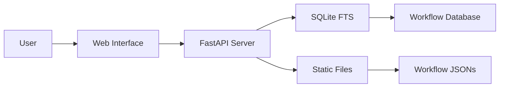
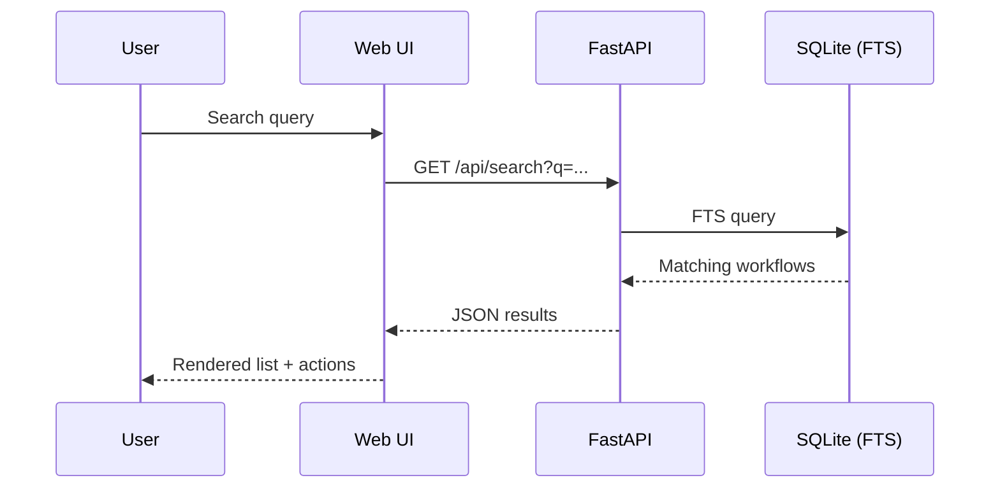

# 🚀 n8n Workflow Collection

<div align="center">


<a href="https://www.buymeacoffee.com/JustInCache"></a>

<br/>

### 🌟 A curated, production-ready collection of n8n automation workflows

<a href="https://JustInCache.github.io/n8n-workflows">🔍 Browse Online</a> • <a href="#%F0%9F%93%9A-documentation">📚 Documentation</a> • <a href="#-quick-start">⚡ Quick Start</a> • <a href="#-contributing">🤝 Contributing</a> • <a href="#-license">📄 License</a>

<br/>

<a href="https://github.com/JustInCache/n8n-workflows/stargazers"></a>
<a href="https://github.com/JustInCache/n8n-workflows/network/members"></a>
<a href="https://github.com/JustInCache/n8n-workflows/issues"></a>

</div>

---

## 📑 Table of Contents

- [✨ What's New](#-whats-new)
- [🌐 Quick Access](#-quick-access)
- [🚀 Features](#-features)
- [💻 Local Installation](#-local-installation)
- [📦 Docker & Docker Compose](#-docker--docker-compose)
- [☸️ Kubernetes & Helm](#%E2%98%B8%EF%B8%8F-kubernetes--helm)
- [📚 Documentation](#-documentation)
- [🏗️ Architecture](#-%EF%B8%8F-architecture)
- [📂 Repository Structure](#-repository-structure)
- [🤝 Contributing](#-contributing)
- [🔒 Security](#-security)
- [📄 License](#-license)

---

## ✨ What's New

> Fresh improvements to make discovering and using workflows delightful.

- 🔒 Security hardening and routine scans
- 🐳 Streamlined Docker and Compose usage
- 📊 Live searchable interface on GitHub Pages
- ⚡ Faster search backed by SQLite FTS
- 🎨 Polished UI with better mobile experience

---

## 🌐 Quick Access

<div align="center">

<a href="https://JustInCache.github.io/n8n-workflows"></a>
<a href="#-documentation"></a>
<a href="#-quick-start"></a>
<a href="#%E2%98%B8%EF%B8%8F-kubernetes--helm"></a>

</div>

> Use online with zero setup: powerful search, category browsing, mobile-friendly, and one-click JSON downloads.

---

## 🚀 Features

<table>
<tr>
<td width="50%" valign="top">

### 📊 By The Numbers
- **2000+** production-ready workflows
- **350+** unique integrations
- **15+** organized categories
- **Zero-setup** web browsing

</td>
<td width="50%" valign="top">

### 🧰 What You Get
- Curated, ready-to-import n8n JSONs
- Smart search and filtering
- Consistent structure and naming
- Local API and web UI options

</td>
</tr>
</table>

<details>
<summary><b>See highlights</b></summary>

<div align="center">

<table>
<tr>
<td><b>🔍 Smart Search</b><br/>Full-text powered by SQLite FTS</td>
<td><b>🧭 Categories</b><br/>Browse by use case and service</td>
<td><b>⬇️ One-Click</b><br/>Instant JSON downloads</td>
</tr>
<tr>
<td><b>🧪 Safe</b><br/>Inputs validated and sanitized</td>
<td><b>🧱 Modular</b><br/>Composable building blocks</td>
<td><b>📦 Portable</b><br/>Docker, Compose, K8s</td>
</tr>
</table>

</div>

</details>

---

## 💻 Local Installation

### Prerequisites
- Python 3.9+
- pip
- ~100MB free disk space

### Quick Start
```bash
# Clone the repository
git clone https://github.com/JustInCache/n8n-workflows.git
cd n8n-workflows

# Install dependencies
pip install -r requirements.txt

# Start the server
python run.py

# Open in browser
# http://localhost:8000
```

## 📦 Docker & Docker Compose

### Docker
```bash
# Using Docker Hub
docker run -p 8000:8000 JustInCache/n8n-workflows:latest

# Or build locally
docker build -t n8n-workflows .
docker run -p 8000:8000 n8n-workflows
```

### Docker Compose
```bash
# Bring up the local stack
docker compose up -d

# Stop
docker compose down
```

> Compose is configured via `docker-compose.yml` (with dev and prod variants).

## ☸️ Kubernetes & Helm

Use the included chart and manifests for an easy deploy:

```bash
# Create namespace
kubectl apply -f k8s/namespace.yaml

# Install via Helm (local chart)
helm upgrade --install workflows-docs ./helm/workflows-docs -n workflows-docs

# Or apply raw manifests
kubectl apply -f k8s/configmap.yaml -n workflows-docs
kubectl apply -f k8s/deployment.yaml -n workflows-docs
kubectl apply -f k8s/service.yaml -n workflows-docs
kubectl apply -f k8s/ingress.yaml -n workflows-docs
```

---

## 📚 Documentation

### API Endpoints

| Endpoint | Method | Description |
|----------|--------|-------------|
| `/` | GET | Web interface |
| `/api/search` | GET | Search workflows |
| `/api/stats` | GET | Repository statistics |
| `/api/workflow/{id}` | GET | Get workflow JSON |
| `/api/categories` | GET | List all categories |
| `/api/export` | GET | Export workflows |

### Search Features
- **Full-text search** across names, descriptions, and nodes
- **Category filtering** (Marketing, Sales, DevOps, etc.)
- **Complexity filtering** (Low, Medium, High)
- **Trigger type filtering** (Webhook, Schedule, Manual, etc.)
- **Service filtering** (365+ integrations)

---

## 🏗️ Architecture





### Tech Stack
- **Backend**: Python, FastAPI, SQLite (FTS)
- **Frontend**: Vanilla JS, HTML, CSS
- **Database**: SQLite with Full-Text Search
- **Deployment**: Docker, Docker Compose, GitHub Pages
- **Security**: Trivy config, CORS protection, input validation

---

## 📂 Repository Structure

```
n8n-workflows/
├── workflows/           # 2000+ workflow JSON files
│   └── [category]/      # Organized by integration
├── docs/                # GitHub Pages site
├── src/                 # Source code (API, indexers, tooling)
├── scripts/             # Utility scripts
├── helm/                # Helm chart for K8s
├── k8s/                 # Raw Kubernetes manifests
├── api_server.py        # FastAPI application
├── run.py               # Server launcher
├── workflow_db.py       # Database manager
└── requirements.txt     # Python dependencies
```

---

## 🤝 Contributing

We love contributions! Here's how you can help:

### Ways to Contribute
- 🐛 **Report bugs** via [Issues](https://github.com/JustInCache/n8n-workflows/issues)
- 💡 **Suggest features** in [Discussions](https://github.com/JustInCache/n8n-workflows/discussions)
- 📝 **Improve documentation**
- 🔧 **Submit workflow fixes**
- ⭐ **Star the repository**

### Development Setup
```bash
# Fork and clone
git clone https://github.com/YOUR_USERNAME/n8n-workflows.git

# Create branch
git checkout -b feature/amazing-feature

# Make changes and test
python run.py --debug

# Commit and push
git add .
git commit -m "feat: add amazing feature"
git push origin feature/amazing-feature

# Open PR
```

---

## 🔒 Security

### Security Features
- ✅ Path traversal protection
- ✅ Input validation & sanitization
- ✅ CORS protection
- ✅ Docker security hardening
- ✅ Non-root container user
- ✅ Trivy configuration included

### Reporting Security Issues
Please report security vulnerabilities to the maintainers via [Security Advisory](https://github.com/JustInCache/n8n-workflows/security/advisories/new).

---

## 📄 License

This project is licensed under the MIT License - see the [LICENSE](LICENSE) file for details.

```
MIT License

Copyright (c) 2025 JustInCache

Permission is hereby granted, free of charge, to any person obtaining a copy
of this software and associated documentation files (the "Software"), to deal
in the Software without restriction...
```

---

## 💖 Support

If you find this project helpful, please consider:

<div align="center">

[](https://www.buymeacoffee.com/JustInCache)
[](https://github.com/JustInCache/n8n-workflows)
[](https://twitter.com/JustInCache)

</div>

---

## 📊 Stats & Badges

<div align="center">

<a href="https://github.com/JustInCache/n8n-workflows/stargazers"></a>
<a href="https://github.com/JustInCache/n8n-workflows/network/members"></a>
<a href="https://github.com/JustInCache/n8n-workflows/watchers"></a>
<a href="https://github.com/JustInCache/n8n-workflows/issues"></a>
<a href="https://github.com/JustInCache/n8n-workflows/pulls"></a>
<a href="https://github.com/JustInCache/n8n-workflows/commits"></a>
<a href="https://github.com/JustInCache/n8n-workflows"></a>

</div>

---

## 🙏 Acknowledgments

- **n8n** - For creating an amazing automation platform
- **Contributors** - Everyone who has helped improve this collection
- **Community** - For feedback and support
- **You** - For using and supporting this project!

---

<div align="center">

### ⭐ Star us on GitHub — it motivates us a lot!

Made with ❤️ by [JustInCache](https://github.com/JustInCache) and [contributors](https://github.com/JustInCache/n8n-workflows/graphs/contributors)

</div>