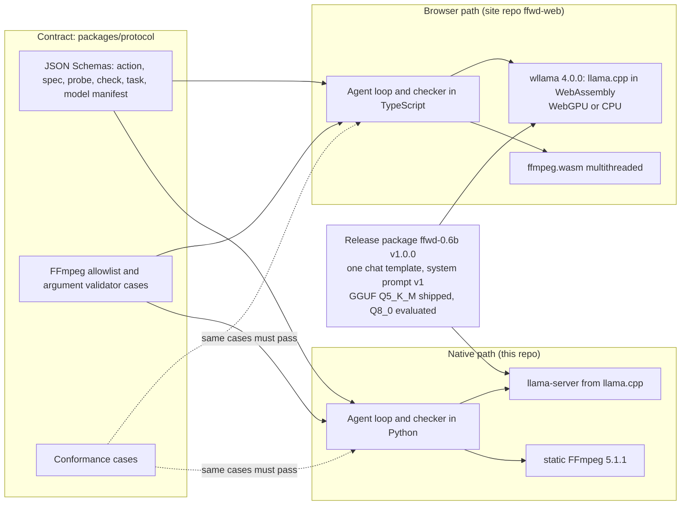
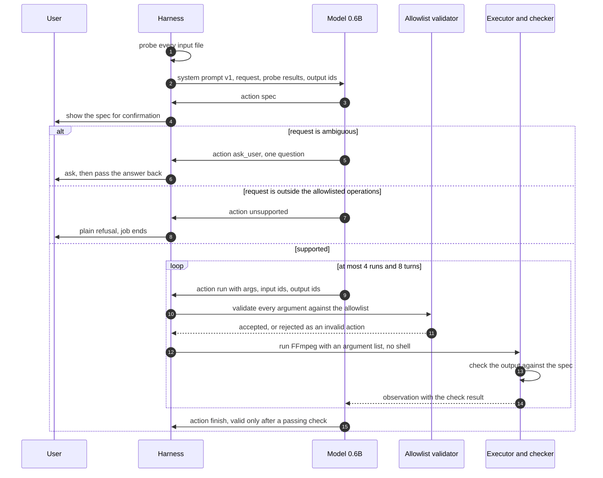
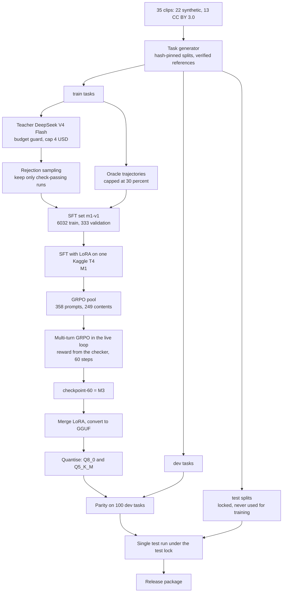
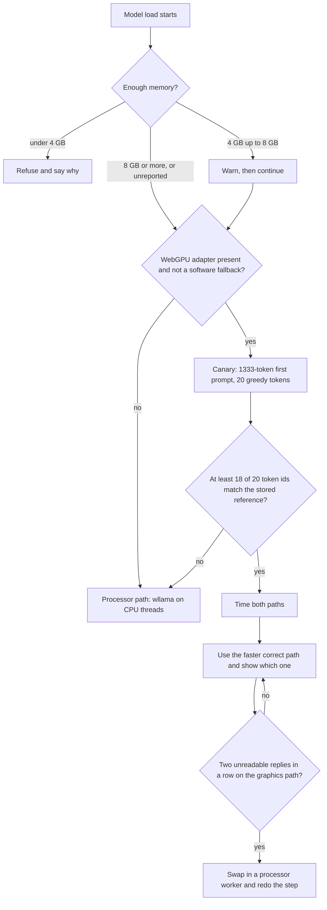

# ffwd-0.6b

**A 0.6B-parameter FFmpeg agent that turns a plain-language video chore into a checked FFmpeg command, small enough to run in a browser tab or on a laptop.**

ffwd is the product name. This repository is the model side (protocol, checker, task generator, training, evaluation, CLI) and still carries the working name `ffmpeg-agent` in its identifiers until a planned rename (D-046; source: `DECISIONS.md`). The browser app lives in a separate repository, `ffwd-web` (not linked here; D-047).

> [!IMPORTANT]
> **Early preview.** The model is v1.0.0, but the website/app that runs it is an early preview, version 0.9.0. Known limitation: vague or ambiguous real-world requests may not be handled correctly. The owner's own example: asking it, on a real clip, "Make the video potrait mode, lower the volume" did not produce a correct result (the cause has not been investigated). Clear, specific requests such as "cut the first 3 seconds" or "make it 720p" work best. The reported accuracy is measured on generated tasks, not on real users' wording; real-world accuracy is unknown.

Nothing is public yet: the model repository and the data repository on the Hugging Face Hub are private, so every download link below reads "link added at release".

## Table of contents

- [Abstract](#abstract)
- [1. Motivation and goals](#1-motivation-and-goals)
- [2. System overview](#2-system-overview)
- [3. The protocol](#3-the-protocol)
- [4. Chore families F1 to F12](#4-chore-families-f1-to-f12)
- [5. Data](#5-data)
- [6. Training](#6-training)
- [7. Evaluation methodology](#7-evaluation-methodology)
- [8. Results](#8-results)
- [9. Runtime and deployment](#9-runtime-and-deployment)
- [10. Limitations and threats to validity](#10-limitations-and-threats-to-validity)
- [11. Reproduce](#11-reproduce)
- [12. Repository layout](#12-repository-layout)
- [13. Release package and versioning](#13-release-package-and-versioning)
- [14. Decision log guide](#14-decision-log-guide)
- [15. Roadmap](#15-roadmap)
- [16. Licence and third-party notices](#16-licence-and-third-party-notices)
- [17. Citation](#17-citation)
- [Acknowledgements](#acknowledgements)

Source citations in this file are written `(source: path)`. Every path is a file tracked in this repository.

---

## Abstract

Many people hit a video chore (trim a clip, fix a file that will not play in a slide deck, pull frames out of a video) a few times a year, and the usual answers are a terminal, an upload to an unknown server, or a full editor. We fine-tuned Qwen3-0.6B, first with supervised fine-tuning (SFT) on execution-verified trajectories and then with multi-turn GRPO inside a live tool loop, to emit one JSON action per turn (`spec`, `ask_user`, `unsupported`, `run`, `finish`). A harness, not the model, validates every FFmpeg argument list against an allowlist and checks every output against a spec. On 900 generated held-out tasks the native Q8_0 model passed 867 (485/500 [95.1%, 98.2%] on test-iid, 188/200 [89.8%, 96.5%] on test-phrasing, 194/200 [93.6%, 98.6%] on test-compositional; Wilson 95%). The shipped browser build (Q5_K_M, wllama, WebGPU) passed 855/900; its paired difference from native is -1.33 pp, 95% CI [-2.67, -0.11], and the preregistered non-inferiority guard was **not shown** (bound -2.67 pp against -2.0 pp). GRPO did not raise success over its SFT parent (866/900 against 867/900); it lowered needless re-encodes. The limits are large: generated tasks only, one training seed, one test run, and no measurement on real users' wording, where a clear failure has already been seen.

---

## 1. Motivation and goals

**The problem.** There is a long tail of small video chores that each person needs rarely and that people in total need often: take a frame every 2 seconds, make an iPhone video play in PowerPoint, shift audio by half a second, merge twelve clips. The current options each cost something: install FFmpeg and learn its flags, upload private files to an online converter, find the right menu in a GUI app, or pay for a coding agent that needs a terminal (source: `PRD.md`, section 2).

**What a 0.6B on-device agent is for.** The model has one narrow job, so a small model can do it; running it on the user's machine means no upload and no per-edit cost to us; and every result is verified by deterministic code, so a small model's mistakes are caught instead of shipped. The target user is a non-developer on a desktop or laptop (source: `PRD.md`, sections 1 to 4).

**Goals**

1. A free, open-source utility for occasional video chores, in the browser first.
2. A research question with a falsifiable answer: can a specialist agent of 0.6B parameters, trained with SFT then multi-turn GRPO on execution-verified rewards, get close to a frontier model on this narrow task? (Context: in the Phase 0 spike, the frontier-class teacher scored 94% against 8% for the best untrained small model, n = 50, source: `DECISIONS.md` D-020.)
3. Honest numbers: preregistered comparisons, a locked test set, intervals everywhere, failures kept in the denominator (source: `EVALUATION.md`, section 5; `RULES.md`, section 4).

**Non-goals** (source: `PRD.md`, section 6)

- Not a general chat model, and not arbitrary FFmpeg: anything outside the allowlisted operations is answered `unsupported`.
- Not mobile, not subtitles burned in, not content-aware edits (object removal, captions, upscaling), not a timeline editor, no accounts or cloud storage.
- Not a claim to beat frontier coding agents for developers (D-002).
- Not a measured result on real users yet (section 10).

---

## 2. System overview

One contract, two implementations of the agent loop, one model file.



- **`packages/protocol` is the contract**: JSON Schemas for actions, spec, probe result, check result, task and the model manifest, plus the FFmpeg allowlist (source: `ARCHITECTURE.md`, section 2; `packages/protocol/schemas/`).
- **The agent loop and the checker exist twice**, in TypeScript (browser, site repo) and in Python (training, evaluation, CLI). They are kept in sync only by the shared conformance cases in `packages/protocol/conformance/`; a conformance failure blocks merge (source: `RULES.md`, section 4, item 8).
- **One model file.** The browser (through wllama), the native CLI and the planned helper all run the same GGUF, so there is one artifact and one set of parity numbers (D-050; source: `ARCHITECTURE.md`, section 4.1).
- The native path is what this repository ships today (a CLI). The helper app (FastAPI, for large files and batches) is designed and **not started** (source: `PHASES.md`, status table).

The offline pipeline that produces the model is in [section 6](#6-training).

---

## 3. The protocol

### 3.1 Actions

The model emits **exactly one JSON action per turn** (source: `ARCHITECTURE.md`, section 3.1; schema `packages/protocol/schemas/action.schema.json`).

| Action | Fields | Effect |
|---|---|---|
| `spec` | a spec object | Proposed description of the finished output. Must come first: a `run` before a `spec` is rejected as an invalid turn. |
| `ask_user` | `question` | Pauses for one clarifying answer (at most 1 per job). |
| `unsupported` | `reason`, optional `nearest_supported` | Ends the job honestly. |
| `run` | `args`, `inputs`, `outputs` | One FFmpeg invocation as a structured argument list. |
| `finish` | `outputs`, `note` | Ends the job; valid only after a run whose check passed. |

**`check` is not a model action.** The harness probes and checks the output after every `run` and returns the result as an observation, so the model cannot skip verification (source: `ARCHITECTURE.md`, section 3.1).

Budgets (source: `training/config.py`): at most 4 `run` actions per job, at most 8 turns per job (invalid replies consume turns), at most 1 `ask_user`. Each run also has a timeout and an output size cap (source: `RULES.md`, section 1, item 4).



### 3.2 Spec and gold spec

A spec says what the output must look like: container, video codec and size, audio presence and codec, time range, size cap, frame interval, lossless or not. A field set to `null` means "unconstrained", and the checker verifies only fields that are set (source: `ARCHITECTURE.md`, section 3.2; `packages/protocol/schemas/spec.schema.json`).

There are two specs, and they are never swapped (source: `RULES.md`, section 4, item 4):

- **Training and evaluation grade against the generator's gold spec.** A model cannot grade itself leniently.
- **Runtime checks use the user-confirmed spec.** At runtime there is no gold spec, so the model proposes a spec, the user confirms it, and a deterministic checker verifies against that (D-008).

The consequence is visible in the results: the stated spec can be wrong while the output still passes the gold spec (section 8.5).

### 3.3 The model never sees paths

The model refers to input and output ids. The harness assigns the real paths inside a per-job directory. Protocols (`http:`, `pipe:`, `concat:` lists) and path traversal are rejected, `-y` is not allowed, and outputs never overwrite inputs (source: `RULES.md`, section 1, items 3 and 5).

### 3.4 The allowlist validator, and why it exists

Rule 1 is that no shell string is ever executed: FFmpeg and ffprobe are started only with argument lists that pass the validator (source: `RULES.md`, section 1, items 1 and 2). The validator allows a fixed set of options, encoders, filters, muxers and pixel formats (51 options, 14 encoders, 31 filters, 14 muxers, 9 pixel formats; source: `packages/protocol/allowlist.json`) and parses filter-graph syntax instead of pattern-matching strings (`training/env/validator.py`). Reason: the model's output is untrusted input to a process that reads and writes files, and a 0.6B model will produce corrupted tokens sometimes (section 8.4 shows the 4-bit failure mode).

### 3.5 A validator bypass we found, and what the audit showed (D-054)

During a review of the site code (25 Nov 2026) we found that the argument validator's filter-graph splitter treated a backslash inside single quotes as an escape. FFmpeg's own tokenizer does not. A crafted filter such as `setsar='\',movie=in_0.mp4'` therefore hid a `movie=` source from the filter allowlist, and real FFmpeg would have opened the file. The JavaScript twin was fixed first; the Python validator had the same bug and was fixed afterwards, with 12 new shared conformance cases (10 bypass variants that must be rejected, 3 legitimate quoting strings that must still pass; source: `DECISIONS.md` D-054).

We then replayed every recorded `run` action through the old and the fixed validator: 53,705 run actions in 37,305 episodes (10,259 unique argument lists) across teacher and SFT data, dev runs, the Phase 1 test and browser runs, parity runs, GRPO spot checks and task reference solutions. **0 were affected**, and none of them even contains a backslash inside single quotes (source: `reports/2026-11-25-validator-audit/summary.md`). So no past result changes. What the finding does show is that the two validators had drifted and that the conformance suite had no case for this construct; the new cases close that gap, not the general risk that the twins diverge elsewhere.

---

## 4. Chore families F1 to F12

(Source: `PRD.md`, section 5.) A request may need one family or a composition of two to four.

| # | Family | Example request |
|---|---|---|
| F1 | Trim / cut | "cut the first 3 seconds", "keep 0:12 to 0:40" |
| F2 | Merge / concatenate | "merge these 12 clips into one" |
| F3 | Compatibility convert | "iPhone video won't play in PowerPoint" (HEVC/MOV to H.264/AAC MP4) |
| F4 | Resize / crop | "make it vertical 9:16", "720p" |
| F5 | Rotate / flip | "rotate 90 degrees without losing quality" |
| F6 | Compress to size | "under 10 MB" |
| F7 | Extract frames | "a frame every 2 seconds as images" |
| F8 | GIF | "make a GIF of 0:05 to 0:09" |
| F9 | Audio extract / remove | "save the audio as MP3", "remove the sound" |
| F10 | Volume / loudness | "make the quiet audio louder" |
| F11 | A/V sync offset | "audio is half a second behind" |
| F12 | Speed / FPS | "2x speed", "convert to 30 fps" |

Out of scope requests (subtitles, object removal, stabilisation, colour grading) are expected to get `unsupported` (source: `docs/hf-cards/model-card-m3.md`, Intended use). Per-family and per-difficulty test results are in `reports/2026-11-23-phase-1/by_family.csv`.

---

## 5. Data

### 5.1 Clip corpus: 35 clips

Task generation can see **35 clips: 22 synthetic and 13 real clips under CC BY 3.0** (source: `docs/hf-cards/data-card-corpus-and-tasks.md`, section 1).

| Group | Count | Licence | What |
|---|---|---|---|
| Synthetic | 22 | CC0-1.0 | Generated by FFmpeg test sources (`training/corpus/make_synthetic.py`); cover VFR, 4:3, ProRes, MKV, mono audio, quiet and noisy audio, known A/V offsets, rotation metadata |
| Blender Foundation films | 13 | CC BY 3.0 | 9 short cuts of Tears of Steel and Big Buck Bunny, plus 4 derived variants (ProRes, extra audio track, quiet audio, shifted audio) |

The clips are modified (cut and re-encoded), so the CC BY 3.0 attribution and the per-clip `provenance` (cut start, command, FFmpeg version) are in the data card and `THIRD_PARTY_NOTICES.md`. Clips are never stored in git; only a manifest with hashes is. 12 of the 13 real clips come from one film (Tears of Steel), so scene content is narrower than the count suggests (source: the clip table in the data card, section 1.2).

### 5.2 Task generation and hash-pinned splits

A task is `(inputs, request, gold spec, difficulty, family tags, flags)` with a verified reference solution: each task is kept only if running its reference through the checker passes its gold spec (`training/taskgen/`; source: data card, section 2).

A task's split comes from a hash of its **content** (inputs plus gold spec), never from its wording, so paraphrases of one content cannot straddle train and test. Splits (source: data card, section 2; `data/tasks/MANIFEST.json`):

| Split | Tasks | Purpose |
|---|---|---|
| train | 4,472 (1,500 contents, each in 3 of 5 request styles) | SFT and GRPO prompts |
| train extra `hard-v1` | 300 | train-only pool for the GRPO pilots |
| dev | 300 | development, checkpoint and quantisation choices |
| test-iid | 500 | same distribution as train |
| test-compositional | 200 | family combinations never generated elsewhere (F3+F4, F5+F12, F1+F8, F4+F10, F6+F9, F9+F12, F1+F4+F6) |
| test-phrasing | 200 | rendered only in two request styles (`context_first`, `indirect`) that train never uses |

Held-out phrasing reuses train core wording inside a new framing, so test-phrasing measures framing robustness, not new vocabulary (D-027).

### 5.3 Leakage audit

Word 4-gram Jaccard between each test request and its nearest train request, gate 0.9 (source: data card, section 2.1, from `reports/2026-11-22-leakage-audit/`):

| Split | tests | over the gate | exact-duplicate requests vs train |
|---|---|---|---|
| test-iid | 500 | 108 | 104 (20.8%) |
| test-compositional | 200 | 0 | 0 |
| test-phrasing | 200 | 0 | 0 |

test-iid is the training distribution and contains near-duplicate requests, so it is reported both on the full split and on a deduplicated subset of 396 tasks (D-039).

### 5.4 Teacher, rejection sampling and the budget rule

- **Teacher:** DeepSeek V4 Flash (thinking off), run only on train tasks through the same loop and checker. A trajectory is kept only if its output passes the checker against the gold spec (rejection sampling) (D-010; source: data card, section 3.1).
- **Bulk run:** 3,490 episodes; 3,372 passed the checker (96.6%); 3,199 kept after the label filter (91.7%); cost $2.2968, cache-hit ratio 84.0% (source: data card, section 3.1; `reports/2026-11-19-teacher-bulk/summary.md`). 27.1% of trajectories contained a schema-invalid turn; the SFT builder drops those turns and never edits what the teacher wrote.
- **SFT set `m1-v1`:** 6,032 train and 333 validation trajectories: 3,021 teacher, 1,896 paraphrases (copies of kept trajectories with the request reworded), 1,115 programmatic "oracle" trajectories (capped at 30% by D-032). Nothing from dev or any test split.
- **Rejection sampling of a local base model** produced nothing to keep: stock Qwen3-0.6B scored 0/300 on dev.
- **Budget rule:** every paid API call goes through a budget-guarded client with a hard lifetime cap of $4, a pilot of at most 20 tasks before scaling, off-peak bulk runs, and cache-hit logging (source: `RULES.md`, section 5). Spend recorded: $2.675 before the test run and $0.5985 for the DeepSeek baseline on the test run (source: data card, section 3.1). **Never run teacher generation without the guard.**
- **Teacher terms:** the review of DeepSeek's Open Platform terms (sections 4.2(2) and 4.2(3), snapshot hash recorded) is done and recorded in the data card; teacher trajectories are not part of any release.

### 5.5 What is and is not published

Nothing is public today. The planned data release (data card, owner decisions of 24 Nov 2026) is: the clips with their licences, the task generator, and all generated splits including the test splits with their hashes (tasks and manifests CC BY 4.0). **Not** uploaded: the teacher trajectories. A private, unlisted `test-real` split of the owner's own recordings exists as a Phase 4 item; it has **not been run**, it is not in any release, and nothing about its clips is described here (source: data card, Exclusions; `PHASES.md`).

---

## 6. Training



**Stage 1, SFT (M1).** Qwen3-0.6B with an all-linear LoRA (r 16, alpha 32), learning rate 1e-4 with cosine decay, maximum length 3,072, loss on assistant turns only, fp16, 2 epochs, effective batch 16, 754 optimizer steps on one Kaggle T4. The configured default was 3 epochs; the 2-epoch run was a time-saving deviation, not tuned on dev (D-037; source: `docs/hf-cards/model-card-m3.md`, Training).

**Stage 2, multi-turn GRPO (M3).** Started from merged M1. Rollouts run the real tool loop with the real checker against each task's gold spec, so the reward is the harness verdict (D-004, D-018). Group size 8, 8 prompts per step (effective batch 64), learning rate 1e-5, KL beta 0.0, rollout temperature 1.0, LoRA r 16, 60 steps over a pool of 358 prompts (249 unique contents) chosen from train tasks by reward variance. 10.51 GPU-hours on a Kaggle T4 (source: model card, Training).

Reward v1 (source: model card, Training; `ARCHITECTURE.md`, section 7.4):

| Term | Weight | Meaning |
|---|---|---|
| pass | 1.0 | the output passes the gold spec |
| partial | 0.3 | fraction of gold-spec fields satisfied, only when not passed |
| efficiency | 0.1 | no needless re-encode when a stream copy suffices; fewer runs |
| clarify | 0.5 | correct `ask_user` or `unsupported`; penalty for needless asks or refusals |
| invalid | -0.5 per invalid action (capped) | disallowed or unparseable action |
| spec_acc | 0 | set to 0 before any GRPO run (D-043) |

**What happened during the run.** It hit two CUDA out-of-memory failures (step 38 of 60, then step 59) and was resumed from checkpoints (step 30, then step 50 with a smaller micro-batch and the same effective batch). **M3 is checkpoint-60**, chosen by a rule fixed before any dev result of checkpoint-50: M3 is the last clean checkpoint of the run (D-045). A 30-step shuffled-reward control passed first: dev 294/300 against 293/300 for M1 (source: `DECISIONS.md` D-045). Training telemetry (first against last 10 steps, training-set rollouts, not test performance): pass rate 0.822 to 0.916, runs per rollout 1.637 to 1.378; part of the late rise is a second pass over the pool's prompts, so dev and test, not training curves, are the evidence (source: `reports/2026-11-23-phase-1/telemetry.md`).

**Seeds.** **Single seed**: one training run per stage. No saved log records the seed passed to the Kaggle runs, so none is quoted. The evaluation seed (llama.cpp server and bootstrap) is 20261115 (source: `reports/2026-11-23-phase-1/manifest.json`).

**Checkpointing.** Kaggle wipes its working directory when a session ends, so each GRPO checkpoint is pushed to a private Hub repo and a resume verifier checks step continuity and the learning-rate schedule (D-022, source: `DECISIONS.md`).

---

## 7. Evaluation methodology

**Preregistration.** The comparisons, the minimum meaningful difference and the decision rules are written in `eval/PREREGISTRATION.md` before the test splits are run. The Phase 1 text was FINAL before any test split ran, and a fixed-sequence procedure was set in Amendment 3 (22 Nov 2026) before the run (D-048). The browser row was added by Amendment 4, written and committed before that row ran.

**Test lock.** A test split is evaluated once per (system, checkpoint, split); a rerun needs a logged written reason. `eval/testlock.py` enforces it and writes the ledger `reports/TEST_RUNS.jsonl` (18 rows: 15 for the five Phase 1 systems on three splits, 3 for the browser row; D-030, D-048). Checkpoints and quantisations are chosen on dev, never on test (source: `RULES.md`, section 4, item 5).

**Baselines** (source: `EVALUATION.md`, section 3; `PHASES.md`):

| ID | System | Status |
|---|---|---|
| B0 | Frozen regex/preset baseline written from train phrasing only | run in Phase 1 |
| B1 | Stock Qwen3, single shot | Phase 0 only |
| B2 | Stock Qwen3-0.6B in the same agent loop | run in Phase 1 |
| M1 | SFT | run in Phase 1 |
| M2 | SFT plus single-turn GRPO | deferred to Phase 4 (D-031) |
| M3 | SFT plus multi-turn GRPO | run in Phase 1 (headline, native Q8_0) |
| X1 | DeepSeek V4 Flash in the same loop | run in Phase 1 |
| X2 | Claude Code / Codex on a small manual subset | not run |

All systems use the same environment, allowlist, checker, turn budget and timeouts.

**What "passed" means.** The final output passes the **gold** spec on every set field within the turn budget (`training/env/loop.py`). `unsupported` and `ambiguous` tasks are graded on the action alone (D-038). Failed, timed-out, malformed and errored episodes count as failures and stay in every denominator (source: `EVALUATION.md`, section 5).

**Statistics** (source: `EVALUATION.md`, section 5; `eval/PREREGISTRATION.md`, Amendments 3 and 4):

- Single rates use **Wilson 95% intervals** (D-021): a percentile bootstrap collapses to 0 to 0% at 0/50.
- System-against-system differences use a **paired bootstrap** on the same tasks (10,000 resamples, seed 20261115).
- Phase 1 confirmatory tests run as a **fixed sequence at alpha 0.05**: Q2 (M1 over B2 on test-iid), Q7 (M3 over B0 on test-phrasing), Q3a (M3 against M1 on needless re-encode or failure, tasks where a stream copy is possible), Q3b (M3 against M1 on runs per task), then Q4 (M3 against X1). A step is tested only if every earlier step was rejected in the favourable direction.
- **Non-inferiority guard.** The efficiency claim also needs: on the three generated splits pooled (n = 900), the one-sided 97.5% lower bound of the paired success difference (M3 minus M1) must be above **-2.0 pp**. For the browser row the same rule is reused as a descriptive check, and it was **not shown**.
- Seeds: at least 3 training seeds were planned "if compute allows"; this release has **one**, and says so.

**Sanity controls** run before the test run: a checker mutation self-test (411 of 413 mutants killed; the 2 survivors lie inside the checker's tolerance), the leakage audit, and a Q8_0 against Q4_K_M parity check (source: `reports/2026-11-23-phase-1/LIMITATIONS.md`; `reports/2026-11-22-checker-mutation/summary.md`). The owner's review of 50 passed M3 outputs was generated after the results and is still pending.

---

## 8. Results

All results are on **generated** tasks (section 5.2), one training seed, one test run, greedy decoding. Native rows are llama.cpp b12032 serving the Q8_0 GGUF.

### 8.1 Success by split

| System | test-compositional | test-iid | test-phrasing | test-iid (dedup, 396) | runs/task (iid) | re-encode rate |
|---|---|---|---|---|---|---|
| B0 regex | 125/200 = 62% [56%, 69%] | 281/500 = 56% [52%, 60%] | 129/200 = 64% [58%, 71%] | 212/396 = 54% [49%, 58%] | 0.87 | 7% |
| B2 stock + loop | 0/200 = 0% [0%, 2%] | 0/500 = 0% [0%, 1%] | 0/200 = 0% [0%, 2%] | 0/396 = 0% [0%, 1%] | 0.00 | n/a |
| M1 SFT | 194/200 = 97% [94%, 99%] | 485/500 = 97% [95%, 98%] | 187/200 = 94% [89%, 96%] | 383/396 = 97% [94%, 98%] | 1.05 | 9% |
| M3 SFT + GRPO | 194/200 = 97% [94%, 99%] | 485/500 = 97% [95%, 98%] | 188/200 = 94% [90%, 97%] | 385/396 = 97% [95%, 98%] | 1.03 | 2% |
| X1 DeepSeek | 195/200 = 98% [94%, 99%] | 483/500 = 97% [95%, 98%] | 188/200 = 94% [90%, 97%] | 382/396 = 96% [94%, 98%] | 0.99 | 9% |

(source: `reports/2026-11-23-phase-1/summary.md`; Wilson 95% intervals; n and counts as shown.)


*Figure 1. Success by split for the five Phase 1 systems; n = 500, 200, 200; whiskers are Wilson 95% intervals from `results.json`. M1, M3 and X1 are not separable on any split (their intervals overlap almost completely); B0 is clearly lower and B2 is at zero.*

B2 scoring 0/900 is the stock model's real behaviour (it packs several actions into one reply and runs on; every episode ends at the turn budget), not a harness fault; it is a floor, not a strawman. B0 answers `unsupported` on 331 of 834 supported tasks (40%) (source: `reports/2026-11-23-phase-1/LIMITATIONS.md`).

### 8.2 Preregistered comparisons and the M1 against M3 question

| Comparison | Split | n | Difference [95% CI] | Status |
|---|---|---|---|---|
| Q2 M1 minus B2 | test-iid | 500 | +97.0 pp [+95.4, +98.4] | rejected |
| Q7 M3 minus B0 | test-phrasing | 200 | +29.5 pp [+22.5, +36.5] | rejected |
| Q3a M3 minus M1, needless re-encode or fail | test-iid + test-phrasing | 90 | -11.1 pp [-18.9, -4.4] | rejected (favourable) |
| Q3b M3 minus M1, runs per task | test-iid | 458 | -0.024 [-0.061, +0.011] | **not rejected, the sequence stops** |
| Q4 M3 minus X1 | test-iid | 500 | +0.4 pp [-1.6, +2.4] | descriptive only |

(source: `reports/2026-11-23-phase-1/summary.md`.) Guard, M3 minus M1 success on the three splits pooled: +0.11 pp, one-sided 97.5% lower bound -0.89 pp against -2.0 pp: **met** (source: `reports/2026-11-23-phase-1/results.json`).

What this does and does not say (source: `reports/2026-11-23-phase-1/LIMITATIONS.md`):

- M1 and M3 are level on success (866/900 and 867/900). **GRPO did not raise accuracy here.** What it changed is the needless re-encode rate on tasks where a stream copy is possible (9% to 2% on test-iid).
- The efficiency claim rests on Q3a alone (n = 90, one seed) plus the guard. It is real and narrow.
- Because Q3b was not rejected, Q4 is descriptive: we do not claim M3 matches the teacher; the interval is compatible with a small gap either way.

### 8.3 The shipped browser build against native Q8_0

The browser row is an extra, descriptive row run once per test split under the lock (Amendment 4; frozen configuration: M3 Q5_K_M, wllama 4.0.0 with llama.cpp build b12637, Chromium 159, WebGPU, q8_0 KV cache, context 8192). It measures the whole browser stack, not quantisation alone. No p-value and no efficiency claim is made for it (source: `reports/2026-11-23-phase-1-browser-row/report/summary.md`).

| | test-iid | test-phrasing | test-compositional | pooled (counts) |
|---|---|---|---|---|
| M3 browser, Q5_K_M | 483/500 = 96.6% [94.6, 97.9] | 181/200 = 90.5% [85.6, 93.8] | 191/200 = 95.5% [91.7, 97.6] | 855/900 = 95.0% |
| M3 native, Q8_0 | 485/500 = 97.0% [95.1, 98.2] | 188/200 = 94.0% [89.8, 96.5] | 194/200 = 97.0% [93.6, 98.6] | 867/900 = 96.3% |
| Paired difference (browser minus native) | -0.40 pp [-2.00, +1.20] | **-3.50 pp [-7.00, -0.50]** | -1.50 pp [-4.50, +1.50] | **-1.33 pp [-2.67, -0.11]** |

**The preregistered guard is not shown for the browser row**: the one-sided 97.5% lower bound is -2.67 pp against the -2.0 pp margin. The interval for the pooled difference excludes zero, so the browser build is measurably a little lower than native, and the loss is concentrated in test-phrasing (7 fewer tasks than Q8_0 of 200). The owner accepted this as shipped and the reports say so in these words (D-052).


*Figure 2. Left: success with Wilson 95% intervals (n = 500, 200, 200). Right: paired browser-minus-native difference with paired-bootstrap 95% intervals; the -2.0 pp margin and the one-sided 97.5% bound (-2.67 pp) belong to the pooled comparison (n = 900) only, because the guard was never tested per split. Only the test-phrasing and pooled intervals exclude zero; the guard is not shown.*

Context only, outside any claim: browser minus M1 -1.22 pp [-2.56, 0.00] and browser minus X1 -1.22 pp [-3.11, +0.56] (n = 900; same source). Invalid-action episodes: browser 2, native M3 5, M1 3, X1 221 (same source).

### 8.4 Quantisation curve (dev sample, not test)

One seeded sample of 100 dev tasks, the same prompt, harness and greedy decoding for every row. Each GGUF is quantised from the same f16 GGUF (source: `reports/2026-11-23-m3-quant-curve/summary.md`; `reports/2026-11-23-browser-gguf/REPORT.md`; `reports/2026-11-23-mlc-parity/summary.md`).

| Format | Native llama.cpp b12032 | Browser WebGPU (wllama, llama.cpp b12637) |
|---|---|---|
| GGUF Q4_K_M | 60/100 | 62/100 |
| GGUF Q5_K_M | 97/100 | 96/100 with f16 KV; 97/100 with q8_0 KV (the shipped setting) |
| GGUF Q6_K | 99/100 | 98/100 |
| GGUF Q8_0 | 97/100 | not run |
| MLC q4f16_1 (M3) | n/a | 2/100 (stored weights read back through Hugging Face fp16; the MLC runtime could not be built, so this is not a browser run) |
| MLC q0f16 (M3, unquantised control) | n/a | 98/100 (same method; about 1.2 GB, rejected for size) |

For M1, MLC q4f16_1 scored 5/100 (source: the MLC report). With n = 100 the interval is about plus or minus 5 pp, so Q5_K_M, Q6_K and Q8_0 are indistinguishable here; Q4_K_M is not (37 tasks that only Q8_0 passes, none the other way).


*Figure 3. Dev tasks passed of 100 (n = 100, one sample, one seed); whiskers are Wilson 95% intervals computed by `make_figures.py` from the counts. The cliff is between Q4_K_M and Q5_K_M and appears in both runtimes, so it belongs to the model, not the runtime; Q5_K_M, Q6_K and Q8_0 are not separable at this n. The MLC points are weights read back through Hugging Face, not a WebGPU run.*

Why Q4_K_M fails: not a template or tokenizer fault (the same pipeline gives 97 to 99 at the other quantisations); the rejected commands carry corrupted tokens (`-xvercode`, `-xmp`, `paletteode`, `libmp3`) and 5 of them the forbidden `-y`, which is a small model losing precision on token choice. The Q5_K_M choice was made on this dev sample, which is the sample the browser settings were also chosen on (section 10).

### 8.5 Stated-spec accuracy (descriptive, not preregistered)

The **material spec error rate** scores the spec the model states (container, resolution, time range, lossless, requested codec) separately from success, because success is graded on the gold spec.

| System | test-compositional | test-iid | test-phrasing |
|---|---|---|---|
| M1 | 34/200 = 17% [12%, 23%] | 107/439 = 24% [21%, 29%] | 42/171 = 25% [19%, 32%] |
| M3 | 28/200 = 14% [10%, 19%] | 97/439 = 22% [18%, 26%] | 38/171 = 22% [17%, 29%] |
| X1 | 20/200 = 10% [7%, 15%] | 91/439 = 21% [17%, 25%] | 31/171 = 18% [13%, 25%] |

(source: `reports/2026-11-23-phase-1/summary.md`.) The stated spec is materially wrong in about a fifth of test-iid episodes even when the output passes. In the product the user confirms that spec and the runtime check uses it, so a wrong stated spec would be shown to the user and checked against, which is why we report it. Two systematic spec bugs, inherited from the SFT data, are known: width and height not swapped after a rotation, and `end_s` stated as source time after a speed change (D-043; source: `LIMITATIONS.md`).

---

## 9. Runtime and deployment

### 9.1 Browser

The browser build runs **wllama 4.0.0** (llama.cpp compiled to WebAssembly, MIT licence, exact-pinned; the release was one day old when adopted, which is why it was reviewed and is pinned, D-051) with the GGUF Q5_K_M, in a dedicated worker, next to a multithreaded ffmpeg.wasm worker. The prompt is rendered by our own JavaScript port of the chat template and passed as plain text; the runtime's own template is never used (MLC's stock template matched ours on 0 of 11 fixtures; the port is byte-identical to the golden prompts) (source: `reports/2026-11-23-browser-gguf/REPORT.md`, sections 1 and 2). Decoding is greedy and unconstrained; `n_ctx` is 8192 with a q8_0 KV cache and flash attention; there is no history truncation, and a job whose next prompt plus the 512-token reply budget would not fit ends as "too long" and counts as not done. On the 300 dev episodes the longest need was 4,659 tokens (source: same report, section 5; D-050, D-051).

### 9.2 The WebGPU canary, and why it exists

On one Intel integrated GPU (Alder Lake-S UHD, gen-12lp, Mesa ANV, Chromium 159) the same model file produced **garbage in every configuration we tried** (Q5_K_M and Q8_0 weights, f16 and q8_0 KV cache, shader cache on and off), at 5 to 27 tokens per second, while the same file scores 96 to 97/100 on the NVIDIA adapter. It points at the WebGPU kernels on that driver and browser build; other Intel drivers, Chrome stable and Firefox were not tested (source: `reports/2026-11-24-overnight/MORNING_REPORT.md`, section 2).

The failure is **length-dependent**: a 774-token and an 837-token prompt gave correct output on that GPU, while 881, 950, 1,176 and 1,333 tokens gave wrong output. A real job's first turn is about 1,330 tokens, so a short canary would have vouched for a path that fails the job. The shipped canary therefore uses the full system prompt plus a first user turn (1,333 tokens), 20 greedy tokens, and passes only if at least 18 of the 20 token ids match the stored reference. Correct paths scored 20 of 20 and every broken run scored 0 (source: `reports/2026-11-24-canary/summary.md`; `releases/ffwd-0.6b-v1.0.0/ffwd-model.json`). A wrong call costs speed, never wrong output.



(source: `reports/2026-11-24-canary/summary.md`; `DECISIONS.md` D-052. The safety net and the memory thresholds are covered by unit tests only, not by a real-browser run; the canary reference was built on the owner's laptop.)

Real-browser results, three runs on one machine (source: canary report): the NVIDIA adapter passed the canary and chose WebGPU; the Intel-only configuration failed it (0 of 20) and ran the job on the processor; a configuration with no GPU skipped it and used the processor.

### 9.3 Measured latency

Per model turn, M3 Q5_K_M, dev spike, 100 dev tasks per path, one laptop (Intel i5-12450HX, 16 GB, RTX 3050 6 GB, Linux), one seed (source: `reports/2026-11-23-browser-gguf/REPORT.md`):

| Path | median turn | p90 | first turn (median) | later turns (median) | generation tok/s | prompt tok/s |
|---|---|---|---|---|---|---|
| WebGPU | 2.16 s | 3.8 s | 3.5 s | 1.6 s | 55.4 | 199.0 |
| Processor only (6 threads) | 6.83 s | 11.6 s | 10.3 s | 5.9 s | 17.4 | 55.4 |


*Figure 4. Median wall time per model turn with interquartile range, computed from `turns.jsonl` of the two dev-spike runs: 100 first turns and 207 later turns (WebGPU), 100 first turns and 209 later turns (processor, 6 threads); one laptop, one seed. The first turn is slower because a new page reads the whole prompt of about 1,300 to 1,900 tokens; later turns reuse the cached prefix.*

Other measurements, from different contexts, so do not compare them across rows:

- Test row on WebGPU (900 tasks): median turn 2.13 s, 2.19 s and 2.36 s on test-iid, test-phrasing and test-compositional; generation about 53 tok/s (source: browser-row summary).
- **CPU thread count matters.** Pinned to 4 performance-core threads, a 12-task subset ran at 36.3 tok/s with a 3.2 s median turn (all 12 passed); the default 6 threads on this hybrid CPU gave 17.4 tok/s. The shipped default is `min(4, max(1, floor(cores / 2)))` (D-052). That subset is not a 100-task parity run (source: `MORNING_REPORT.md`, section 2).
- A simulated budget laptop (Intel iGPU under a 4-core, 7 GB cap) ran 4 tasks at a 133 s median turn and passed 0, because the output was wrong (source: same section).
- The canary report's CPU check, on a fresh page, took 20.5 s for the 1,333-token prompt; the first real step is long for the same reason.

### 9.4 Download, memory and size budget

- Download: the shipped GGUF is 444,411,456 bytes (444.4 MB) plus about 10.8 MB of wasm, 455.2 MB in total, against a 500 MB budget. Q6_K plus the runtime would be 505.9 MB (over). Q8_0 is 639.4 MB (source: `REPORT.md`; `ffwd-model.json`).
- A real cold download was measured only for a same-size stand-in file, 49 s at 71 Mbit/s, because our own repository is private; other speeds are arithmetic, not measured (source: `REPORT.md`, section 6).
- GPU memory in use after load: about 1,000 MiB with the q8_0 KV cache (1,416 MiB with f16); processor-path resident memory about 2,225 MiB. Stated requirements: 8 GB recommended, 4 GB minimum with a warning (D-052).
- Responsiveness: during an F4 re-encode in ffmpeg.wasm the longest main-thread stall was 2.6 ms on WebGPU and 4.0 ms on the processor path (limit 200 ms) (source: `REPORT.md`, section 8).

### 9.5 Native CLI

The CLI (`apps/cli/ffmpeg_agent_cli`) loads the release manifest and **fails closed**: it refuses a schema error, a protocol or minimum-app-version mismatch, a file whose size or sha256 differs, and any FFmpeg other than the pinned **static FFmpeg 5.1.1**. It shows the spec for confirmation, runs, checks, and reports success only when a check passed (source: `releases/README.md`; `releases/ffwd-0.6b-v1.0.0/RELEASE_NOTES.md`). The browser's ffmpeg.wasm core is 5.1.4, one patch release away from the 5.1.1 used for evaluation; the gap is unmeasured on the Phase 1 tasks (source: `LIMITATIONS.md`).

---

## 10. Limitations and threats to validity

Read these next to every number above.

1. **Generated tasks are not real requests.** All reported accuracy is on tasks produced by our generator from 35 clips, in-distribution for the models trained on them. Real-world accuracy is unknown, and the owner's real-clip example, "Make the video potrait mode, lower the volume", failed (cause not investigated). Phrasing generalisation was tested only with two held-out framing styles built from train wording (D-027).
2. **No real-user study.** No user has run the app yet; the real-clip split (`test-real`) has not been run, and it is a Phase 4 item (source: `PHASES.md`).
3. **Single seed.** Every system has one training run; intervals cover test-set sampling noise, not training-run variance. M1 against M3 differences are one run each (source: `LIMITATIONS.md`).
4. **Sample sizes and intervals.** Test splits are 200 to 500 tasks, so differences of 1 to 2 pp are within noise except where the interval says otherwise. Dev comparisons use n = 100 (about plus or minus 5 pp).
5. **Selection effect on dev.** The quantisation choice (Q5_K_M) and the browser settings were chosen on the same 100-task dev sample that Figure 3 reports (source: D-050). The 900-task browser row tightened the estimate but is itself descriptive.
6. **The guard was not shown for the browser build.** It is -1.33 pp [-2.67, -0.11] pooled and -3.50 pp [-7.00, -0.50] on test-phrasing. We accepted that for a 444 MB download; it is a decision, not a pass (D-052). A Q6_K build is a future-version candidate to be decided on dev; running it on the test splits now would be selection on test.
7. **Runtime build differs.** Native results use llama.cpp b12032 and the browser uses b12637, so transcripts are not bit-identical (62% of Q5_K_M transcripts and 91% of first turns identical on dev). The browser row therefore measures the whole stack, not the quantisation alone.
8. **Integrated-GPU finding.** One Intel adapter on one driver gave wrong output at every prompt length above about 880 tokens. The canary mitigates this on that machine; other drivers, Apple, AMD, Firefox, Safari and phones are untested, and a real budget laptop has not been measured.
9. **Loop parity gaps.** The browser row was driven by the **Python** harness loop, not the app's JavaScript loop; the JS loop ends a job on the first passing run while the Python loop waits for `finish` (source: `MORNING_REPORT.md`, item 17). The app also has a plan-versus-command consistency check (a command is compared with the confirmed plan before it runs) that exists **only in the JavaScript product layer**: it has no Python twin and no conformance cases, and the Phase 1 numbers do not include it.
10. **The stated spec is often wrong** even when the output passes (about a fifth of test-iid episodes, section 8.5), and two systematic spec bugs carry over from the SFT data.
11. **The CLI is lightly verified.** It was run on a handful of single jobs on two clips with the pinned FFmpeg (remove audio, make it 720p, one quantisation check) and llama.cpp b12032 on CPU; that is not an evaluation. A packaged-model run with `-ngl 99` on a GPU was not verified (source: `RELEASE_NOTES.md`).
12. **Distribution of content.** 12 of the 13 real clips come from one film; no real variable-frame-rate phone footage or HDR was tested.
13. **FFmpeg versions.** Evaluation used a pinned static 5.1.1; the browser uses ffmpeg.wasm 5.1.4.
14. **Test-iid overlaps train wording** (104 of 500 requests are word-for-word train requests), which is why the deduplicated numbers are shown beside the full ones.
15. **The helper app is not built.** Large files and batches are served only by the native CLI for now.

---

## 11. Reproduce

Most of what you can reproduce on a fresh machine is the code, the tests and the release package. Re-running the evaluation or the training needs data and accounts that are not in this repository; each step says what it needs.

**Prerequisites:** Linux (the project is developed on Linux), `git`, [`uv`](https://docs.astral.sh/uv/), Python 3.11 (pinned in `.python-version`; `uv` fetches it), and for the model a llama.cpp `llama-server` (tested with build b12032). No GPU is needed for steps 1 to 7.

```bash
git clone <repository URL, added at release>   # the repository is not public yet
cd ffmpeg-agent
```

1. **Install the Python environment.**

   ```bash
   uv sync
   ```

2. **Install the pinned FFmpeg** (static 5.1.1, sha256 verified; the checker and executor refuse any other build).

   ```bash
   uv run python -m training.env.ffmpeg_pin install
   uv run python -m training.env.ffmpeg_pin check
   ```

   It installs under `~/.cache/ffmpeg-agent/pin` (override with the `FFMPEG_AGENT_PIN_HOME` environment variable).

3. **Run the tests.** 893 tests are collected at this commit; the tests need the pinned FFmpeg, and they generate small clips in a temporary directory (if your `/tmp` is RAM-backed and small, add `--basetemp=<a directory on disk>`).

   ```bash
   uv run pytest
   ```

4. **Lint and format check** (CI runs both).

   ```bash
   uv run ruff check . && uv run black --check .
   ```

5. **Verify the release package** once you have the files (the GGUFs and weights are not in git; link added at release).

   ```bash
   uv run python -m training.export.release verify --out releases/ffwd-0.6b-v1.0.0
   (cd releases/ffwd-0.6b-v1.0.0 && sha256sum -c SHA256SUMS)
   ```

   `sha256sum` prints `<file>: OK` per file.

6. **Run the CLI against the package** (needs a `llama-server`, the pinned FFmpeg, and an input clip of your own).

   ```bash
   uv run python -m apps.cli.ffmpeg_agent_cli "cut the first 3 seconds" clip.mp4 \
     --release releases/ffwd-0.6b-v1.0.0 --llama-server /path/to/llama-server
   ```

   It shows the spec for confirmation, runs, and checks; success is reported only when a check passed. Exit code 5 means the package failed verification; exit code 6 means the job grew too long (source: `releases/README.md`).

7. **Rebuild the figures** (CPU only; matplotlib is fetched for this run only and the lockfile is not changed).

   ```bash
   uv run --frozen --with matplotlib==3.11.2 python docs/figures/make_figures.py
   ```

**What a fresh clone cannot reproduce yet**

| Step | Needs | Cost |
|---|---|---|
| Regenerate splits: `uv run python -m training.taskgen.build --workers 3` | the 35 clips, which are in a private Hub dataset and not in git (a hash-verified tarball; link added at release) | CPU only |
| Verify tasks: `uv run python -m eval.verify_tasks data/tasks/dev/spike-v1.jsonl` | the clips | CPU only |
| Evaluate a system: `uv run python -m eval.run_baseline --system M1 --model-config eval/configs/m1-0.6b-q8.toml --tasks data/tasks/dev/v1.jsonl --out reports/<date>-<name>/<run>` | the clips, a running `llama-server` with the config's arguments, the GGUF | CPU or GPU; **test splits** additionally need `--checkpoint` and are refused by `eval/testlock.py` once spent (the single Phase 1 run is spent) |
| Browser parity: `eval.browser_parity` and `eval.browser_test_run` | the site repository's spike (`spikes/wllama/run.mjs`), Chromium and a GPU; their docstrings give the exact commands | GPU |
| SFT: `uv run python -m training.sft.kaggle_sft package`, then `push`, `status`, `fetch` | a Kaggle account and a T4 (D-037) | Kaggle GPU quota (the SFT run used one T4) |
| GRPO: `training/grpo/` (`kaggle_grpo.py`, notebooks) | Kaggle T4, checkpoint and resume to a private Hub repo, `uv sync --group train` | 10.51 GPU-hours for the 60-step run |
| Teacher generation: `training/teacher/` | a DeepSeek API key | **Costs money.** Never run without the budget guard (hard cap $4 lifetime, pilot of at most 20 tasks first, off-peak only for bulk) |
| GGUF export: `uv run --group train python -m training.export.merge ...` then `training.export.gguf.to_gguf(...)` | the llama.cpp b12032 tools (D-036) | CPU |

(source: the module docstrings named above; `RULES.md`, section 5.)

---

## 12. Repository layout

Only directories that exist are listed.

```text
ffmpeg-agent/
├── apps/
│   └── cli/              # ffmpeg_agent_cli: the native command-line agent (release-manifest aware, fail closed)
├── packages/
│   └── protocol/         # THE CONTRACT
│       ├── schemas/      #   action, spec, probe, check, task, model manifest (JSON Schema)
│       ├── allowlist.json
│       ├── prompts/      #   system prompt v1 and the agent chat template
│       └── conformance/  #   golden cases both implementations must pass (validator, checker, templates, manifest)
├── training/
│   ├── env/              # Python agent loop, probe, executor, allowlist validator, checker, sandbox, pinned FFmpeg
│   ├── corpus/           # clip manifests, synthetic clip generator, ingest from sources.json
│   ├── taskgen/          # families, compositions, phrasing, splits, verification
│   ├── teacher/          # budget-guarded teacher client, oracle trajectories, data card
│   ├── sft/              # SFT dataset builder, training, Kaggle driver
│   ├── grpo/             # multi-turn GRPO rollout, reward, telemetry, checkpoint sync, Kaggle drivers
│   ├── export/           # merge, GGUF conversion, release package builder and uploader
│   └── config.py         # the one config source for this package
├── eval/                 # harness, baselines (B0 regex), statistics, test lock, parity, reports, PREREGISTRATION.md
├── tests/                # unit and conformance tests (893 collected)
├── data/                 # tracked: task splits, corpus manifest; clips, models and logs stay local and untracked
├── reports/              # immutable run outputs with manifests; start at reports/2026-11-23-phase-1/
├── releases/             # ffwd-0.6b-v1.0.0 package (small files tracked; GGUFs and weights are git-ignored)
├── docs/
│   ├── hf-cards/         # drafts of the model card and the data card
│   └── figures/          # make_figures.py, data.json and the README charts
├── spikes/browser/       # the Phase 0 browser spike, kept as reference (the site is a separate repo)
├── scripts/              # release helper for a GitHub release
├── PRD.md  ARCHITECTURE.md  EVALUATION.md  RULES.md  PHASES.md  DECISIONS.md
├── THIRD_PARTY_NOTICES.md  LICENSE
└── pyproject.toml  uv.lock
```

`ARCHITECTURE.md` section 11 describes a planned layout that includes `apps/web` and `apps/helper`; those live elsewhere or do not exist yet (the site is the separate repository `ffwd-web`, the helper is not started).

---

## 13. Release package and versioning

The model is **ffwd-0.6b v1.0.0**: M3 (GRPO checkpoint-60), shipped as Q5_K_M, with Q8_0 as the evaluated headline file. The package lives in `releases/ffwd-0.6b-v1.0.0/` (source: `releases/README.md`).

**Semantic versioning for the model (D-053):**

| Part | Changes when |
|---|---|
| MAJOR | anything that changes the prompt, the protocol or the action schema (system prompt text, chat template, `protocol_version`), because it breaks the app that talks to the model |
| MINOR | retrained or improved weights with the same protocol, or a different shipped quantisation |
| PATCH | card, metadata or packaging only, no change to any weight byte |

The app version is separate: the website is 0.9.0 and this release's `min_app_version` is 0.9.0. The app, helper and CLI read `ffwd-model.json` and refuse a model whose `protocol_version` or minimum app version does not match (they fail closed).

**Files and hashes** (source: `releases/ffwd-0.6b-v1.0.0/ffwd-model.json`, `SHA256SUMS`):

| File | Role | Bytes | sha256 (first 16 hex) |
|---|---|---|---|
| `ffwd-0.6b-v1.0.0-Q5_K_M.gguf` | shipped | 444,411,456 | `bbf439b749c02c04` |
| `ffwd-0.6b-v1.0.0-Q8_0.gguf` | evaluated | 639,443,520 | `0fa2333c66e4b869` |
| `weights/model.safetensors` | merged fp16 weights | 1,192,134,784 | `f81b97c7115e058e` |
| `adapter/adapter_model.safetensors` | LoRA adapter, checkpoint-60 (optional) | 40,422,168 | `67958a13b78bd358` |
| `adapter-m1/adapter_model.safetensors` | LoRA adapter, M1 (optional) | 40,422,168 | `b4f8b98b5010e4b6` |
| `system-v1.txt` | system prompt v1 | 4,350 | `56e7d7217b97c122` |
| `chat-template.jinja` | agent chat template | 793 | `8d12c21330339015` |
| `ffwd-model.json` | manifest | not listed | `90cc698e26ee1b77` |

The full 64-character hashes are in `releases/ffwd-0.6b-v1.0.0/SHA256SUMS`. Both GGUFs are byte-identical to the files that were evaluated (copied, never re-quantised). To re-merge from the adapters, merge `adapter-m1/` into Qwen3-0.6B first, then `adapter/`.

**Use the agent chat template, not the stock Qwen3 one.** The stock template drops the empty think block from earlier assistant turns, which this model was never trained on (D-026). Do not pass `chat_template_kwargs` or `enable_thinking`.

**Verify:** `uv run python -m training.export.release verify --out releases/ffwd-0.6b-v1.0.0` and `sha256sum -c SHA256SUMS` (section 11, step 5).

**Where to get it:** Hugging Face model repository, link added at release; the site pins a tag or commit hash, never `main`.

**Licence of the weights:** Apache-2.0, as a derivative of Qwen3-0.6B (the licence text ships unchanged as `releases/ffwd-0.6b-v1.0.0/LICENSE`).

---

## 14. Decision log guide

`DECISIONS.md` is an append-only log: each entry is context, decision, alternatives, consequences. Settled entries are not edited; a change is a new entry that supersedes the old one, and later additions to an entry are labelled addenda. `eval/PREREGISTRATION.md` works the same way: the original text is kept, and changes are dated amendments, with post-hoc analyses labelled post-hoc (source: `RULES.md`, sections 4 and 9). Where a document and a later amendment disagree, the amendment wins.

Ten entries worth reading first:

| ID | What it settles |
|---|---|
| D-004 | Multi-turn GRPO in the live tool loop (single-turn kept as an ablation) |
| D-008 | The user confirms the spec; the checker is code, never a model |
| D-018 | TRL `rollout_func`, so training, evaluation and the browser share one JSON protocol and one checker |
| D-020 | Phase 0 verdict GO (frontier 94% against best base 8%) |
| D-021 | Wilson intervals for single rates, because the percentile bootstrap collapses at 0/n |
| D-026 | One agent chat template and system prompt for training and every runtime |
| D-027 | Split design: content hashing, held-out family combinations and phrasing styles |
| D-043 and D-045 | GRPO reward without `spec_acc`, the pool, the run size and the OOM incidents, M3 = checkpoint-60 |
| D-048 | Phase 1 test run: procedure, outcome, what ships |
| D-049, D-050, D-052 | MLC rejected on evidence; wllama plus our GGUF; the browser build accepted with the guard not shown; the canary |
| D-053, D-054, D-055 | Release versioning; the validator bypass and its audit; the early preview launch |

---

## 15. Roadmap

Honest status, from `PHASES.md` (read it for the current table):

- **Done:** Phase 0 spike (GO); Phase 1 core model and the single preregistered test run; the browser GGUF path; the release package v1.0.0 and the early-preview decision (D-055).
- **Still open from Phase 1:** the owner's review of 50 passed outputs; publishing the model and data cards (drafted in `docs/hf-cards/`, nothing public until the release steps are done).
- **In progress, outside this repo:** the website (Phase 2), an early preview at version 0.9.0 in `ffwd-web`. Open items include real-device testing (a real budget laptop, other GPUs, Firefox, Safari) and a model host in production.
- **Not started:** the helper app (Phase 3: native FFmpeg and llama.cpp for large files and batches, loopback-only with an origin and pairing-token check).
- **Phase 4, science:** the single-turn GRPO ablation (M2), more training seeds, a 1.7B model, the real-clip split `test-real`, the frontier-agent subset (X2), a fix for the two known spec-data bugs, and a Q6_K candidate decided on dev.
- **Phase 5:** users and iteration, measured by anonymous analytics that never contain prompts, file names or paths.

Nothing here has a date; this is a part-time project and the table in `PHASES.md` is the source of truth.

---

## 16. Licence and third-party notices

- **Code:** GPL-3.0-only (`LICENSE`), chosen because the browser build ships an FFmpeg core with GPL components (D-016).
- **Model weights and GGUFs:** Apache-2.0, a derivative of Qwen3-0.6B.
- **Data:** generated tasks and manifests CC BY 4.0; each clip keeps its own licence (22 synthetic clips CC0-1.0; 13 clips CC BY 3.0, credit to the Blender Foundation).
- **Third parties:** llama.cpp (MIT, not redistributed here), the pinned static FFmpeg 5.1.1 build (GPL-2.0-or-later, run as a separate process, not bundled), ffmpeg.wasm (GPL-2.0-or-later), Python and JavaScript dependencies, and the DeepSeek terms are listed in [`THIRD_PARTY_NOTICES.md`](THIRD_PARTY_NOTICES.md). It is a notice file, not legal advice.

---

## 17. Citation

```bibtex
@software{ffwd2026,
  title   = {ffwd-0.6b: a 0.6B on-device FFmpeg agent trained with SFT and multi-turn GRPO},
  author  = {{The ffwd authors}},
  year    = {2026},
  version = {1.0.0},
  note    = {Early preview. Model v1.0.0, app v0.9.0. Link added at release.}
}
```

---

## Acknowledgements

- The **Qwen team** (Alibaba) for Qwen3-0.6B, the base model.
- **llama.cpp and ggml** for the inference engine, GGUF format and quantisation tools, and **wllama** for running llama.cpp in the browser.
- **FFmpeg** and **ffmpeg.wasm** for the tool the agent drives, natively and in the browser.
- The **Blender Foundation** for Tears of Steel and Big Buck Bunny, released under CC BY 3.0.
- **DeepSeek** for the V4 Flash teacher and baseline; the terms review for training on its outputs is recorded in the data card.
- **Kaggle** for the T4 GPU time used for SFT and GRPO.
