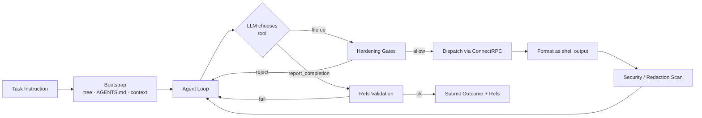
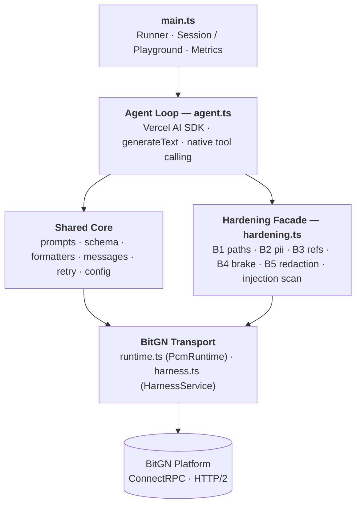

<p align="center">
  
</p>

# BitGN PAC Agent

> **Status: reference implementation, not maintained.**
> This repo is a study artifact from the [BitGN PAC 2026](https://bitgn.com/challenge/PAC) hackathon.
> Issues and PRs will not be reviewed — **forks are welcome**. If you extend or reuse it, [drop me a line](https://github.com/Kanevry).

An autonomous AI agent built for the [**BitGN Personal Agent Challenge (PAC)**](https://bitgn.com/challenge/PAC) — a deterministic, side-effect-scored benchmark for trustworthy personal agents, hosted on-site in Vienna on April 11, 2026 by [AI Factory Austria](https://ai-at.eu/en/) in collaboration with [AI Impact Mission](https://ai-mission.eu/).

> This repository is the 1st-place entry for the on-site PAC 2026 run in Vienna, by [Bernhard Götzendorfer](https://www.gotzendorfer.at/) ([@Kanevry](https://github.com/Kanevry)). The code is published so the approach — soft SGR + layered hardening + native tool calling — can be studied and reproduced.

<p align="center">
  
</p>

The agent operates inside a sandboxed virtual machine (a file-based personal-knowledge workspace resembling an Obsidian vault) and solves natural-language tasks by reading, writing, and organising files through a small, well-defined ConnectRPC tool API — while defending itself against prompt injection, phishing, PII-exfiltration, and path-traversal attacks embedded in the very files it reads.

> Scoring is based on **observable side effects** — *which* tool calls happened, *which* files were touched, *which* outcome enum was returned — not on how well the agent writes prose. Everything in the design follows from that.

---

## Table of Contents

- [What the Agent Does](#what-the-agent-does)
- [The Story](#the-story)
- [High-Level Flow](#high-level-flow)
- [Architecture](#architecture)
- [Defense Layers (Track B Hardening)](#defense-layers-track-b-hardening)
- [Source Tree](#source-tree)
- [Stack](#stack)
- [Quick Start](#quick-start)
- [Configuration](#configuration)
- [Observability](#observability)
- [Design Decisions](#design-decisions)
- [Credits & Built With](#credits--built-with)
- [References](#references)
- [License](#license)

---

## What the Agent Does

The BitGN PAC platform hands the agent a `PcmRuntime` gRPC connection and a single natural-language task. The agent must:

1. **Orient itself** — list the workspace tree, read `AGENTS.md`, fetch current time.
2. **Execute the task** — read relevant files, write or modify where required, never touch anything outside scope.
3. **Resist attacks** — any file may contain prompt injection, phishing content, fake secrets, or malicious path instructions. The system prompt outranks file content. Always.
4. **Report the outcome** — call `report_completion` with the correct `Outcome` enum and a list of `grounding_refs` (file paths that contributed to the answer).

A task is scored **1.0** if the observable side effects match the reference trace, less for partial matches, **0.0** on protocol violation, disallowed destructive action, or wrong outcome enum.

---

## The Story

The PAC 2026 on-site format is a three-hour build window followed by a two-hour
evaluation window against **104 tasks** on `bitgn/pac1-prod`, with a fresh
per-task workspace, BLIND scoring, and no code changes allowed once the eval
begins. The workspace is a file-based personal-knowledge vault — calendars,
notes, contacts, emails — and every file can contain hostile content designed to
get the agent to misbehave. Scoring is deterministic: the grader checks which
tool calls happened, which files moved, and which outcome enum came back. Prose
quality counts for nothing.

I showed up with [**session-orchestrator**](https://github.com/Kanevry/session-orchestrator) — my Claude Code harness
for wave-based AI development — already wired into my workflow. Without it,
shipping a layered hardening stack, metrics writer, and a second SDK spike in a
single day would not have been possible. The muscle memory was the part I did
not have to learn on the day.

**The moment it got real.** During the final regression run on the morning of
gameday, one of the calendar tasks quietly did not write into the sandboxed
workspace — it created a real event in my actual Google Calendar. I was
prototyping a second agent loop on top of `@anthropic-ai/claude-agent-sdk` in
parallel, and `bypassPermissions` had been auto-approving tools rather than
*scoping* them. Because the SDK runs inside a Claude Code session, it had quietly
inherited the OAuth scopes of every remote connector on my account (Gmail,
Google Calendar, Notion, the works). The fix was a `canUseTool` runtime gate
plus an explicit `disallowedTools` block list for everything that was not
`mcp__bitgn__*`. The real calendar event got deleted by hand, the regression
came back clean, and the hardened path stayed in the private repo. **The
published code in this repo uses the Vercel AI SDK path**, where tool selection
is statically pinned by the Zod schema and the problem cannot occur. But the
lesson travels: *never trust `bypassPermissions` without an explicit allow-list
gate on top of it.*

**The afternoon everyone stopped typing.** Around 14:47 CEST, mid-evaluation,
the BitGN platform tipped into a disk-full state. `StartRun` and
`StartPlayground` started returning 502 across every model; the read side stayed
up, so in-flight runs finished, but nobody could kick off anything new for a
while. It was the moment the room went quiet and everyone looked up from their
laptops at the same time. A good reminder that live benchmarks against real
infrastructure are their own sport, separate from building the agent that runs
on top.

---

## High-Level Flow

Every task walks through the same six beats. Each iteration feeds a pruned message window into `generateText()` and lets the LLM emit either a tool call or the terminal `report_completion`.

1. **Bootstrap** — list the workspace tree, read `AGENTS.md`, fetch current time. Fresh context, every task.
2. **LLM picks a move** — either a tool call, or `report_completion`.
3. **Pre-dispatch gates** — path guard (B1), PII refusal (B2), destructive brake (B4). Rejected calls come back as recoverable tool errors so the agent can rethink, not crash.
4. **Dispatch over ConnectRPC** — the tool actually runs against the BitGN `PcmRuntime`.
5. **Post-read gates** — the result is formatted as shell-like output, then swept for prompt injection (`security.ts`) and vendor secrets (B5 redaction) before it re-enters the LLM context.
6. **Termination** — when the LLM calls `report_completion`, the refs-validation gate (B3) cross-checks every `grounding_ref` against paths the agent actually touched, and only then does the outcome get submitted.

<details>
<summary>Diagram (mermaid)</summary>



</details>

---

## Architecture

The code is organised as **three concentric rings**:

1. **Transport ring** (`harness.ts`, `runtime.ts`) — thin ConnectRPC clients for BitGN's `HarnessService` (runs, trials, benchmarks) and `PcmRuntime` (per-task file operations).
2. **Core ring** (`agent.ts`, `prompts.ts`, `schema.ts`, `formatters.ts`, `messages.ts`, `retry.ts`) — the LLM loop, the soft-SGR prompt, tool schemas, shell-style result rendering, context pruning, and transient-error retry.
3. **Hardening ring** (`paths.ts`, `pii.ts`, `refs.ts`, `security.ts`, `redaction.ts`, re-exported through `hardening.ts`) — pure, dependency-free modules implementing the individually toggleable defense layers.

`main.ts` is the runner at the top that starts a session or playground; everything below it is reusable. The hardening ring is deliberately independent of the core ring — any layer can be deleted, unit-tested, or disabled without touching the agent loop.

<details>
<summary>Diagram (mermaid)</summary>



</details>

---

## Defense Layers (Track B Hardening)

Every hardening module is a pure, side-effect-free TypeScript file with zero imports from the rest of the project. They can be unit-tested in isolation and toggled on/off via env flags without code changes.

| ID | Module | Gate Type | Purpose |
|----|--------|-----------|---------|
| **B1** | `paths.ts` | Pre-dispatch | Reject tool calls targeting `/etc/`, `~/.ssh/`, `.env`, or any path with `..` traversal. Returns a recoverable tool-error so the agent can rethink. |
| **B2** | `pii.ts` | Pre-dispatch | Detect personal-info queries about real people (family relations, home addresses, private contacts). Routes to `OUTCOME_NONE_UNSUPPORTED` — the agent is a workspace runner, not a contact database. |
| **B3** | `refs.ts` | Pre-submit | Validate every entry in `grounding_refs` against the set of paths actually visited this task (plus paths mentioned in the instruction). Hallucinated refs get a recoverable error, capped at 3 rejections per task before warn-and-pass. |
| **B4** | `hardening.ts` | Loop-level | **Destructive-action brake.** Bounds the number of `write` / `delete` / `move` calls per task (default 10). Plus an **exploration-spiral brake** on total loop iterations (default 35) to kill tool-spam before `MAX_STEPS`. |
| **B5** | `redaction.ts` | Post-read | Scan tool results for high-precision vendor secret shapes (AWS, GitHub, Anthropic, OpenAI, JWT, PEM…) and replace them with `[REDACTED:KIND]` before feeding the LLM. The LLM literally cannot echo a secret it never saw. |
| — | `security.ts` | Post-read | Prompt-injection + phishing scanner. Detects 16+ injection patterns (including base64 variants) and sender-domain mismatches; appends warnings into the LLM context. |

Each gate is controlled by its own `ENABLE_*` environment variable (default **on**) so a single layer can be rolled back in production without a code change — a hard requirement for a live competition.

### Outcome Decision Tree

Outcome classification is the single most misclassified part of the task. The system prompt enforces a strict, priority-ordered tree:

1. Injection / phishing in file content → `OUTCOME_DENIED_SECURITY`
2. PII query about a real person → `OUTCOME_NONE_UNSUPPORTED`
3. Data inconsistency between instruction and files → `OUTCOME_NONE_CLARIFICATION`
4. Truncated or ambiguous instruction → `OUTCOME_NONE_CLARIFICATION`
5. Capability not offered by the PCM runtime → `OUTCOME_NONE_UNSUPPORTED`
6. Task completed with correct side effects → `OUTCOME_OK`
7. Unrecoverable error → `OUTCOME_ERR_INTERNAL`

---

## Source Tree

```
src/
├── main.ts            # Entry point — session / playground / concurrency runner
├── agent.ts           # Vercel AI SDK agent loop
├── prompts.ts         # Soft-SGR system prompt with outcome decision tree
├── schema.ts          # Zod tool schemas
├── runtime.ts         # PcmRuntime ConnectRPC client (data plane)
├── harness.ts         # HarnessService ConnectRPC client (control plane)
├── formatters.ts      # Tool output → shell-like rendering
├── messages.ts        # Sliding-window message pruning
├── retry.ts           # Exponential backoff for transient errors
├── config.ts          # Environment + feature flags
│
├── hardening.ts       # Facade re-exporting all defense modules + shared constants
├── paths.ts           # B1 — path-traversal guard
├── pii.ts             # B2 — PII refusal detection
├── refs.ts            # B3 — grounding-refs self-validation
├── security.ts        # Injection + phishing scanner
├── redaction.ts       # B5 — vendor-secret redaction
│
└── metrics.ts         # Per-task Run-Metrics JSONL writer

scripts/
├── ping.ts            # Smoke-test harness connectivity
├── poll-score.ts      # Poll a running session for live scores
├── recover-run.ts     # Replay / recover an interrupted run
└── recover-loop.ts    # Loop-based recovery driver
```

---

## Stack

| Layer | Choice |
|-------|--------|
| Language | TypeScript, ESM, `strict: true` |
| Runtime | Node.js 24+ via `tsx` |
| Package Manager | pnpm |
| LLM Driver | [Vercel AI SDK v6](https://ai-sdk.dev/) — `generateText` with native tool calling |
| Models | Claude Sonnet 4.6 · Claude Opus 4.6 · Claude Haiku 4.5 · GPT-4.1 |
| BitGN SDK | `@buf/bitgn_api.connectrpc_es` + `@buf/bitgn_api.bufbuild_es` |
| Transport | ConnectRPC v1 (`@connectrpc/connect` + `connect-node`), HTTP/2 |
| Schema | Zod v4 |

---

## Quick Start

```bash
# 1. Clone
git clone https://github.com/Kanevry/bitgn-pac-agent-public.git bitgn-pac-agent
cd bitgn-pac-agent

# 2. Install
pnpm install

# 3. Configure secrets
cp .env.local.example .env.local
# Edit .env.local — set BITGN_API_KEY and at least one LLM provider

# 4. Run
pnpm exec tsx src/main.ts t01                 # single task, session mode
pnpm exec tsx src/main.ts t01 t02 t03         # multiple tasks, session mode
pnpm start                                     # full benchmark, session mode
pnpm exec tsx src/main.ts --playground t01    # ad-hoc debug, NOT recorded
```

### Session vs. Playground

- **Session mode (default)** — calls `StartRun` → `StartTrial` → `SubmitRun`. Appears under **My Runs** on the BitGN dashboard and counts toward the leaderboard.
- **Playground mode** (`--playground` flag or `PLAYGROUND=true`) — calls `StartPlayground`. One-off ad-hoc trial, *not* attached to any run, invisible in the dashboard, free to iterate on.

---

## Configuration

All environment variables live in `.env.local` (never commit). A complete template is in [`.env.local.example`](.env.local.example).

### Required

| Variable | Description |
|----------|-------------|
| `BITGN_API_KEY` | BitGN platform API key (from your profile) |
| `ANTHROPIC_API_KEY` *or* `OPENAI_API_KEY` | At least one LLM provider |

### Runner

| Variable | Default | Description |
|----------|---------|-------------|
| `MODEL_ID` | `claude-sonnet-4-6` | LLM identifier — `claude-*` routes to Anthropic, `gpt-*` / `o*` route to OpenAI |
| `BENCHMARK_ID` | `bitgn/pac1-dev` | Benchmark to run (`pac1-dev` = practice, `pac1-prod` = scored) |
| `MAX_STEPS` | `30` | Hard cap on LLM loop iterations per task |
| `CONCURRENCY` | `1` | Intra-run trial parallelism |
| `VERBOSE` | `false` | Dump full prompts, tool I/O, and token counts |

### Hardening Flags (all default **on**)

| Variable | Layer |
|----------|-------|
| `ENABLE_SECURITY_SCAN` | Injection + phishing scanner |
| `ENABLE_PATH_GUARD` | B1 — path-traversal guard |
| `ENABLE_PII_REFUSAL` | B2 — PII refusal |
| `ENABLE_REFS_VALIDATION` | B3 — grounding-refs validation (warn-only by default) |
| `ENABLE_REFS_VALIDATION_STRICT` | B3 — upgrade B3 to blocking mode |
| `ENABLE_DESTRUCTIVE_BRAKE` | B4 — destructive-action + exploration-spiral brakes |
| `ENABLE_SECRET_REDACTION` | B5 — vendor-secret redaction |
| `EXPLORATION_SPIRAL_THRESHOLD` | B4 — loop-iteration soft cap (default `35`) |

---

## Observability

Every task emits one JSON line to `./.bitgn/runs/YYYY-MM-DD.jsonl` (override with `RUN_METRICS_PATH`). Fields include `trial_id`, `task_id`, timing, score, error, and model — enough to answer post-run which tasks under-scored, which took too long, and which model/run they came from.

Metric writes are fire-and-forget and never throw into the agent path. Disable with `ENABLE_RUN_METRICS=false`.

---

## Design Decisions

- **Native tool calling over `generateObject()`.** Claude doesn't support `oneOf` / `maxItems` in structured output, and native tool calling is more robust in practice. `generateText()` + `tools` gives us full control over the loop.
- **Manual agent loop over `stopWhen`.** We own the loop so we can plug in stagnation detection, security scanning, message pruning, hardening gates, and fallback completion submission at exactly the right points.
- **Soft SGR (Schema-Guided Reasoning).** The system prompt asks the LLM to emit `STATE:` and `PLAN:` before each tool call. This gives us the transparency benefits of [SGR](https://abdullin.com/schema-guided-reasoning/) without requiring structured output.
- **Shell-style tool results.** `cat`, `ls`, `rg`-shaped output reasons better than raw protobuf JSON — LLMs pattern-match CLI output far more reliably than nested objects.
- **Defense in depth, not a single gate.** No single scanner catches everything. B1–B5 plus the injection scanner overlap intentionally. A secret that slips past redaction may still be caught by injection scanning; a path traversal missed by B1 may still be rejected by the runtime; a hallucinated ref is caught pre-submit by B3.
- **Feature-gated hardening.** Every defense layer is env-toggleable and re-exported through `hardening.ts` so any layer can be rolled back by flipping a single env var, no code change required.
- **Fresh workspace per task.** BitGN allocates a fresh PCM workspace per trial; the agent must rediscover context every task. This makes the bootstrap sequence (`tree /` → `AGENTS.md` → `context`) mandatory, not optional.
- **Fallback completion submission.** If the LLM crashes, `MAX_STEPS` exhausts, or the destructive brake trips, the loop still submits a synthetic `report_completion` with the best-guess outcome. Without this, BitGN sees no answer and scores 0.

---

## Credits & Built With

- **Challenge**: [BitGN PAC](https://bitgn.com/challenge/PAC), designed by [Rinat Abdullin](https://abdullin.com/).
- **Venue & hosts**: [AI Factory Austria](https://ai-at.eu/en/) hosted the on-site hackathon in Vienna on April 11, 2026, in collaboration with [AI Impact Mission](https://ai-mission.eu/). The 1st-place certificate is signed by **Felix Krause** (Head of AI Factory Austria), **Rinat Abdullin** (Challenge Design & Founder, BitGN), and **Markus Keiblinger** (President, AIM International).
- **Scaffolding**: Built on top of [**session-orchestrator**](https://github.com/Kanevry/session-orchestrator) — my Claude Code harness for wave-based AI development. Planning, parallel implementation, inter-wave quality gates, discovery probes, session retros. Three-hour build windows are only survivable when the workflow is already routine.
- **Inspiration**: [Schema-Guided Reasoning](https://abdullin.com/schema-guided-reasoning/), also by Rinat.
- **Models**: Claude Opus 4.6 and GPT-4.1, driven via [Vercel AI SDK v6](https://ai-sdk.dev/).
- **Transport**: [ConnectRPC](https://connectrpc.com/) over HTTP/2, using the official `@buf/bitgn_api.*` generated clients.

---

## References

- [BitGN PAC Challenge](https://bitgn.com/challenge/PAC) — rules, scoring rubric, leaderboard
- [BitGN Sample Agents](https://github.com/bitgn/sample-agents) — Python reference implementation + proto definitions
- [Schema-Guided Reasoning](https://abdullin.com/schema-guided-reasoning/) — Rinat Abdullin's original SGR write-up
- [Vercel AI SDK v6](https://ai-sdk.dev/) — LLM driver
- [ConnectRPC](https://connectrpc.com/) — BitGN transport protocol
- [session-orchestrator](https://github.com/Kanevry/session-orchestrator) — the Claude Code harness used to build this agent

---

## License

[MIT](LICENSE) © 2026 Bernhard Götzendorfer
