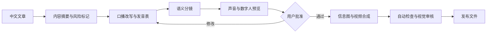

# Kanvis Video

[English](README.en.md) | 中文 | [官网](https://kanvis-chen.github.io/kanvis-homepage/) | [开放生态](https://kanvis-chen.github.io/kanvis-homepage/open/?tab=skill)

[](https://github.com/Kanvis-chen/kanvis-video)
[](LICENSE)
[](https://github.com/Kanvis-chen/kanvis-video/commits)
[](https://github.com/Kanvis-chen/kanvis-video/issues)
[](https://www.typescriptlang.org/)
[](https://react.dev/)
[](https://github.com/hyperframes)
[](https://kanvis-chen.github.io/kanvis-homepage/open/?tab=skill)
[](https://www.localfirstweb.dev/)
[](https://github.com/Kanvis-chen/kanvis-video/commits)
[](https://my.feishu.cn/share/base/shrcnLa2i2JpSeCvYqpPoDDJw7e)

[产品介绍](#它解决什么问题) · [核心能力](#核心能力) · [快速开始](#安装) · [MCP 集成](#mcp-集成) · [路线图](#路线图) · [Star 趋势](#star-趋势) · [参与贡献](#贡献)


> 从一篇文章到可导演的视频工程，Agent、分镜、字幕、信息图、数字人与发布门禁在同一流水线中协作。

> 文章不是拿来逐字朗读的，而是拿来重新导演的。

Kanvis Video 是 Kanvis System 中开源的视频制作能力层：用 Codex Skill 把长文、课程稿和知识库内容变成可导演、可检查、可发布的视频项目，再交给 Kanvis Studio 本地检查和编辑。

当前内置的首个 workflow 是 `kanvis-article-to-video`：从原文保真、口播改写和语义分镜，到真人增强、无人出镜、数字分身、信息图、字幕、多语种配音路径、音频、渲染与发布门禁。

当前版本：`v0.3.0`

## 名称与边界

| 名称 | 职责 |
|---|---|
| **Kanvis System** | 总品牌，连接 Skill、Content OS、Studio 与后续经营系统 |
| **Kanvis Content OS** | Obsidian 内容管理与内容资产系统，不是本仓库 |
| **Kanvis Video** | 本开源仓库：视频 Skill、项目协议、质检与 Studio 交接 |
| **Kanvis Article to Video** | 当前首个 Skill，调用名 `$kanvis-article-to-video` |
| **Kanvis Studio** | 本地视频工作台，负责画布、时间轴、检查、微调、渲染与后续工程导出。独立仓库：[Kanvis-chen/kanvis-studio](https://github.com/Kanvis-chen/kanvis-studio) |

> 完整介绍见 [Kanvis 官网](https://kanvis-chen.github.io/kanvis-homepage/)。

`Kanvis Cut` 不再作为产品名。它容易被理解成单纯裁剪工具，而 Studio 实际覆盖完整的视频项目工作区。

## 它解决什么问题

普通数字人工具通常从“已有脚本”开始，最终输出一段人物口播。Kanvis Video 从文章开始，先判断讲什么、怎么讲、什么时候应该让数字人退到画面一角，再把内容编排成可检查、可恢复、可替换供应商的视频项目。

它不是另一个 talking-head generator，而是一条内容视频生产流水线。

| 能力 | 普通数字人生成 | Kanvis Video |
|---|---|---|
| 输入 | 已完成脚本 | 中文长文、公众号文章、Markdown |
| 内容处理 | 直接朗读 | 原文保真、口语改写、发音表、风险标记 |
| 视觉设计 | 人物全屏为主 | 比较、流程、数字、证据、引语、信息图、人物 PIP |
| 供应商 | 固定平台 | 可替换 voice/avatar adapter，可使用本地 CosyVoice |
| 质量控制 | 人工观看 | 分镜校验、媒体探测、授权检查、人工视觉门禁 |

<details>
<summary>架构总览（点击展开）</summary>


</details>

## 核心能力

| 领域 | 已实现能力 |
|---|---|
| 内容处理 | 长文保真、口播改写、发音表、风险标记 |
| 视觉导演 | 语义分镜、信息图、证据、流程、对比、引语、人物 PIP |
| 生产模式 | 真人增强、无人出镜、数字分身 |
| 供应商 | HeyGen / ElevenLabs / MiniMax / 本地 CosyVoice，可替换适配器 |
| 质量控制 | 分镜校验、媒体探测、授权检查、人工视觉门禁 |
| 付费策略 | `off` / `confirm` / `auto` 三种策略 + 成本上限 + 任务缓存 |
| 工作台 | 可视化画布、多轨时间轴、属性面板、实时预览、本地渲染 |
| 导出 | MP4 + 项目协议（FCPXML 导出在路线图） |
| Agent | Codex Skill 调用、Kanvis Studio 本地工作台 |
| 安全 | 密钥仅环境变量、授权素材、医疗法律金融内容事实核验 |

## 与数字人口播 Skill 的区别

Kanvis Video 不以“生成一个数字人视频”为中心，而以“把一篇中文长文重新导演成可发布视频”为中心。

| 维度 | 数字人口播 Skill | Kanvis Video |
|---|---|---|
| 起点 | 已经写好的脚本、肖像和声音 | 中文长文、公众号文章、Markdown |
| 核心问题 | 如何安全调用声音和数字人供应商 | 如何把文章改写、分镜、视觉化并通过发布质检 |
| 画面策略 | talking-head 为主 | 信息图、证据、流程、对比和人物 PIP 轮换 |
| 成功标准 | 生成授权数字人口播成片 | 内容保真、画面有信息密度、成本受控、可发布 |
| 贡献重点 | provider API、素材预检、任务状态 | 文章改写规则、语义分镜、视觉语法、平台质检 |

如果你已经有一个完整脚本，只想做授权数字人口播，这不是最短路径。
如果你有大量文章、课程稿或知识库内容，想把它们变成有画面结构的视频，这正是本项目的范围。

维护者可参考 [docs/positioning-vs-talking-head-skills.md](docs/positioning-vs-talking-head-skills.md)，确保公开传播始终围绕 directed content-to-video pipeline，而不是某个供应商组合或数字人口播复刻。

## 工作流



## 三种生产模式

三种模式共用同一套内容、字幕、特效、封面、质检和导出流程，只切换出镜主体：

| 模式 | `presenter_mode` | 用途 |
|---|---|---|
| 真人增强 | `human` | 保留真人表演，增加字幕、信息图和特效 |
| 无人出镜 | `none` | 使用配音、文字、图表、截图和素材完成视频 |
| 数字分身 | `avatar` | 使用授权数字人，或真人表演驱动的 AI 换声/换嘴型 |

数字分身中的 `performance_lipsync` 必须说明真人表演来源，不能描述成完全由 AI 生成。详见 [docs/production-modes.md](docs/production-modes.md)。

可直接查看三种模式的配置：

- [真人增强](examples/modes/human-enhancement.config.json)
- [无人出镜](examples/modes/faceless-visual.config.json)
- [真人表演驱动数字分身](examples/modes/avatar-lipsync.config.json)

项目默认可在没有 MiniMax/HeyGen 付费额度时运行。硬件不足会退到 Mock 项目生成，不会暗中调用付费 API。详见 [docs/local-runtime.md](docs/local-runtime.md)。

## 亮点

- **Article-native**：保存原文，区分原始事实与推导，不把文章机械地逐段朗读。
- **语义驱动画面**：根据比较、流程、层级、数字、证据和引语选择视觉结构。
- **数字人不是永远的主画面**：证据和信息需要空间时，数字人自动退为 PIP 或暂时离场。
- **供应商可替换**：HeyGen、ElevenLabs、MiniMax 和本地 CosyVoice 都通过适配器契约接入。
- **付费动作可控**：支持 `off`、`confirm`、`auto` 三种付费策略、成本上限和任务缓存。
- **发布门禁可执行**：脚本会检查分辨率、FPS、时长、音轨、授权状态和人工视觉审核结果。

## 当前范围

这是一个 **Codex 编排 Skill**，不是托管服务，也不捆绑 HeyGen、MiniMax 或其他平台的 SDK、账号与额度。

仓库提供：

- 完整生产工作流与决策规则；
- 可移植的配置和分镜契约；
- 项目初始化、前置检查、分镜验证和成片质检脚本；
- 本地 CosyVoice 3.0 接入说明；
- 不包含真人素材的完整示例；
- 自动测试和 GitHub Actions。

具体的声音、数字人和渲染动作由当前 Codex 环境中已安装的 provider adapter 与 HyperFrames 工具完成。

## Kanvis Studio 本地工作台

Kanvis Studio 同时作为独立开源项目维护：[**Kanvis-chen/kanvis-studio**](https://github.com/Kanvis-chen/kanvis-studio)。如果你只想使用本地视频编辑器（不需要完整的文章到视频 Skill 流水线），可以直接安装独立版；独立版还为 Obsidian 插件嵌入做了准备。

本仓库内置的 workbench 是 Kanvis Studio 的基础版，方便用户检查和微调 Agent 生成的视频项目，而不是只开放项目协议或展示截图。

基础工作台提供：

- 可选择、拖动和缩放图层的可视化画布；
- **剪映对齐时间轴**：常驻多轨时间轴、拖拽、裁剪、磁吸吸附、框选多选、波纹删除、J/K/L 播放快捷键；
- AI 辅助字幕编辑：字幕时间轴、样式预设、逐字高亮；
- 文本、位置、尺寸、透明度、时长和特效参数调整；
- 实时特效预览与成片播放；
- 撤销与重做；
- 本地项目存储、预览服务和渲染任务；
- HyperFrames、Codex 和 MCP 接入。

<details>
<summary>图层模型示意（点击展开）</summary>


</details>

源码位于 [`workbench/`](workbench/)，使用 MIT 许可证。它的定位是“基础检查与微调台”，不是完整商业生产后台；客户项目管理、批量队列、账号与供应商运营、私有模板库、团队 SOP、商业导出适配和客户交付系统不在本仓库范围内。参见 [Jianying / CapCut Export Strategy](docs/jianying-capcut-export.md) 了解项目导出方向。

### 两种打开模式

1. **成片自动接力**：`$kanvis-article-to-video` 完成渲染和质量检查后，把 `output/video.mp4` 登记为项目产物，自动启动 Kanvis Studio 并载入当前项目。
2. **独立打开**：调用 `$kanvis-studio` 打开最近项目或指定项目目录；也可以直接运行下面的命令。

```bash
npm run studio:open -- --project ./demo-project --video ./demo-project/output/video.mp4
```

如果项目已经包含 `visualhyper.artifact.json`，Studio 会保留可编辑图层和参数；如果只有 MP4，则以扁平视频导入，能够播放、检查和继续添加内容，但不能恢复已经合成掉的原始图层。

## 安装

要求：

- Codex 或兼容的 Skill 运行环境；
- Node.js 20 或更高版本；
- `ffmpeg` 和 `ffprobe`，用于媒体检查；
- 需要渲染时安装 HyperFrames；
- 使用云端供应商时，自备账号、密钥、额度和素材授权。

将仓库放入 Codex skills 目录：

```bash
git clone https://github.com/Kanvis-chen/kanvis-video ~/.codex/skills/kanvis-video
```

启动新的 Codex 任务并显式调用：

```text
Use $kanvis-article-to-video from Kanvis Video to turn this Chinese article into a visually directed video project, then open the result in Kanvis Studio.
Show me the script, scene plan, provider cost, and preview before paid full-length generation.
```

默认禁用隐式触发，避免文章处理意外进入付费数字人生成。

## 快速体验

仓库附带一个完全离线、无真人素材的结构化示例：

```bash
npm test
npm run check
```

也可以手动运行：

```bash
node scripts/preflight.mjs \
  --article examples/knowledge-video/article.md \
  --config examples/knowledge-video/kanvis-video.config.json

node scripts/detect-runtime.mjs \
  --config examples/knowledge-video/kanvis-video.config.json

node scripts/init-project.mjs \
  --article examples/knowledge-video/article.md \
  --config examples/knowledge-video/kanvis-video.config.json \
  --out ./demo-project

node scripts/validate-scene-plan.mjs \
  examples/knowledge-video/scene-plan.json
```

增加 `--paid` 可以检查项目是否已经满足付费生成所需的授权、资产 ID 和策略要求：

```bash
node scripts/preflight.mjs --article article.md --config kanvis-video.config.json --paid
```

## MCP 集成

Kanvis Video 当前以 Codex Skill 形式被调用，未来会暴露 Streamable HTTP MCP 端点，让任意 MCP 客户端都能驱动同一条文章到视频的流水线。

### 在 Codex 中调用文章到视频 Skill

```text
Use $kanvis-article-to-video from Kanvis Video to turn this Chinese article into a visually directed video project, then open the result in Kanvis Studio.
```

Skill 默认禁用隐式触发：文章处理不会自动进入付费数字人生成或云端渲染，必须由用户显式批准。这避免了“读一篇文章意外消耗 HeyGen/MiniMax 额度”的情况。

### 在 Codex 中打开 Kanvis Studio

```text
Use $kanvis-studio to open the most recent Kanvis Video project.
```

也可以指定项目目录：

```text
Use $kanvis-studio to open the project at ./demo-project.
```

### MCP 路线图

- [x] Codex Skill 调用与本地工作台自动接力
- [ ] Streamable HTTP MCP 端点（`kanvis_article_to_video`、`kanvis_studio_open`）
- [ ] MCP 客户端的付费策略与成本上限透传

## 项目产物

一次完整任务建议保留以下中间产物：

```text
project/
├── input/source.md
├── kanvis-video.config.json
├── project.json
├── work/
│   ├── content-brief.json
│   ├── voiceover.md
│   ├── pronunciations.json
│   ├── scene-plan.json
│   └── provider-jobs.json
└── output/
    ├── video.mp4
    ├── cover.jpg
    ├── title-and-description.md
    └── quality-report.json
```

这些中间文件让任务可以从失败阶段恢复，也让脚本、事实来源、远程任务 ID、成本和发布状态可追踪。

仓库也提供一个更通用的剪辑项目协议示例：

- [assets/kanvis-video-project.schema.json](assets/kanvis-video-project.schema.json)
- [examples/knowledge-video/kanvis-video-project.json](examples/knowledge-video/kanvis-video-project.json)

## 成片质检

```bash
node scripts/quality-check.mjs \
  --video output/video.mp4 \
  --config kanvis-video.config.json \
  --report output/quality-report.json \
  --visual-review passed
```

只有自动检查没有阻断项，并且人工视觉审核为 `passed` 时，报告中的 `publish_ready` 才会变成 `true`。

## 安全边界

- 只处理用户拥有或明确获授权的文章、声音、肖像和品牌素材。
- 密钥只能来自环境变量，不得写入仓库、状态文件或日志。
- 不提交真实声音样本、私人肖像、客户视频、临时下载链接或本地路径。
- 新声音或新数字人先生成 10-15 秒预览，再决定是否生成完整视频。
- 对医疗、法律、金融、政治和时效性内容进行事实核验。
- 遵守目标平台对 AI 合成内容的披露要求。

参见 [SECURITY.md](SECURITY.md) 和 [references/acceptance-criteria.md](references/acceptance-criteria.md)。

## 常见问题

### Kanvis Video 是免费的吗？

MIT 开源，免费使用。云端供应商（HeyGen、ElevenLabs、MiniMax 等）的费用由你直接向供应商支付，本仓库不捆绑任何平台账号或额度。

### 我需要哪些前置条件？

- Codex 或兼容的 Skill 运行环境；
- Node.js 20 或更高版本；
- `ffmpeg` 和 `ffprobe`；
- 需要渲染时安装 HyperFrames；
- 使用云端供应商时自备账号、密钥、额度和素材授权。

### 它和直接用 HeyGen / MiniMax 有什么区别？

HeyGen、MiniMax 等平台是 talking-head generator：从已有脚本生成人物口播。Kanvis Video 是一条内容视频生产流水线：从文章开始，做原文保真、口播改写、语义分镜、信息图、字幕、多语种配音、发布质检，最后才调用这些平台完成声音和数字人环节。供应商只是流水线中可替换的一环。

### 我可以用自己的声音和肖像吗？

可以，但只处理你拥有或已获得明确授权的素材。数字分身模式中的 `performance_lipsync` 必须说明真人表演来源，不能描述成完全由 AI 生成。新声音或新数字人会先生成 10-15 秒预览，再决定是否生成完整视频。

### 项目数据保存在哪里？

全部保存在本地工程目录中。密钥只能来自环境变量，不进入仓库、状态文件或日志。仓库不收集任何用户数据，也不向 Kanvis 上传项目内容。

### 我可以贡献 provider adapter 吗？

欢迎。阅读 [CONTRIBUTING.md](CONTRIBUTING.md) 了解适配器契约、测试要求和提交规范。新的 provider adapter 需要覆盖预览、全量生成、任务状态查询和成本回传四个能力。

更多问题见 [docs/faq.md](docs/faq.md)。

## 路线图

- [x] 文章初始化、配置前检、分镜验证和媒体质检
- [x] 隐私安全的发布质检报告示例：`examples/knowledge-video/quality-report.example.json`
- [x] 可替换 provider 契约与本地 CosyVoice 指南
- [x] 无隐私的端到端结构示例和自动测试
- [x] Kanvis Studio 常驻时间轴 + 剪映对齐体验（磁吸吸附、框选多选、波纹删除、J/K/L）
- [x] AI 辅助字幕编辑与样式预设
- [x] Kanvis Studio 独立仓库拆分（[kanvis-studio](https://github.com/Kanvis-chen/kanvis-studio)）
- [ ] 官方 HeyGen/MiniMax provider adapter 实现
- [ ] 可复现的公开演示视频与基准成本报告
- [ ] 更多平台预设、字幕样式和中文发音词典
- [ ] 拆出 `cover-director`、`subtitle-director`、`effect-director` 的稳定示例
- [ ] 生成稳定的剪映/CapCut 导入资产包
- [ ] Obsidian 插件（基于 kanvis-studio 独立仓库）

## Star 趋势

[](https://www.star-history.com/#Kanvis-chen/kanvis-video&Date)

## 贡献

```bash
npm test
npm run check
```

贡献新的 provider adapter、视觉语法、平台预设或质量检查前，请阅读 [CONTRIBUTING.md](CONTRIBUTING.md)。

需要帮助时，请先看 [SUPPORT.md](SUPPORT.md)。版本变化见 [CHANGELOG.md](CHANGELOG.md)。

后续路线图见 [docs/roadmap.md](docs/roadmap.md)。
常见问题见 [docs/faq.md](docs/faq.md)。

加入飞书内测群，获取更新通知、使用经验和贡献机会：

[](https://my.feishu.cn/share/base/shrcnLa2i2JpSeCvYqpPoDDJw7e)

### 支持作者与答疑

如果 Kanvis 对你有帮助，欢迎付费支持。付费支持默认包含答疑群服务，付费后可进群交流，并获得作者答疑。

可扫码或打开 [答疑群说明](https://mp.weixin.qq.com/s/TmEo0UmFubuD-7Ugiwi82Q) 了解详情。

[](https://mp.weixin.qq.com/s/TmEo0UmFubuD-7Ugiwi82Q)

## 了解更多

- [Kanvis 官网](https://kanvis-chen.github.io/kanvis-homepage/) — 系统介绍、课程与服务
- [开放 Skill 生态](https://kanvis-chen.github.io/kanvis-homepage/open/?tab=skill) — 官方与社区 Skill 目录
- [Kanvis Studio 工作台](https://kanvis-chen.github.io/kanvis-homepage/open/?tab=workbench) — 本地视频编辑与渲染工具

## Brand Usage Policy

The "Kanvis" name, "Kanvis Video", "Kanvis Studio" and the Kanvis logo are trademarks of Kanvis Chen. You may not use them in your own products or services without explicit written permission.

### Permitted Uses
- Referencing Kanvis Video in documentation, articles, or educational content
- Using Kanvis Video as a dependency in your own projects
- Forking and modifying the code for personal or commercial use, as long as the fork is not marketed as "Kanvis"

### Prohibited Uses
- Using the "Kanvis" name or logo in your own product name, domain, or branding
- Creating derivative products or services that could be confused with official Kanvis products
- Using Kanvis trademarks in advertising, marketing, or course material without permission
- Removing or obscuring copyright notices or attribution from the source code

### Attribution Requirement
All copies, forks, or distributions of this software must retain the copyright notice and license header in the source files. See [LICENSE](LICENSE) for the full MIT license text.

## License

[MIT](LICENSE)
