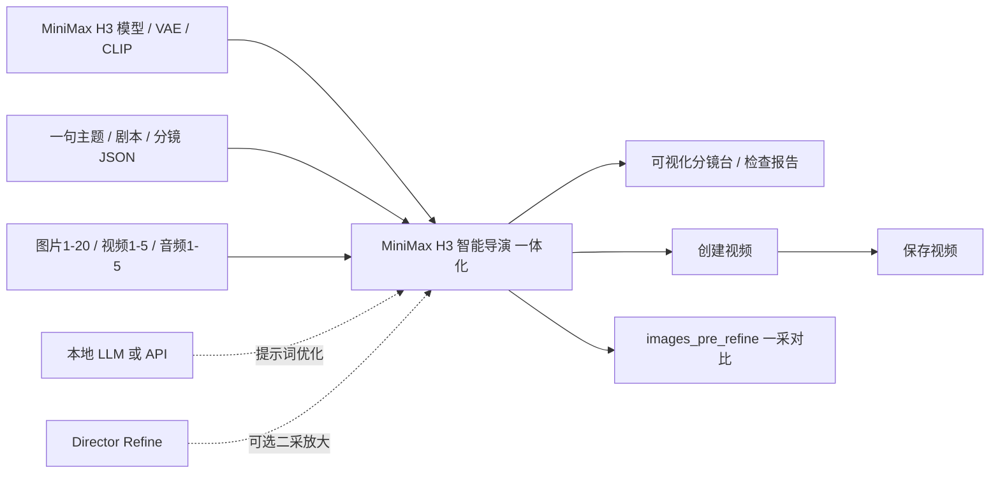

# ComfyUI MiniMax H3 Smart Director

[](https://github.com/comfyanonymous/ComfyUI)
[](https://github.com/AIMixer/ComfyUI_MiniMaxH3_Director)
[](LICENSE)

把主题、普通剧本文本或结构化分镜 JSON、图片、视频、音频参考和采样参数集中到一个中文节点里。

主节点是 `MiniMax H3 智能导演 一体化`：它会自动编译分镜、判断 `t2v/i2v/fl2v/r2v`、生成
`MMX_DIR_GROUP`，并在节点内部调用 AIMixer `MiniMaxH3Director` 执行，直接输出视频帧、音频和运行报告。
保留的 `MiniMax H3 智能导演` 节点只输出 `MMX_DIR_GROUP`，适合高级调试或继续手动接 AIMixer Director。

## 主要功能

- 自动判断 `t2v/i2v/fl2v/r2v`，自动补参考媒体标签和首尾帧锁定提示。
- 输出原生 `MMX_DIR_GROUP`，可直接交给 `MiniMaxH3Director` 的外部 group 输入执行。
- 中文剧本友好：可以直接粘贴多段文本，也可以填结构化 JSON 分镜。
- 中文素材入口：界面显示为 `图片1` 到 `图片20`、`视频1` 到 `视频5`、`音频1` 到 `音频5`。
- 多镜头友好：每个镜头独立时长、景别、运镜、声音、转场和连续性。
- i2v 长视频接力：可按 5/10/15 秒自动拆段，首段使用输入首帧，后续段由 Director Motion Context 承接上一段尾部并自动拼接。
- 检查报告：提示素材缺失、引用标签越界、选镜范围错误、总时长和 H3 对齐帧数。
- 一体化执行：主节点自己接 `model / video_vae / audio_vae / clip` 和采样参数，内部调用 AIMixer Director，不需要再摆一个 Director 节点。
- 可选二采/放大：把原版 `MiniMax H3 Director Refine` 的 `refine` 输出接到一体化节点的 `二采放大`；不接时仍为单次采样，接入后支持同分辨率精修、放大后二采和 H3 latent 放大，并可用 `images_pre_refine` 对比一采结果。
- 提示词优化：生成前可选择 `关闭 / 本地LLM / API`，自动优化中文分镜、H3 提示词、镜头运动、声音和负面约束。
- 智能创作方式：默认选择 `auto 根据生成模式`；R2V 自动使用 `R2V参考素材引导`，i2v/fl2v 有图片时自动使用 `忠于图片轻动作`，纯文本或已有剧本使用 `优化现有分镜`。也可手动选择 `一句话创作故事` 或 `按总时长自动分镜`。

## 工作流展示



### 可直接拖入 ComfyUI

| 工作流 | 模型系列 | 用途 |
| --- | --- | --- |
| [一体化 t2v / i2v / fl2v](example_workflows/MiniMax_H3_智能导演一体化_t2v_i2v_fl2v.json) | FL2VA | 文生视频、单图生视频、首尾帧生视频、长视频接力 |
| [一体化 r2v](example_workflows/MiniMax_H3_智能导演一体化_r2v.json) | REF2VA | 多图片、参考视频、参考音频的主体一致性生成 |
| [手动 Director t2v / i2v / fl2v](example_workflows/MiniMax_H3_智能导演_t2v_i2v_fl2v_已连接.json) | FL2VA | Smart 规划节点与 AIMixer Director 分开，便于高级调试 |
| [手动 Director r2v](example_workflows/MiniMax_H3_智能导演_r2v_已连接.json) | REF2VA | 手动检查 `r2v_groups`、时间线和参考标签 |

一体化工作流已经连接模型加载、VAE、CLIP、视频创建与保存节点。拖入后只需要检查本机模型文件名，并连接自己的图片、视频或音频素材。

## 安装

在 `ComfyUI/custom_nodes` 目录克隆：

```bash
git clone https://github.com/Kiwi-shijie/ComfyUI_MiniMaxH3_Smart_Director.git
```

把本目录放到：

```text
ComfyUI/custom_nodes/ComfyUI_MiniMaxH3_Smart_Director
```

并确认已经安装：

```text
ComfyUI/custom_nodes/ComfyUI_MiniMaxH3_Director
```

依赖项目：[AIMixer/ComfyUI_MiniMaxH3_Director](https://github.com/AIMixer/ComfyUI_MiniMaxH3_Director)。本地 LLM 优化为可选功能，使用时再安装 `ComfyUI-llama_Reversal`。

重启 ComfyUI，搜索：

```text
MiniMax H3 Smart Director
```

## 接线

也可以直接拖入已连接示例工作流：

- `example_workflows/MiniMax_H3_智能导演一体化_t2v_i2v_fl2v.json`
- `example_workflows/MiniMax_H3_智能导演一体化_r2v.json`
- `example_workflows/MiniMax_H3_智能导演_t2v_i2v_fl2v_已连接.json`
- `example_workflows/MiniMax_H3_智能导演_r2v_已连接.json`

优先使用带“一体化”的两个工作流；另外两个是保留的手动 Director 接线版本。

文生、图生、首尾帧：

```text
MiniMax H3 Smart Director.导演组
    -> MiniMaxH3Director.i2v_groups
```

参考主体/参考视频/参考音频：

```text
MiniMax H3 Smart Director.导演组
    -> MiniMaxH3Director.r2v_groups
```

`检查报告` 会告诉你该接到哪个输入。AIMixer `MiniMaxH3Director.task_type` 要和报告中的模式一致。

## 中文素材口规则

- `auto 智能判断`：没有素材就是 t2v；只接 `图片1` 是 i2v；接 `图片1 + 图片2` 是 fl2v；接视频或音频时进入 r2v。
- `i2v 图生视频`：`图片1` 是首帧。
- `fl2v 首尾帧`：`图片1` 是首帧，`图片2` 是尾帧。
- `r2v 参考主体/音画参考`：`图片1` 到 `图片20` 对应 `<Picture 1>` 到 `<Picture 20>`，`视频1` 到 `视频5` 对应 `<Video 1>` 到 `<Video 5>`，`音频1` 到 `音频5` 对应 `<Audio 1>` 到 `<Audio 5>`。

`视频1`到`视频5`可直接连接 ComfyUI 新版“加载视频”的 `VIDEO` 输出，节点会自动提取画面帧，并把视频自带音轨作为同编号配套音频传给 r2v。旧视频加载器输出的 `IMAGE` 帧批次也继续兼容。

## 全模式长视频分段接力

`长视频分段` 提供：

- `自动（超过15秒按10秒）`：15 秒及以下保持单段；超过 15 秒按最长 10 秒拆分。
- `每段5秒` / `每段10秒` / `每段15秒`：按指定上限拆分，例如 30 秒分别生成 6、3、2 段。
- `关闭（单段生成）`：保持原始单段生成。

开启 `镜头连续` 和 `尾帧接续` 后，后续段通过 AIMixer Director 的 Motion Context 接入上一段尾部视频和音频潜变量，裁掉衔接重复帧后自动合成为一个视频。四种模式均可使用：

- `t2v`：第一段和后续段都是文本生成，后续段接入上一段尾部。
- `i2v`：第一段使用 `图片1`，后续段使用上一段尾部；仍加载 `minimax_h3_fl2va...`。
- `fl2v`：第一段锁定 `图片1`，中间段接力，最后一段锁定 `图片2`；仍加载 `minimax_h3_fl2va...`。
- `r2v`：每一段保留图片身份参考，视频/音频按整片时间轴切片，同时承接上一段尾部；加载 `minimax_h3_ref2va...`。

R2V 长视频采用时间轴防循环策略：

- 参考图片作为身份/服装/场景锚点，可持续用于所有分段。
- 参考视频和参考音频按整片时间位置切片，不会在每个 5/10/15 秒分段从第 0 秒重新播放。
- 动态参考比目标片短时，后续段使用参考视频尾帧作为静态身份锚点，并继续承接上一段 Motion Context；不会循环动作。
- 多张图片属于并列参考，不等于按图片顺序播放的关键帧。单人物建议使用 1-2 张稳定参考图；有序图片分镜应拆成首尾帧接力镜头。
- 若模型生成音轨完全为 0，节点会使用按时间轴切片的参考音频兜底，素材用完后补静音而不循环。R2V 建议使用 20-25 采样步数，过低步数容易造成动作僵硬和静音。

## 提示词优化

`提示词优化` 有三种模式：

- `关闭`：不调用任何 LLM，直接用本地规则编译。
- `本地LLM`：调用 `ComfyUI-llama_Reversal` 的 `ReversalMultimodalChat`，使用 `ComfyUI/models/LLM` 下的 GGUF 主模型和 mmproj 视觉模型。
- `API`：调用 OpenAI-compatible `/chat/completions` 接口。默认地址是 `https://api.openai.com/v1/chat/completions`，也可以填本地网关或第三方兼容地址。

本地 LLM 模式里 `LLM推理后自动卸载` 默认开启。建议保持开启，这样优化完提示词后会立刻释放本地 LLM 占用的内存/显存，给后面的 MiniMax H3 视频生成留空间。只有在连续多次优化、暂时不生成视频时，才建议关闭它来节省重复加载时间。

API 密钥可以填在 `API密钥`，也可以留空并使用环境变量：

```text
MINIMAX_H3_SMART_API_KEY
OPENAI_API_KEY
```

优化会要求 LLM 返回严格 JSON。`R2V参考素材引导`、`优化现有分镜`和`忠于图片轻动作`会保留原镜头数量、`id` 与时长；`一句话创作故事`和`按总时长自动分镜`都会把“默认时长”作为整片目标总时长，并由节点在 LLM 返回后再次校准，保证所有镜头时长之和严格等于目标值。例如填写 20 秒时，最终整片就是 20 秒，不会按每镜 20 秒累加。

空主题时可保持 `auto 根据生成模式`：R2V 会创建一个不新增人物和无关剧情的参考素材计划。手动选择 `一句话创作故事` 时必须输入一句主题；没有主题且只希望图片稳定动起来，应选择 `忠于图片轻动作`。

R2V 的参考视频是完整视觉条件，并不是纯动作骨架。图片和视频同时连接时，Smart Director 会在提示词中把图片设为身份、服装和场景最高优先级，把视频限制为动作与镜头节奏参考，但底层 REF2VA 仍可能看到并混入视频演员。若两份素材不是同一人物、同一服装和相近场景，建议断开 `视频1`，只保留 `图片1 + 音频1`；或者换用主体一致的参考视频。R2V 低于 12 采样步数会在执行前停止，建议使用 20-25 步。

时长约束对本地 LLM 和 API 完全一致，并且优先级高于故事扩写：节点会在请求中发送整片目标时长和镜头时长序列，明确禁止模型自行延长；LLM 返回后还会由本地编译器再次校准。检查报告会显示最终执行的总时长。

## 输入格式

可以直接写普通文本，每段一个镜头：

```text
[5s] 雨夜车站：女主从站台灯下抬头，听见远处电车声。

[4s] 特写：她握紧一枚旧车票，雨水顺着指尖滴落。

[6s] 远景：电车进站，灯光扫过空旷站台。
```

也可以写结构化 JSON：

```json
{
  "project": {
    "title": "雨夜车站",
    "logline": "一个人等待一班也许不会到来的电车。",
    "style": "冷蓝电影光，湿润反光，低饱和"
  },
  "shots": [
    {
      "title": "开场",
      "scene": "雨夜站台",
      "duration": 5,
      "shot_size": "中景",
      "camera": "缓慢推进",
      "action": "女主站在灯下抬头看向轨道尽头",
      "sound": "雨声，远处电车低频轰鸣",
      "transition": "直接切换"
    }
  ]
}
```

界面里：

- `主题 / 剧本 / 分镜JSON`：写一句主题、普通剧本，或完整 JSON 分镜。
- `全局画面风格`：只写画面气质、镜头风格、清晰度和一致性要求。

## 测试

在插件目录执行：

```text
python -m unittest discover -s tests -v
```

## 致谢

感谢以下开源项目提供的思路、接口和实现参考：

- [goohai/Goohai-MiniMax-H3_Integration](https://github.com/goohai/Goohai-MiniMax-H3_Integration)
- [AIMixer/ComfyUI_MiniMaxH3_Director](https://github.com/AIMixer/ComfyUI_MiniMaxH3_Director)
