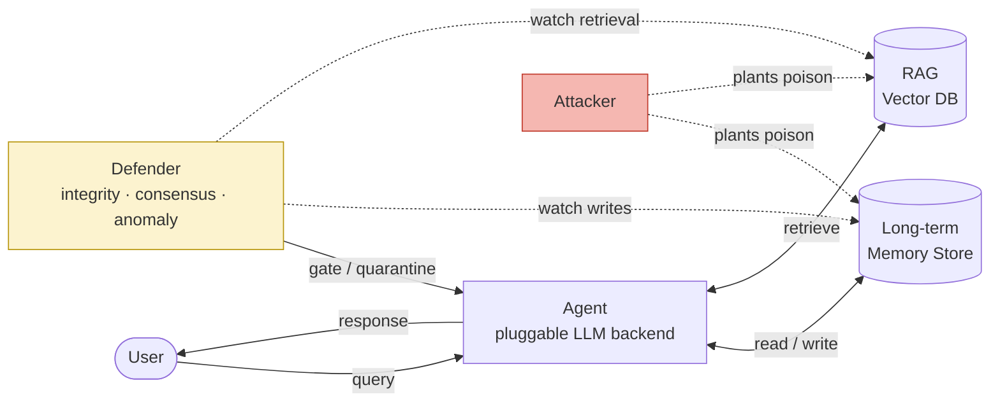

# PoisonRecall

**Attack taxonomy, toolkit & defenses for persistent-memory poisoning of LLM agents.**

> Plant benign-looking content in an agent's long-term memory *now*; hijack its
> behavior in a *later* session, after the triggering context is gone.

Author: **Krishita Sanjay Choksi** · License: MIT · Status: research / defensive use only

---

## Why this project

Most data-poisoning research targets **training time**. This project targets a
newer, under-explored surface: the **persistent memory** of LLM agents — the
long-term memory stores and RAG vector databases that carry state *across
sessions*.

The threat is different in kind. Memory is written and read at **operation
time**, continuously, often from partially untrusted channels (tool outputs,
ingested documents, prior conversations). An attacker who can place one
benign-looking entry can arrange for it to **lie dormant and activate later** —
long after the context that would have made it suspicious has scrolled away.

This repo builds **both sides** as an **attacker-vs-defender arms race**: a
modular target agent, an **eight-attack taxonomy** (including *adaptive* attacks
that each defeat a specific defense, plus an *erasure* adversary that deletes
rather than injects), **six composable defenses** — from source-trust gating up
to a **provable certified-robustness** layer and a **tamper-evident audit log** —
real + synthetic data pipelines, and a fully reproducible evaluation that
regenerates every figure and table below from a clean clone with **no API key
required**.

Two headline findings:

1. **No conventional single control is sufficient.** Label-only provenance is
   defeated by *trust forgery*; source-quorum consensus by a *Sybil*; and a
   *detector-aware adaptive evader* — a directive-free, paraphrased campaign —
   walks past provenance, integrity, consensus **and** the anomaly detector alike.
2. **Certification closes the gap with a guarantee.** A certified-robustness
   defense that lets only *verified-trusted, de-duplicated* sources vote (and
   *abstains* otherwise) drives **every** attack's success rate to **0** and
   emits, per decision, a provable robustness radius — robust to *unbounded*
   untrusted poison. Erasure, a different threat entirely, is caught by the
   hash-chained audit log that per-item signing cannot see.

---

## System architecture



A rendered version is in [`figures/architecture.png`](figures/architecture.png)
(regenerated by code). Every memory **write** and **read** is instrumented, so
attacks and defenses observe the exact same seam.


---

## Attack taxonomy

| Attack | Mechanism | Trigger | Persistence | Property violated |
|---|---|---|---|---|
| **Dormant trigger injection** | Instruction gated on a future keyword | A later query contains the trigger word | Persistent, inert until fired | Integrity · delayed activation |
| **Slow-drift poisoning** | Many small preference nudges accumulate | Cumulative weight passes the baseline | Builds over many writes | Integrity |
| **Retrieval hijack** | Entry engineered for term overlap wins the context slot | Query overlaps the planted terms | Persistent corpus doc | Integrity · retrieval integrity |
| **Cross-session persistence** | Persistent write survives "new chat" resets | Re-surfaces after N resets, then trigger | Survives session resets | Integrity · persistence bound |
| **Instruction smuggling** | Untrusted memory phrased as a privileged policy | A privileged (e.g. transfer) request | Persistent policy note | Integrity · authority separation |
| **Trust forgery** *(adaptive)* | Directive stamped with a forged *trusted* label | Any query on the target topic — no trigger | Persistent, immediate | Authenticity · provenance forgery |
| **Sybil corroboration** *(adaptive)* | Same directive planted across *k* fake sources | k distinct sources manufacture a quorum | Persistent, immediate | Integrity · manufactured corroboration |
| **Adaptive evasion** *(adaptive)* | Detector-aware, directive-free *paraphrased* endorsements steer via a soft-preference channel | Endorsements accumulate past the emit threshold | Persistent, immediate | Integrity · detector-evading soft capture |

Plus a distinct **memory erasure** adversary (`memory_erasure.py`) that *deletes*
a trusted corroborator instead of injecting — an availability/integrity-by-
omission threat that gating defenses cannot see (handled in the tamper-detection
track, not the additive grid).

The adaptive attacks each target one control: *trust forgery* walks through
label-only provenance, *Sybil corroboration* satisfies a source quorum, and
*adaptive evasion* slips past both provenance and the anomaly detector at once.

Full adversarial model in [`docs/threat_model.md`](docs/threat_model.md).

---

## Defenses

Six composable controls spanning *prevention*, *corroboration*, *detection*, a
*provable certificate*, and *tamper-evidence*. The **defense-in-depth** stack is
consensus + anomaly + certified (which brings verified provenance with it).

| Defense | Type | Signal it uses | Stops | Blind spot |
|---|---|---|---|---|
| **Provenance / taint** (`provenance.py`) | prevention | *claimed* source-trust tier | untrusted directives; down-weights untrusted docs | **trust forgery**; directive-free evasion |
| **Integrity** (`integrity.py`) | prevention | *cryptographically verified* provenance (HMAC-signed memory) | forged-trust and all unsigned directives; tamper-evident trail | key secrecy; **directive-free evasion** |
| **Consensus** (`consensus.py`) | corroboration | independent-source *quorum* (k-of-n) | any single-source injection | **Sybil**; directive-free evasion |
| **Anomaly detector** (`anomaly.py`) | detection | directive-likeness · keyword stuffing · burst redundancy | instruction-shaped & repetitive poison; Sybil bursts | precision cost; **adaptive evasion** |
| **Certified** (`certified.py`) | **provable** | verified-trusted, de-duplicated source votes + **abstention** | *every* additive attack, with a robustness radius | availability (abstains w/o trusted backing); key secrecy |
| **Audit log** (`audit.py`) | tamper-evidence | append-only **hash chain** over writes | **erasure / modification / reorder** (deletion adversary) | detection only; needs a trusted log store |

**Why more than a stack of filters.** Every filter above is best-effort. The
**certified** defense is different in kind: because untrusted content contributes
*zero* weight, a certified decision is provably robust to an *unbounded* amount
of untrusted poison, and it reports the exact margin (radius) an attacker would
need to forge to overturn it — trading a measured *abstention* rate for a
guarantee. The **audit log** covers the orthogonal *erasure* threat that no
additive/gating defense can. Together they turn "we filtered what we could" into
"we can prove what influenced this decision, and detect anything removed."

---

## Results

All numbers below are produced by `make eval` (seed `0`, mock backend) and the
figures by `make figures`.

### Attack success rate vs. poison ratio


Undefended (`none`), every attack succeeds. **Provenance** fails outright against
**trust forgery**; **consensus** blocks everything single-source but not the
**Sybil**; and **adaptive evasion** defeats provenance, integrity, consensus and
anomaly alike. Only **certified** and **defense-in-depth** pin every curve to zero.

### Attack × defense success rate (poison ratio = 0.3)

Lower is better. The 🔴 cells are each control's deliberate blind spot — note the
whole `adaptive_evasion` row is red until certification.

| Attack | none | provenance | integrity | consensus | anomaly | certified | dfns-in-depth |
|---|---|---|---|---|---|---|---|
| dormant_trigger | 1.00 | 0.63 | 0.00 | 0.00 | 0.00 | 0.00 | **0.00** |
| slow_drift | 1.00 | 0.15 | 0.00 | 0.00 | 0.20 | 0.00 | **0.00** |
| retrieval_hijack | 1.00 | 0.58 | 0.00 | 0.00 | 0.03 | 0.00 | **0.00** |
| cross_session | 1.00 | 0.70 | 0.00 | 0.00 | 0.00 | 0.00 | **0.00** |
| instruction_smuggling | 1.00 | 0.70 | 0.00 | 0.00 | 0.00 | 0.00 | **0.00** |
| trust_forgery | 1.00 | 🔴 **1.00** | 0.00 | 0.00 | 0.03 | 0.00 | **0.00** |
| sybil_corroboration | 1.00 | 0.93 | 0.00 | 🔴 **1.00** | 0.03 | 0.00 | **0.00** |
| adaptive_evasion | 1.00 | 🔴 **1.00** | 🔴 **1.00** | 🔴 **1.00** | 🔴 **1.00** | 0.00 | **0.00** |


### Certified robustness (the guarantee)


As the poison ratio climbs to 50%, the **undefended** success rate is pinned at
**1.00**, while the **certified** defense holds attack success at **0.00** *and*
still answers correctly (**certified accuracy 1.00**, abstention 0.00) because a
trusted majority exists. This is not empirical luck: untrusted content carries
zero certified weight, so the decision is provably invariant to *any* amount of
untrusted poison.

### Where the guarantee breaks: trusted-key compromise


Certification converts an *unbounded untrusted-poison* problem into a *bounded
trusted-compromise* one — so it is worth showing exactly where it fails. Against
`f` forged/compromised **trusted** signing identities, the certified defense with
forgery budget `b` stays safe until `f` exceeds `b` (plus the honest majority):
`b = 0` is subverted at `f = 2`, `b = 2` not until `f = 4`. The budget is the
explicit safety margin against key compromise; beyond it, the certificate itself
is fooled — an honest boundary, not hidden.

### Adaptive evasion: effort beats detection, not certification


A detector-aware attacker paraphrases directive-free endorsements until the
**anomaly** detector's success rate leaps to **1.00** (three endorsements
suffice). The **certified** defense stays flat at **0.00** across the whole
frontier — the empirical case for pairing detection with a provable guarantee.

### Erasure and the tamper-evident audit log

A stronger adversary *deletes* a trusted corroborator instead of injecting. Every
remaining signature still verifies, so gating defenses are blind — but the
hash-chained audit log flags it every time.

| Metric | Value |
|---|---|
| Erasure success (correct answer suppressed) | **1.00** |
| Detection by hash-chained **audit log** | **1.00** |
| Detection by gating defenses (e.g. integrity) | **0.00** |

### Defense in depth


Every attack is fully successful undefended; each *adaptive* attack still fully
succeeds against at least one *single* control; the **layered stack reduces all
eight to zero**.

### Dwell time, detector PR, and retrieval rank shift

| | |
|---|---|
|  |  |

- **Dwell time** — dormant payloads fire a mean of **~4.2 sessions** after
  injection (max 11), quantifying how far the cause is separated from the effect.
- **Detector PR** — average precision **≈ 0.60**; precision reaches **1.0** at
  high thresholds and falls off only as the threshold drops into the band where
  genuine user preferences look like poison.


- **Retrieval rank shift** — the injected document seizes rank **1** with no
  defense; a provenance retrieval penalty of **≥ 0.6** evicts it from the top
  slot and restores a legitimate document.

---

## Data

- **Synthetic** (`src/data/synthetic.py`) — labeled benign + poison memory logs
  with a **tunable poison ratio** and **configurable trigger design**. A
  deliberate slice of benign items are genuine user preferences that *look like*
  instructions — the honest source of the detector's false positives.
- **Real** (`src/data/fetch_real.py`) — the **SQuAD v1.1** development set
  (Rajpurkar et al., 2016; **CC BY-SA 4.0**), whose unique context paragraphs
  form a real human-written RAG corpus. Large raw data is **not** committed; a
  25-paragraph sample lives in [`data_sample/`](data_sample/) and the fetcher
  pulls the rest.

---

## Installation

Prerequisites: Python ≥ 3.9, `make` (optional), ~1 minute.

```bash
git clone https://github.com/Krishita17/PoisonRecall.git
cd PoisonRecall
make setup                      # creates .venv and installs requirements
# or manually:
python3 -m venv .venv && . .venv/bin/activate && pip install -r requirements.txt
```

The default path is **offline and deterministic** — no API key needed.

### Optional backends (config-switchable)

| Backend | Enable | Config |
|---|---|---|
| Claude API | `pip install anthropic`; export `ANTHROPIC_API_KEY` | `backend: {name: anthropic, params: {model: claude-sonnet-5}}` |
| Local open model (Ollama/vLLM) | `pip install openai`; run a local server | `backend: {name: local, params: {model: llama3.1}}` |
| Neural embeddings | `pip install sentence-transformers` | `embedder: {name: sentence-transformers}` |

---

## Usage

```bash
make data                                   # 1. generate labeled data
make attack ATTACK=dormant_trigger          # 2. run one attack, no defense
make defend ATTACK=dormant_trigger DEFENSE=provenance   # 3. same attack, defended
make eval                                   # 4. full evaluation -> results/*.csv + reports
make figures                                # 5. regenerate every figure
make report DEFENSE=defense_in_depth        # 6. print the posture report
make test                                   # run the test suite
make all                                    # setup + data + eval + figures
```

**Red-team console** (`poisonrecall`, or `python -m src.cli`):

```bash
python -m src.cli list                                          # attacks + defenses
python -m src.cli run --attack trust_forgery --defense provenance --explain
python -m src.cli run --attack adaptive_evasion --defense certified --explain
python -m src.cli erasure --explain                            # deletion vs. audit log
python -m src.cli report --defenses defense_in_depth           # posture report
```

`--explain` probes the agent after the attack and prints the decision, its
**robustness certificate** (certified? radius? abstained?), and every quarantined
item — so you can see *why* a defense held or failed.

Reproduce a specific experiment: `make eval CONFIG=experiments/high_poison.yaml`.

---

## Reproducibility

- Every experiment is seeded (`experiment.seed`, default `0`); a clean clone
  reproduces the committed numbers and figures.
- Configs are declarative YAML in [`config/`](config/) and
  [`experiments/`](experiments/).
- The default embedder is a dependency-free deterministic hasher, and the
  default LLM backend is a deterministic instruction-following model — so results
  do **not** depend on a network, an API key, or GPU nondeterminism.
- CI (`.github/workflows/ci.yml`) runs the tests and a pipeline smoke test on
  every push.

---

## Limitations

- The default backend is a **deterministic behavior model**, not a neural LLM.
  It follows parsed directives so that success/dwell/detection are measurable and
  reproducible; the same context also drives the optional API backend, but exact
  rates on a real model will differ.
- The anomaly detector is strongest against **instruction-shaped, repetitive**
  payloads; the adaptive-evasion attack shows a directive-free, paraphrased
  campaign defeats it (a recall/precision trade-off the PR curve and evasion
  frontier make explicit).
- Provenance assumes **mostly-trustworthy labels**; its residual success rate is
  precisely the poison that acquires a trusted label.
- **Certified robustness** buys its guarantee with two assumptions and one cost:
  it depends on **key secrecy** and a sound signing path (shared with integrity),
  and it **abstains** when no verified-trusted majority exists — a safe but real
  *availability* trade-off (measured as the abstention rate). Its guarantee is
  over the defined aggregation model, not a claim about arbitrary neural LLMs.
- The **audit log** *detects* erasure/modification but does not prevent it, and
  assumes its own log store is trustworthy.
- Certification's guarantee is over *untrusted* poison; the forgery-budget figure
  shows it degrades under **trusted-key compromise** — a bounded, measured failure
  mode, but a real one.
- Scope is the **persistent-memory data plane** only (see the threat model).

---

## Ethical use

This toolkit exists to **measure and defend against** a real, emerging weakness
in agent memory systems. It targets a self-contained local agent with synthetic
targets and a public corpus. Do not use it against systems you are not
authorized to test. Attacks and defenses ship together on purpose.

---

## Policy relevance

Memory integrity is becoming an **auditable** property. As agents gain
persistent memory, "what can influence this agent's privileged actions, and how
is that provenance evidenced?" is a governance question, not just an engineering
one. This project makes the answer concrete: the **verified-provenance** defense
produces a tamper-evident, non-repudiable record of *which authorized source*
each behavior-shaping memory came from — exactly the evidence an assessor needs.

`make eval` emits an operator-facing **Memory-Integrity Posture Report**
(`results/security_report_*.md`, also `python -m src.cli report`): for a declared
control set it states the measured residual attack success rate per attack, the
certified and tamper-detection posture, and a **PASS / RESIDUAL-RISK** verdict
mapped to governance controls — a reproducible assurance artifact, not a claim.

[`docs/governance_mapping.md`](docs/governance_mapping.md) maps each attack and
defense to controls in the **NIST AI Risk Management Framework**, **ISO/IEC
42001**, and the **OWASP LLM Top 10** (notably *LLM04: Data & Model Poisoning*
and *LLM08: Excessive Agency*), turning the threat model's adversarial properties
into testable memory-integrity requirements that this repo can demonstrate and
check on demand.

---

## Future work

- Neural-backend success rates and transfer of the arms-race findings.
- Tighter certificates: certified radius under a non-zero forgery budget, and
  learned soft-preference aggregation that keeps the guarantee.
- Semantic (embedding-space) evasion vs. semantic detection, extending the frontier.
- Multi-agent memory contagion (poison propagating between agents).
- Sybil-resistant provenance (identity-cost / attested sources) to harden consensus.
- Extending the [governance mapping](docs/governance_mapping.md) into a certifiable
  memory-integrity audit checklist, with the audit log as the evidence store.

---

## Citation

See [`CITATION.cff`](CITATION.cff).

```bibtex
@software{choksi_agent_memory_poisoning_2026,
  author  = {Choksi, Krishita Sanjay},
  title   = {PoisonRecall: Attack Taxonomy, Toolkit \& Defenses for
             Persistent-Memory Poisoning of LLM Agents},
  year    = {2026},
  license = {MIT},
  url     = {https://github.com/Krishita17/PoisonRecall}
}
```
