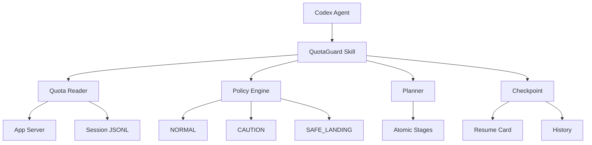

# QuotaGuard

> **Quota-aware runtime policy for Codex.**
>
> QuotaGuard helps coding agents plan, checkpoint, re-plan, and safely land
> long-running tasks around usage limits.


QuotaGuard does not bypass or extend Codex usage limits. It treats them as a
scheduling constraint.

It is a local Python CLI plus a Codex Skill. The MVP reads real ChatGPT/Codex
usage windows, applies a small policy state machine, captures git-aware
checkpoints, and produces an exact resume card. It is not a quota dashboard or
a replacement agent runtime.

## What works

- Real quota sensing through Codex App Server `account/rateLimits/read`.
- Bounded fallback to recent Codex session JSONL quota snapshots.
- Explicit fail-open `Quota unavailable` behavior.
- `NORMAL`, `CAUTION`, `SAFE_LANDING`, and unknown-source behavior.
- Rule-based task complexity and new-stage admission decisions.
- Atomic checkpoint writes with quota, tests, decisions, next action, and
  read-only git state.
- Resume cards and append-only JSONL history.
- A validated `SKILL.md` that makes Codex use the policy during long tasks.

## Architecture



## Install for development

Python 3.11 or newer and a signed-in Codex installation are required for live
quota sensing.

```powershell
python -m venv .venv
.venv\Scripts\python -m pip install -e .
quotaguard --help
```

QuotaGuard has no third-party runtime dependencies.

## Quick start

Run commands from the repository you want to protect:

```powershell
quotaguard init
quotaguard status
quotaguard plan "Refactor authentication module and add tests"
```

Write a checkpoint with facts another session can act on:

```powershell
quotaguard checkpoint `
  --task-id auth-refactor `
  --goal "Refactor authentication module and add tests" `
  --stage 2 --total-stages 5 `
  --completed "Extracted TokenService and passed unit tests" `
  --remaining "Refactor LoginService" `
  --next-action "Inspect LoginIntegrationTest failure" `
  --next-file "tests/LoginIntegrationTest.py" `
  --next-line 117 `
  --verification "python -m unittest" `
  --test-passed "TokenServiceTest" `
  --decision "Preserve the TokenService interface" `
  --buildable true
```

Continue in a new session with:

```powershell
quotaguard resume
quotaguard history
```

## Safe-landing demo

The scripted demo runs production policy, checkpoint, resume-card, git-state,
and CLI-resume code against simulated quota values:

```powershell
python examples\demo_safe_landing.py
```

It begins with 32% remaining (`CAUTION`), completes Stages 1 and 2, then moves
to 18% (`SAFE_LANDING`). QuotaGuard refuses Stage 3, writes a durable
checkpoint, generates a resume card, and verifies that `resume` recovers the
exact next action.

Regenerate the README GIF without recording the desktop:

```powershell
python -m pip install Pillow
python scripts\generate_demo_gif.py
```

Pillow is used only by the release-asset generator and is not a QuotaGuard
runtime dependency.

Every command also supports a project root before the subcommand, for example:

```powershell
quotaguard --root D:\code\my-project status --json
```

## Policy

Default five-hour thresholds are configurable in `.quotaguard/config.yaml`.

| Remaining | State | New work policy |
|---:|---|---|
| 40% or more | `NORMAL` | Planned work allowed |
| 20% to under 40% | `CAUTION` | Reduce scope; no new `VERY_HIGH` stage |
| Under 20% | `SAFE_LANDING` | No new expensive stage; verify and checkpoint |
| Unknown | `UNKNOWN` | Fail open with atomic stages and checkpoints |

At safe landing, QuotaGuard prioritizes a coherent repository, necessary
verification, an honest buildability record, and one exact next action.

## Runtime files

`quotaguard init` creates project-local state:

```text
.quotaguard/
  config.yaml
  current-task.yaml
  history.jsonl
  RESUME.md
  checkpoints/
```

Checkpoint files use JSON-compatible YAML, so the standard library can write
them atomically without adding a YAML dependency. Add `.quotaguard/` to the
target repository's ignore policy when checkpoints should remain local, or
track selected checkpoints when team handoff is desired.

## How quota is read

The primary reader starts a short-lived local `codex app-server` process,
performs the required initialize handshake, calls the documented read-only
rate-limit method, normalizes the `codex` bucket, and terminates the child.
Authentication remains owned by Codex; QuotaGuard does not read `auth.json`.

If that path fails, QuotaGuard scans bounded tails of a few recently modified
session JSONL files and labels the result `session_jsonl`. If no valid snapshot
exists, status remains usable and reports the source as `unavailable`.

See [quota research](docs/quota-research.md) for observed schemas and stability
analysis, and [architecture](docs/architecture.md) for component boundaries.

## QuotaGuard dogfoods itself

During development of v0.1.0, the active Codex five-hour window dropped to
approximately 14% remaining. QuotaGuard entered `SAFE_LANDING`, avoided
starting the remaining demo phase, and wrote a durable checkpoint with an exact
resume action. By the time the checkpoint was persisted, the latest session
snapshot showed 7% remaining; the repository was clean, all 16 tests passed,
and the next window resumed directly from Stage 6.

The anonymized evidence is preserved in
[`docs/case-studies/dogfood-run-001.yaml`](docs/case-studies/dogfood-run-001.yaml).

## Tests

Without installing the package:

```powershell
$env:PYTHONPATH = "$PWD\src"
python -m unittest discover -s tests -v
```

The current suite covers quota parsing and fallback, all policy states,
burn-rate replanning, checkpoint serialization, invalid checkpoints, latest
checkpoint selection, actionable resume output, and the full safe-landing demo.

## Current MVP limits

- Complexity and expected-cost decisions are rules, not learned predictions.
- Session JSONL is a stale fallback and not a public compatibility contract.
- Checkpoint context is supplied explicitly by the agent/CLI caller; QuotaGuard
  does not infer semantic completion from a git diff.
