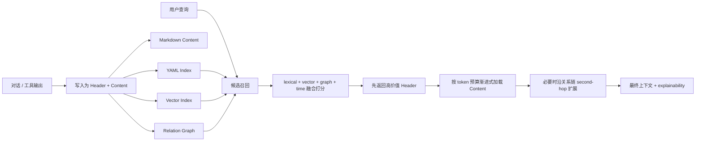

# memBook

<p align="center">
  
</p>

[](https://github.com/Larkspur-Wang/memBook/actions/workflows/ci.yml)
[](LICENSE)
[](pyproject.toml)
[](https://github.com/Larkspur-Wang/memBook/stargazers)
[](https://github.com/Larkspur-Wang/memBook/network/members)

中文 | [English](README.en.md)

给 AI Agent 用的渐进式长期记忆层。

不是把整段对话直接塞进向量库，而是：
- 先写成 `Header + Content` 两层记忆。
- 先召回轻量记忆头，再按 token 预算渐进式加载正文。
- 必要时沿关系图做链式扩展，把 second-hop 证据一起带回来。

一句话说，`memBook` 的核心不是“存记忆”，而是“以可控成本把对的记忆逐步捞出来”。

## 历史 Benchmark 自申明

`memBook` 是从 [`agent_mem_L`](https://github.com/Larkspur-Wang/agent_mem_L) 清理出来的公开版。当前公开仓库不再内置完整 benchmark harness；下面这组数字来自旧仓库最后一个 pinned `official4` 快照，用来说明同一套记忆内核在 4 个官方 benchmark 上的历史表现。

<table>
  <tr>
    <td align="center" width="20%">
      <strong>LoCoMo</strong><br>
      <sub>official track</sub><br><br>
      <code>0.7226</code>
    </td>
    <td align="center" width="20%">
      <strong>LongMemEval</strong><br>
      <sub>official track</sub><br><br>
      <code>0.7333</code>
    </td>
    <td align="center" width="20%">
      <strong>HaluMem</strong><br>
      <sub>official track</sub><br><br>
      <code>0.6667</code>
    </td>
    <td align="center" width="20%">
      <strong>MemoryAgentBench</strong><br>
      <sub>official track</sub><br><br>
      <code>0.6695</code>
    </td>
    <td align="center" width="20%">
      <strong>macro4</strong><br>
      <sub>4-benchmark mean</sub><br><br>
      <code>0.6980</code>
    </td>
  </tr>
</table>

其中 `official4` 表示 `LoCoMo + LongMemEval + HaluMem + MemoryAgentBench` 的官方数据集联合跑分，固定协议为 `strict_official_only=true`、每个 benchmark `40` 个 official samples、`3` 个 seeds（`232010 / 467676 / 763545`）。这组分数是旧仓库里用于对外说明的 pinned 平衡基线，不是只追某个单项 benchmark 的 profile。

- answer model + LongMemEval judge: `qwen3.5-plus`
- thinking: disabled
- embedding rerank: local `Qwen/Qwen3-Embedding-0.6B`
- cross-encoder rerank: disabled

> 工程清爽说明
>
> 完整 benchmarking harness、缓存数据、原始跑分产物和持续调参工作流保留在私有 benchmark 仓库 / 工作区，没有放入这个公开仓库；`memBook` 只保留干净可用的产品化工程、历史可追溯分数、协议说明和来源链接。

<details>
<summary>官方数据源、历史追溯与旧仓库跑分方式</summary>

- LoCoMo official JSON: [`snap-research/locomo`](https://raw.githubusercontent.com/snap-research/locomo/main/data/locomo10.json)
- LongMemEval cleaned JSON used by the legacy runner: [`xiaowu0162/longmemeval-cleaned`](https://huggingface.co/datasets/xiaowu0162/longmemeval-cleaned/resolve/main/longmemeval_oracle.json)
- HaluMem Medium JSONL used by the legacy runner: [`IAAR-Shanghai/HaluMem`](https://huggingface.co/datasets/IAAR-Shanghai/HaluMem/resolve/main/HaluMem-Medium.jsonl)
- MemoryAgentBench official dataset used by the legacy runner: [`ai-hyz/MemoryAgentBench`](https://huggingface.co/datasets/ai-hyz/MemoryAgentBench)
- pinned baseline snapshot in the old repo: [`docs/benchmark-baseline.md`](https://github.com/Larkspur-Wang/agent_mem_L/blob/92176aa4cfb18051bd109fef31b0dc05bc9545dc/docs/benchmark-baseline.md)
- legacy benchmark runner: [`evaluation/run_comparison.py`](https://github.com/Larkspur-Wang/agent_mem_L/blob/92176aa4cfb18051bd109fef31b0dc05bc9545dc/evaluation/run_comparison.py)
- legacy nightly workflow: [`.github/workflows/nightly-official-benchmarks.yml`](https://github.com/Larkspur-Wang/agent_mem_L/blob/92176aa4cfb18051bd109fef31b0dc05bc9545dc/.github/workflows/nightly-official-benchmarks.yml)
- current public repo intentionally excludes the full benchmark harness and cached/raw benchmark artifacts to keep the package focused and clean

```bash
python -m evaluation.run_comparison \
  --frameworks codex \
  --benchmarks locomo,longmemeval,halumem,memoryagentbench \
  --strict-official-only \
  --use-llm --llm-model qwen3.5-plus --no-llm-enable-thinking \
  --llm-fallback-mode balanced \
  --longmemeval-official-judge --longmemeval-judge-model qwen3.5-plus --no-longmemeval-judge-enable-thinking \
  --codex-use-embedding-rerank --codex-embedding-provider local \
  --codex-embedding-local-model Qwen/Qwen3-Embedding-0.6B \
  --no-codex-use-cross-encoder-rerank \
  --max-samples-by-benchmark locomo=40,longmemeval=40,halumem=40,memoryagentbench=40
```

</details>

## 方法精髓

### 1. Header First，不是一上来就加载全文
- `Header` 保存 summary、tags、时间、关系、置信度和 metadata。
- `Content` 保存完整正文，默认落盘到 Markdown。
- 召回先看头部，只有分数够高、预算允许、关系需要时才扩正文。

### 2. Progressive Loading，不让长记忆直接炸掉上下文
- 第一阶段先做低成本候选筛选。
- 第二阶段再根据 token 预算逐步扩展内容层。
- 如果 `l0` 不够，再向 `l1 / l2` 升级上下文层。

### 3. Chain Recall，不只找“像”的，还找“相关的”
- 支持 lexical / vector / graph / time 混合召回。
- 支持 relation-hop 扩展，把与命中记忆直接相关的链路节点带回来。
- 适合长时序、多关系、多会话的 agent 记忆问题。

### 4. File Truth Layer，记忆不是黑盒
- YAML 索引 + Markdown 正文。
- 支持 `health-check`、`sync-files`、`rebuild-vector-index`。
- 方便人看、人改、人审计，不会只剩数据库黑箱。

## 架构总览

<p align="center">
  
</p>

这张图对应的是 `入口 -> Adapter -> Memory Engine -> Retrieval Strategy -> Storage -> Maintenance Tools` 的整体分层。核心点是：
- 入口统一，但底层只走一套 memory engine。
- `Write / Recall / Consolidate / Govern` 是主能力面。
- lexical、vector、graph、time 是可组合的召回策略，而不是单一路径。
- Index / Content / Vector / Graph 分层存储，便于审计、重建和演进。

## 这套设计解决什么问题

| 问题 | 常见做法 | memBook 做法 |
| --- | --- | --- |
| 长记忆直接塞进 prompt，成本失控 | 全文检索后硬拼上下文 | 先记忆头，后渐进式加载正文 |
| 只靠向量相似度，跨关系链容易漏 | 只返回“最像”的片段 | 在候选命中后做关系链扩展 |
| 记忆系统难排查 | 黑盒向量库 + 不可解释分数 | 返回分数拆解、丢弃原因、关系证据 |
| 文件和运行时状态容易漂移 | 手工改文件后系统不知道 | 提供文件同步、健康检查、重建工具 |

## 召回流程



## 核心能力
- `Header + Content` 双层记忆模型。
- 渐进式上下文加载和 token 预算控制。
- lexical / vector / graph / time 混合召回。
- 关系链式加载与可解释召回输出。
- 文件后端、文件同步、健康检查、向量重建。
- 写入安全护栏：可疑模式拦截、长度限制、置信度阈值。
- 会话生命周期：`add_message -> used -> commit -> archive_summary`。
- 统一入口：Python API、`membook` CLI、REST API、MCP server。

## 快速开始
```bash
python -m venv .venv
source .venv/bin/activate
pip install -e ".[dev]"
pytest -q
```

默认配置是文件模式 + token 向量索引，不依赖外部 embedding 服务。

## CLI 示例
```bash
membook --config configs/default.yaml write \
  --id mem_cli_1 \
  --name "release note" \
  --summary "release checklist" \
  --body "run tests before release" \
  --tag release

membook --config configs/default.yaml recall \
  --query "release checklist" \
  --tag release \
  --explain

membook --config configs/default.yaml health-check --repair
```

## Python API 示例
```python
from membook import GenericAgentAdapter, create_engine_from_dict

engine = create_engine_from_dict(
    {
        "storage": {"mode": "in_memory"},
        "vector": {"enabled": False},
        "graph": {"enabled": False},
        "security": {"enable_guard": False},
    }
)

adapter = GenericAgentAdapter(engine=engine, source="demo")
adapter.after_llm_call(
    user_message="我们下周发版，需要准备什么？",
    assistant_message="先跑回归测试并确认回滚方案。",
    tags=["release"],
)

records = adapter.before_llm_call("发布前需要确认什么？", tags=["release"])
print([item.header.summary for item in records])
```

## 示例脚本
```bash
python examples/quickstart_generic.py
python examples/quickstart_file_backend.py
python examples/quickstart_langgraph_adapter.py
python examples/quickstart_consolidation.py
python examples/quickstart_metrics.py
python examples/quickstart_graph_recall.py
python examples/quickstart_security_guard.py
python examples/quickstart_schema_migration.py
python examples/quickstart_api_server.py
python examples/quickstart_mcp_server.py
```

## 文档
- `docs/architecture.md`：整体架构
- `docs/cli.md`：CLI 用法
- `docs/api.md`：REST API
- `docs/mcp.md`：MCP server
- `docs/integration.md`：运行时集成方式
- `docs/runtime-embedding.md`：运行时 embedding 配置
- `docs/file-sync.md`：文件同步
- `docs/observability.md`：指标和 explainability
- `docs/schema-versioning.md`：索引 schema 迁移
- `docs/security-regression.md`：写入安全说明

## 项目结构
```text
memBook/
├─ configs/
├─ docs/
├─ examples/
├─ memory/
├─ src/
├─ tests/
├─ CHANGELOG.md
└─ LICENSE
```

## Star History

[](https://star-history.com/#Larkspur-Wang/memBook&Date)

## 许可证
MIT
