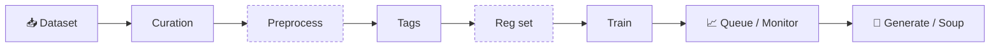

<div align="center">


# LemongrassisLora

**A local web studio for training LoRA / LoKr adapters for Anima, Krea 2 and MOSS Image.**<br>
From raw images to test renders in one browser window — on your PC, in Colab or from your phone.

[](README.ru.md)
[](CHANGELOG.md)
[](LICENSE)
[](#-supported-models)
[](#-requirements)

[Why](#-why-lemongrassislora) · [Models](#-supported-models) · [Quick start](#-quick-start) · [Features](#-features) · [Docs](#-documentation)

<br>


</div>

<br>

## ✿ Why LemongrassisLora

<table>
<tr>
<td width="50%" valign="top">

**🧭 The whole cycle in one place**<br>
Dataset → curation → preprocess → tags → reg set → training → queue → generation. The sidebar shows where you are, configs save themselves.

</td>
<td width="50%" valign="top">

**📖 Every setting explains itself**<br>
Each training option has a plain-language description and a recommended value, in English or Russian. Hover the name to read it.

</td>
</tr>
<tr>
<td valign="top">

**🪶 Fits ordinary GPUs**<br>
Block swap, fp8 / INT8 bases, latent and text caches, NaViT packing. Before you start you see the step count, the time and whether it fits in VRAM.

</td>
<td valign="top">

**📱 Works from your phone**<br>
A permanent link through Tailscale Funnel or ngrok, protected by an access key. Every page is laid out for a phone.

</td>
</tr>
</table>

<br>

## ✿ Supported models

| Model | Size | Text encoder | Trains on | Guide |
|---|---|---|---|---|
| [**Anima**](https://huggingface.co/circlestone-labs/Anima) (incl. 2.9B) | Cosmos-Predict2 DiT, 2B | Qwen3-0.6B | 6 GB+ with block swap | [captions](docs/user-guide/caption-format.md) |
| **Krea 2** (Raw, Turbo previews) | single-stream MMDiT, 12.9B | Qwen3-VL-4B | 12 GB+ with INT8 / fp8 and block swap | [optimizers](docs/user-guide/optimizers.md) |
| [**MOSS Image**](https://huggingface.co/OpenMOSS-Team/MOSS-Image-Base) (Base) | 5B | Qwen3.5-9B | 12 GB+ with ConvRot INT8 and offloading | [MOSS guide](docs/user-guide/moss-image.md) |

All three train **LoRA, LoKr and LoHa**. Outputs are plain `lora_unet_*` files that load into ComfyUI as they are.

<br>

## ✿ Quick start

<table>
<tr>
<td width="33%" valign="top">

### 1 · Prepare

- NVIDIA driver
- Python **3.10+**
- Node.js **18+** (builds the UI)
- Git

</td>
<td width="33%" valign="top">

### 2 · Launch

```bash
git clone https://github.com/Lemongrassis/LemongrassisLora
cd LemongrassisLora
```

**Windows**: `LemongrassisLora.exe` or `studio.bat`<br>
**Linux / macOS**: `./studio.sh`

</td>
<td width="33%" valign="top">

### 3 · Get models

Open **Settings → Models** and press download for your model family. Files go to `./models/`.

Then create a project and follow the sidebar.

</td>
</tr>
</table>

> [!TIP]
> The first launch takes a while: it creates the environment, picks PyTorch for your driver (cu118–cu130) and builds the UI. Then <http://127.0.0.1:8765> opens by itself.



<sub>Dashed steps are optional.</sub>

<details>
<summary><b>Commands and flags</b></summary>

```bash
python -m studio              # build the UI if needed and start the server
python -m studio dev          # dev mode: Vite :5173 + uvicorn :8765 --reload
python -m studio build        # build the UI only
python -m studio test         # pytest + vitest

studio.bat --torch=cu128      # force a specific PyTorch build
studio.bat --reinstall        # recreate venv (studio_data is kept)
LemongrassisLora.exe --check  # diagnostics: Python, venv, GPU, cache paths

python tools/download_models.py                  # every model from HuggingFace
python tools/download_models.py --modelscope     # via ModelScope
python tools/download_models.py --endpoint URL   # via your own mirror
```

</details>

<br>

## ✿ Features

### 🗂 Dataset
- **Import** images and zip archives by drag & drop or from disk, scrape Danbooru / Gelbooru.
- **Curation**: a two-pane "dataset → train" view, `N_name` concept folders with repeats, a validation set.
- **Preprocess** *(optional)*: duplicate review, ESRGAN upscaling, aspect-ratio cropping, inpainting — every action can be undone.
- **Tag editor**: bulk add / remove / replace, dedupe, tag distribution, autocomplete, restore points.
- **Reg set**: generated by the base model or pulled from Booru by the train set's tag distribution.
- **Edit LoRA**: before → after image pairs for instruction-style edit adapters.

### 🎛 Training
- **Projects and versions**: one dataset, many versions, each with its own config, reg set and outputs.
- **Presets** both ways: save a version as a preset or pull a preset into a version.
- **An honest estimate**: steps, time measured from your own runs and a VRAM check before Start.
- **GPU queue**: pause with progress saved, resume, schedule, auto-restart after a crash.
- **Monitor**: loss and LR curves, samples every N steps, logs, zip export of outputs.

<details>
<summary><b>🧪 Algorithms</b></summary>

<br>

| | |
|---|---|
| **Adapters** | LoRA, LoKr, LoHa, DoRA, rs-LoRA, OrthoLoRA, T-LoRA, Riemann LoRA; per-layer ranks |
| **Optimizers** | AdamW / AdamW8bit, Lion, CAME, Automagic, Prodigy (+ ScheduleFree), Simplified AdEMAMix, Muon, SOAP (+ SF), SinkGD — [how to choose](docs/user-guide/optimizers.md) |
| **LR schedules** | cosine family, polynomial, REX, ReREX, Licatron |
| **Timesteps** | logit-normal, uniform, mode, mixed, InfoNoise, Style-Friendly SNR, dual peak, Krea 2 shift, MOSS (truncated) logit-normal, low-noise quota |
| **Per image** | caption variations for cached text, per-image loss watch and learning rate, adaptive LR |
| **Against overfitting** | EMA of adapter weights, DOP, tone anchor — [EMA and DOP](docs/ema-and-dop.md) |
| **Memory** | block swap, fp8 / ConvRot INT8, latent and text caches, NaViT packing — [details](docs/navit-packing.md) |
| **Attention** | xformers / flash-attn / PyTorch SDPA |

</details>

### 🎨 Generation
- Single images and XY matrices from a persistent daemon, several LoRAs with their own weights.
- **Checkpoint soup**: average epochs or runs into one file and test it right away.

### 🍋 A card inside every LoRA
Each saved `.safetensors` carries a short summary in its metadata, readable in ComfyUI, SwarmUI, Forge and on Civitai:

```
✿ ── LemongrassisLora ── ✿
project      : my_style_v3
base model   : MOSS Image Base
network      : lokr · factor 4
rank / alpha : 32 / 32
batch size   : 4
timesteps    : moss_truncated_logit_normal
```

<details>
<summary><b>📱 Remote access from your phone</b></summary>

<br>

**Settings → Remote access**

| Provider | Address | What you need |
|---|---|---|
| **Tailscale Funnel** | permanent `https://<computer>.<tailnet>.ts.net` | Tailscale on this computer, sign in once |
| **ngrok** | permanent, on the free static domain | authtoken and domain from the ngrok dashboard |
| **Cloudflare** | new on every start | nothing |

Nothing is opened on your router. The link carries an access key, and the studio does not answer without it. **New access key** revokes every old one.

</details>

<details>
<summary><b>📸 A quick tour</b></summary>

<br>

<table>
<tr>
<td width="50%" valign="top">
<br>
<b>Overview</b> · pipeline of the active version, tasks and versions.
</td>
<td width="50%" valign="top">
<br>
<b>Dataset</b> · drag & drop or Booru scrape.
</td>
</tr>
<tr>
<td valign="top">
<br>
<b>Curation</b> · concept folders with repeats, validation set.
</td>
<td valign="top">
<br>
<b>Train</b> · hover tips, step budget, live preview.
</td>
</tr>
<tr>
<td valign="top">
<br>
<b>Task</b> · loss and LR curves, samples, logs.
</td>
<td valign="top">
<br>
<b>Queue</b> · one GPU slot, timeline, pause and resume.
</td>
</tr>
</table>

<sub>Screenshots use demo data.</sub>

</details>

<br>

## ✿ Requirements

| | Minimum | Recommended |
|---|---|---|
| **GPU** | NVIDIA 6 GB (Anima) / 12 GB (Krea 2, MOSS) | NVIDIA 16 GB+ |
| **RAM** | 16 GB | 32 GB+ |
| **Disk** | SSD, ~20 GB | SSD with headroom for models |

> [!WARNING]
> AMD GPUs and Apple Silicon are not supported.

<br>

## ✿ Documentation

| | |
|---|---|
| 📘 **User guide** | [Captions](docs/user-guide/caption-format.md) · [Tagging](docs/user-guide/tagging-guide.md) · [Regularization](docs/user-guide/regularization.md) · [Optimizers](docs/user-guide/optimizers.md) · [Training tips](docs/user-guide/training-tips.md) · [Custom models](docs/user-guide/custom-models.md) · [MOSS Image](docs/user-guide/moss-image.md) |
| 🧪 **Algorithms** | [EMA and DOP](docs/ema-and-dop.md) · [Style-Friendly SNR](docs/style-friendly-snr.md) · [NaViT packing](docs/navit-packing.md) |
| 🏗 **Architecture** | [How the studio is built](docs/architecture/) · [Decision records](docs/adr/) · [Backend and frontend](studio/README.md) · [Training core and plugins](runtime/training/README.md) |
| 🤝 **Project** | [Contributing](CONTRIBUTING.md) · [Changelog](CHANGELOG.md) · [Third-party notices](THIRD_PARTY_NOTICES.md) |

<details>
<summary><b>Repository layout</b></summary>

```
LemongrassisLora/
├── runtime/        # training core, generation, inference daemon (usable from the CLI)
├── studio/         # web studio: FastAPI (api / services / domain / infrastructure / workers)
│   └── web/        # UI: React + Vite + Tailwind
├── modeling/       # model implementations
├── utils/          # shared training utilities
├── tools/          # CLI: model downloads, torch selection, flash-attn install, launcher build
├── models/         # weights and tokenizers (large files are not in git)
├── studio_data/    # projects, database, presets, tasks (created on first run)
└── docs/           # documentation
```

</details>

<br>

## ✿ Origin and credits

> [!NOTE]
> LemongrassisLora started as a fork of [WalkingMeatAxolotl/AnimaLoraStudio](https://github.com/WalkingMeatAxolotl/AnimaLoraStudio). The training core follows upstream **v0.20.2** with later fixes backported; the interface, explanations, remote access, Krea 2 / MOSS support and most of the training toolbox were reworked or added here.

| Part | Source |
|---|---|
| **Original project** | [WalkingMeatAxolotl/AnimaLoraStudio](https://github.com/WalkingMeatAxolotl/AnimaLoraStudio) |
| **Training scripts** | [Moeblack/AnimaLoraToolkit](https://github.com/Moeblack/AnimaLoraToolkit) |
| **Models** | [circlestone-labs/Anima](https://huggingface.co/circlestone-labs/Anima) · Krea 2 · [OpenMOSS MOSS Image](https://huggingface.co/OpenMOSS-Team/MOSS-Image-Base) |
| **Adapters** | [LyCORIS](https://github.com/KohakuBlueleaf/LyCORIS) |
| **Everything else** | [THIRD_PARTY_NOTICES.md](THIRD_PARTY_NOTICES.md) |

## ✿ License

Code: **GPL-3.0** ([LICENSE](LICENSE)). Some third-party components (NVIDIA Cosmos, Wan2.1) are **Apache-2.0** ([LICENSE-APACHE](LICENSE-APACHE)).

> [!IMPORTANT]
> Model weights (Anima, Krea 2, MOSS, Qwen, VAEs) have their own licenses, some of them non-commercial. Check the model cards before using a trained LoRA commercially.

<br>

<div align="center">

✿ **LemongrassisLora** · made for people who train LoRAs, not for people who read training scripts ✿

</div>
