<div align="center">


# Oral History Toolkit

**A methodology-grounded pipeline that turns verbatim interview transcripts into faithful, reviewable editorial drafts.**

Pass 1 de-oralization · machine-readable `term_lock` contract · chunked long-text editing · consistency and fidelity gates · word-level review bundle

[**简体中文**](README.zh-CN.md) · **English**

<a href="LICENSE"></a>
<a href="https://www.python.org/"></a>
<a href="https://github.com/LeoLin990405/oral-interview-transcription-skill/actions/workflows/test.yml"></a>
<a href="docs/reference.md"></a>
<a href="oral-history-master/requirements.txt"></a>

</div>

> [!NOTE]
> **Current state.** The repository ships two Agent Skills — `oral-history-master` (the Pass 1
> pipeline) and `oral-history-quality-guard` (the delivery audit) — plus 13 Python scripts, 24
> `unittest` cases, and a synthetic end-to-end demo. Pass 2 bookification is documented as a
> separate post-signature workflow. Licensed MIT.

## ✨ Features

- **Fidelity before readability.** The conflict order is fixed: protect > convert > context >
  remove. Contradictions are retained and flagged; hedges such as "probably" are preserved rather
  than resolved.
- **Two separate passes.** Pass 1 de-oralization is this repository; Pass 2 publication editing is a
  distinct workflow that may start only after the interviewee signs the Pass 1 draft.
- **Machine-readable contract.** `term_lock.md` stores the term table, interviewee voice profile,
  and editing switches; the editor re-reads it before every chunk to resist context drift.
- **Chunked long-text processing.** The chunker splits on boundaries with overlap and progress
  anchors; cross-chunk term consistency is checked by script rather than by memory.
- **Dual deterministic gates.** `consistency_checker` flags leftover term variants;
  `fidelity_checker` flags length anomalies, new numbers or proper nouns, and deleted uncertainty.
- **Word-level review bundle.** Markdown diff, browser review, and Word tracked changes are
  generated from the same diff — not from the model's self-reported edit count.
- **Adversarial audit.** The companion quality-guard skill checks seven violation classes per
  speaker turn and returns `PASS` or `NEEDS FIX` for every chunk.
- **Local-only, stdlib-only.** The core pipeline requires Python 3.9+ and no third-party package;
  `python-docx` and `openpyxl` are optional and only needed for `.docx` / `.xlsx` imports.
- **Three genres, one scale.** Oral history, podcast, and general-interview modes share the same
  red lines and differ in default filler strength and delivery reminder.

## 🧠 Architecture

```mermaid
flowchart LR
    T[Verbatim transcript] --> I[transcript_ingest]
    I --> G[glossary_extractor]
    G --> S{{"Surveyor: edit_spec + term_lock"}}
    S -->|"user confirms"| C[chunker]
    C --> E{{"Editor: de-oralize each chunk"}}
    E --> D[consistency_checker + fidelity_checker]
    D -->|"error: rework chunk"| E
    D --> R[diff_reporter + package_review]
    R --> Q{{"Quality Guard: adversarial audit"}}
    Q -->|"NEEDS FIX"| E
    Q --> O[Review bundle + signed draft]
```



The pipeline is strictly serial: each step consumes the previous step's artifacts, and only the
surveyor's editorial-plan confirmation is a hard stop for the user. Implementation layout:
[`oral-history-master/scripts/`](oral-history-master/scripts/) holds the deterministic tools,
[`references/`](oral-history-master/references/) holds the role definitions and editing standards,
[`templates/`](oral-history-master/templates/) holds the two contracts, and
[`workflows/`](oral-history-master/workflows/) holds resume and Pass 2 procedures. The methodology
behind the A/B/C/D classes is in
[`references/methodology.md`](oral-history-master/references/methodology.md); the editing scale is
set by the paired examples in
[`references/examples.md`](oral-history-master/references/examples.md).

## 🚀 Quick start

**Requirements:** Python 3.9+ (macOS, Linux, or Windows). No package installation for the core
pipeline. Optional: `python-docx>=1.1.0` and `openpyxl>=3.1.0` only when the transcript is `.docx`
or `.xlsx`.

```sh
git clone https://github.com/LeoLin990405/oral-interview-transcription-skill.git
cd oral-interview-transcription-skill
python3 --version          # 3.9 or newer
```

Run the unit tests and the deterministic half of the pipeline against the bundled synthetic demo:

```sh
cd oral-history-master
python3 -m unittest discover tests -v

cd scripts
python3 run_pipeline.py check demo
cat ../projects/demo/review/质检总览.md
```

The demo is fictional. It already contains ingested sources, three edited chunks, and a review
bundle, so no model or API key is needed to inspect the outputs:

| Look at | Contents |
|---|---|
| [`projects/demo/sources/raw.txt`](oral-history-master/projects/demo/sources/raw.txt) | Input: spoken transcript with fillers, slips, dialect, and a contradiction |
| [`projects/demo/output/整理稿.md`](oral-history-master/projects/demo/output/整理稿.md) | Output: de-oralized Pass 1 draft |
| [`projects/demo/review/对照稿.md`](oral-history-master/projects/demo/review/对照稿.md) | Paragraph-level word diff plus full original and edited text |
| [`projects/demo/review/审阅稿.html`](oral-history-master/projects/demo/review/审阅稿.html) | Browser review with red deletions and green insertions |
| [`projects/demo/review/待核对清单.md`](oral-history-master/projects/demo/review/待核对清单.md) | Every `⚠` item (names and proper nouns) |

To process your own transcript manually:

```sh
cd oral-history-master/scripts
python3 project_manager.py init my_interview
python3 project_manager.py import my_interview ~/transcripts/interview.txt --move
python3 transcript_ingest.py my_interview
python3 glossary_extractor.py my_interview

# Surveyor: read sources/ingested.md, fill edit_spec.md and term_lock.md, then confirm the plan.
python3 chunker.py my_interview

# Editor: edit work/chunks/chunk_NNN.md → work/edited/chunk_NNN.edited.md, one chunk at a time.
python3 consistency_checker.py my_interview
python3 fidelity_checker.py my_interview
python3 diff_reporter.py my_interview
python3 package_review.py my_interview
```

> [!TIP]
> Rules explain *why* to change a passage; the paired before/after examples set *how far* to go.
> Calibrate the editor against [`references/examples.md`](oral-history-master/references/examples.md)
> first — the repository states that example quality, not rule count, bounds output quality.

## 🧩 Using it as an agent skill

Both directories are Agent Skills with `SKILL.md` frontmatter. Copy them into the skills directory
of a compatible agent (for example `~/.claude/skills/`) and let the agent orchestrate the pipeline:

```text
oral-history-master/
oral-history-quality-guard/
```

Then hand over a transcript and ask, for example, "use oral-history-master on this transcript" or
"用 oral-history-master 整理这篇转写稿".

| Mode | What runs | Best for |
|---|---|---|
| Agent skill (recommended) | The agent performs surveyor and editor judgments, calls the scripts between steps, and runs the QA gate at Step 7 | Full pipeline with role discipline and audit |
| Manual scripts | You run the deterministic scripts and make every editorial decision yourself | Full control, or inspecting each artifact |
| Deterministic only | `run_pipeline.py prep` / `check` and `make smoke` | Reproducing the demo or debugging the tooling |

The agent stops once, at the editorial-plan confirmation: genre, intended use, fidelity level,
switches, term table, fidelity red lines, and scale estimate are presented for approval. After that
the steps advance automatically. Delivery requires the quality-guard audit — the responsible
statement is that the draft was checked turn by turn for fabrication, false certainty, reconciled
contradictions, and erased dialect.

## 🗂️ Pipeline & scripts

The scripts only perform deterministic mechanical work; the de-oralization judgment stays with the
agent role. The full reference is in
[`oral-history-master/scripts/README.md`](oral-history-master/scripts/README.md) and
[`docs/reference.md`](docs/reference.md).

| Script | Role |
|---|---|
| `project_manager.py` | `init` / `import` / `validate` / `status` for one interview project |
| `transcript_ingest.py` | Clean, separate speakers, normalize timestamps; never changes wording |
| `glossary_extractor.py` | Pre-scan proper nouns and cluster variants already present in the transcript |
| `chunker.py` | Split into chunks on boundaries, with overlap and progress anchors |
| `consistency_checker.py` | Cross-chunk term, label, and marker consistency |
| `fidelity_checker.py` | Length-ratio error gate; new numbers or proper nouns; deleted uncertainty |
| `diff_reporter.py` | Word-level review bundle: Markdown, HTML, and Word tracked changes |
| `filler_scan.py` | Flag leftover fillers and repetitions without rewriting |
| `package_review.py` | Assemble `output/整理稿.md` and the `⚠` checklist |
| `run_pipeline.py` | Orchestrate `prep` and `check` |
| `report.py` | One-page QA dashboard |

The two contracts are filled by the surveyor and re-read by the editor: `edit_spec.md`
(human-readable plan, sections I–VIII) and `term_lock.md` (voice profile, switches, canonical term
table, fidelity red lines). Marker conventions — `〔…〕` for meaning-level changes, `⚠` for items
needing verification, `【问】` for substantive interviewer questions — are defined once in
[`shared-standards.md`](oral-history-master/references/shared-standards.md).

## 📦 Review bundle

| Artifact | Contents |
|---|---|
| `output/整理稿.md` | Clean reading copy: `〔…〕` notes stripped, `⚠` kept, genre-specific delivery reminder |
| `review/对照稿.md` | Paragraph-level word diff with full original and edited text |
| `review/审阅稿.html` | Browser review with Word-style red deletions and green insertions, plus original/edited toggles |
| `review/审阅稿.docx` | Word / WPS tracked changes that can be accepted or rejected |
| `review/待核对清单.md` | Every `⚠` with chunk number and context |
| `review/一致性报告.md` | Leftover term variants, speaker labels, marker counts |
| `review/忠实度报告.md` | Per-chunk length ratio and suspected invention or false-certainty signals |
| `review/语气词残留.md` | Suspected leftover fillers and repetitions (advisory, not a hard gate) |
| `review/质检总览.md` | One-page dashboard combining progress, consistency, fidelity, `⚠`, and delivery verdict |

The reports are heuristics: they flag material for human review and do not replace it. The HTML and
Word files contain real tracked changes generated from the diff, so a reviewer can accept or reject
each edit.

## 📁 Repository layout

| Path | Contents |
|---|---|
| `oral-history-master/` | Pass 1 skill: `SKILL.md`, roles, scripts, templates, workflows, demo |
| `oral-history-master/scripts/` | 13 Python modules: 11 CLI tools plus `config.py` and `review_diff.py` |
| `oral-history-master/references/` | Methodology, surveyor, editor, examples, shared standards |
| `oral-history-master/templates/` | `edit_spec_reference.md`, `term_lock_reference.md` |
| `oral-history-master/workflows/` | `resume-execute.md` (long interviews), `pass2-bookify.md` (Pass 2) |
| `oral-history-master/projects/demo/` | Synthetic end-to-end sample with outputs and review reports |
| `oral-history-quality-guard/` | Seven-dimension adversarial fidelity audit |
| `docs/reference.md` | Pipeline, contract, A/B/C/D, literature, QA, and troubleshooting reference |
| `QUICKSTART.md`, `CONTRIBUTING-methodology.md`, `FEEDBACK.md` | Onboarding, methodology contribution guide, feedback channels |
| `.github/workflows/test.yml` | CI: `py_compile`, unittest, demo smoke on Python 3.9 and 3.12 |

## 🛠️ Development

```sh
make test     # cd oral-history-master && python3 -m unittest discover tests -v
make lint     # py_compile over scripts and tests
make smoke    # run the deterministic check on projects/demo and assert the review bundle
```

The suite has 24 `unittest` cases covering `term_lock` parsing, number normalization and chunk
boundaries, speaker detection, fidelity heuristics, word-level diffing, filler scanning, and
genre-specific delivery banners. GitHub Actions runs the same checks on Python 3.9 and 3.12, then
asserts that the demo HTML contains `<del>` / `<ins>` and the Word document contains `<w:del` /
`<w:ins`. Changes to scripts should keep `make test` and `make smoke` green.

## 🧭 Scope, limits & open work

The project provides a Pass 1 editing pipeline and deterministic checks. It does not claim
publication quality or measured accuracy. Known boundaries:

| Boundary | Behavior |
|---|---|
| Mechanical checks are heuristics | Length ratio, new numbers or proper nouns, and deleted uncertainty flag suspicion; false positives and false negatives exist, and a human or the audit role makes the final fidelity call |
| Example-bound quality | Committed examples are synthetic; quality on real material depends on calibrating with real before/after pairs |
| Limited validation | The repository states that the hardest passages and 100k-character long-range consistency still need systematic evaluation |
| No ASR | Input must already be a transcript; the toolkit never processes audio |
| Pass 1 only | Publication-level bookification is Pass 2, run separately after signature |
| Not a replacement for review | Oral-history drafts require interviewee review and signature; podcast drafts require host or guest fact-checking |

Open work named in the repository:

- [ ] Validate the pipeline on held-out published interviews, comparing output with the scholar's
      published version (the procedure in
      [`CONTRIBUTING-methodology.md`](CONTRIBUTING-methodology.md) Phase 4)
- [ ] Replace the synthetic examples with real, de-identified before/after pairs
- [ ] Systematically evaluate the hardest passages and long-range consistency at 100k+ characters

## 🤝 Contributing

Methodology contributions and engineering fixes are both welcome. Before opening a pull request:

1. run `make test`, `make lint`, and `make smoke`;
2. keep one fact per rule, and add paired before/after examples rather than more prose;
3. follow the three output targets in
   [`CONTRIBUTING-methodology.md`](CONTRIBUTING-methodology.md): rules to `methodology.md`, examples
   to `examples.md`, bookification rules to `pass2-bookify.md`.

> [!WARNING]
> This is a public repository. Never paste real interview content into an issue or pull request —
> use fabricated or de-identified excerpts, or describe the symptom only. See
> [`FEEDBACK.md`](FEEDBACK.md) for the issue templates and what to include.

If the toolkit is useful to you, consider leaving a ⭐ — it helps others find the project.

## 📄 License & attribution

Released under the [MIT License](LICENSE). Copyright (c) 2026 Zhongyue Lin. No `NOTICE` file or
third-party license text is included in this repository.

The toolkit is a collaboration: the methodology and literature genealogy were compiled by oral
history researcher [**Kelvin (USTC, history of science) · @InsightHist**](https://github.com/InsightHist),
with field feedback; the multi-role pipeline, consistency and fidelity mechanisms, and engineering
were built by [**LeoLin990405**](https://github.com/LeoLin990405).

If you use the toolkit in research or production, cite it as:

```text
口述访谈文字处理工具（oral-interview-transcription-skill）.
Methodology: Kelvin (@InsightHist, USTC history of science); engineering: LeoLin990405. 2026.
https://github.com/LeoLin990405/oral-interview-transcription-skill
```

## ⭐ Star history

<div align="center">

<a href="https://star-history.com/#LeoLin990405/oral-interview-transcription-skill&Date">
  
</a>

</div>
