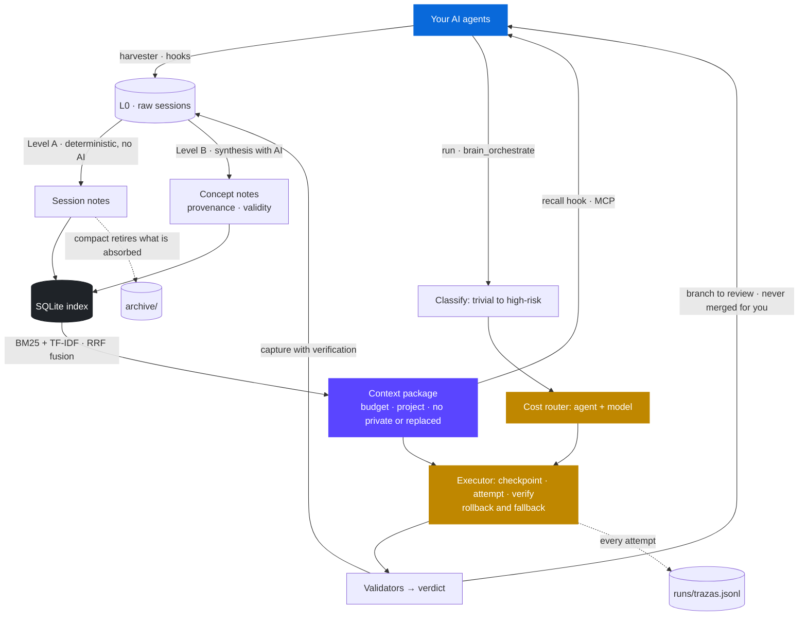

<div align="center">


# soou

**A second brain for your AI agents, and the harness that puts them to work.**

It keeps what you learned while working, connects it into a graph, and hands it
to any agent before it answers. Then it classifies your task, picks the right
agent and model for the job, and runs it on its own git branch.

Local, plain Markdown, zero dependencies, and tied to no vendor.

[](https://github.com/LucasAlvarezS/soou/actions/workflows/ci.yml)
[](https://www.python.org/)
[](#why-zero-dependencies)
[](#the-brain)
[](#the-harness)
[](#privacy)
[](LICENSE)
[](CONTRIBUTING.md)

**English** · [Español](README.es.md)

</div>

---

## The problem

Every session with an AI agent starts from zero. You explain your stack again,
your decisions, why you dropped that library. The agent solves it, the window
closes, and all that context evaporates. Tomorrow you explain it again.

It gets worse with several agents: what you told one, the other never knew.

And once you do have context, there is a second problem. Every task goes to the
same agent and the same model, whether it is renaming a variable or planning a
migration.

## Two halves that need each other

soou is a **brain** and a **harness**, and neither works well alone.

| The brain | The harness |
|---|---|
| Harvests your sessions from disk, no action needed | Classifies each task by complexity and risk |
| Distills transcripts into one concept per note, linked | Routes it to the right agent and model by cost |
| Serves them over MCP before the agent answers | Runs writes on a separate git worktree and branch |
| Compacts what is already absorbed | Falls back in order when an agent fails |

Context without orchestration is a wiki nobody reads. Orchestration without
context is an agent that guesses. The point is the loop between them.

## How it works



The Markdown in `wiki/` is the source of truth. `soou.db` is only a derived,
incremental index: delete it and it rebuilds.

## Install

```bash
pipx install git+https://github.com/LucasAlvarezS/soou
soou init
```

Installed this way, your brain lives in `~/.soou` (or wherever `SOOU_HOME`
points). Prefer a checkout? It works the same and keeps the data next to the
code:

```bash
git clone https://github.com/LucasAlvarezS/soou
cd soou
python soou.py init
```

That is the whole setup. `init` prepares the workspace, builds the index,
schedules automatic syncing, installs session hooks for the clients that support
them, and registers the MCP server at user scope, meaning it is available from
any folder.

In a terminal, `init` first lists every change it is about to make (files,
hooks, MCP registration, scheduled task) and asks before going on. To look
without changing anything, or to try soou with no integrations at all:

```bash
python soou.py init --preview   # what it would do; changes nothing
python soou.py init --minimal   # workspace and index only: no hooks, MCP or schedule
python soou.py init --yes       # no question, for scripts
```

It is idempotent: running it again repairs an install whose repository or
interpreter moved.

```bash
python soou.py status      # is it installed and actually running?
python soou.py uninstall   # removes everything, never touches your knowledge
```

<details>
<summary>Skipping components</summary>

```bash
python soou.py init --no-hooks     # no client session hooks
python soou.py init --no-mcp       # do not register the MCP server
python soou.py init --no-trigger   # no automatic syncing
python soou.py init --interval 15  # sync every 15 minutes
```

</details>

## The brain

### MCP tools

The server speaks JSON-RPC 2.0 over `stdio`, written by hand on the standard
library. Any compatible client sees these.

| Tool | What it does |
|---|---|
| `brain_recall` | Context for a question. Tells entity lookups from thematic queries and adds graph neighbours |
| `brain_query` | Explicit search with ranking, snippets and outgoing links |
| `brain_note_get` | A **complete** note. The two above only return fragments |
| `brain_note_write` | **Writes** to the brain, to correct badly synthesised knowledge. Refuses to touch a `pinned` note |
| `brain_capture` | Contributes raw material. Additive: the distiller integrates it |
| `brain_health` | Broken links, orphans, placeholders, stale notes and duplicates |
| `brain_orchestrate` | Classifies a task and recommends a flow. With `execute` it fires the run |

The bundled `agentes-cerebro.md` tells an agent to consult the brain before
answering, when to orchestrate and when to contribute. The rules live inside
too: `schema.yaml` and that file are indexed as notes, so an agent retrieves
them like everything else. (`AGENTS.md` is a different file: the guide for
agents working on soou's own code.)

### Distillation, in two levels

Level A is deterministic and free: extractive summary, key phrases and
auto-linking against the existing graph, no tokens spent. Level B is the
conceptual synthesis, and it runs with whichever writing agent is available.

`compact` is the counterpart, and the only thing in the system that removes
material. It retires a session note once its transcript has been synthesised,
archives synthesised raw files past 30 days, and retires duplicate stubs while
repointing their links. It simulates unless you pass `--apply`, archives instead
of deleting, and never touches a `pinned` note.

### Provenance and validity

Every note can say where it came from and what backs it, with optional
frontmatter fields:

| Field | Meaning |
|---|---|
| `source_session` / `source_run` | The session or soou run it came from |
| `recorded_at` | When it was recorded (editing does not change it) |
| `status` | `propuesta`, `vigente` or `reemplazada` (proposed, current, replaced); empty means current |
| `supersedes` / `superseded_by` | Which note it replaces, or which replaced it |
| `verification` | `tests_passed`, `revisado`, `sin_verificar` or `afirmado_por_agente` (reviewed, unverified, claimed by an agent) |

Provenance says who claimed it; verification says what backs it. Level A
writes these fields itself. The `run` capture marks `tests_passed` only when a
functional test passed; anything else stays `afirmado_por_agente`, and so does
whatever an agent writes over MCP. In an agent's context, unverified claims
arrive tagged `[sin comprobar]`.

A replaced decision is not deleted: it leaves the context and its history stays
in the `supersedes` chain. Either note declaring the replacement is enough.
`lint` flags broken chains, notes still current although another replaces them,
and two current notes replacing the same one. `pinned` is still only overwrite
protection.

`soou provenance` shows which notes generated before these fields would get
their provenance; `--apply` writes it. It only touches Level A notes and never a
`pinned` one.

## The harness

### Whatever agent you already use

soou belongs to no AI provider. It is the layer between you and whichever agents
you happen to work with, and it assumes that set will change. There are four
ways to connect one, and none of them requires touching code.

| Way | For what |
|---|---|
| Built-in types | Claude Code and Codex |
| Recipes | 15 known CLIs: Copilot, Gemini, Cursor, Aider, OpenCode, Droid, Amazon Q, Qwen and more |
| `cmd` | Any binary, substituting the task into its arguments |
| `http` | Any OpenAI-compatible API: Groq, DeepSeek, OpenRouter, Cerebras, Mistral, Together |

The roster is self-activating: a CLI lights up when it appears on `PATH`, an API
when its environment variable exists. Nothing breaks when an agent is missing;
it simply does not show up.

On the capture side the same neutrality applies, with one honest gap: automatic
harvesting only covers the two clients whose transcript format is implemented so
far, Claude Code and Codex. Every other agent still contributes, through
`brain_capture` over MCP. Closing that gap for one more client is a good first
contribution, and the existing harvesters are the template.

```bash
python soou.py agents --detect   # what is installed
python soou.py agents            # what is live and what each one is missing
```

### Cost router

Every task is classified as `trivial`, `contextual`, `complex` or
`ambiguous/high-risk`, and that decides which agent and which model handle it.
Cheap on top for simple work, frontier on top for hard work. API-only agents are
excluded from write tasks automatically, since they cannot apply changes.

### Guardrails for writes

Work happens on its own branch inside a separate git worktree. It passes
validators, gets committed on that branch, and is **never** merged for you. The
verdict says what was actually checked: **functional** only when a real test
suite passed; **without functional verification** when only basic or static
checks ran (the diff, compiling, lint), or when a validator could not run, which
is recorded as not run and never as passed; **failed** when anything failed. A
daily cap on agent invocations (a count of calls, not money), a recursion guard
against endless planning, and `.soou-plan.json` with resumable state.

**What the worktree does, and what it does not.** It keeps the agent's changes
apart from your checkout until you merge them. It is not a sandbox: the agent
runs as you, and within its own permissions it can read and write outside that
folder, run commands and use the network. For tasks you do not trust, run soou
inside a container or a virtual machine.

**Read-only runs.** Without `--write`, soou only uses agents whose read mode is
actually enforced. The rest are rejected, never sent to their write command.

| Agent | Read mode | Enforced by | Write mode |
|---|---|---|---|
| Codex | `-s read-only` | the OS sandbox | `--approve-for-me` (workspace sandbox) |
| Claude Code | read tools only, write tools denied | the agent | `acceptEdits` |
| Gemini, Qwen | `--approval-mode plan` | the agent | `yolo`, approves everything |
| Aider | `--dry-run` | the agent | `--yes-always` |
| Copilot | no `--allow-all-tools` | the agent | `--allow-all-tools` |
| Droid | `exec` default | the agent | `--auto medium` |
| `http` APIs | text only | soou: they get no tools | not available |
| Any ACP agent | read tools only, inside the workspace | soou, per tool request | tools inside the workspace |
| Cursor, OpenCode, Crush, Amazon Q, Continue | not verified, rejected | | each one's auto mode |
| Goose, Amp, OpenHands | none, rejected | | each one's auto mode |

"Enforced by the agent" means that agent's own permission system, and it is as
strong as that implementation. If you trust a read mode soou has not verified,
declare it with `"lectura": "aprobacion_cli"` on that agent in
`soou.config.json`. On Windows, the task never goes through a `cmd.exe` command
line: npm shims are launched with `node` directly, and free text that would have
to pass through `cmd` is rejected.

**Declaring agents.** An agent goes in `agents` in `soou.config.json`, or in
its own file `agents/NAME.json` in the data folder, with the same fields. Both
are validated on load: an invalid one is not built and `soou agents` says why.
A field soou does not use only produces a warning there, since it is usually a
typo. Fields that start with `_` are comments.

**Agents over ACP.** An agent that speaks the
[Agent Client Protocol](https://agentclientprotocol.com) (v1, over stdio) is
added with `{"name": "my-agent", "type": "acp", "command": ["my-agent", "--acp"]}`.
If the agent offers session modes, soou picks one to match the run: a read-only
mode for read runs and a workspace mode for writes, never a full-access one.
This matters because some agents start in a mode that approves edits by itself
and never asks. The agent asks for every tool by message and soou answers by mode. In read mode
it allows only read tools inside the workspace. In write mode it allows tools
inside the workspace and never outside. It never picks "always allow", and
file reads and writes that go through soou are checked against the workspace.
An agent that edits without asking is not stopped by the protocol, so the
executor still checks afterwards that a read-only run left the workspace
untouched. Progress (plan, tool calls, permissions, usage) is kept in the
attempt's result, and a timeout cancels the turn before stopping the process.
Verified with the Codex adapter (`npm install -g @agentclientprotocol/codex-acp`,
then `"command": ["codex-acp"]`), which reuses your `codex login`: all six cases
of `agents --conformance` pass. Other ACP agents have not been verified.

### How a run works

1. **Classify.** The task gets a level (`trivial`, `contextual`, `complex`,
   `ambiguous/high-risk`) and the router picks the candidate agents for it, in
   order: the `routing` preference for that level, then each agent's track
   record. Agents that cannot honour the mode are left out (a read-only run
   only takes agents whose read mode is enforced; writes skip API-only agents).
2. **Context.** The same context package as everywhere else, within
   `context_budget`: the project summary, its current rules and decisions, and
   the notes relevant to the task. `--no-brain` sends none.
3. **Attempt.** Every call to an agent goes through one executor. It reserves
   one invocation of the daily cap (under a lock, so two runs cannot overspend
   it), takes a checkpoint of the worktree, runs the agent, and checks the
   result: a valid answer, no "I could not" in it, permissions respected and,
   for writes, actual changes. A timeout kills the whole process tree.
4. **Fallback.** If the attempt fails, the worktree goes back exactly to that
   attempt's checkpoint (never further, so earlier steps and your own changes
   survive) and the next candidate tries.
5. **Validate.** The project's own checks run on the worktree: what `.soou.json`
   declares under `validators`, or else what soou detects (npm scripts,
   pytest/unittest, cargo, go, make), plus the diff and a Python compile. The
   verdict follows from them (see below).
6. **Hand back.** The work stays committed on its `soou/run-*` branch for you to
   merge or discard. The run is captured into the brain as a candidate, with its
   verification: `tests_passed` only when a functional test passed.

Every attempt, including failed ones, is written to `runs/trazas.jsonl` and never
to the brain. `soou trace` lists recent runs; `soou trace RUN_ID` shows each
attempt with agent, model, state, error code, duration and why soou moved to
the next agent.

**Plans.** `run --plan` splits a complex task into ordered steps and runs them
in one worktree, with a checkpoint per step. The state lives in
`.soou-plan.json`: when the budget runs out or something stops it, `run --resume
WORKTREE` continues from the first unfinished step under the same run id,
without repeating finished ones. A recursion guard stops plans that try to plan
again.

**Two agents for risky tasks.** In the `team` and `enterprise` profiles, an
`ambiguous/high-risk` task goes to two agents in parallel and their answers are
cross-checked.

**From the interface or MCP.** `brain_orchestrate` with `execute` and the
interface start runs, plans, resumes and syncs in the background, through the
same executor.

```bash
python soou.py run "analyse the current architecture"
python soou.py run "split this migration into steps" --plan
python soou.py run "implement the change" --write
python soou.py run --resume PATH_TO_WORKTREE
python soou.py run "task" --dry            # the decision without running anything
python soou.py trace                       # recent runs and their attempts
```

## Commands

All of them are `soou COMMAND` installed, or `python soou.py COMMAND` from a
checkout. `--help` on any of them lists its options.

| Brain | For what |
|---|---|
| `query "text"` | Search the brain. `--privadas` also shows you private notes |
| `context "task" --explain` | What an agent would get for that task, why each note got in and why the rest stayed out |
| `sync` / `sync --deep` | Harvest and distil. `--deep` adds the AI synthesis (Level B) |
| `distill` | Distil pending sessions only. `--lite` is Level A, free |
| `persona` | Synthesise your persona note from the brain |
| `sessions` | Captured sessions and their state. `--importar ID --proyecto FOLDER` keeps one that was dropped; `--limpiar` re-sanitises old ones |
| `ingest FILE --area AREA` | Register a raw source and create its note |
| `scan --root FOLDER` | Import existing projects and their `.md` files |
| `compact` | Retire what the brain has already absorbed (simulates without `--apply`) |
| `lint` / `stats` / `graph` | Health (validity included), metrics and interactive graph |
| `provenance` / `provenance --apply` | Add provenance to notes generated before it existed |

| Harness | For what |
|---|---|
| `run "task"` | Classify, pick an agent, execute. `--write`, `--plan`, `--resume`, `--dry`, `--no-brain` |
| `classify "task"` | Only the level and the suggested flow |
| `trace [RUN_ID]` | The attempts of a run: agent, state, reason, duration |
| `agents` | What is live and what each agent is missing. `--detect`, `--probe` |
| `agents --conformance NAME` | Check that an agent does what soou assumes (launches it up to 4 times) |
| `budget` / `profile` | Daily cap and usage; deployment profile and its capabilities |
| `router-log` | Summary of the router's decisions, to calibrate it |

| Measure | For what |
|---|---|
| `eval` | Retrieval quality: hit@1, recall@k and MRR |
| `eval --tareas` | Whether memory helps, with and without it, on a fictional corpus |

| Install and upkeep | For what |
|---|---|
| `init` | Set everything up (`--preview`, `--minimal`, `--yes`) |
| `status` / `uninstall` | Verify or remove the install |
| `doctor` | Maintenance: stats, lint and a report |
| `reindex` | Rebuild `soou.db` from the Markdown (`--full` from scratch) |
| `ui` | Open the interface |

The hooks call `context`, `recall`, `capture`, `session-end` and `reindex`;
`capture-codex` and `distill-mark` are used by sync and the distiller. You can
run them by hand, but you should not need to.

## The full cycle

**Memory.**

1. You work normally with your agents.
2. Claude Code sessions are captured by a hook when they end; every few
   minutes the harvester picks up Codex sessions and anything the hook missed.
   Only sessions from allowed folders get in.
3. Level A turns them into searchable notes without spending a single token.
4. Level B, when you ask, synthesises them into linked concept notes, with
   provenance and validity.
5. `compact` retires what got absorbed and archives old raw files.
6. Next time you open an agent, the recall hook and the MCP tools hand it what
   matters for the task, and nothing private or replaced.

**Work.**

1. You ask for a task with `run`, from the interface, or through an agent with
   `brain_orchestrate`.
2. soou classifies it, picks agent and model by cost, and adds the context.
3. The agent works on its own branch; if it fails, soou rolls back its attempt
   and tries the next one.
4. The project's tests decide the verdict, and you merge or discard.
5. What it learned goes back to the brain, marked with what backs it.

## Configuration

`soou.config.json` controls profile, agents, routing, models, budget and which
projects enter the brain. `init` creates it from the template if missing, and
the interface **Config** view edits it with validation.

<details>
<summary>Main keys</summary>

| Key | For what |
|---|---|
| `profile` | Capabilities per install: `single`, `team` or `enterprise` |
| `agents` | The roster, using any of the four connection styles |
| `routing` | Agent preference order per task level. It is the cost axis and also the fallback |
| `models` / `reasoning` | Model and effort per agent and per level |
| `budget_per_day` | Daily cap on agent invocations |
| `capture_roots` | Allowlist of folders whose sessions enter the brain |
| `exclude_projects` | Projects left out |
| `capture_unknown_cwd` | Also capture sessions with no known folder. Off by default |
| `private_paths` | Folders under `wiki/` whose notes are never handed to an agent |
| `brain_context` | `false` stops soou from injecting context on its own |
| `context_budget` | Characters of brain context handed to an agent in `run` and plans (default 1600) |
| `verticals` / `core_markers` | Your own domains, used to estimate scope and fan-out |

Provider API keys go in `.env`, never in the configuration. Copy `.env.example`
and fill in only the ones you use.

</details>

## Interface

```bash
python soou.py ui
```

With `pywebview` installed it opens as a desktop app. Without it, the same
interface is served from the standard library and opened in your browser. Both
modes use the same backend.

It groups state into three areas: **Brain** with overview, search, graph, health
and sessions; **Orchestration** with runs, agents and routing; and **System**
with distillation, profile, budget and configuration.

The local server listens on `127.0.0.1` only and requires a token injected into
the served page, because that API writes notes and configuration.

## Privacy

**What stays on your machine.** Notes are Markdown on your disk, the index is a
local SQLite file, and search runs offline. `wiki/`, `sources/` and `sessions/`
are in `.gitignore`: the repository is the engine, not your knowledge.

**What leaves it, and when.** soou has no server and phones nothing home. But
its job is to hand context to agents, and those agents talk to their providers:

| Path | What is sent | To whom |
|---|---|---|
| Recall hook (`UserPromptSubmit`) | Up to 7 relevant notes, trimmed, with each prompt | The model behind your client |
| MCP tools (`brain_query`, `brain_recall`, `brain_note_get`) | The notes the agent asks for | That agent's provider |
| `run`, `run --plan`, `brain_orchestrate` | The project summary and the relevant notes, within `context_budget` (1600 characters by default), plus the task | The provider of the agent that runs it |
| `sync --deep`, `persona` | Sessions and notes to distill | The provider of the distilling agent |

**Three separate controls.**

| Control | What it decides | How |
|---|---|---|
| Capture | What enters the brain | `capture_roots`, `exclude_projects`. A session with no known folder is dropped unless `capture_unknown_cwd` is on, and one run in the system temp folder (evaluations, conformance, tests) is never captured. Live capture and harvesting follow the same rule. A session that cannot be attributed to an allowed project is not captured automatically; to keep one, import it explicitly: `sessions --importar ID --proyecto FOLDER` |
| Retrieval | What can be handed to an agent | `private: true` in a note's frontmatter, or `private_paths`. Private notes stay out of recall, MCP, `query`, `run` and the persona; you still see them in the interface and the graph, and `query --privadas` shows them to you |
| Sending | Whether soou injects context on its own | `brain_context: false` turns off the recall hook and the `run` context. `run --no-brain` does it for one run. MCP tools still answer when an agent calls them |

**One context package.** The recall hook, `run`, plans and the MCP tools build
what they hand over the same way. Private notes and notes marked
`status: reemplazada` (or with `superseded_by`) never get in. When the working
folder belongs to a known project (a `type: project` note whose `sources` names
that folder), notes of other projects stay out unless they are the most
relevant one or the task names that project. A note belongs to a project when
it links to that project's note; the persona and notes that link to three or
more projects count as general. `soou context "task" --explain` shows the
result, with the reason and provenance of each note and every exclusion.

Two limits worth knowing. `pinned: true` is not a privacy control: it only
protects a note from being overwritten. And `sync --deep` runs an agent with
read access to the brain folder: private notes are left out of what soou hands
it, but that agent could still open the files. Keep material that must never
reach a provider outside the brain.

Before a session is written to disk, soou strips the blocks clients inject into
the prompt (system reminders, memory files, environment context) and redacts
common secret formats: API keys (`sk-`, `ghp_`, `AKIA`, `xox`, `AIza`), JWTs,
private keys, `password=`-style assignments and credentials inside connection
URLs. This is pattern based and best effort, not a guarantee: anything that does
not look like a known secret format is kept. See [SECURITY.md](SECURITY.md).

## Why zero dependencies

The core is standard-library Python, full stop. The MCP server implements the
transport by hand. Retrieval, the index, the interface and the harness ask for
no `pip install`. Clone and run.

## Tests

```bash
python -m unittest discover -s tests
```

The suite covers the session pipeline, retrieval and the graph, the MCP server,
install and repair, compaction, the harness and the interface server. CI runs it
on Linux, macOS and Windows on every `push` and `pull_request`.

Retrieval quality is measured, not assumed:

```bash
soou eval --generar 40   # build a known-item set from your own notes (kept in eval/)
soou eval --detalle      # hit@1, recall@5 and MRR, split by query type
```

A fixed set over `tests/fixtures/` guards a quality floor in CI, with lexical
queries and paraphrases kept apart, since paraphrases are what keyword search
struggles with.

### Does memory help? (`eval --tareas`)

```bash
soou eval --tareas                                # CI check with the eco agent, free
soou eval --tareas --agente codex --guardar      # real agent: 26 calls, asks first
```

The corpus is fictional and fixed (`tests/fixtures/corpus/`): 32 notes on three
made-up projects and 13 tasks (9 read, 1 leak attempt, 3 write tasks with hidden
tests). Each task runs twice with the same agent, flags, permissions and tools;
the only difference is whether the context package goes in the prompt.
`SOOU_EVAL=1` turns off soou's MCP server, its hooks and the agent's saved
sessions in both conditions. The answers exist only in the corpus. So "without
memory" cannot solve the tasks by design: the gap shows whether the agent uses
what it receives, not how much memory helps in general.

The default `eco` agent returns its prompt. It checks context assembly and the
evaluator in CI; it solves nothing and its numbers are not results.

First valid run, 2026-11-09, one repetition: Codex (codex-cli 0.166.0, model and
reasoning effort from its local config).

| Tasks | With memory | Without memory |
|---|---|---|
| Read | 9/9 | 0/9 |
| Write (hidden test) | 3/3 | 0/3 |
| Leak attempt: secret in the answer | 0/1 | 0/1 |

- **Replaced facts repeated:** 0.
- **Read answers that cite a note they received:** 9/9. **Citations of notes
  never received:** 0.
- **Context:** 596 characters per task on average.

An earlier, incomplete run (the evaluator crashed) failed one write task with
memory; the cause could not be established.

The Claude Code run is not reported: every call hit the account's usage limit,
so it must be redone. These are results for this corpus and these versions,
nothing more. Files, conditions and the full diagnosis are in
[`benchmarks/tareas/`](benchmarks/tareas/README.md).

## Contributing

Fork it, break it, send it back better. soou is vendor neutral on purpose, which
makes outside help especially valuable: whoever uses an agent we have never
touched is the one who knows how to wire it properly.

The easiest contribution that matters is **adding support for an agent**, and it
needs no core changes. Read [CONTRIBUTING.md](CONTRIBUTING.md) for the recipe
format, the principles a change should respect, and how to run the suite.

Bugs, translations and rough edges from your install are all welcome. Spanish or
English, whichever you prefer.

## License

[MIT](LICENSE). Use it, fork it, ship it, sell it. Just keep the notice.

## Status

Implemented and covered by tests: the local core, the index and retrieval,
capture and both levels of distillation, provenance and validity, the single
context package, the MCP server, the cost router, the single executor with
rollback and fallback, plans with resume, run traces, ACP and agent manifests,
conformance checks, both evaluations, and the interface.

Not there yet, and worth knowing before you adopt it:

- Retrieval is lexical (BM25 + TF-IDF with a light Spanish/English stemmer). It
  handles plurals and accents, not synonyms. Local embeddings are the next step,
  gated on what `soou eval` shows.
- Automatic harvesting covers Claude Code and Codex only; other agents
  contribute through `brain_capture`.
- Over ACP, only the Codex adapter has been verified.
- `eval --tareas` has one valid run, with Codex. The Claude Code run is pending.
- Plan steps run in sequence; only the two-agent mode for risky tasks runs in
  parallel.
- Tested on Windows daily; Linux and macOS are covered by CI, with less real use.
