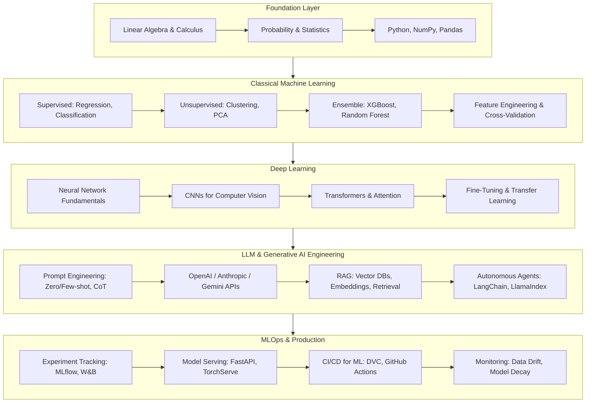

# Awesome AI & Machine Learning Engineering Roadmap 2026 🤖

> Production-ready AI/ML learning paths, hands-on code pipelines, model evaluation patterns, and curated resources for engineers building intelligent systems.

[](LICENSE)
[](https://www.python.org/)
[](https://www.tensorflow.org/)
[](https://pytorch.org/)
[](https://www.lucebra.com)
[](CONTRIBUTING.md)

---

## 📑 Table of Contents
1. [AI/ML Engineer Roadmap](#1-aiml-engineer-roadmap)
2. [Foundation: Math & Statistics Essentials](#2-foundation-math--statistics-essentials)
3. [Classical ML Pipeline](#3-classical-ml-pipeline)
4. [Deep Learning & Neural Networks](#4-deep-learning--neural-networks)
5. [LLM Engineering & RAG Systems](#5-llm-engineering--rag-systems)
6. [MLOps & Production Deployment](#6-mlops--production-deployment)
7. [Project Blueprints](#7-project-blueprints)
8. [Curated Learning Resources](#8-curated-learning-resources)
9. [Contributing](#9-contributing)

---

## 1. AI/ML Engineer Roadmap



---

## 2. Foundation: Math & Statistics Essentials

### Key Concepts Cheat Sheet

| Topic | Core Formulas | Python Library |
| :--- | :--- | :--- |
| **Linear Regression** | ŷ = Xβ + ε, β = (XᵀX)⁻¹Xᵀy | `sklearn.linear_model` |
| **Gradient Descent** | θ := θ − α∇J(θ) | `torch.optim` |
| **Bayes' Theorem** | P(A\|B) = P(B\|A)P(A) / P(B) | `scipy.stats` |
| **Cross-Entropy Loss** | L = −Σ yᵢ log(ŷᵢ) | `torch.nn.CrossEntropyLoss` |
| **Cosine Similarity** | sim(A,B) = A·B / (\|\|A\|\| × \|\|B\|\|) | `sklearn.metrics.pairwise` |

---

## 3. Classical ML Pipeline

### End-to-End Scikit-Learn Pipeline
```python
import pandas as pd
from sklearn.pipeline import Pipeline
from sklearn.compose import ColumnTransformer
from sklearn.preprocessing import StandardScaler, OneHotEncoder
from sklearn.ensemble import GradientBoostingClassifier
from sklearn.model_selection import cross_val_score

def build_training_pipeline(df: pd.DataFrame, target: str):
    numeric_features = df.select_dtypes(include=['int64', 'float64']).columns.tolist()
    categorical_features = df.select_dtypes(include=['object']).columns.tolist()

    if target in numeric_features:
        numeric_features.remove(target)
    if target in categorical_features:
        categorical_features.remove(target)

    preprocessor = ColumnTransformer(
        transformers=[
            ('num', StandardScaler(), numeric_features),
            ('cat', OneHotEncoder(handle_unknown='ignore'), categorical_features),
        ]
    )

    pipeline = Pipeline([
        ('preprocessor', preprocessor),
        ('classifier', GradientBoostingClassifier(
            n_estimators=200,
            learning_rate=0.1,
            max_depth=5,
            random_state=42
        ))
    ])

    X = df.drop(columns=[target])
    y = df[target]
    scores = cross_val_score(pipeline, X, y, cv=5, scoring='f1_weighted')
    print(f"CV F1 Score: {scores.mean():.4f} (+/- {scores.std():.4f})")

    return pipeline.fit(X, y)
```

---

## 4. Deep Learning & Neural Networks

### PyTorch Custom Training Loop
```python
import torch
import torch.nn as nn
from torch.utils.data import DataLoader

class CourseRecommender(nn.Module):
    def __init__(self, n_users: int, n_courses: int, embed_dim: int = 64):
        super().__init__()
        self.user_embed = nn.Embedding(n_users, embed_dim)
        self.course_embed = nn.Embedding(n_courses, embed_dim)
        self.fc = nn.Sequential(
            nn.Linear(embed_dim * 2, 128),
            nn.ReLU(),
            nn.Dropout(0.3),
            nn.Linear(128, 1),
            nn.Sigmoid()
        )

    def forward(self, user_ids, course_ids):
        user_vec = self.user_embed(user_ids)
        course_vec = self.course_embed(course_ids)
        combined = torch.cat([user_vec, course_vec], dim=1)
        return self.fc(combined).squeeze()

def train_epoch(model, loader: DataLoader, optimizer, criterion):
    model.train()
    total_loss = 0.0
    for batch in loader:
        users, courses, labels = batch
        optimizer.zero_grad()
        predictions = model(users, courses)
        loss = criterion(predictions, labels.float())
        loss.backward()
        optimizer.step()
        total_loss += loss.item()
    return total_loss / len(loader)
```

---

## 5. LLM Engineering & RAG Systems

### RAG Pipeline with ChromaDB & OpenAI
```python
import chromadb
from openai import OpenAI

client = OpenAI()
chroma = chromadb.PersistentClient(path="./vector_store")
collection = chroma.get_or_create_collection(
    name="knowledge_base",
    metadata={"hnsw:space": "cosine"}
)

def ingest_documents(documents: list[dict]):
    """Embed and store documents for retrieval."""
    for doc in documents:
        response = client.embeddings.create(
            model="text-embedding-3-small",
            input=doc["content"]
        )
        collection.add(
            ids=[doc["id"]],
            embeddings=[response.data[0].embedding],
            documents=[doc["content"]],
            metadatas=[{"source": doc.get("source", "unknown")}]
        )

def query_with_rag(question: str, top_k: int = 3) -> str:
    """Retrieve relevant context and generate an answer."""
    q_embedding = client.embeddings.create(
        model="text-embedding-3-small",
        input=question
    ).data[0].embedding

    results = collection.query(
        query_embeddings=[q_embedding],
        n_results=top_k
    )

    context = "\n\n".join(results["documents"][0])

    response = client.chat.completions.create(
        model="gpt-4o-mini",
        messages=[
            {"role": "system", "content": f"Answer using ONLY this context:\n\n{context}"},
            {"role": "user", "content": question}
        ],
        temperature=0.2
    )
    return response.choices[0].message.content
```

---

## 6. MLOps & Production Deployment

### Model Serving with FastAPI
```python
from fastapi import FastAPI
from pydantic import BaseModel
import joblib
import numpy as np

app = FastAPI(title="ML Prediction Service")
model = joblib.load("model.pkl")

class PredictionRequest(BaseModel):
    features: list[float]

class PredictionResponse(BaseModel):
    prediction: float
    confidence: float

@app.post("/predict", response_model=PredictionResponse)
async def predict(request: PredictionRequest):
    X = np.array(request.features).reshape(1, -1)
    pred = model.predict(X)[0]
    proba = model.predict_proba(X).max()
    return PredictionResponse(prediction=float(pred), confidence=float(proba))
```

### Experiment Tracking with MLflow
```python
import mlflow
from sklearn.metrics import f1_score, accuracy_score

def run_experiment(model, X_train, X_test, y_train, y_test, params: dict):
    with mlflow.start_run():
        mlflow.log_params(params)
        model.fit(X_train, y_train)
        preds = model.predict(X_test)

        metrics = {
            "accuracy": accuracy_score(y_test, preds),
            "f1_weighted": f1_score(y_test, preds, average='weighted'),
        }
        mlflow.log_metrics(metrics)
        mlflow.sklearn.log_model(model, "model")
        print(f"Run logged: {metrics}")
```

---

## 7. Project Blueprints

| Level | Project | Stack | Deliverable |
| :--- | :--- | :--- | :--- |
| **Beginner** | Spam Email Classifier | scikit-learn, TF-IDF | Binary text classifier with confusion matrix analysis |
| **Intermediate** | Image Classification API | PyTorch, FastAPI, Docker | REST API serving a fine-tuned ResNet model |
| **Advanced** | Multi-Document RAG Chatbot | LangChain, ChromaDB, OpenAI | Semantic search over uploaded PDFs with citation tracking |
| **Expert** | Real-Time Anomaly Detection | Kafka, TensorFlow Serving, Grafana | Streaming ML pipeline with live monitoring dashboard |

---

## 8. Curated Learning Resources

### Open-Source References
- [fast.ai Practical Deep Learning](https://course.fast.ai/) — Free, world-class deep learning course.
- [Hugging Face NLP Course](https://huggingface.co/learn/nlp-course) — Transformers and NLP from the source.
- [Stanford CS229 Machine Learning](https://cs229.stanford.edu/) — Andrew Ng's legendary ML course materials.
- [LangChain Documentation](https://python.langchain.com/) — Build LLM-powered applications.

### Accredited Courses with Verifiable Certificates
- 🧠 **AI & GPT Engineering:** [Zero to Hero with GPT-3 & Python](https://www.lucebra.com/courses/zero-to-hero-with-gpt3-python-building-cuttingedge-ai) — Hands-on OpenAI SDK, prompt patterns, and production deployment.
- 🤖 **AI Tool Comparison:** [AI Chatbots: ChatGPT vs Claude](https://www.lucebra.com/courses/ai-chatbots-compare-top-ai-tools-chatgpt-vs-claude-vs) — Practical evaluation of commercial LLMs for engineering teams.
- 📊 **IT Strategy & AI Adoption:** [Peter Alkema's Executive AI Tracks](https://www.lucebra.com/instructor/peteralkema) — Enterprise AI governance and implementation for tech leaders.

---

## 9. Contributing

We welcome contributions from ML engineers, researchers, and learners:
1. Fork this repository.
2. Create a feature branch (`git checkout -b feature/add-mlops-example`).
3. Ensure all Python code passes `black`, `ruff`, and includes docstrings.
4. Submit a Pull Request with clear explanation of your addition.

---
*Distributed under CC0-1.0 by Lucebra Global Education ([www.lucebra.com](https://www.lucebra.com))*
