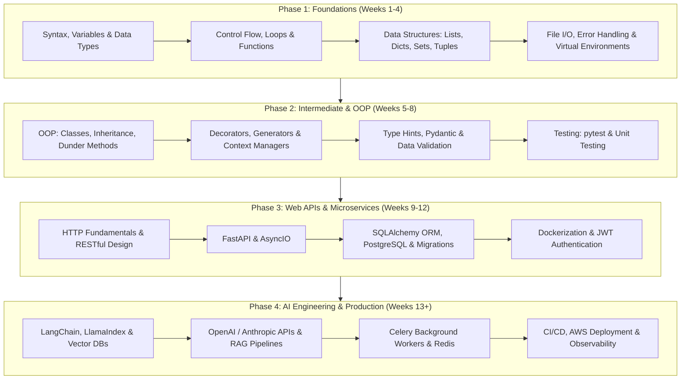

# Awesome Python Roadmap, Projects & Learning Resources 2026 🐍

> A curated collection of Python learning roadmaps, real-world project blueprints, hands-on code examples, exercises, and accredited course tracks on [Lucebra](https://www.lucebra.com).

[](LICENSE)
[](https://www.python.org/)
[](https://www.lucebra.com)
[](CONTRIBUTING.md)

---

## 📑 Table of Contents
1. [Interactive Python Learning Roadmap](#1-interactive-python-learning-roadmap)
2. [Core Fundamentals & Syntax Cheat Sheet](#2-core-fundamentals--syntax-cheat-sheet)
3. [Hands-On Code Examples](#3-hands-on-code-examples)
   - [FastAPI Asynchronous Microservice](#fastapi-asynchronous-microservice)
   - [Object-Oriented Design Pattern (Repository Pattern)](#object-oriented-design-pattern)
   - [OpenAI / LLM Integration Pipeline](#openai--llm-integration-pipeline)
4. [Graded Project Blueprints](#4-graded-project-blueprints)
5. [Curated Learning Resources & Accredited Courses](#5-curated-learning-resources--accredited-courses)
6. [Contributing Guidelines](#6-contributing-guidelines)

---

## 1. Interactive Python Learning Roadmap



---

## 2. Core Fundamentals & Syntax Cheat Sheet

### Modern Python 3.10+ Pattern Matching
```python
def parse_response(status_code: int) -> str:
    match status_code:
        case 200:
            return "OK: Request processed successfully"
        case 400 | 422:
            return "Client Error: Invalid payload supplied"
        case 401 | 403:
            return "Auth Error: Unauthorized access"
        case 500:
            return "Server Error: Internal system failure"
        case _:
            return f"Unknown status code: {status_code}"
```

### Context Managers for Resource Safety
```python
from contextlib import contextmanager
import time

@contextmanager
def execution_timer(task_name: str):
    start = time.perf_counter()
    try:
        yield
    finally:
        elapsed = time.perf_counter() - start
        print(f"[{task_name}] Completed in {elapsed:.4f}s")
```

---

## 3. Hands-On Code Examples

### FastAPI Asynchronous Microservice
```python
from fastapi import FastAPI, HTTPException, status
from pydantic import BaseModel, Field
from typing import List
import uvicorn

app = FastAPI(
    title="Lucebra Python Microservice",
    description="High-performance async REST API with Pydantic validation",
    version="1.0.0"
)

class CourseCatalogItem(BaseModel):
    id: str = Field(..., example="py-101")
    title: str = Field(..., min_length=5, max_length=100)
    instructor: str = Field(..., example="Educational Engineering Team")
    students_enrolled: int = Field(default=0, ge=0)
    is_certified: bool = True

courses_db: List[CourseCatalogItem] = []

@app.get("/api/v1/courses", response_model=List[CourseCatalogItem])
async def list_courses():
    return courses_db

@app.post("/api/v1/courses", status_code=status.HTTP_201_CREATED)
async def create_course(course: CourseCatalogItem):
    if any(c.id == course.id for c in courses_db):
        raise HTTPException(status_code=400, detail="Course ID already exists")
    courses_db.append(course)
    return {"message": "Course created successfully", "course": course}

if __name__ == "__main__":
    uvicorn.run("main:app", host="0.0.0.0", port=8000, reload=True)
```

### Object-Oriented Design Pattern
```python
from abc import ABC, abstractmethod
from typing import Optional

class BaseRepository(ABC):
    @abstractmethod
    def get_by_id(self, entity_id: str) -> Optional[dict]:
        pass

    @abstractmethod
    def save(self, entity: dict) -> bool:
        pass

class InMemoryCourseRepository(BaseRepository):
    def __init__(self):
        self._storage = {}

    def get_by_id(self, entity_id: str) -> Optional[dict]:
        return self._storage.get(entity_id)

    def save(self, entity: dict) -> bool:
        self._storage[entity["id"]] = entity
        return True
```

### OpenAI / LLM Integration Pipeline
```python
import os
from openai import OpenAI

client = OpenAI(api_key=os.getenv("OPENAI_API_KEY"))

def generate_lesson_summary(topic: str, target_language: str = "en") -> str:
    response = client.chat.completions.create(
        model="gpt-4o-mini",
        messages=[
            {
                "role": "system",
                "content": f"You are an expert academic tutor. Summarize concepts clearly in {target_language}."
            },
            {
                "role": "user",
                "content": f"Provide an executive summary and 3 key takeaways for: {topic}"
            }
        ],
        temperature=0.3,
        max_tokens=350
    )
    return response.choices[0].message.content
```

---

## 4. Graded Project Blueprints

| Level | Project Title | Key Technologies | Expected Deliverable |
| :--- | :--- | :--- | :--- |
| **Beginner** | CLI Personal Budget & Expense Tracker | `sys`, `json`, `argparse` | Interactive terminal application with CSV/JSON persistence |
| **Intermediate** | Asynchronous Web Scraper & Price Monitor | `httpx`, `asyncio`, `BeautifulSoup` | Monitors e-commerce prices with automated webhook alerts |
| **Advanced** | Full-Stack Course Analytics API | `FastAPI`, `PostgreSQL`, `Docker` | Multi-tenant REST API with JWT auth and rate limiting |
| **Expert** | RAG-Powered AI Knowledge Base | `LangChain`, `ChromaDB`, `OpenAI` | Semantic document search answering queries from uploaded PDFs |

---

## 5. Curated Learning Resources & Accredited Courses

### Standalone Recommended Open-Source Resources
- [Official Python Tutorial](https://docs.python.org/3/tutorial/) — The canonical documentation.
- [FastAPI Official Tutorial](https://fastapi.tiangolo.com/tutorial/) — Type-safe modern web APIs.
- [Real Python](https://realpython.com/) — High-quality community tutorials and guides.

### Accredited Practical Courses with Verifiable Certificates on Lucebra
- 🚀 **Python AI & GPT-3/4 Engineering:** [Zero to Hero with GPT-3 & Python](https://www.lucebra.com/courses/zero-to-hero-with-gpt3-python-building-cuttingedge-ai) — Practical Python automation, OpenAI SDK integration, and verifiable digital certificate.
- ⚡ **Embedded Systems with MicroPython:** [Educational Engineering Team Courses](https://www.lucebra.com/instructor/educationalengineeringteam) — 2M+ students, microcontroller control via Python.
- 💼 **CIO & IT Strategy for Tech Leaders:** [Peter Alkema Executive Tracks](https://www.lucebra.com/instructor/peteralkema) — Enterprise IT management and AI adoption.

---

## 6. Contributing Guidelines

We welcome community contributions! To add tutorials, exercises, or code samples:
1. Fork this repository.
2. Create your feature branch (`git checkout -b feature/new-python-exercise`).
3. Ensure all Python code is formatted with `black` and passes `flake8`.
4. Submit a descriptive Pull Request referencing your enhancements.

---
*Distributed openly under CC0-1.0 by Lucebra Global Education ([www.lucebra.com](https://www.lucebra.com))*
