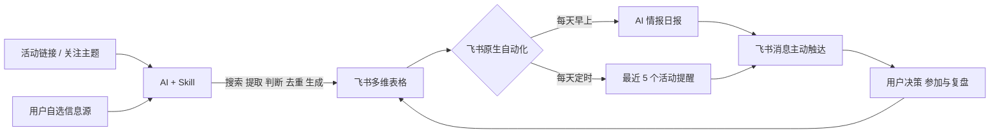

# 《AI村口情报中心》：别让好消息只在村口路过

> 每天替你打听 AI 圈的新鲜事，也替你盯住那些不能再错过的截止日期。

[](LICENSE)
[](https://www.feishu.cn/product/base)
[](ai-village-intelligence/tests)

把散落在各个平台的 AI 新闻和活动，变成每天主动送上门、临近截止还会追着你催的个人情报中心。

《AI村口情报中心》是一套由 **AI、Skill、飞书多维表格和飞书原生自动化**共同运行的个人情报闭环。AI 负责搜索、理解、提取、判断、去重和生成；飞书负责数据存储、状态管理、定时筛选和主动触达。

## 为什么做

独立开发者、学生和副业创作者经常在公众号、社区、群聊或资讯网站看到比赛、黑客松、征文和开发者活动。看到时觉得“之后一定参加”，顺手收藏，转头却被新的工作淹没。等再次想起来，报名或提交已经截止。

真正的问题不是没有看到机会，而是机会没有进入一个持续运行、会主动推进的系统。

> 从“我看到了一个机会”，推进到“我没有错过这个机会”。

（亲测，通过飞书的提醒功能，已经获得上万元，已交税）


## 两个核心功能

### AI 情报日报

- 根据用户配置的信息源和关注主题搜索 AI 行业动态。
- AI 合并重复事件，筛选真正值得关注的内容。
- 每条新闻保留来源名称和原始链接，不把无法核验的信息写成事实。
- 日报写入飞书多维表格，由飞书自动化每天定时发送。
- 用户可直接修改 Markdown 提示词，建立自己的情报来源组合。

#### 新闻来源

项目默认从以下页面发现当天的候选情报：

- [Sopilot Hot Tweets](https://sopilot.net/zh/hot-tweets)：用于观察 AI 圈热门推文和正在集中讨论的话题。
- [NewsNow](https://newsnow.busiyi.world/)：用于浏览聚合新闻与热点线索，快速发现当天值得继续核验的事件。
- [Buzzing](https://www.buzzing.cc/)：用于补充不同平台的热榜信息，观察跨平台公共讨论热度。

这些页面只是情报发现入口，不构成广告、推荐或背书。AI 发现候选新闻后，还会继续查找原始报道、官方公告、产品博客或研究机构页面进行核验；用户也可以直接修改 [`daily-intelligence-prompt.md`](ai-village-intelligence/references/daily-intelligence-prompt.md) 中的“热点来源”，换成自己信任的信息源。

### 截止日期救命器

- 用户只需把活动链接交给安装了 Skill 的 AI。
- AI 提取活动标题、链接、开始日期和结束日期。
- 系统按规范化链接查重，以“进行中”状态写入活动表。
- 飞书每天筛选尚未结束的活动，AI 按结束日期生成最近 5 条推荐。
- 活动消息直接展示完整 URL 和结束日期。
- “参考及注意事项”留给用户完成活动后复盘，AI 不代填、不覆盖。

## AI + 飞书持续运行闭环



少了 AI，系统无法理解非结构化网页、判断重要性或生成可读摘要；少了飞书，信息无法持续保存、按时间筛选并稳定触达。两者都参与运行时核心流程。

## 复制案例，创建自己的 AI 村口情报中心

项目提供了一份已经跑通的[飞书案例模板](https://lucianaib.feishu.cn/wiki/HbOawBgMai2tI5kvSQIc7odlnbg)。模板允许持链接者读取与复制。

### 前置条件

- Node.js 20+
- PowerShell 5.1 或 PowerShell 7
- 已安装并登录 `lark-cli`
- 支持 Skills 的 AI 客户端或 Agent 环境

### 1. 安装 Skill

直接对你的 AI 说，帮我安装 Skill 即可（本教程中，以豆包工作伙伴为例）

> 帮我安装一下这个 skill：https://github.com/LucianaiB2004/ai-village-intelligence


AI 就会自动完成 Skill 的安装以及飞书 CLI 的安装，并且通过飞书 CLI 进行复制模板并生成个人配置。

### 2. 配置自己的信息来源

这里我已经设置了三条信息来源，你也可以进行自定义的增加。

- 在 `config.local.json` 中修改关注主题、活动来源和推送时间。
- 在 [`daily-intelligence-prompt.md`](ai-village-intelligence/references/daily-intelligence-prompt.md) 中修改新闻来源。
- 在 [`activity-recommendation-prompt.md`](ai-village-intelligence/references/activity-recommendation-prompt.md) 中修改活动推荐格式和规则。

默认来源只是“信息可能从哪里获得”的示例，不构成广告、推荐、背书或质量承诺。

### 3.数据表测试

> 用这个 skill 生成一份我的今日 AI 情报日报，并且存入热点日报数据表
> 帮我把这个活动加进入活动数据表： https://mp.weixin.qq.com/s/GGQebCABpbtyE7kCpCB69g


### 4.启用工作流

在进行多维表创建以后，我们需要手动进行工作流的保存与应用。


### 5. 触发工作流运行

这个时候，我们就已经完成了全部操作。我们现在只需要对 AI 说：

> 两个工作流都已经启用了，请你都触发运行


完整说明见[模板安装流程](ai-village-intelligence/references/template-installation.md)和[上手指南](ai-village-intelligence/references/setup-guide.md)。

## 项目结构

仓库按“项目说明 → 可安装 Skill → 飞书运行证据”组织。第一次使用时从根目录 README 进入，真正参与安装和自动化运行的内容集中在 `ai-village-intelligence/`。

```text
.
├── README.md                         # 项目首页、安装路径与效果展示
├── LICENSE                           # MIT 开源协议
├── screenshots/                     # 安装、数据表、工作流与消息效果截图
│
├── ai-village-intelligence/         # 可直接安装的 AI 村口情报中心 Skill
│   ├── SKILL.md                     # AI 执行入口：路由完整安装与使用流程
│   ├── agents/openai.yaml           # Skill 名称、简介和默认调用信息
│   ├── assets/config.example.json   # 不含凭据的用户配置样例
│   │
│   ├── references/                  # AI 需要读取的规则与操作说明
│   │   ├── daily-intelligence-prompt.md      # 新闻来源与日报生成提示词
│   │   ├── activity-recommendation-prompt.md # 活动筛选与推送格式
│   │   ├── template-installation.md          # 飞书模板复制流程
│   │   └── automation-setup.md               # 三条工作流及触发条件
│   │
│   ├── scripts/                     # 飞书 CLI 确定性执行层
│   │   ├── install_from_template.ps1 # 复制模板并生成个人配置
│   │   ├── configure_workflows.ps1   # 创建、更新和启停工作流
│   │   ├── upsert_activity.ps1       # 活动查重与入库
│   │   └── write_digest.ps1          # AI 日报入库
│   │
│   ├── tests/                       # 37 项确定性逻辑与回归测试
│   ├── examples/                    # 飞书 AI 绝活大会活动案例
│   └── docs/                        # 参赛介绍、演示脚本与验证报告
│
├── artifacts/                       # Base 结构、日报和工作流验证证据
└── docs/superpowers/                # 设计规格与实施计划
```

### 从哪里开始

| 你想做什么 | 建议入口 |
|---|---|
| 安装并复制自己的飞书案例 | [`SKILL.md`](ai-village-intelligence/SKILL.md) |
| 修改 AI 新闻来源和生成规则 | [`daily-intelligence-prompt.md`](ai-village-intelligence/references/daily-intelligence-prompt.md) |
| 修改活动推荐格式和筛选规则 | [`activity-recommendation-prompt.md`](ai-village-intelligence/references/activity-recommendation-prompt.md) |
| 了解三条飞书工作流如何运行 | [`automation-setup.md`](ai-village-intelligence/references/automation-setup.md) |
| 查看真实验证结果 | [`verification-report.md`](ai-village-intelligence/docs/verification-report.md) |

## 验证

```powershell
cd ai-village-intelligence
node --test
```

当前 37 项测试覆盖活动校验与查重、日报事实契约、配置安全、工作流定义和复制模板后的个人接收人保护。

项目还完成了真实飞书验证：活动入库、日报入库、工作流启用、定时消息触达、按截止日期排序和完整 URL 展示均已跑通。详见[验证报告](ai-village-intelligence/docs/verification-report.md)。

## 开源协议

本项目采用 [MIT License](LICENSE)。你可以使用、复制、修改和分发本项目，但请保留原始版权与许可声明。
