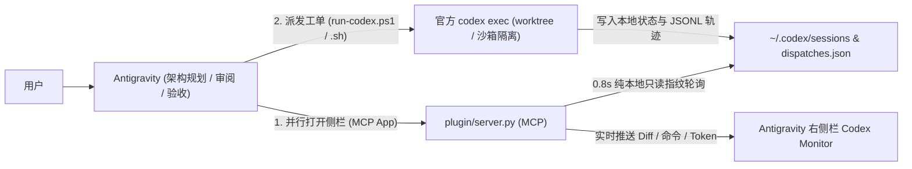

# Antigravity Codex Monitor

**简体中文** · [English](./README.en.md)

[](https://github.com/Lyl101010/antigravity-codex-monitor)
[](https://github.com/Lyl101010/antigravity-codex-monitor)
[](https://github.com/Lyl101010/antigravity-codex-monitor)
[](https://github.com/Lyl101010/antigravity-codex-monitor)
[](LICENSE)
[](https://glama.ai/mcp/servers/Lyl101010/antigravity-codex-monitor)

面向 **Google Antigravity** 的原生 **MCP Server / MCP App**（Model Context Protocol）实时协作监控面板与 `codex-worker` 派单套件。

当你让 Antigravity（Gemini）统筹规划并把编码、重构、写脚本、补单测等任务派发给本地官方 **OpenAI Codex CLI（`codex exec`）** 执行时，以往 `codex exec` 只能在后台黑盒运行、看不到中间过程。装上本插件后，Antigravity 右侧辅助栏会自动弹出 **Codex Monitor**，以 **0.8 秒** 实时流式展示每一次派单的执行命令、语法高亮文件 Diff、模型档位、Token 与缓存命中统计——**纯本地只读轮询，零额外 LLM 消耗，零 CDP 侵入，客户端升级不失效**。

> 供 AI Agent 读取的自动部署契约见 **[`INSTALL_SKILL.md`](./INSTALL_SKILL.md)**。

---

## 实机预览

### 15 秒实机动态演示


### 浅色暖纸模式（左侧会话列表 + 实时对话流 / 命令输出 / 语法高亮 Diff）


### 深色书卷模式（自适应宿主深浅色，支持右上角一键切换）


*(本地也可直接用浏览器打开 `plugin/ui/app.html?demo=1` 或 `?demo=1&theme=dark` 离线体验交互式演示界面。)*

---

## 核心特性

- **告别 `codex exec` 黑盒**：派单瞬间自动弹出右侧栏面板，每 0.8s 实时流式呈现 Codex 正在执行的命令、退出码、语法高亮 Diff、推理模型与 Token / 缓存命中率，纯本地状态指纹轮询，**不消耗任何模型额度**。
- **原生 MCP App，不惧客户端更新**：严格遵循 Antigravity 官方插件与 MCP Apps（SEP-1865）规范，**不修改 `.asar`、不依赖 CDP 注入、不破坏客户端签名**，官方更新后依然稳定可用。
- **一个插件，开箱即用**：内置侧栏监控面板 + 跨平台派单脚本（Windows `run-codex.ps1` / macOS & Linux `run-codex.sh`）+ 内嵌 `codex-worker` Skill，前端已预编译为单文件 HTML，**最终用户安装无需 Node.js**。
- **无工作区也能派单**。省略目标路径时，启动器会在 `~/.gemini/antigravity/scratch/codex-tasks/` 下创建独立任务目录。可用 `ANTIGRAVITY_SCRATCH_DIR` 自定义 scratch 根目录。
- **默认隔离**。只读和写任务的默认沙箱分别为 `read-only` 和 `workspace-write`。可信写任务可显式指定 `-Sandbox full-access` / `--sandbox full-access`。Git 写任务默认使用 `--worktree`，支持按 `SESSION_ID` 续跑，最多两轮，合并与推送须由用户确认。
- **为什么用 `codex exec + Monitor` 而不是 `codex mcp-server`？**

| 对比维度 | `antigravity-codex-monitor` (`codex exec`) | `codex mcp-server` |
| :--- | :--- | :--- |
| **执行过程可见性** | 右侧栏每 0.8s 实时直播命令、Diff 与 Token | 黑盒阻塞，任务执行期间看不到实时过程 |
| **长任务稳定性** | 走 Antigravity 后台异步命令，5–10 分钟任务不断连 | 容易触发 MCP 单次 RPC 调用超时 |
| **隔离与档位控制** | 自动 Git `--worktree` 隔离 + `low/medium/high/xhigh` 档位 | 仅暴露基础调用，无内置 worktree 封装 |

---

## 快速安装

### 环境要求
- **Google Antigravity 2.x** 桌面端
- **OpenAI Codex CLI**（官方版，已完成 `codex login`）
- **Python 3.10+** 且已安装 `mcp` 包（`pip install mcp`），支持 1.x 和 2.x

### 方式一：复制引导词发给你的 AI Agent 一键安装（推荐）

> **复制发给 Antigravity**：  
> 请帮我克隆 `https://github.com/Lyl101010/antigravity-codex-monitor.git`，阅读仓库内的 `INSTALL_SKILL.md`，然后依次执行 `python install.py doctor --json`（如缺少 `mcp` 请提示安装）、`python install.py install --json` 和 `python install.py verify --json` 完成部署验收。

### 方式二：手动命令行安装

```bash
git clone https://github.com/Lyl101010/antigravity-codex-monitor.git
cd antigravity-codex-monitor

# 1. 检查 Python（含 mcp）与 Codex CLI 环境
python install.py doctor

# 2. 安装自包含插件至 ~/.gemini/config/plugins/antigravity-codex-monitor
python install.py install

# 3. 真实 MCP stdio 握手验收
python install.py verify
```

*(macOS / Linux 若默认命令为 `python3`，将上述 `python` 替换为 `python3` 即可。)*

### 可选：让 Antigravity 默认自动委派杂活给 Codex
如果你想让 Antigravity 遇到写脚本、重构、补单测等机械任务时自动调用 Codex 并弹出面板，可以将 [`examples/codex-delegation-rule.md`](./examples/codex-delegation-rule.md) 复制到 `~/.gemini/config/rules/`。

### 一键卸载
```bash
python install.py uninstall
```
仅删除插件安装目录，绝不触碰 `~/.codex/` 中的历史会话或你的项目代码。

---

## 工作原理



---

## 目录结构

```text
antigravity-codex-monitor/
├── install.py                       # 跨平台生命周期 CLI (doctor / install / verify / uninstall)
├── INSTALL_SKILL.md                 # AI Agent 自动部署契约
├── plugin/                          # 自包含 Antigravity 原生插件包
│   ├── plugin.json                  # 插件清单与快捷提示
│   ├── server.py                    # MCP 服务端 (open_codex_monitor / get_codex_state)
│   ├── dashboard_server.py          # 纯标准库本地会话解析与指纹引擎
│   ├── assets/logo.svg              # 原创 SVG 图标
│   ├── ui/app.html                  # 预编译单文件前端 (安装无需 Node.js)
│   ├── scripts/
│   │   ├── run-codex.ps1            # Windows PowerShell 派单封装
│   │   └── run-codex.sh             # macOS / Linux Bash 派单封装
│   └── skills/
│       └── codex-worker/SKILL.md    # 内嵌跨平台派单 Skill
├── ui-src/                          # 前端源码 (TypeScript + esbuild，供二次开发)
├── examples/
│   └── codex-delegation-rule.md     # 可选全局协作规则模板
├── assets/                          # 脱敏演示截图
└── tests/
    └── test_monitor.py              # 单元测试
```

---

## 安全与合规边界

- **严格单向调用**：仅支持 **Antigravity → 官方 `codex exec`**，不包含任何由 Codex 反向调用个人订阅版 Antigravity CLI（`agy`）的代码或脚本。
- **不接触任何凭据**：绝不读取、导出或转发 `~/.codex/auth.json`、OAuth Token 或 Cookie；所有模型鉴权完全留存在官方原生 CLI 内部。
- **纯本地、零遥测**：不连接任何第三方服务器，不收集匿名遥测，默认 MCP 模式下不额外监听外部网络端口。

---

## 贡献与前端二次开发

如果你需要修改前端样式或交互逻辑：

```bash
cd ui-src
npm install
npm run build   # 重新编译生成 plugin/ui/app.html
cd ..
python -m unittest discover -s tests -v
```

## License

[MIT](./LICENSE)
