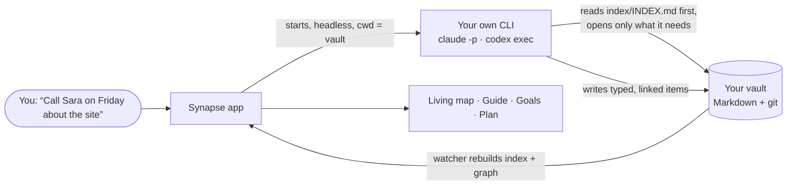

<div align="center">


# Synapse

**The second brain that organizes itself.**

Talk to it. It files, links, plans and reviews — in plain Markdown files you own,<br>
on the AI subscription you already pay for, drawn as a living map of your mind.

**English** · [فارسی](README.fa.md)

[](LICENSE)


-f59e0b)

[Get started](#get-started) · [How it works](#how-it-works) · [Features](#features) · [Privacy](#privacy-and-security) · [FAQ](#faq) · [Contributing](#contributing)


</div>

## What is Synapse?

Synapse is an AI-native second brain and life OS. Your notes, ideas, tasks, projects, goals, habits, people and journal live as a folder of Markdown files on your own disk. You never have to sort them: you say what is on your mind — in a sentence, in Persian or English — and a brain files it as the right kind of item, links it to what it belongs to, and keeps the whole picture current. You see that picture as a living map, and every day the brain tells you what deserves your time.

The brain is not a service we run. It is **your own AI subscription**: Synapse starts the official, unmodified command-line app you are already signed in to (Claude Code or OpenAI Codex) with your vault as its working folder. No API keys to buy, no account with us, and Synapse never sees your credentials.

## Why?

Second brains rarely die from a lack of features. They die from upkeep. Folders, tags, templates and links are work, and the moment life gets busy the system falls behind and is abandoned. Tools like Obsidian give you total control and total responsibility; AI note apps take the work away and your files with it.

Synapse is built on a different bet: **the AI does the filing, you keep the files.**

- **Yours.** A plain folder of Markdown with YAML frontmatter and `[[wikilinks]]`. Obsidian opens it; any editor can read it; it outlives this app.
- **Effortless.** Capture in one sentence. The brain decides the kind, the category, the links, the due date.
- **Reversible.** Every brain run is a git commit in your vault. One click undoes it.
- **Private.** Local-first. Nothing leaves your machine except what the brain you chose reads to answer you. On a Mac the whole vault sits in an AES-256 encrypted disk opened with your password or Touch ID.
- **Independent.** Your subscription, your engine, your choice of model and effort — switchable at any time.

## How it works



1. **You talk.** Type or dictate into the composer, or capture straight to the inbox.
2. **Your brain runs.** Synapse spawns your signed-in `claude` (or `codex`) with the vault as its folder, the right skill (capture, ask, review, plan…) and a short runtime context: date, language, what is on screen.
3. **Index first.** The brain reads a small generated index (≤ 2.5k tokens of always-loaded instructions) and opens only the files it needs — so answers stay fast and cheap, even with thousands of items.
4. **It writes plain files.** New and changed items land in `nodes/` as Markdown; the run is committed to the vault's own git history.
5. **You see it.** The server rebuilds the index and graph, and the map lights up the items the brain touched — live, while it works.

## Features

- **🧠 Talk instead of organize** — one composer for capture, questions and conversation; replies in the language you wrote in; dictation in the browser.
- **🌌 A living map of your mind** — a WebGL map where categories are glowing regions and every item has its own shape; islands for separate worlds (a business, a page, *your character*), each with a switch to connect it or keep it apart; watch the brain's reads and writes travel along the links in real time.
- **🧭 A guide that tells you what matters now** — overdue and due-today items, what is in progress, today's habits, the brain's own priorities and the questions it would rather ask you than guess.
- **🎯 Goals with their work** — every goal with its progress ring, its why and its target date, and under it the projects, tasks, habits and decisions that move it; tick them right there.
- **🗓️ Plan and reviews** — a daily plan, a full review that archives what is stale and re-ranks priorities, and a weekly review — on demand or on a schedule; a missed day is made up the next time the app opens.
- **🗂️ Categories and islands, from the whole to the parts** — a page for each with everything in it, what needs attention, an analysis, and its own small map.
- **📥 An inbox the brain empties** — quick captures wait there until the brain files them all in one go.
- **🔗 Your vault inside other AI apps** — Synapse is an MCP server with its own OAuth sign-in: connect it to Claude, ChatGPT, Claude Code or Codex and they can search, read and (if you allow) change your items.
- **🔒 Encrypted on your Mac** — the desktop app keeps the vault in an AES-256 encrypted disk image, unlocked by your password or Touch ID, with a recovery key and an encrypted backup.
- **📱 Everywhere you are** — Mac app, a server you self-host with Docker, or a browser; pair a phone on the same Wi-Fi with a QR code and add it to the home screen.
- **🌗 Persian and English, light and dark** — an RTL-first interface with an English toggle, a 24-hour clock, and a light theme checked page by page.
- **↩️ Undo, backup and move** — every brain run is undoable; export the whole vault and bring it into another Synapse in one step.

## Screenshots

| | |
|---|---|
|  |  |
| **The mind map** — categories, islands and the core | **Guide** — what needs you now |
|  |  |
| **Goals** — each with the work that serves it | **A category's own map** |
|  |  |
| **Plan** — today, the week and every project's next step | **Light theme** |

## Get started

You need **Node.js 22**, **pnpm 9** (`corepack enable`), **git**, and a brain: the [Claude Code CLI](https://docs.anthropic.com/en/docs/claude-code) signed in once (`claude`, then `/login`), or the [Codex CLI](https://github.com/openai/codex) signed in with your ChatGPT account. API keys (Anthropic, OpenAI, OpenRouter) work too.

| Way | Best for | Command |
|---|---|---|
| **Try it** | a first look with sample data | `pnpm install && pnpm vault:seed && pnpm dev` |
| **Mac app** | daily use on an Apple-silicon Mac, encrypted | `pnpm install && pnpm mac:dmg` |
| **Self-host** | phone + every computer, from anywhere | `docker compose up -d --build` |

### Try it from source

```bash
git clone https://github.com/Mahdi-Ai-Agent/synapse-os.git && cd synapse-os
pnpm install
pnpm vault:seed          # a fresh vault with fictional sample data at ~/Synapse/vault
                         # (or: pnpm vault:create for an empty one; SYNAPSE_VAULT=... puts it elsewhere)
pnpm dev                 # open http://localhost:5173 (the server runs on :4317)
```

`pnpm build && pnpm start` runs the same thing as one process at `http://127.0.0.1:4317`.

### The Mac app

```bash
pnpm install
pnpm mac:dmg             # → apps/desktop/release/Synapse-<version>-arm64.dmg
```

Open the DMG and drag Synapse to Applications. On first open choose an app password (and Touch ID if you like) and **write down the recovery key it shows once**. Closing the window locks the vault. The build is signed ad hoc on the Mac that made it; on another Mac right-click → Open the first time. Details: [docs/DEPLOY.md](docs/DEPLOY.md#on-a-mac-an-app).

### On a server

One Docker image carries the server, the web UI and the Claude Code and Codex CLIs. [docs/DEPLOY.md](docs/DEPLOY.md) walks through Coolify and plain Docker, the first-run account (protected by a setup code from the log), signing the CLIs in from Settings, HTTPS and backups.

## Your data

```
~/Synapse/vault/
├── nodes/        your items: notes, ideas, tasks, projects, goals, habits, people, events, journal, resources, maps…
├── memory/       what the brain knows about you and what it has learned
├── index/        generated by the app for the brain to read first — never edited by hand
├── AGENTS.md     the brain's operating instructions (also read by Codex)
└── .claude/      the brain's skills and rules (capture, ask, review, daily, weekly, character…)
```

Every item is one Markdown file with YAML frontmatter (`type`, `title`, `summary`, `status`, `due`, `links`…) and `[[wikilinks]]` by title — the format is specified in [docs/VAULT-SPEC.md](docs/VAULT-SPEC.md). The vault is a git repository, so you have its full history. Open a copy in Obsidian, grep it, back it up with any tool, or export it from Settings → Backup and move.

## Brains

| Engine | Signs in with | Notes |
|---|---|---|
| **Claude Code CLI** | your Claude subscription (`claude` → `/login`, or from Settings) | the first and best-tested engine |
| **Codex CLI** | your ChatGPT account (`codex login`, or from Settings) | same vault instructions (`AGENTS.md`) |
| **Anthropic API** · **OpenAI API** · **OpenRouter** | an API key pasted in Settings | pay per use; any OpenAI-compatible endpoint |

You pick the engine, the model and the effort per conversation. How each engine is run is specified in [docs/BRAIN-ENGINES.md](docs/BRAIN-ENGINES.md).

## Privacy and security

- **No credentials, ever.** You sign in inside the vendor's own CLI. When you sign in from Settings, Synapse runs that CLI's own sign-in command and passes your one-time code straight to it — never to disk or logs. API keys you paste stay in your vault's private settings file.
- **Local-first.** The server listens on `127.0.0.1` unless you turn on phone access. A brain run sends the vendor what the brain reads from your vault to answer you — that is the point — so choose an engine you trust.
- **Encrypted on the Mac.** An AES-256 encrypted APFS disk image whose random key is wrapped by your password (scrypt), by a recovery key, and optionally by Touch ID through the Keychain.
- **A locked door on a server.** One owner account created with a setup code from the server log, rate-limited sign-in, sessions you can end, and OAuth consent for every connected AI app.
- **The brain stays in its lane.** It runs with only file tools, no MCP servers, and a hook that refuses writes outside `nodes/` and `memory/`.

Found a vulnerability? Please report it privately — see [SECURITY.md](SECURITY.md).

## FAQ

<details>
<summary><b>Do I need to pay for anything?</b></summary>

Synapse is free and open source (MIT). The brain runs on an AI subscription or API key you already have; Synapse adds no fee and no account.
</details>

<details>
<summary><b>Can I use it with Obsidian?</b></summary>

Yes. The vault is Obsidian-compatible Markdown with `[[links]]` and YAML frontmatter. Point Obsidian at the vault folder (or a copy) and both see the same files; Synapse rebuilds its index whenever a file changes on disk.
</details>

<details>
<summary><b>Is my data sent anywhere?</b></summary>

Only to the AI vendor of the engine you chose, and only what the brain reads during a run. Synapse has no servers and no telemetry.
</details>

<details>
<summary><b>What if the brain does something wrong?</b></summary>

Every run is a git commit in your vault. Undo it from the chat, or use `git` yourself.
</details>

<details>
<summary><b>Does it work on Windows, Linux or a phone?</b></summary>

The server and web UI run anywhere Node.js 22 or Docker runs; open it in any modern browser. The packaged desktop app is macOS (Apple silicon) for now. On a phone, pair it with a QR code from Settings → Phone (same Wi-Fi) or sign in to your self-hosted server, then add it to the home screen.
</details>

<details>
<summary><b>Can I use it from Iran or another region the AI vendors don't serve?</b></summary>

Synapse itself has no region limits, but Anthropic and OpenAI do not serve every country (Iran among them), so their sign-in and API need a connection from a supported region and a payment method they accept. Docker Hub also refuses connections from some countries; use a registry mirror or build from source. The Persian README has a longer guide for users in Iran.
</details>

## Roadmap

Synapse is built in phases; [docs/PLAN.md](docs/PLAN.md) lists every phase and what is next, and [docs/STATUS.md](docs/STATUS.md) says where it stands. On the horizon: signed and notarized Mac releases, more engines (local models), embeddings for "related items", a Windows/Linux desktop build, and a mobile companion.

## Contributing

Contributions are welcome — code, translations, bug reports and ideas. Start with [CONTRIBUTING.md](CONTRIBUTING.md).

The repository is written to be continued by people **and** coding agents: [AGENTS.md](AGENTS.md) is the entry point (Claude Code reads it through [CLAUDE.md](CLAUDE.md)), the specs in [docs/](docs) are canonical, and `.claude/rules/` holds the conventions per package.

| Part | What it is |
|---|---|
| `packages/core` | the vault: frontmatter, wikilinks, index and graph builders, search |
| `packages/brain` | the engine contract and the engines |
| `packages/vault-template` | the vault's agent layer (instructions, rules, skills) and the sample data |
| `apps/server` | the Fastify brain host: vault service, REST + WebSocket, run queue, vault git, MCP + OAuth |
| `apps/web` | the Vite + React UI: the three.js map, chat, guide, goals, plan, settings; fa/en, RTL |
| `apps/desktop` | the Electron Mac app with the encrypted vault |

```bash
pnpm test · pnpm typecheck · pnpm vault:validate · pnpm vault:context · pnpm eval:vault
```

## Terms

Running the Claude Code or Codex CLI on your own subscription is between you and that vendor; a server you deploy is your own single-user instance, not a shared service.

## License

[MIT](LICENSE). Built on the shoulders of Node.js, Fastify, React, Vite, three.js, d3-force-3d, Tailwind CSS, Radix, TipTap, Motion, Electron and the Vazirmatn, Estedad and Inter typefaces.
