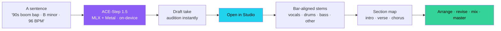
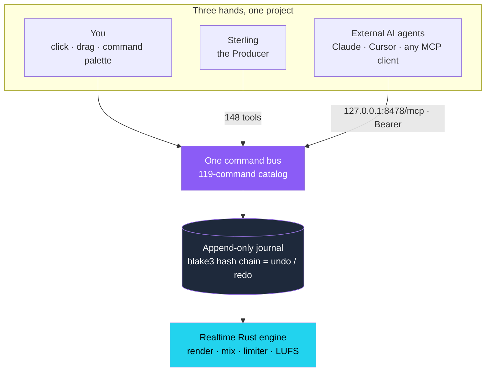
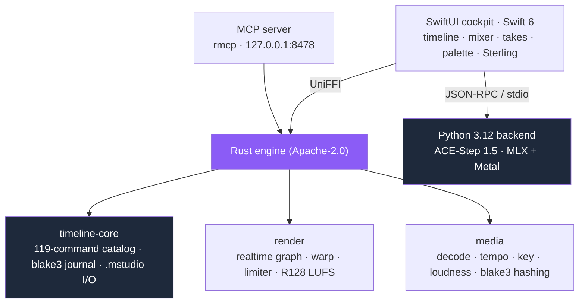

<div align="center">


<h1>Majiks Music Studio</h1>

### Generate a song from a sentence. Then produce it like a pro — by hand, by voice, or by agent.

**A macOS DAW built around three ideas the others aren't: music you _generate_ on your own machine, a studio an _AI can run_ alongside you, and a project where every edit is _journaled and traceable_. Generate full multitrack songs locally, land them on a real timeline as bar-aligned stems, then arrange, revise, mix, and master — with your hands, with Sterling the in-app producer, or with any AI agent over MCP.**

[](#requirements)
[](#install)
[](LICENSE)
[](#agent-native--the-project-is-an-api)
[-22D3EE?style=flat-square)](#generate--open-in-studio)

**[Why it's different](#why-its-a-different-kind-of-daw)&nbsp; · &nbsp;[Generate → Studio](#generate--open-in-studio)&nbsp; · &nbsp;[Sterling](#meet-sterling--the-engineer)&nbsp; · &nbsp;[The DAW](#the-daw--arrange-mix-master)&nbsp; · &nbsp;[Agent-native](#agent-native--the-project-is-an-api)&nbsp; · &nbsp;[How it compares](#how-it-compares)&nbsp; · &nbsp;[Requirements](#requirements)**

<br/>


<sub><i>"Neon Getaway" — eight stem tracks on the timeline, <b>71% AI-generated / 29% imported</b>, volume automation, and a live −14.2 LUFS master. Every clip carries its lineage.</i></sub>

</div>

---

## Why it's a different kind of DAW

Ableton, Logic, FL, and Bitwig are superb **MIDI-and-plugin** production environments. Majiks Music Studio isn't trying to be a better one of those — it's a **different instrument**, built on three things none of them have:

- 🎼 **Music from a sentence — on your machine.** Describe a track and **ACE-Step 1.5** generates a full song locally on Apple Silicon (MLX + Metal — no cloud, no subscription). **Open in Studio** lands it as bar-aligned stems, a section map, and full lineage in **under a minute**.
- 🧠 **Generative editing is a first-class timeline op.** Don't just generate and pray — **revise** a region, **extend** past the end, **layer** a fitting instrument, **retake** variants, **cover** in a new style, **autocomplete** missing parts. Draft takes audition instantly; full-quality re-renders splice in without blocking.
- 🤖 **Sterling engineers with you — and so can any agent.** The in-app copilot and external MCP agents drive the **exact same command bus** your mouse does. An AI edit is a journaled command identical to a human click — same undo, same provenance, no shadow path.
- 🔗 **Provenance-native by construction.** Content-addressed audio (blake3), an **append-only hash-chained journal that _is_ the undo stack**, per-clip lineage, and an export manifest. Every second of audio can say where it came from.

You still get the real studio underneath — a low-latency Rust audio engine, a proper mixer, automation, time-warp, and mastering-grade metering. You just get a new way to fill it.

---

## Generate → Open in Studio

The signature flow: a prompt becomes a finished, editable multitrack — locally, in about a minute.



<div align="center">

<br/><sub><i>Generated locally, landed in 16.8 s: stems on the bar line, sections detected 3/3, tempo reconciled — and null-tested to −200 dBFS. Nothing left the machine.</i></sub>
</div>

### The Gen Protocol — generative timeline operations

| Operation | What it does |
|---|---|
| **`gen.song`** | a full song from a text prompt (text-to-music) |
| **`gen.revise`** | repaint a bar-snapped region — per stem, in place |
| **`gen.extend`** | continue the arrangement past the project end |
| **`gen.layer`** | add a new instrument track that fits harmonically and rhythmically |
| **`gen.retake`** | fresh-seed variants to audition |
| **`gen.autocomplete`** | fill in the instruments a track is missing |
| **`gen.cover`** | style-transfer the arrangement into a new genre |
| **`gen.separate`** | split any track into stems (htdemucs or ace-extract) |

Two-speed rendering keeps you moving: **draft** takes to audition, then `gen.finalize` re-renders at full quality and splices in — take lanes, audition mixing, promote or discard.

---

## Meet Sterling, the Producer


Sterling is the in-app copilot (right-rail dock, ⌘⌥C — or a floating popout, ⌘⇧S, that follows you across tabs). It's an in-process, tool-calling loop that enumerates the **same tool registry** the MCP server serves and dispatches through the **same choke point** as the UI. So when Sterling makes a move, it's a real, journaled, undoable command — not a suggestion.

**What it can actually do:** build an arrangement from scratch, revise regions, layer parts, extend, mix, and export — the entire command surface. A real acceptance prompt:

> *"Make the outro 16 bars longer, keep the mood, and duck the bed under my VO track."*

Every action shows up in an **Actions log** — click a tool chip to reveal its region on the timeline or undo the newest edit.

**Rails that keep it safe:** a per-turn tool budget, a model-call cap, a credential/self-config blocklist, a `confirm:true` gate on manage-tier actions, and API-key scrubbing on every event.

**Your model, your choice.** Sterling runs on a local MLX model. The default is Granite 4.0 H-Micro below 24 GB RAM and Qwen3 30B A3B at 24 GB and above. Llama 3.2 3B is still in the list. Or pick any of nine providers, bring an OpenAI-compatible endpoint, and keep the key in the Keychain.

Sign in with Unicorn Commander is device-flow SSO. The Keycloak realm is `uchub`. The public client is `majiks-music-studio`.

Brigade agent list, routing, and registration are in the app. They do nothing until a Brigade key is set. A Brigade turn chats with that agent. It does not drive this project's command bus.

---

## The DAW — arrange, mix, master

A real studio under the generation: a hard-real-time Rust audio engine (integer-tick timing at 960 PPQ, sample-accurate scheduling, an offline bounce that null-tests bit-identical to realtime).

**Arrange**
- Multitrack timeline with add / remove / rename / reorder / color / mute / solo / **arm** tracks.
- Clips: place, move, trim, split, duplicate, gain, mute, rename, fades, crossfades, and time-warp (ratio or conform-to-tempo, Signalsmith Stretch, on its own thread). The fades you hear are linear or equal-power. Exponential and logarithmic fades are stored, then played as equal-power.
- A piano roll on a MIDI clip. Draw, move, resize, and duplicate notes. Each edit is one journaled command.
- A subtractive synth, a sampler, and a 16-pad drum rack. An on-screen keyboard plays them. A MIDI controller can play them too, or stay a control surface.
- Named **sections** (Verse / Chorus…), timeline **markers**, snap (bar / beat / division / off, plus magnetic), and per-track **automation lanes** (volume, pan) with sample-accurate ramps.

**Mix**

<div align="center">

</div>

- Per-track channel strip — fader (−60…+12 dB), equal-power pan, channel **EQ**, and two post-fader **sends**: **Bus A = reverb (Freeverb)**, **Bus B = tempo-synced ping-pong delay**.
- Master bus with a true-peak **lookahead limiter** and **EBU R128 LUFS** metering (integrated + short-term) plus a correlation meter.

**Record & separate**
- Arm any track and record from any input, with **count-in, exact-length punch, and loop-record take comping**.
- **Stems-native:** generated songs arrive as four stem tracks (vocals / drums / bass / other); split any track into a **Stem Session** with per-stem mute / solo / volume, or run htdemucs on import.

**Master & export**

<div align="center">

</div>

- Library export supports WAV / FLAC / M4A. Studio bounce supports 24-bit WAV or AAC. Stems export as 24-bit WAV. There is no MP3 export. Loudness targets are Streaming −14, Club −7, and Broadcast −16 LUFS.
- Emit a machine-readable **provenance manifest** with the export, or **publish** a track with a provenance certificate.

---

## Agent-native — the project is an API

The same surface Sterling uses is a **localhost MCP server** any external AI agent can drive. Your hands, Sterling, and a remote agent all issue commands through **one bus** into **one append-only journal** — so nothing desyncs, and every edit (whoever made it) is undoable and attributed.



- **148 tools** in three tiers: **10 read**, **128 perform**, **10 manage**. Manage requires `confirm:true`. Writes are rate-limited.
- **Localhost, bearer-gated, off by default, fails closed** — binds `127.0.0.1:8478`.
- **Connect an agent:**

  ```bash
  claude mcp add majiks-studio --transport http \
    --url http://127.0.0.1:8478/mcp \
    --header "Authorization: Bearer <TOKEN>"
  ```

Contracts live in **[docs/AGENT_API.md](docs/AGENT_API.md)** and **[docs/MCP_API.md](docs/MCP_API.md)**; a parity test guarantees the copilot, the MCP surface, and the UI share one registry.

---

## How it compares

The four majors have converged on a deep MIDI-and-plugin toolset. Majiks matches the **arrange / mix / master** surface, and then plays on an axis they don't: **generation, an AI copilot, agent control, and provenance.**

### Where Majiks Music Studio stands alone

| | **Majiks Music Studio** | Ableton Live | Logic Pro | FL Studio | Bitwig |
|---|:---:|:---:|:---:|:---:|:---:|
| **Generate full multitrack songs from text, on-device** | ✅ | — | — | — | — |
| **Generative region editing** (revise · extend · layer · cover) | ✅ | — | — | — | — |
| **Conversational AI copilot that arranges & mixes** | ✅ | — | —¹ | — | — |
| **Agent-operable over MCP** (external AI drives the project) | ✅ 148 tools | — | — | — | — |
| **Provenance** (hash-chained journal · per-clip lineage · manifest) | ✅ | — | — | — | — |
| **Open source** | ✅ Apache-2.0 | — | — | — | — |

<sub>¹ Logic Pro's Session Players (and similar assistive features) generate parts, but none of these DAWs offer a conversational copilot that arranges and mixes the whole project from natural language. Third-party facts reflect generally documented capabilities and can change between versions.</sub>

### Table stakes — the studio holds its own

| | **Majiks** | Ableton | Logic | FL | Bitwig |
|---|:---:|:---:|:---:|:---:|:---:|
| Multitrack timeline arrangement | ✅ | ✅ | ✅ | ✅ | ✅ |
| Realtime mixer · EQ · sends · master limiter | ✅ | ✅ | ✅ | ✅ | ✅ |
| EBU R128 LUFS · true-peak metering | ✅ | ✅ | ✅ | ✅ | ✅ |
| Built-in stem separation | ✅ | — | ✅ | — | — |
| Time-warp / tempo conform | ✅ | ✅ | ✅ | ✅ | ✅ |
| Track automation | ✅ | ✅ | ✅ | ✅ | ✅ |
| MIDI control-surface mapping | ✅ | ✅ | ✅ | ✅ | ✅ |
| Export master + stems | ✅ | ✅ | ✅ | ✅ | ✅ |

### What is here, and what is not

The Studio has a piano roll, a subtractive synth, a sampler, a 16-pad drum rack, and an on-screen keyboard. A MIDI controller can play those instruments, or map to transport, the mixer, and AI triggers. Keep, or an armed MIDI take, lands the notes you just played as a MIDI clip.

There is no VST, AU, or CLAP plugin host. Recording that live performance as audio is not built. See `docs/design/midi-playable-instrument.md`.

The transport can store 2/4, 3/4, 4/4, 6/8, or 12/8, and the click follows it. Tempo detection still reports 4/4. `bar_to_tick` still counts every bar as four quarter notes.

---

## Architecture

A native SwiftUI cockpit over a real-time **Rust** engine, with a **Python** generation backend — three cooperating cores, one command bus.



- **Rust engine.** A Cargo workspace: `timeline-core` (the 119-command catalog bus, hash-chained journal, and `.mstudio` package I/O), `render` (the hard-real-time graph, warp, limiter, LUFS), `media` (symphonia decode, tempo/key/loudness analysis, blake3 hashing, waveform tiles), and `agent-surface` (the UniFFI bridge, MCP server, Sterling, and the generative ops). Formally evidenced: property tests, a 10k-command fuzz, `kill -9` crash-safety, and golden-journal replay.
- **Swift 6 / SwiftUI** frontend, linking the engine via `MajiksEngine.xcframework`, with a hardware-free mock engine for CI.
- **Python 3.12** backend — ACE-Step 1.5 on MLX + mlx-lm (with PyTorch/HuggingFace paths), plus remote/cloud generation options.

See **[engine/README.md](engine/README.md)**, **[docs/CONCEPTS.md](docs/CONCEPTS.md)**, and **[docs/ARCHITECTURE](docs/)** for the full picture.

---

## Requirements

- **macOS 14.0+ (Sonoma; 15 Sequoia recommended)** on **Apple Silicon only** (M1 minimum; M2/M3/M4 recommended).
- **16 GB RAM** minimum. The ACE-Step language-model floors are:

  | ACE-Step LM | Minimum physical RAM |
  |---|---:|
  | 0.6B | 16 GB |
  | 1.7B | 24 GB |
  | 4B | 32 GB |

- Download footprint is approximately **2.5 GB for the app**, **9–10 GB for the default models**, and **about 7 GB when the 0.6B LM is selected**. Generation runs **entirely on-device**. Sterling and remote generation are optional and configurable.

### Install

Download and open the notarized **Majiks Music Studio** DMG, drag it to Applications, and launch. On first run it fetches the ACE-Step model weights.

<details>
<summary><b>Build from source</b></summary>

```bash
# 1. Build the Rust agent-surface into MajiksEngine.xcframework
#    (regenerates the UniFFI Swift bindings)
src/swift/scripts/build-engine.sh

# 2. Open and run the app
open src/swift/MajiksMusicStudio.xcodeproj
```

Requires the Rust toolchain (`aarch64-apple-darwin`), Xcode 16+, and Python 3.12 for the generation backend. `MACOSX_DEPLOYMENT_TARGET=14.0`.
</details>

---

## Who it's for

- **Producers & artists** who want to get from an idea to a finished, editable multitrack *fast* — and own it outright.
- **Stem-first creators, remixers, and content makers** who live in vocals/drums/bass/other and want them as first-class tracks.
- **AI builders** who want a real, low-latency music engine they can drive over a standard agent protocol.
- **Anyone tired of the subscription treadmill** — your music, your models, your machine, no cloud.

---

## Changelog (Recent)

### v3.6.6
- **16 GB Macs work out of the box** — the ACE-Step language model and the on-device chat model now follow your Mac's memory: 0.6B LM and Granite 4.0 h-micro below 24 GB, 1.7B LM and Qwen3-30B-A3B at 24 GB and above. The Setup Wizard shows each model's minimum RAM ("needs 16 / 24 / 32 GB"), pre-selects the right download and says why. A model you chose yourself is never changed.
- **Third-party notices ship in the app** — Help → "Third-party notices" opens the bundled THIRD-PARTY-NOTICES.md (Demucs, ACE-Step, bundled Python and Rust components); LICENSE is bundled too.
- **Docs tell the truth** — Apple Silicon only, the per-model RAM table, download sizes, and the export formats stated exactly (Library: WAV / FLAC / M4A; Studio bounce: 24-bit WAV or AAC; stems: 24-bit WAV; no MP3). New docs/MODELS_AND_LICENSES.md.

### v3.6.5
- **Fix — songs would not generate on your Mac ("Unexpected error while loading ACE-Step model", tokenizers 0.23.x).** 3.6.3 and 3.6.4 shipped a newer tokenizers library than the transformers version ACE-Step needs, so the music model could not load and the on-device chat model showed as unavailable. The app now ships the matching tokenizers (0.22.2), and the release build refuses to ship if transformers, the chat model library or the ACE-Step loader cannot be imported.

### v3.6.4
- **Fix — language-model download on a Mac that does not have Homebrew.** The setup wizard found ACE-Step, then failed with `CERTIFICATE_VERIFY_FAILED` / unable to get local issuer certificate, and suggested restarting the backend. The bundled Python was trusting a certificate file that exists only on the build machine. The app now ships its own certificate bundle and uses it for those downloads.

### v3.6.3
- **Fix — Lego mode on the Create tab actually works.** Selecting Lego showed no Source Audio picker and no “what stem” field, so Generate died with `Missing instruction (what stem to generate...)`. Lego now has Source Audio (like Continue) plus a required stem name (bass, sax lead, …). Style is still the sound; it is not a substitute for the stem name.
- **Extract, Repaint, and Auto-Complete were the same missing-panel class.** Each now has its Source Audio picker. Extract asks which stems to isolate. Repaint asks which time range to regenerate. Auto-Complete takes the partial mix. The app now refuses Generate in-panel instead of sending an empty RPC.

### v3.4.13 (built, not yet published)
- **Stem separation is real.** Splitting a song now runs demucs and produces genuine vocals, drums, bass and other. The previous default was a **test fixture** that routed every 4th sample to a different stem and zeroed the rest — the four summed back to the original exactly, so a bounce sounded perfect, but each stem alone was 75% silence chopped at 12 kHz and screeched when soloed.
- **The fixture cannot be selected by accident.** Renamed to `interleave-fixture`, removed from the tool schema, and refused by the CLI with an explanation of what it would do to the audio.
- **Separation that cannot run now refuses and says how to fix it**, instead of silently handing back unusable stems.
- **Fix — a failed "Open in Studio" was invisible.** The error was recorded and no view ever read it, so the progress overlay simply vanished. Since separation always failed in the shipped app, that was the actual experience.

### v3.4.12 (built, not yet published)
- **Fix — the Stems tab crashed the app on any playback, and always had.** The level meters installed audio taps written as closure literals inside a `@MainActor` class; under Swift 6 those inherit the actor's isolation, and AVFAudio calls tap blocks on its own queue, so the first buffer through trapped the process. The meters had never once run with audio flowing.
- **The Stems tab is reachable.** It was already a complete per-stem mixer — waveform, solo, mute, gain, pan and meter per stem on a real engine with a real bounce — and nothing anywhere created a stem session, so everyone only ever saw its empty state.
- **Every numeric control takes a typed number.** 48 of them, across the mixer, the routing pane, all 36 effect parameters and the instrument panel, plus up/down arrows with a sensible step per unit. Nobody dials an EQ to 2.5 kHz by dragging.
- **The play head can be dragged.** Click the ruler to jump, drag to scrub, and rewind/fast-forward a bar at a time. The scrub gesture existed and was unreachable: the play head's only visible grip sat in the band that selects bars.
- **Fix — seeking clicked.** The jump set the output gain to zero outright, and the arrangement sent one seek per mouse-move, so a scrub was a full-scale step repeated at pointer rate.
- **A stem says what it is.** Vocals, Drums, Bass and Other are named and coloured in the track header, and audio tracks no longer offer to add a synth to a recording.

### v3.4.11 (built, not yet published)
- **A MIDI clip shows its notes.** Until now every MIDI clip in the arrangement was a flat coloured rectangle — an empty clip and a 56-note performance looked identical, because the timeline drew every clip through the audio waveform path and a MIDI clip has no audio to draw. Notes now paint inside the clip, scaled to the part's own pitch range so a bassline fills its row, with velocity riding opacity. An empty clip is drawn as visibly empty, which is a different statement from "not read yet".

### v3.4.10 (built, not yet published)
- **The instrument has a sound you can choose.** Five named starting points — Electric Piano, Soft Pad, Pluck, Bass, Organ — one click each, one undo each, with waveform and envelope underneath for anyone who wants them. Until now the synth's four waveforms and its whole envelope were reachable only by drawing an automation lane: **no command in the app could write an instrument parameter at all.**
- **A new instrument no longer sounds like a raw sawtooth.** The default waveform is now a triangle. Sawtooth is the harshest of the four, and it was the first thing anyone heard on pressing a key.
- **Throw a take away.** A discard button beside Keep, for when a pass is not the one. It can only touch what you have played and not kept — nothing already in your song.
- **Fix — a captured performance could land a thousand bars away.** Keep placed the clip wherever the playhead was, and a transport left rolling puts that a long way past your music. A take now lands where you played it when there is something to play along to, and just after your music when there is not; either way the timeline scrolls to show you where it went.
- **Fix — deleting an instrument that carried a chosen sound was refused**, which would have made a track with a preset on it undeletable.

### v3.4.9 (built, not yet published)
- **Every pane resizes.** Drag the edge of the browser, the inspector, Sterling's dock, the piano roll, the routing pane, the mixer or the on-screen keyboard. Each pane remembers its own size between launches, clamps so it can never be dragged to nothing or made to swallow the window, and snaps back to its default on a double-click.
- **Fix — the transport bar could wrap into a 475pt column.** Every readout in the bar was horizontally flexible, and a `Text` offered too little width wraps rather than truncates. At the limit, "POSITION" and "Generate" each became an eight-line vertical column, which pushed the browser, tracks and inspector into the bottom third of the window under a black void and squeezed the engine chip out entirely. The bar's labels are now fixed-size, and the row height is pinned so no future control can do this again.

### v3.4.8 (built, not yet published)
- **Play your sample library.** Add a Sampler or Drum Rack from the track header, pick a sound, and play it. One sound across the keyboard for the sampler, or drop sounds onto a 16-pad grid for drums — from a file picker or straight from Finder. Pitch tracks the keyboard properly: an octave up is exactly double the frequency, not a resampled approximation.
- **Loop a section and play over it.** Drag in the new loop strip under the bar numbers, or press Loop in the transport. The brace shows what repeats.
- **The meters are real.** The transport's master meter previously animated from a sine function and was connected to no audio at all. It now reads the engine's own measured level, and holds still when nothing is playing.
- **Time-stretching actually works.** `clip.warp.set` has always journalled, saved and undone — and changed nothing you could hear, because the shipping app passed an empty overlay to the renderer. Stretching a clip now stretches the audio, with pitch preserved.
- **Fix** — stretching above 2× was not reproducible: the stretcher seeded itself from the system random device, so exporting the same project twice gave different audio. It now uses a deterministic path above 2×.
- **Docs** — the build instructions pointed at a directory that does not exist, MP3 and FLAC export were advertised and never existed, and the manual claimed the count-in was silent after it had been made audible.

### v3.4.7 (built, not yet published)
- **A metronome you can hear.** It was previously a switch with no sound behind it — and the count-in the record bar offered was silent too, while the help text promised "beats of clicks". Both now click, on the beat, honouring the project's tempo and bar-one anchor. The click never reaches an exported mix or a recorded take.
- **Set your own tempo, time signature and key.** The BPM readout was a label you could not edit; a musician could not change the speed of their own song.
- **Right-click a clip** to rename it, set its gain, mute it or delete it. **Right-click the ruler** to add or remove markers and sections. **Track headers** get colour and height.

### v3.4.6 (built, not yet published)
- **Your work is saved.** The Studio now writes every command to a durable journal as you work, checkpoints automatically, and reopens your project on launch. Previously a session existed only in memory: quitting the app discarded everything. ⌘S and File ▸ Save Project are there if you want them, but you should not need them.
- **Three separate faults were behind it**: reopening a project attached an in-memory journal instead of the file, the file writer never flushed, and saving orphaned its own file handle. The crash test that was supposed to catch this wrote the journal by hand, so it passed while proving nothing.

### v3.4.5 (built, not yet published)
- **Tooltips that teach** — hover anything and it says what it *does*, not what it's called: "Solo — hear ONLY this track and mute everything else." 161 entries covering the toolbar, transport, track headers, piano roll, mixer, routing, and settings. Choose teaching, terse, or off from the **?** in the Studio toolbar.
- **You can see your instrument** — a chip on the track header names it, and when a track has none, a **+ Instrument** button appears in its place.
- **Silence explains itself** — playing a track with no instrument now says so and points at the fix, instead of just making no sound. Held chords say it once, not once per note.
- **Messages appear where you're looking** — result toasts render beside the surface that raised them rather than at the far corner of the window, and destructive results stay up long enough to read.
- **Undo respects you** — undoing an automatically-created instrument track no longer has the next note immediately rebuild it.

### v3.4.4 (built, not yet published)
- **Delete, finally** — right-click a track header to delete the track or remove its instrument; right-click a clip to delete it. No confirmation dialogs: one gesture is one undo step, and Cmd-Z restores everything — clips, instrument, sampler zones, automation. A refusal shows the engine's actual message and remedy, never a shrug.
- **The keyboard announces itself** — play a hardware note while the on-screen keyboard is hidden and it appears. Hiding it by hand keeps it hidden for the rest of the session. The toggle is now a labelled **Keys** button instead of a computer-keyboard glyph.
- **Bus faders you can touch** — every bus and group has a real dB fader (`route.node.set`): journaled, undoable, saved, rendered.
- **Automate your effects** — 22 effect parameters (thresholds, ratios, delay time, reverb size, drive, chorus…) accept per-frame automation lanes; the ones that can't yet (attack/release, EQ bands) are refused by name with the reason, not ignored.
- **Real bus meters** — bus and group rows meter the actual signal; the routing pane's "not yet audible" badge is gone because processing is live.

### v3.4.3 (built, not yet published)
- **On-screen keys light while you play** — hardware notes now reach the screen with the transport stopped. Before, the display only updated during playback: two correct decisions (performances are journal-silent; playing a note never starts the transport) combined so the app never adopted a snapshot while a human was playing. Keys held under 90 ms still read as a visible flash.
- **The keyboard learns your controller** — play your lowest and highest key once and the on-screen range widens to match (never narrows on its own; up to 9 octaves so an 88-key board fits). Span is also adjustable by hand.
- **Sign-in no longer revokes Majik's DJ's key** — the app mints its API key under its own name. Previously it inherited the server default and silently replaced the DJ's key.
- **Sign-in ends with a working model** — after SSO the app reads the account's real catalog (all of it — the API silently truncates at 100 of 350 unless asked) and reconciles the configured model or offers a picker, instead of failing on a dead id. No model name is hardcoded anywhere anymore.
- **Routing & FX** — create buses and groups, connect anything to anything with per-edge level and pre/post tap, and build insert chains (EQ, compressor, gate, delay, reverb, chorus, saturator, limiter, utility) on tracks, buses, and the master. Every gesture is one journaled, undoable command.
- **The engine plays the graph** — buses, sends, effect chains, sidechain-keyed dynamics, and automatic latency compensation render sample-accurately at any block size; existing projects bounce byte-identically to before.
- **Send automation is audible** — a drawn send ramp now changes the mix. Parameters that have no renderer yet are refused with an explanation naming the path, instead of silently ignored.
- **Undo restores everything** — deleting a track and undoing it brings back its instrument, sampler zones, and automation intact; seventeen silent data-loss paths closed and now guarded by generative tests.
- **Sterling is The Producer** — the creative agent's subtitle changed from "The Engineer" to "The Producer". The app shipped two built-in agents both reading "The Engineer" in Settings ▸ Agents: Sterling (lyrics, arrangement, generation, the whole Studio command surface) and the technical specialist (BPM/key detection, mixing advice, parameter extraction). In a real studio the producer owns creative direction and song decisions and the engineer owns capture, levels, EQ and mixing, which is exactly this split. **The Engineer** keeps its name and its job; only Sterling's subtitle changed. Agent IDs, saved settings, and MCP tool names are untouched, so existing configurations carry over. Changelog entries below that read "Sterling, The Engineer" describe those releases as they shipped.

### v3.4.2 (built, not yet published)
- **Piano roll** — draw, move, resize, and duplicate notes on a real MIDI clip. Every edit is one journaled command, so undo puts the chord back exactly.
- **Instruments** — a polyphonic subtractive synth, a multi-zone sampler, and a drum rack, all automatable through the same parameter path as volume and pan. One click on **Instrument** creates a track, a synth, and a clip ready to play.
- **Play your keyboard** — a connected MIDI keyboard now plays the instrument by default instead of triggering transport commands. Each port can be switched between *Keys play* and *Control surface*.
- **Record a MIDI take** — arm an instrument track and record what you play. The whole take lands as one clip and one undo step, with held notes closed cleanly at stop and punch-out.
- **Input level meter** — see peak, RMS, and a latching clip indicator before you hit record, so you can set gain instead of guessing.
- **Much lower MIDI latency** — key-to-sound dropped from roughly 14 ms to 4–7 ms, and — more audibly — the note-to-note jitter is gone. The MIDI pump now wakes on event arrival instead of a 15 ms poll.
- **Arrangement ruler** — bar lines and numbers no longer disappear at some zoom and scroll combinations, and the grid honors a project's bar-1 anchor.
- **Sterling tells you what's wrong** — authentication failures now explain the actual problem and what to do, instead of printing a raw provider error. Saving a Sterling endpoint now tests it and reports the result.
- **Fix** — "Sign in with Unicorn Commander" works. It previously returned 401 for everyone because the desktop app's OAuth client was never configured for the device flow.
- Live input monitoring remains intentionally disabled — see the notes in the engine's `monitoring_allowed`.

### v3.4.1
- **Sign in, no license keys** — the License section is gone; a new Account section in Settings signs you into majiks.online with Unicorn Commander (SSO). Publishing is free with sign-in.
- **Publisher fixed** — Catalogue, Earnings, and Artist Profiles no longer fail with "Not authenticated" while the sidebar claims Connected; the app now shows your real sign-in state and recovers expired sessions properly.
- **Sterling everywhere** — Sterling, The Engineer is now the app's chat agent (not just the Studio copilot), with a floating popout chat window (⌘⇧S or Pop Out from the Chat tab) that follows you across tabs.
- **Settings that fit** — the Settings tabs no longer vanish behind a tiny overflow chevron on narrow windows.
- **Menu bar upgrade** — the status item is now the full-color unicorn avatar with a proper menu: open, generate, chat, now-playing controls, updates, quit.

### v3.4.0
- **Studio — the AI-native DAW** — new Studio tab: a full multitrack timeline on a real-time Rust audio engine. Place and edit clips, mix with per-track EQ, sends, and automation, and bounce sample-accurate exports.
- **Revise** — select bars and regenerate just that region: scoped per-stem variants land in take lanes, audition with one key, commit as a single undo step.
- **Open in Studio** — any generated track lands on the timeline as bar-aligned stems with a section map and full lineage, in under a minute.
- **Recording** — arm a track and record from any input, with count-in, exact-length punch, and loop-record take comping.
- **MIDI control surface** — map any controller to transport, mixer, and recording; MIDI-learn, importable per-device maps, and bindable AI triggers.
- **Sterling, the Engineer** — the in-app AI copilot now drives the entire Studio command surface; every agent action is journaled, attributed, and undoable.
- **Provenance-native export** — master, stem, or region export with loudness targeting and a machine-readable provenance manifest.
- **Agent-first** — 100+ MCP tools expose the full DAW to external agents with the same undo/journal guarantees as the UI.
- **Fix** — backend now honors the Artwork status contract on its HTTP surface.

### v3.3.0
- **Stem Sessions** — new Stems tab: split any track into stems and play them as a multitrack session with per-stem mute/solo/volume, transport with spacebar control, and session library with export.
- **Provenance carried through** — stem bounces inherit the source track's provenance record, keeping the chain of custody intact end to end.
- **Reliability** — signed-bundle integrity fix (Python bytecode no longer written inside the app seal), more robust release builds on current Homebrew Python.

### v2.0.0
- **Open source** — Core app released under Apache License 2.0. Full music creation, library management, and AI chat are free for everyone.
- **Shared license storage** — License keys now stored in `~/Library/Application Support/Majiks/license.json` alongside Keychain, enabling cross-app activation across the Majiks suite.
- **Security hardening** — License public key override restricted to debug builds only. Force-unwrap crash risks eliminated in remote server URL handling. RPC server catches all exception types to prevent backend crashes from malformed input.
- **Data integrity** — Library save errors now surface to UI instead of being silently swallowed. Backup creation failures are logged. Session pruning preserves staging directories that contain unsaved tracks.
- **Performance** — Library scan at startup uses O(1) Set lookups instead of O(n) linear search per file. Studio playback timer avoids redundant SwiftUI state updates when idle.
- **Minimum RAM corrected** — System requirements updated from 8 GB to 16 GB minimum, matching the actual preflight check enforced by the code.
- **Setup wizard streamlined** — License key entry step removed from first-run wizard for free users (only shown in Pro builds).
- **Dead code cleanup** — Removed unused legacy StudioView placeholder and fake waveform section labels.

### v1.9.0
- **Extraction model upgrade** — Swapped from Granite 3.3 2B to Qwen 3.5 4B for parameter extraction; significantly more accurate BPM, key, duration, and lyrics parsing
- **Cancel generation** — Cancel button now stops both the UI and the backend generation process (previously only cancelled the GUI)
- **Quit actually quits** — App properly terminates the Python backend on quit; active generation is cancelled and tracks are saved before exit
- **Chat reply race fix** — Replies now always land in the originating conversation, even if you switch conversations while waiting
- **Double-click protection** — Generate button has a 2-second cooldown to prevent accidental duplicate generations
- **Empty style guard** — Generate button is disabled when the style/caption field is empty; prevents generating tracks with no description
- **Clickable suggestion chips** — Chat suggestion chips are now interactive buttons instead of static text
- **RPC threading** — Backend RPC server uses a threaded architecture so cancel commands can be received during generation
- **Task-cancellation aware RPC** — Swift RPC client properly cleans up pending requests when tasks are cancelled
- **Generation queue stability** — Jobs are resolved by stable ID instead of array index across async boundaries; failed jobs clean up staging files
- **Safe quit with save** — Quit path cancels active generation first, waits briefly, then saves tracks to prevent half-written files
- **App renamed** — .app bundle is now "Majiks Music Studio.app" (was "Majiks Studio.app"); users upgrading should delete the old app from Applications
- **Lyrics editor** — Expanded max height for better editing of longer lyrics
- **Model display in chat** — Friendly model name shown below the chat header
- **Menu bar improvements** — Custom app icon in menu bar with backend status indicator
- **Help docs updated** — Now covers all 9 LLM providers, generation queue, remote servers, library location, export formats, and new keyboard shortcuts
- **Security** — Keycloak account ID no longer displayed in Publisher UI

### v1.8.7
- **Fixed generation failures** — Resolved a bug introduced in v1.8.0 where local generation always failed with "Server error (-32010): Backend error" due to invalid keyword arguments passed to the ACE-Step generator
- **Extraction model hot-swap** — Changing the extraction model in Settings now auto-restarts the backend so the new model takes effect immediately (previously required manual restart)
- **Removed NuExtract** — Dropped NuExtract extraction model (was echoing templates instead of extracting); all extraction models now use unified chat format
- **Backend auto-recovery** — Generate button now auto-restarts the backend if it's not running, instead of showing a dead-end error
- **Crash counter reset** — Intentional restarts (Settings, pre-generation) reset the crash counter so previous crashes don't permanently block the backend
- **Model migration** — Users who had NuExtract selected are automatically migrated to the default Qwen 3.5 4B extraction model on upgrade

### v1.8.4
- **Library location** — Move your entire audio library to an external drive or custom folder from Settings > Library Location; all audio, artwork, and metadata move together
- **Disconnected drive alert** — Startup warning when your configured library drive is missing, with options to use default location, open settings, or continue
- **Thread-safe relocation** — Library move operations use locked property access to prevent race conditions during playback or generation
- **Relocation safety** — Pre-flight writable check, same-path guard, metadata originals cleaned up after successful copy
- **Repo migration** — Repository moved to MajiksStudio org on Forgejo

### v1.8.3
- **Pre-generation guard** — Verifies ACE-Step models are installed before generating; shows a friendly alert instead of a cryptic backend error
- **Auto-fix missing silence_latent.pt** — Automatically copies the required silence file from the turbo model dir to other LM checkpoint dirs, preventing generation failures at 3%
- **Build script fix** — Changelog extraction now captures up to 20 lines instead of 10, preventing truncation for feature-rich releases

### v1.8.2
- **Credits in library** — Add credits (name, display name, role) directly to library tracks; persisted in library.json
- **Internal metadata** — Opaque `internalMetadata` dict on Track for pipeline/tooling data (persisted, never rendered)
- **Display name on credits** — `displayName` field on Credit for public display vs. private full name
- **Expanded credit roles** — Added lyricist, co-creator, inspiration, engineer to standard roles
- **Credits carry to publishing** — Track credits auto-populate into PublishCandidate and sync to server
- **Credits UI in TrackDetailView** — Collapsible credits section with add/edit/remove, role picker, display name field

### v1.8.0
- **Playback queue** — Continuous playback through track lists with shuffle, repeat (off/all/one), skip next/previous, and "Up Next" popover
- **Cover / Style Transfer** — Generate new tracks in the style of a reference audio file with adjustable cover strength
- **Audio continuation** — Extend existing tracks from where they end using ACE-Step 1.5's completion mode
- **Music understanding** — Auto-extract BPM, key, genre, lyrics, and caption when importing audio files
- **Real waveform visualization** — Player bar shows actual audio sample data instead of decorative bars, with playback progress coloring
- **Quality model mode** — ACE-Step v1.5 Quality option (32-100 inference steps) alongside Turbo for higher-fidelity output
- **Advanced generation controls** — Seed control for reproducible results, inference steps slider, LM temperature/guidance, time signature (2/4, 3/4, 4/4, 6/8), vocal language selection
- **Extended duration** — Up to 8 minutes (480s) on remote servers; ACE-Step 1.5 handles it natively
- **Library backup system** — Rolling auto-backup on every save (keeps 10), manual backup/restore UI in Settings
- **Import audio** — File > Import Audio (Cmd+I), drag-and-drop from Finder, auto-metadata extraction on import
- **Drag tracks to Finder** — Drag library tracks to Desktop, DAW, or any app that accepts audio files
- **Publisher overhaul** — Sidebar navigation, pre-flight validation, retry failed, batch operations, catalogue search/filters, detail panel, field-level sync review
- **Bi-directional sync** — Push local metadata to server or pull server changes to local library with field-level diff review
- **Dashboard charts** — Swift Charts for earnings visualization with time-range toggle and top tracks leaderboard
- **VoiceOver accessibility** — 80+ accessibility labels across all interactive elements
- **Toast notifications** — Non-blocking feedback for publish, unpublish, sync, profile actions, and errors
- **Backend auto-restart** — Automatic recovery when Python backend crashes (up to 3 retries with cooldown)
- **Keyboard shortcuts** — Library search (Cmd+F), publisher shortcuts (Cmd+Shift+P, Cmd+R, Cmd+Option+F), playback controls
- **Library empty state** — Welcoming onboarding view with action buttons for new users
- **Album grid view** — Third library view mode with large artwork, hover-to-play, expandable track lists
- **BUG-021 fix** — Artist profiles now return all profiles (added pagination params)

### v1.7.0
- **Multi-server generation** — Generate music on local GPU and remote servers simultaneously with parallel queue processing
- **Generation mode picker** — Choose Auto, Local Only, Remote Only, or Both in Settings; round-robin job assignment in Both mode
- **Swift RemoteGenerationService** — Actor-based HTTP client talks directly to remote ACE-Step servers, no Python needed for remote jobs
- **UI zoom** — Cmd+/Cmd-/Cmd+0 to scale the entire interface via DynamicTypeSize (7 levels from xSmall to xxxLarge)
- **Extended track metadata** — Pipeline fields: mood, contentType, topic, topicTags, inspiredBy, sourceURLs, extendedMetadata
- **Song package import** — Import Songwriter app JSON packages via RPC/MCP for automated content pipeline
- **Genre variation generation** — Create genre-shifted variants of existing tracks with 26 genre templates
- **Batch generation** — Queue multiple song packages as an album batch via RPC/MCP
- **Export with metadata sidecar** — Export now writes a JSON sidecar alongside the audio file with full track metadata
- **Smart backend selection** — Auto mode routes batch jobs (3+) to remote server, singles to local
- **MCP tools** — 3 new tools: `generate_from_package`, `generate_variation`, `batch_generate`
- **MCP setup helper** — Copy MCP config JSON to clipboard from Settings
- **Remote API fix** — Corrected request format (params wrapper, tags/tempo naming, download endpoint)
- **Server library save** — Remote generations auto-save to the headless server's library

### v1.6.0
- **Persistent player bar** — Playback controls now stay visible across all tabs (Chat, Studio, Library, Publisher) with track info, seek bar, and volume
- **Menu bar persistence** — Closing the window no longer quits the app; status bar icon lets you reopen from the menu bar or Dock
- **Waveform playhead sync** — Studio waveform playhead now moves in real time during playback
- **Catalogue streaming playback** — Play published tracks directly from the Publisher catalogue with download-then-play streaming
- **Check for Updates in About** — Update check button added to Help > About for easier discoverability
- **Smart workspace clear** — Clearing the studio workspace no longer interrupts library playback
- **Artist profiles fix** — maxArtists default raised from 1 to 5; server value of 0 handled gracefully
- **App-wide tooltips** — 25+ tooltips added across Studio, Library, and Publisher controls
- **Build script update** — Version API POST now includes `product` key for multi-app site support

### v1.5.7
- **Art Studio integration** — Generate cover artwork from the catalogue edit sheet via Majik's Art Studio companion app (localhost:8420). Buttons auto-disable when Art Studio isn't running.
- **Catalogue grouping** — Publisher catalogue now groups tracks by Artist > Album > Tracks with collapsible sections, artist filter, and sort controls.
- **Album field in catalogue editor** — Edit album assignments directly in the catalogue edit sheet; changes persist to server via PATCH.
- **Branding update** — Display name is now "Majik's Music Studio" throughout UI, title bar, and About screen. Technical paths remain apostrophe-free.
- **Build script fix** — APP_NAME reverted to "Majiks Studio" for file paths; apostrophe display name used only in echo output and DMG README.

### v1.5.6
- **Publisher tab overhaul** — Catalogue rows now show larger artwork thumbnails, BPM/key/duration metadata, and a consolidated actions menu. Edit sheets match Library quality with sectioned layouts, artwork previews, publishing info, and styled editors.
- **Artist profile social links** — Add and manage social media links (Instagram, Twitter, etc.) directly in the profile editor
- **Publish queue artwork** — Candidate rows now show artwork thumbnails from your Library
- **Automated release pipeline** — Forgejo Actions workflow: push a `v*` tag to build, sign, notarize, upload to B2, and auto-update majiks.studio
- **Generic build script** — `build-release.sh` reads version from Info.plist, no more per-version build scripts

### v1.5.5
- **Fix LRC generation crash** — MMS_FA tokenizer requires word list input; fixed tokenizer call in forced alignment pipeline
- **Artwork integration API** — New RPC methods for external artwork generators: `list_library_tracks`, `list_library_albums`, `list_library_artists`, `set_track_artwork`, `set_album_artwork`, `set_artist_artwork`
- **Songwriting bridge import** — New `import_track` RPC method accepts track metadata from external songwriting apps and creates library entries
- **User-Agent version bump** — Bridge API requests now identify as v1.5.5

### v1.5.2
- **Timestamped lyrics (LRC)** — automatically generates synced lyrics files when you keep a track, using torchaudio forced alignment (zero new dependencies)
- **New Song button** — clear the Studio form without losing queued generations or tracks; queue multiple different songs
- **Drag & drop in Library** — drag tracks between artists and albums in the column browser
- **Publish from Library** — right-click any track to Publish, Unpublish, or Update on majiks.online
- **Autocomplete dropdowns** — Artist and Album fields now suggest existing entries as you type
- **Analyze with Engineer** — right-click a track to re-extract BPM, key, and duration from the audio
- **Procedural art fallback** — tracks without custom artwork get their procedural art uploaded when publishing
- **Context menus** — full Rename/Delete context menus for artists and albums; merge-on-rename for duplicates
- **Artwork thumbnails** — artist photos and album art shown in column browser sidebar
- **50 Swift tests** — new test target covering GenerationQueue and StudioModels
- **Setup Wizard** — blocks on pip install with progress bar, auto-restarts backend
- **Bug fixes** — duration parsing (verbal fractions, MM:SS), lyrics extraction (filters arrangement notes), AI Style button error visibility, RAM optimizations, update checker logging

### v1.5.1
- **Published badge in Library** — tracks published to majiks.online show a green "Published" badge; click for details (date, plays, link)
- **Custom artwork** — set custom artwork on tracks, albums, and artists from Library (right-click or Track Details)
- **Artwork included in publishing** — track/album/artist artwork automatically uploaded when publishing to majiks.online
- **Library search includes lyrics** — search now matches against lyrics in both flat list and column browser views
- **Dead code cleanup** — removed ~690 lines of unused views

### v1.5.0
- **Free app model** — Full music creation, saving, exporting, and library management are now completely free. No license required.
- **Publisher tier** — Optional upgrade unlocks publishing to majiks.online with artist profiles, provenance certificates, and creator dashboard.
- **Cryptographic license tiers** — License tier encoded in Ed25519 signed payload. Tamper-proof tier verification.
- **Creator dashboard** — Sales summary, earnings tracking, payout history, and catalogue overview for Publisher users.
- **Provenance certificates** — View cryptographic proof-of-first-publication for published tracks, with copy-hash and online verification.
- **DMCA reporting** — File infringement claims directly from the app.
- **Publisher tab** — Always visible with upgrade prompt for free users, full publishing UI for Publisher tier.

### v1.4.1
- Fix duration extraction rounding

### v1.4.0
- Fix 9 bugs from Codex audit + implement auto-naming

### v1.3.9
- Update README download links and version badge

### v1.3.8
- Fix MPS memory leak (~10GB/generation) — restart Python backend before each generation so OS reclaims all leaked GPU memory
- Defense-in-depth cleanup: `gc.collect()` + `torch.mps.empty_cache()` + model unload after every generation

### v1.3.7
- Fix ACE-Step model initialization crash (`use_mlx_dit` removed)
- Fix lyrics leakage across multi-song conversations (regex now searches last assistant message first)
- Fix lyrics falsely deleted by empty-value detector (`"na"` substring matching "imagination")
- Better arrangement note filtering (bullet characters, "FULL LYRICS" marker detection)

### v1.3.6
- Sequential model loading/unloading pipeline (chat → extraction → generation)
- Memory cache clearing at every model transition (MLX, MPS, GC)
- Extraction model auto-unloads after extraction completes
- Offline-first HuggingFace model loading (no unnecessary network calls)

### v1.3.0
- Restore original ACE-Step 1.5 orchestration modules for full music quality
- 5Hz LLM chain-of-thought reasoning for better generation

### v1.2.x
- Audio distortion fixes, proper guidance defaults, APG guidance restoration

### v1.1.x
- Smart memory management, The Engineer (parameter extraction), Llama 3.2 3B chat

---

## License

**[Apache-2.0](LICENSE)** © 2026 Magic Unicorn Unconventional Technology & Stuff Inc. ACE-Step and other bundled components retain their own licenses.
See [THIRD-PARTY-NOTICES.md](THIRD-PARTY-NOTICES.md) for bundled third-party software notices.

<div align="center">
<br/>
<sub><b>Majiks Music Studio</b> — generate it, produce it, own it. 🦄🎛️<br/>
<i>Screenshots show demo projects generated on-device.</i></sub>
</div>
