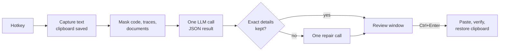

<div align="center">


# PromptForge

**Turn the rough prompt you're typing into a clear one without leaving the app you're in.**

Type naturally, press <kbd>Ctrl</kbd>+<kbd>Alt</kbd>+<kbd>P</kbd>, review the rewrite, press <kbd>Ctrl</kbd>+<kbd>Enter</kbd>.

[](https://github.com/Maneet7805/PromptForge/releases/latest)
[](https://github.com/Maneet7805/PromptForge/actions/workflows/ci.yml)
[](LICENSE)


[**Download**](https://github.com/Maneet7805/PromptForge/releases/latest) · [Quick start](#quick-start) · [How it works](#how-it-works) · [FAQ](#troubleshooting) · [Contributing](CONTRIBUTING.md)


</div>

---

## Why

Most prompts are typed in a hurry: no deliverable, missing context, details buried in a run-on sentence. PromptForge is a small Windows tray app that fixes that in place, following [Anthropic's prompt engineering guidance](https://docs.claude.com/en/docs/build-with-claude/prompt-engineering/overview). It never sends anything for you: you always see the rewrite first and decide.

## Features

- **Works where you type.** ChatGPT, Claude, Gemini, Perplexity, VS Code, Word, email, Notepad: any normal text box, with no browser extension or per-app plugin.
- **Review before replace.** See the improved prompt, a word-level diff and the original side by side. Edit it, re-run it, copy it, or keep your original.
- **Doesn't invent things.** When details are missing it asks you questions instead of making them up. Simple questions stay simple, and good prompts come back unchanged.
- **Keeps exact details.** URLs, file paths, identifiers, numbers and quoted text are checked after every rewrite. Pasted code, stack traces and logs are held back and restored byte-for-byte.
- **Your clipboard is safe.** It's saved before and restored after every operation.
- **Voice dictation.** Tap or hold a shortcut, speak, and the transcript is typed (or optimised) for you.
- **Free to run.** Uses [Groq's](https://console.groq.com) free API tier by default. No card, no account with us, no server.
- **Private by design.** Keys are encrypted with Windows DPAPI, and no prompt text is ever logged or stored.

<details>
<summary><b>See the word-level diff view</b></summary>
<br>

</details>

## Quick start

1. **Get a free API key** at <https://console.groq.com/keys>. It takes about a minute, and no card is needed.
2. **Download [`PromptForge.exe`](https://github.com/Maneet7805/PromptForge/releases/latest/download/PromptForge.exe)** from the latest release and double-click it.
   - Windows SmartScreen may say *"Windows protected your PC"*, because the app isn't code-signed (signing needs a paid certificate). Click **More info → Run anyway**.
3. Choose **Yes** to install. PromptForge copies itself to `%LOCALAPPDATA%\Programs\PromptForge`, adds a Start menu shortcut, and can start with Windows. It doesn't need admin rights or a separate .NET install.
4. Settings opens on the **Model** tab. Paste your key, click **Test connection**, then **Save**.
5. Click into any text box, type a rough prompt, and press <kbd>Ctrl</kbd>+<kbd>Alt</kbd>+<kbd>P</kbd>.

**Update:** from 1.1.0 on, PromptForge checks for a new release once a day and shows a notification. Click it (or **Update to …** in the tray menu), and it downloads the new exe, checks it against the release's `SHA256SUMS.txt`, and asks **Yes** to update. Your settings and keys are kept. You can also download the newer `PromptForge.exe` yourself, run it, and choose **Yes**. To turn the daily check off: Settings → General.
**Uninstall:** run `uninstall.cmd` from the release zip. It removes the app, the shortcut and start-with-Windows, and asks whether to delete settings, keys and logs.

## Usage

| Shortcut (changeable in Settings) | What it does |
| --- | --- |
| <kbd>Ctrl</kbd>+<kbd>Alt</kbd>+<kbd>P</kbd> | Optimise everything in the text box you're typing in |
| <kbd>Ctrl</kbd>+<kbd>Alt</kbd>+<kbd>Shift</kbd>+<kbd>P</kbd> | Optimise only the selected text. Use this in Word, code editors and long documents |
| <kbd>Ctrl</kbd>+<kbd>Alt</kbd>+<kbd>D</kbd> | Voice: tap to start and tap again to stop, or hold while talking and release |

In the review window:

| Key | Action |
| --- | --- |
| <kbd>Ctrl</kbd>+<kbd>Enter</kbd> | Replace your text with the (edited) improved prompt |
| <kbd>Esc</kbd> | Keep your original |
| <kbd>Ctrl</kbd>+<kbd>Shift</kbd>+<kbd>C</kbd> | Copy the improved prompt instead |
| <kbd>Ctrl</kbd>+<kbd>R</kbd> | Re-run, e.g. after answering the questions or changing Mode or Task |
| <kbd>Ctrl</kbd>+<kbd>1</kbd> / <kbd>2</kbd> / <kbd>3</kbd> | Improved / Changes / Original |

**Modes:**
- *Light*: minimal edits.
- *Standard* (default): clarity, plus structure where it helps.
- *Detailed*: full structure for complex tasks.

Set the default mode from the tray icon. The tray menu also has *Copy last original text* as an undo safety net, and *Pause shortcuts*.

## Where it works

PromptForge reads and writes text by sending <kbd>Ctrl</kbd>+<kbd>A</kbd> / <kbd>C</kbd> / <kbd>V</kbd> to the focused app. It then reads the field back to confirm the replacement actually happened.

| Where | Status | Notes |
| --- | --- | --- |
| Browser AI chats (ChatGPT, Claude, Gemini, Perplexity) | ✅ Tested | |
| Notepad and other native Windows text boxes | ✅ Tested | Including Windows 11 Notepad's delayed paste |
| VS Code / Cursor chat panels | ✅ Tested | In the code editor itself, use *Optimise selection* |
| Microsoft Word | ✅ Tested | Use *Optimise selection*, because select-all would take the whole document |
| Voice dictation | ✅ Tested | Uses the same Groq key (Whisper) |
| Terminals (Windows Terminal, cmd, PowerShell, Claude Code / Codex CLI) | ⚠️ Copy only, by design | Keystrokes in a terminal could interrupt or run commands. Copy your prompt, press the shortcut, then paste the result yourself |
| Password fields | 🚫 Refused | Detected via UI Automation |
| Apps running as administrator | ❌ Not possible | Windows blocks input from normal apps into elevated ones. You get a message and can copy instead |

If a replacement can't be confirmed, the improved prompt goes to your clipboard and a notification tells you. Your original text is never lost.

## How it works



1. **Mask pasted material.** Fenced code, stack traces, logs and `<document>` blocks are swapped for `[[BLOCK_n]]` markers. They come back byte-for-byte, and the request uses fewer tokens.
2. **One model call** with a static system prompt (`src/PromptForge.Core/Optimization/SystemPrompt.cs`). The prompt is static so it can be cached. The call classifies the task, decides how much to change, rewrites, and lists missing details as questions, all as JSON.
3. **Check exact details.** URLs, paths, file names, identifiers, quoted text and numbers from your draft must survive. If any were dropped, one repair call fixes them; otherwise the review window warns you.
4. **Fallback.** If the main model is rate-limited or down, a second model with its own limits is tried.

The rewriting rules:
- Be clear and direct, and state the deliverable.
- Keep the user's reasons.
- Say what to do rather than what to avoid.
- Add structure only when there are several requirements.
- Put pasted material before the request.
- No shouting, no "world-class expert" filler, nothing invented.

## Quality

A test set of 76 prompts runs with code-graded checks, three times each by default, so a change shows up as a per-case pass rate rather than one lucky or unlucky run. It covers simple, vague, coding, debugging, research, writing, study, planning, image-generation, template placeholders, references to material that isn't included, casually stated rules, questions, answers, statements and standing instructions that must keep their type, strict constraints, already-good, long, prompt-injection and non-English drafts. The checks look for:
- dropped details (including the user's own `[slots]` and `{{slots}}`) and leftover markers
- inserted placeholders and filler phrases
- invented numbers and over-expansion
- rewriting prompts that were already good
- missing questions on vague drafts

With `--judge`, a second model also checks for answering instead of rewriting, invented details, dropped requirements (a rule or condition the user stated that the rewrite left out), changed intent (a question turned into an instruction, "fix" turned into "explain", a standing instruction turned into a one-off task, or pasted context turned into the task), rewrites written as the AI's reply, and added requests (deliverables, formats or "ask me first" steps the draft didn't ask for). Set the judge in **Settings → Data** to a different provider from the main model, so it isn't grading its own model family.

| Version | Passed all checks | Median / p95 latency |
| --- | --- | --- |
| 0.2 | 48/53 (91%) | 830 ms / 1.5 s |
| 0.3 – 1.0 | 50/53 (94%) | 914 ms / 1.7 s |

The tests used `openai/gpt-oss-120b` on Groq's free tier, with one run per case; later results use repeats. Run it yourself: **Settings → Data → Run quality check** and pick `eval/cases.json`. To compare two versions of the rewriting rules, see [eval/README.md](eval/README.md).

## Models and free-tier limits

| Provider | Default model | Notes |
| --- | --- | --- |
| **Groq** (default) | `openai/gpt-oss-120b`, fallback `openai/gpt-oss-20b` | Free tier: 30 requests/min, 1,000/day and 8K tokens/min per model. That comfortably covers personal use |
| Gemini | `gemini-3.5-flash-lite` | Free tier available. Google may use free-tier prompts to improve its products |
| Ollama | any local model | Fully offline, but slower and RAM-hungry |
| Custom | any OpenAI-compatible API | Set the base URL, model and key |

A typical rewrite uses about 1,200 input tokens, most of which is the cached system prompt, plus 150–300 output tokens. Free-tier limits change, so check your provider's docs.

## Privacy

- Your text never leaves your PC until you press a shortcut. Then only the text you chose goes to your model provider, and dictated audio goes to your voice provider.
- The update check (on by default, Settings → General) asks `api.github.com` once a day which release is newest. It sends no prompt text, settings or keys.
- API keys are encrypted with Windows DPAPI for your Windows account (`%APPDATA%\PromptForge\secrets.dat`).
- No prompt history is stored. Logs (`%APPDATA%\PromptForge\logs`, kept 7 days) contain events and timings only: never prompt text, transcripts or keys.
- Text PromptForge puts on the clipboard is marked to stay out of Windows clipboard history and cloud sync.

## Troubleshooting

| Problem | Fix |
| --- | --- |
| Shortcut does nothing | Another app may own it. Settings → Shortcuts shows conflicts. Also check *Pause shortcuts* in the tray menu |
| "Couldn't read text here" | The field is empty, or the app runs as administrator. Select the text and use *Optimise selection*, or copy it manually |
| "Rate limit reached" | Wait a few seconds; the fallback model is used automatically |
| Result copied instead of replaced | Focus changed, the field changed, or the app rejected the paste. Press <kbd>Ctrl</kbd>+<kbd>V</kbd> |
| A shortcut types a character (e.g. <kbd>Ctrl</kbd>+<kbd>Alt</kbd>+<kbd>D</kbd> types "ḍ") | Your keyboard layout uses <kbd>Ctrl</kbd>+<kbd>Alt</kbd> as AltGr. PromptForge warns about this at startup and in Settings; pick a shortcut without <kbd>Ctrl</kbd>+<kbd>Alt</kbd>, e.g. <kbd>Alt</kbd>+<kbd>V</kbd> |
| Voice records the wrong microphone | PromptForge uses Windows' default recording device: Settings → System → Sound → Input |
| Voice: "Couldn't start the microphone" | Windows Settings → Privacy & security → Microphone → allow desktop apps |
| Anything else | Tray icon → *Open logs folder*, check the latest `promptforge-*.log`, and [open an issue](https://github.com/Maneet7805/PromptForge/issues/new/choose) |

## Build from source

You need the [.NET 10 SDK](https://dotnet.microsoft.com/download). The code builds on Windows, Linux or macOS; the app runs on Windows 10/11 x64.

```bash
git clone https://github.com/Maneet7805/PromptForge.git
cd PromptForge
dotnet test tests/PromptForge.Core.Tests
dotnet publish src/PromptForge.App -c Release -o publish
```

The output is a single self-contained `publish/PromptForge.exe` (~72 MB). Releases are built by [GitHub Actions](.github/workflows/release.yml) whenever a `v*` tag is pushed.

```
src/PromptForge.Core     optimiser pipeline, provider client, settings, eval runner (cross-platform, unit-tested)
src/PromptForge.App      Windows tray app: hotkeys, text capture/replace, review window, settings, voice, self-install
tests/                   unit tests for the core
eval/cases.json          optimiser test set
installer/               uninstall script
```

## Contributing

Bug reports, ideas and pull requests are welcome. See [CONTRIBUTING.md](CONTRIBUTING.md). Please report security issues privately as described in [SECURITY.md](SECURITY.md).

## License

[MIT](LICENSE) © 2026 Maneet Arvind Mehta

## Acknowledgements

- [Anthropic's prompt engineering guide](https://docs.claude.com/en/docs/build-with-claude/prompt-engineering/overview), the basis of the rewriting rules
- [Groq](https://groq.com) for the free inference tier
- [DiffPlex](https://github.com/mmanela/diffplex) (word diff) and [NAudio](https://github.com/naudio/NAudio) (microphone capture)
