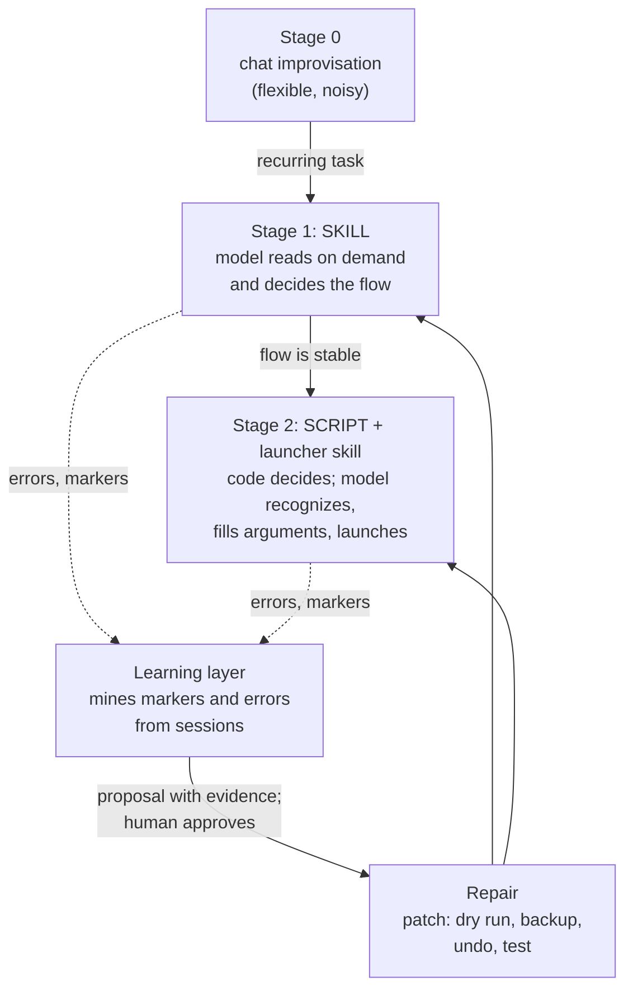
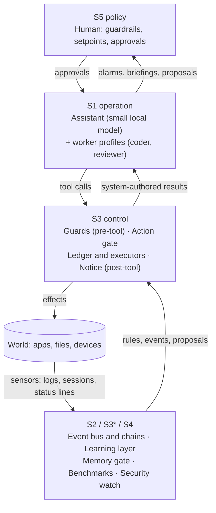

# Local Agent Blueprint

> **"the purpose of a system is what it does."**
> — Stafford Beer, *What is cybernetics?*, Kybernetes 31(2), 2002

**A blueprint for personal agents in which the system, not the model, approves actions, and in which recurring work hardens from chat into skills and from skills into scripts.**

This repository is not a framework and not a library. It is a set of design decisions, interface specifications, pseudocode and acceptance checks. It is written so that a person, or a coding agent such as Claude Code or Codex, can rebuild a comparable assistant on top of any agent harness, including your own.

Nothing here depends on one harness, one model, or one person's setup. Where a mechanism needs a harness capability (a pre-tool hook, a scheduler, a skill loader), the document says which capability, why, and what to do if your harness lacks it.

---

## Who this is for

You want an assistant that does everyday work for you (notes, tasks, planning, home, coding helpers) and you want it to run **locally on small models**, with sensitive data staying on your machine. You have noticed, or expect, that such models do not behave like the large cloud models:

- they do not reliably follow rules written in the prompt;
- their tool use drifts (invented APIs, wrong channel, wrong arguments, the same failing call repeated);
- they sometimes report success without having done the work;
- long contexts are slow, only one large model fits in memory at a time, and results vary from run to run.

## How to use it

- **As a human reader:** read this file, then 00, 01, 02 and 04. The rest can be read as you need it. To try a new model on an existing system, go straight to [16](docs/core/16-sizing-and-model-qualification.md); for operating the system over months, to [14](docs/core/14-operations-day-2.md), [15](docs/core/15-backup-and-restore.md) and [17](docs/core/17-emergency-stop-and-degraded-mode.md).
- **If you already have a running assistant:** start with [`docs/retrofit-gap-analysis.md`](docs/retrofit-gap-analysis.md) to see where you stand before changing anything.
- **As a coding agent:** read [`AGENTS.md`](AGENTS.md) and follow the build order. Build the target system in a *separate* workspace; this repository is the specification, not the place to build.

### Target model class

The blueprint aims at **agentic, local operation of small models**:

- **Primary target:** mixture-of-experts models around 27B parameters (a few billion active per token), served locally.
- **Overall range:** generally models up to about 40B parameters, depending on the hardware (unified memory or a single consumer GPU, quantized, one large model resident at a time).
- **Out of scope as a design driver:** frontier cloud models. They profit from the same structure, but the structure is sized for models that need it.

Smaller models need more of the structure (narrower tools, earlier hardening to scripts); models at the upper end of the range can stay at stage 1 for longer. Section [09](docs/core/09-measure-dont-believe.md) explains how to measure which is true for *your* model instead of guessing.

The consequence is the central thesis of this blueprint:

> **Reliability must be moved out of the model and into the system.**
> The model proposes. Plugins, guards, scripts and the human decide and enforce.

---

## Design principles from cybernetics and control engineering

These are the lens for every document in this repository. They are a reading of the system, not a formal model, and they do not constitute a stability proof. They have been useful because they force the right questions: *what is the setpoint, what is the sensor, who is the controller, what damps the loop?*

| Concept | Meaning here | Where it shows up |
|---|---|---|
| **Sharp setpoints ("grill me", after Matt Pocock's `grilling` skill)** | A loop can only be closed against a precise setpoint. Vague requests are sharpened by a bounded interview into a spec with acceptance criteria before anything is built or changed. | [12 Grill me](docs/core/12-grill-me.md) |
| **Closed loop** | Every subsystem (action approval, memory, tool knowledge, scheduling, planning, security) is a feedback loop. A loop is closed only when its *effect* is measured, not when the job ran green. | [00 Control loops](docs/core/00-control-loops.md) |
| **Setpoint belongs to the human** | Without a given setpoint a loop drifts into *some* stable state. The system corrects deviations; what is "right" (goals, priorities, limits, guardrails) is set by the person. | [01 Action protocol](docs/core/01-propose-dont-execute.md), [03 Memory and learning](docs/core/03-memory-and-learning.md) |
| **Sensor quality limits control quality** | If a measurement is missing or unreliable, the controller does nothing (deadband) instead of guessing. | [09 Measure](docs/core/09-measure-dont-believe.md) |
| **Choose the most reliable controller that can do the job** | Order of preference: executor refusal, then guard plugin, then script, then human, then model. The model is the controller of last resort. | [02 Enforce, don't prompt](docs/core/02-enforce-dont-prompt.md) |
| **Slow loops get slow controllers** | If you can measure weekly, do not adjust daily. Thresholds ("at least three sessions") are damping. | [05 Event-driven loops](docs/core/05-event-driven-loops.md) |
| **Damping and limits** | Stages, caps, minimum intervals, debounce, backups and undo keep a loop from oscillating or running away. | [06 Change discipline](docs/core/06-change-discipline.md) |
| **Disturbances are expected** | Model updates, harness updates, renamed jobs, restructured APIs, and changes in the operator's own workflow will happen. The design detects drift instead of assuming it away. | [04 Task hardening](docs/core/04-task-hardening.md), [14 Operations](docs/core/14-operations-day-2.md) |
| **Resources are a loop too** | Time, tokens, attention and cloud spend have setpoints and sensors like everything else. Over budget, a loop degrades or stops. | [18 Resource budgets](docs/core/18-resource-budgets.md) |
| **An off switch the model cannot touch** | Stop levels are held by the system and read at the point of effect; lost dependencies lead to defined, visible degraded modes. | [17 Emergency stop](docs/core/17-emergency-stop-and-degraded-mode.md) |
| **Requisite variety (Ashby)** | A controller can only absorb as much variety as it has itself. A small model has little. So reduce the variety it must handle: narrow tools, fixed scripts, closed vocabularies. | [04 Task hardening](docs/core/04-task-hardening.md) |
| **Viable System Model** (Beer) | A map of levels: S1 operation, S2 coordination, S3 control, S3\* sporadic audit, S4 intelligence (environment and future), S5 policy. | [00 Control loops](docs/core/00-control-loops.md) |
| **Maturity per loop** | Level 0 open (the report ends at the human); 1 proposal with veto; 2 automatic with log and undo; 3 self-adjusting within fixed bounds. The goal is a *deliberate* level per loop, not the highest everywhere. | [00 Control loops](docs/core/00-control-loops.md) |

Rules that apply to every loop in this blueprint:

1. The setpoint stays with the human, and it is sharp: vague requests are grilled into a spec first.
2. Sensor quality bounds control quality; when unsure, do nothing.
3. Slow loops get slow controllers.
4. A loop is closed only when the effect is measured.
5. Enforcement lives in the system (plugin, script, token), not in the prompt.
6. Every new feedback path ships with a proposal phase, a backup, an undo, and evidence.
7. Every loop has a budget and can be stopped from outside the model.

---

## The central idea: the two-stage hardening ladder

Small local models are good at *recognizing* what to do and weak at *reliably doing a long flow from scratch every time*. The blueprint therefore turns repeated chat tasks into progressively more deterministic artifacts:

- **Stage 1: skill.** For a recurring task a task-specific skill is created: the relevant information, steps and pitfalls, retrievable *on demand*. The model loads it when needed and uses it itself. Flexibility stays high; performance still depends on the model, but far less than with improvisation. In some harnesses (the reference harness, for example) these skills are created automatically after tool-heavy turns. How other harnesses behave has not been verified by the author; this blueprint therefore also describes a fallback in which the learning layer drafts the skill.
- **Stage 2: script.** When the flow is stable, it is cast into a script. This deliberately limits the flexibility of the task, but performance no longer depends on the model: it is faster, repeatable, testable and far less error-prone. After the transition, the stage-1 skill becomes a thin **launcher**: it states the use case and the exact terminal invocation with every argument.
- **Repair loop.** If circumstances change (the operator's workflow changes, an API is restructured, a file layout is renamed), the script code is changed *iteratively*, through the same disciplined path as every other change. The learning layer drives this: it mines **markers and errors** from the sessions, creates an evidence-backed proposal, and, after approval, the change is applied with dry run, backup, undo and a test. How far this runs without a human depends on the loop's maturity level.

Details, schemas, templates, promotion criteria and acceptance checks: [04 Task hardening](docs/core/04-task-hardening.md).

### What flows through it

The assistant is, in essence, a system that takes data from **any connection** (local files, web pages by fetch or scrape, APIs, message buses, mailboxes) and, **according to the human's stated purpose**, prepares, stores, forwards or uses it, including as input for other pipelines. The purpose is a small spec owned by the human, not code: see [11 Intent-driven data flows](docs/core/11-intent-driven-data-flows.md). Vague purposes are sharpened first: see [12 Grill me](docs/core/12-grill-me.md).

---

## Architecture at a glance

---

## Repository map

| Path | Content |
|---|---|
| [`AGENTS.md`](AGENTS.md) | Entry file for a coding agent: ground rules, questions to ask the human, build order with acceptance gates. `CLAUDE.md` points to it. |
| [`docs/core/`](docs/core/) | The principles and patterns. Each file has **Problem, Decision, Rationale, Interfaces and pseudocode, Acceptance check, Lessons**. |
| [`docs/pitfalls.md`](docs/pitfalls.md) | Consolidated failure modes with symptom, cause, countermeasure and pointer, sorted by build phase (section K: documentation, operations and long-term topics); plus a diagnostic order and a pre-flight checklist for the build agent. |
| [`docs/acceptance-suite.md`](docs/acceptance-suite.md) | One command that runs every acceptance check as a manifest of executable entries, including negative checks and a canary; when it runs and what it reports. |
| [`docs/retrofit-gap-analysis.md`](docs/retrofit-gap-analysis.md) | For an assistant that already exists: a read-only gap analysis of the running system against this blueprint, with limits, statuses, prompt template and lessons from a first run. |
| [`docs/glossary.md`](docs/glossary.md) | The terms of this blueprint in one table (tier, gate, ledger, launcher, tripwire, stop level and so on). |
| [`docs/adapting-to-your-harness.md`](docs/adapting-to-your-harness.md) | Capability map, fallbacks, harness-independent traps, and where the reference harness is named as an example. |
| [`docs/examples/`](docs/examples/) | **Optional** application examples, each with the same structure (where the data comes from, what happens to it, how it reaches the user): inbox digest, smart home control, task planning with a capacity brake, project intake and version control, kanban coder and reviewer, security watch. Examples 04, 01 and 02 are worked in more depth. To see the hardening ladder in practice, start with [04](docs/examples/04-project-intake-and-git.md), then [01](docs/examples/01-inbox-digest.md). |

Core documents (00 to 12 build the system; 13 to 19 document, operate and extend it):

| # | Document | One-line summary |
|---|---|---|
| 00 | [Control loops](docs/core/00-control-loops.md) | Loop datasheet, VSM map, maturity levels, typical gaps |
| 01 | [Propose, don't execute](docs/core/01-propose-dont-execute.md) | Action protocol: ledger, tiers, gate, approval token, system-authored notices |
| 02 | [Enforce, don't prompt](docs/core/02-enforce-dont-prompt.md) | Guards, deterministic context injection, why text rules fail |
| 03 | [Memory and learning](docs/core/03-memory-and-learning.md) | Memory drawers, quality gate, learning layer, human-only promotion |
| 04 | [Task hardening](docs/core/04-task-hardening.md) | Chat, skill, script; launcher handover; repair loop |
| 05 | [Event-driven loops](docs/core/05-event-driven-loops.md) | Events instead of clocks, chains, idle trigger, schedule as safety net |
| 06 | [Change discipline](docs/core/06-change-discipline.md) | Patches with dry run, backup, undo, sandbox, evidence |
| 07 | [Privacy zones](docs/core/07-privacy-zones.md) | Local-only data, secret detection, model routing |
| 08 | [Workers and review](docs/core/08-workers-and-review.md) | Kanban with coder and reviewer, worktrees, write-scope guard |
| 09 | [Measure, don't believe](docs/core/09-measure-dont-believe.md) | Benchmarks, self-checks, effect metrics, local-inference field notes |
| 10 | [Security and operations](docs/core/10-security-and-operations.md) | Audit, daily watch, privileged snapshot, health checks |
| 11 | [Intent-driven data flows](docs/core/11-intent-driven-data-flows.md) | Any source (files, web, API, bus) is processed and routed according to a human-owned intent spec; sinks can feed other pipelines |
| 12 | [Grill me](docs/core/12-grill-me.md) (derived from Matt Pocock's `grilling` skill) | Sharpen vague requests with a checklist-driven interview into a spec with acceptance criteria before anything is built |
| 13 | [Documenting the build](docs/core/13-documenting-the-build.md) | Fixed documentation set, handover state file, decision records, freshness check as part of the gate |
| 14 | [Operations after the build](docs/core/14-operations-day-2.md) | Update classes, pinned versions, tripwires that prove safeguards are alive, housekeeping, drift review |
| 15 | [Backup and restore](docs/core/15-backup-and-restore.md) | State classes, 3-2-1 with encryption, restore drills, restore order, no silent replay |
| 16 | [Sizing and model qualification](docs/core/16-sizing-and-model-qualification.md) | Memory and speed estimate; a fixed procedure with gates and a scorecard to test a model the human proposes against the incumbent |
| 17 | [Emergency stop and degraded mode](docs/core/17-emergency-stop-and-degraded-mode.md) | System-owned stop levels read at the point of effect, automatic triggers, defined degraded modes, resume checklist |
| 18 | [Resource budgets](docs/core/18-resource-budgets.md) | Budgets and meters per loop (time, tokens, attention, cloud spend), soft and hard limits, interactive priority |
| 19 | [Several people](docs/core/19-several-people.md) (optional, design only) | Identity per request, per-person zones and approvals, conflicts on shared devices |

## Status and honesty

The patterns were extracted from a working personal build that ran on a single mini PC (AMD Ryzen AI 9 HX 470, integrated GPU only, 96 GB RAM of which 45 GB dedicated as video memory), running small mixture-of-experts models. Statements are labelled by evidence: *observed* (seen in logs or sessions), *measured* (counted, usually with a small sample), or *design* (a decision made for a reason that has not been tested). Chapters 13 to 19 were added after the reference build and are mainly *design*; each states what has not been exercised. The exception is chapter [17](docs/core/17-emergency-stop-and-degraded-mode.md): its stop levels were then built in the reference system and exercised live, while its automatic triggers remain design. The reference build also has a known gap against chapter [07](docs/core/07-privacy-zones.md): the routing of cloud models in the interactive chat is not yet enforced in code. Numbers are small-sample, from one hardware class, and meant as orientation, not as benchmarks. Several loops are deliberately at maturity level 1 or 2; each document says what was proven and what was not.

This blueprint is not a security product. Guards catch mistakes, not intent. Where a real barrier is required (secrets, privileged operations, network exposure), the documents point to mechanisms that do not rely on the model's cooperation.

## Credits

- The "grill me" principle ([12](docs/core/12-grill-me.md)) is derived from the `grilling` skill (entry point `grill-me`) by Matt Pocock, MIT licensed: <https://github.com/mattpocock/skills/tree/main/skills/productivity/grilling>. Document 12 states what is taken over and what this blueprint adds.
- The viable-system framing follows Stafford Beer's Viable System Model; requisite variety is W. Ross Ashby's law. Both are used here as interpretive lenses, not as formal models.
