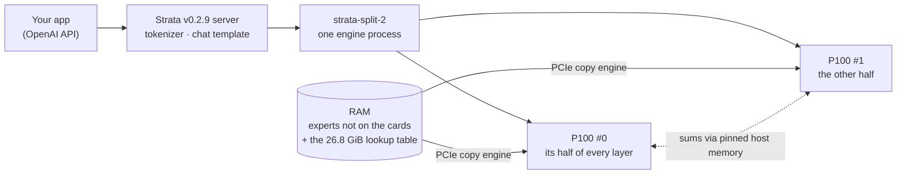

<div align="center">

# 😱 Scream P100

**Big MoE models on two retired Tesla P100s. Loud fans, fast tokens.**

[](#-inkling-2-mini-an-engine-of-its-own)

Qwen3.8-Flash-Next and Edge0-145B with a 512k context on a pair of 2016 server cards,<br>
and Thinking Machines' **Inkling 2 Mini** on an engine of its own, `ink2`.<br>
Built and measured for exactly **two Tesla P100 16 GB, each on its own PCIe 3.0 x16 link**.<br>
Flash-Next IQ3_S: **~67 tok/s writing · 110+ tok/s edits · ~1,000 tok/s reading a 38k-token prompt**.<br>
Inkling 2 Mini (`ink2`, exact): **~97 tok/s writing · ~100 tok/s Koda edits · ~1,030 tok/s reading · a chat's next turn in under a second · 256k or 512k context · pictures**.

[](LICENSE)


[🦑 **Inkling 2 engine**](#-inkling-2-mini-an-engine-of-its-own) · [Quick start](#-quick-start) · [Speed](#-speed) · [Models](#-models) · [2× M40 test build](#-test-build-two-tesla-m40-24-gb) · [Hy4 test build](#-test-build-tencent-hy4-flash) · [How it works](#-how-it-works) · [Full guide](docs/GUIDE.md)

</div>

> 🦑 **New: Inkling 2 Mini on the same two P100s**, with an engine of its own (`ink2`): the whole model in VRAM, every sum
> exact, ~97 tok/s writing with its DSpark drafter (15 % faster since 26 Nov), ~1,030 tok/s reading (5 % faster since 26 Nov, midday), a 256k or a 512k context and pictures; llama.cpp
> did 13 / 143 on the same cards. **A chat keeps its place:** the next turn reads only its new messages (0.76 s to the first
> byte instead of ~20 s on a 16k chat), other conversations wait in RAM, and **since 23 Nov such short reads are 18-22 %
> faster** (128 new tokens in 336 ms instead of 409). **And since 23 Nov on one P100 too** ([`ink2_1c`](https://github.com/Megla123/Scream-P100/blob/inkling2/docs/INKLING2.md#one-p100-27--faster-writing-the-same-bits-26-nov-evening)): 49 tok/s
> writing exactly since 26 Nov (40 before), 48 with a lossy option within 6 GB. **And since 24 Nov several chats at once** (test
> builds [`ink2_tpb` / `ink2_pp`](https://github.com/Megla123/Scream-P100/blob/inkling2/docs/INKLING2.md#several-conversations-at-once-ink2_tpb-ink2_pp-24-nov)): 121-136 tok/s in all for 2-4 agents, 162-166 for 6,
> every answer the same as alone. On branch [`inkling2`](https://github.com/Megla123/Scream-P100/tree/inkling2): [what it is and how to run it](#-inkling-2-mini-an-engine-of-its-own).

> 🧪 **Tencent Hy4 flash on the same two P100s**, with an engine of its own: 27 tok/s writing, 337 tok/s reading (442
> with f16 sums). A test build on branch [`hy4-test`](https://github.com/Megla123/Scream-P100/tree/hy4-test):
> [what it is and how to run it](#-test-build-tencent-hy4-flash).

---

Scream P100 holds **two different engines**, and only the Flash-Next one comes from Strata:

| Engine | Models | Where it comes from |
|---|---|---|
| **`ink2`** (branch [`inkling2`](https://github.com/Megla123/Scream-P100/tree/inkling2), `engine-inkling2/`) | Inkling 2 Mini | **Not a Strata fork.** Written from scratch for Inkling 2's looped MoE: its own CUDA engine and kernels, GGUF reader, DSpark drafter path and server. No Strata code; llama.cpp only as a library for the tokenizer and the picture encoder (mtmd, on the CPU). |
| **`strata-split-2`** (`engine/`) | Qwen3.8-Flash-Next, Edge0-145B | A port of [Strata](https://github.com/Niko1221/Strata)'s all-cards split engine (from [sFNX](https://github.com/johnfink8/sfnx)) to the P100, served by Strata v0.2.9's server. What is ours and what is Strata's: [docs/PROVENANCE.md](docs/PROVENANCE.md). |

The rest of this part is about the Flash-Next engine. `strata-split-2` runs on the **NVIDIA Tesla P100** (Pascal, sm_60),
a card that engine was never built for. Both cards work on every layer at once, the experts that do not fit in VRAM stream in from RAM over PCIe,
and two drafters (the model's own MTP layer and prompt lookup) let the cards check several tokens per step.

On the same two cards, our previous setup (Strata 0.2.9's layer-split engine with our P100 kernels, where one card
waits while the other works) wrote at 47-55 tok/s and read long prompts at 620-650 tok/s. It writes at **66.5**
and reads at about **1,000**.

> *Why "Scream"?* Under full load, the fans cooling two P100s in a 2U server scream. The tokens come out fast anyway.

## ✨ Highlights

- 🦑 **Inkling 2 Mini on an engine of its own (`ink2`):** the whole model in VRAM, every sum exact, **97.2 tok/s writing,
  1,031 tok/s reading, ~100 tok/s on code edits**, 256k or 512k context, pictures, and a chat's next turn in 0.76 s. llama.cpp
  does 13.0 / 143 on the same two cards. [Numbers](#inkling-2-mini-ink2-on-the-same-two-cards) · [what it is](#-inkling-2-mini-an-engine-of-its-own).
- 🧠 **Big MoE on old iron:** Qwen3.8-Flash-Next (IQ3_S or UD-Q4_K_XL) and Edge0-145B (6.6B active) on two 16 GB cards.
- ⚡ **Fast drafting:** the MTP draft layer plus prompt lookup of up to 15 tokens. On IQ3_S with 96 GB of RAM, code and
  text edits run at over 100 tok/s.
- 🎯 **Exact by default:** each step was checked against the build before it, with the same first-token logits (KL 0)
  and the same answers at temperature 0. A few kernel switches change only rounding. The lossy options
  (`FNX_ROUTE_PRIOR`, the Coder mask and the fast UD-Q4_K_XL profile) are off unless you set them.
- 🔌 **No NVLink, no P2P:** plain PCIe. The cards exchange their sums through pinned host memory.
- 🖼️ **Pictures, a 524,288-token context and an OpenAI-compatible API** through Strata v0.2.9's server.
- 🧰 **Tools for your machine:** `tune/check.py` finds what limits it, and `tune/tune.py` measures the exact switches on it.

## 🚀 Quick start

You need Linux, two Tesla P100 16 GB, 96 GB of RAM and CUDA 12 ([requirements](#-requirements)).
`/data/flash-next` is any folder with about 95 GB free.

```bash
git clone https://github.com/Megla123/Scream-P100.git && cd Scream-P100
bash build.sh                    # the engine, about 20 minutes
bash setup.sh /data/flash-next   # Strata v0.2.9, the model (85 GB), tokenizer, MTP layer, pictures, run config
bash run.sh /data/flash-next     # OpenAI-compatible API on http://127.0.0.1:8080/v1 after about 5 minutes
```

Then measure your machine against ours, on a freshly started engine, once (the expert cache learns, so a second run is
faster):

```bash
python3 bench/bench.py --strata-dir /data/flash-next/strata-v0.2.9 --wait
```

- `setup.sh` can be run again after an interruption (downloads resume), and `--check` only reports what is still to do.
  Set `HF_TOKEN` if Hugging Face asks for one.
- ⚠️ **Never build while the engine is loaded.** It pins most of the RAM, and a build beside it once hung our server.
- **Updating:** stop the server, `git pull`, run `bash build.sh` again, and check the [guide](docs/GUIDE.md) for
  profile changes. `setup.sh` keeps an existing `profile.json`, and an older engine ignores new switches silently.

Building by hand, preparing the files and every option are in the [full guide](docs/GUIDE.md#install).

## 📊 Speed

> **Every number here is from one machine: two Tesla P100 16 GB, each on its own PCIe 3.0 x16 link (11.9 GB/s from
> RAM to each card), one card on each CPU** (see "Our machine" below). Most experts live in RAM and stream over these
> links, so with x8 slots or PCIe Gen2 expect clearly slower reading and somewhat slower writing
> ([Other machines](docs/GUIDE.md#other-machines)).

`bench/bench.py` on our server, tok/s, each a single run on a freshly loaded engine, exact routing (`FNX_ROUTE_PRIOR=0`),
built from this repository's 17 Nov sources (`e56c3f60`, before the 18 Nov switch):

| Model | Context | RAM (most used) | ✍️ Fresh writing | ✏️ Edits (Python / Markdown) | 📖 Cold read, 38,862 tokens |
|---|---:|---:|---:|---:|---:|
| **Flash-Next IQ3_S** (ISTA-DASLab GSQ-RCO) | 512k | 96 GB | **66.5** | **110.7 / 115.8** | **1,012** |
| Flash-Next IQ3_S, 64 GB mode ¹ | 256k | 64 GB (55.6 GiB) | 63.8 | 93.6 / 99.2 | 807 |
| Flash-Next UD-Q4_K_XL (Unsloth) ² | 512k | 96 GB | 52.3 | 60.2 / 63.6 | 963 |
| Flash-Next UD-Q4_K_XL, **64 GB mode** ⁶ | 512k | 64 GB (55.5 GiB) | 37.6 | 38.9 / 42.8 | 429 |
| Flash-Next UD-Q4_K_XL, **Coder** experts ⁷ | 512k | 96 GB | 59.3 | 100.6 / 91.8 | 802 |
| Flash-Next UD-Q4_K_XL, **Coder** experts, **32 GB mode** ⁷ | 512k | 32 GB (22.5 GiB) | 50.1 | 73.6 / 63.4 | 987 |
| Edge0-145B NVFP4 | 512k | 96 GB | 55.0 | 96.6 / 98.9 | 691 |
| ⚠️ Fast UD-Q4_K_XL, **lossy** ⁴ | 512k | 96 GB | 73.9 | 125.1 / 126.4 | 1,007 |
| ⚠️ Fast UD-Q4_K_XL, lossy, **32 GB mode** ⁵ | 512k | 32 GB (22.5 GiB) | 67.1 | 118.5 / 120.2 | 754 |

¹ We have no 64 GB machine: this ran in a 58 GiB memory cgroup on our 96 GB server. In brackets for the low-RAM modes:
the most RAM the engine used in these tests (page-locked and its own memory, not the page cache, which Linux gives back).<br>
² With 18 Nov's switch and settings, our own test chain on 18-19 Nov (not `bench.py`), the same window as the fast
profile; its long read is 36,424 tokens on a freshly loaded engine with the lookup table in the page cache, as it
mostly is in use (a 29,700-token read in our production on the night of 18 Nov: 974 tok/s). `bench.py` on 16 Nov, before the switch:
50.9, 62.5 / 63.7 and 795, its read the first after a load with the page cache emptied, so it waits for the disk.<br>
⁴ Our own test chain on 18-19 Nov, not `bench.py`, in the same window as the exact UD-Q4_K_XL row ².
Answers are worded differently from the exact profile, see [Fast UD-Q4_K_XL](docs/GUIDE.md#fast-ud-q4_k_xl).<br>
⁵ Our own test chain on 19 Nov in a 28 GiB memory cgroup on our 96 GB server (we have no 32 GB machine), the model files
on an SSD, with the low-RAM engine of 19 Nov's evening (the 64 GB mode's; its first build that afternoon: 68.2, 121.3 /
121.7, 770); the same profile with every expert pinned: 69.9, 125.4 / 123.8, 909. See
[32 GB of RAM](docs/GUIDE.md#32-gb-of-ram).<br>
⁶ The exact UD-Q4_K_XL on the low-RAM engine, our own test chain on 19 Nov in a 58 GiB memory cgroup on our 96 GB server,
the model files on our SAS array (about 0.5 GB/s for these reads): the same first-token logits as with 96 GB (KL 0).
The edits' first runs read their prompts from the disk; the second and third ran at 43.0-43.1 / 46.5-46.8. Each new
prompt of more than 144 tokens reads about 13.5 GB from the disk (6,000 characters: 23.6 s, with 96 GB 4.0 s), so the
SSD sets the reading speed. At 510k tokens it read at 368 and wrote at 23.5 tok/s. See
[UD-Q4_K_XL on 64 GB](docs/GUIDE.md#ud-q4_k_xl-on-64-gb).<br>
⁷ The Coder's experts (a different, smaller model than the full one, see [Coder](docs/GUIDE.md#coder)) with exact
routing (λ 0), our own test chain on 21 Nov, both in the same window. The 32 GB mode ran in a 28 GiB memory cgroup on
our 96 GB server, the model files on our SAS array: the same first-token logits as with 96 GB in 150 of 150 requests
(KL 0) and every answer the same to the character. It pins 19.6 GiB of RAM, at most 22.5 GiB with the engine's own
memory. Writing code with reasoning: 73.6 / 54.0 tok/s, edits through an `edit` tool 69.2 / 42.4. A new 6,000-character
prompt right after the long read took 8.9 s (96 GB: 3.1 s): it reads from the disk. See
[32 GB of RAM](docs/GUIDE.md#32-gb-of-ram).

### 🦑 Inkling 2 Mini (`ink2`) on the same two cards

Thinking Machines' Inkling 2 Mini on `ink2`, an engine of its own (branch [`inkling2`](https://github.com/Megla123/Scream-P100/tree/inkling2)),
**everything exact**, temperature 0, the same machine, the figures of the branch's [guide](https://github.com/Megla123/Scream-P100/blob/inkling2/docs/INKLING2.md#speed) (writing: the build of 26 Nov at 185 W a card; edits 22 Nov; reading 4k 26 Nov, 14k / 40k 23 Nov). llama.cpp is `690b87d` with a layer split
across the same two cards, its greedy outputs match ours:

| | llama.cpp (same cards) | **ink2** |
|---|---:|---:|
| ✍️ Fresh writing, no drafts | 13.0 tok/s | **72.2 tok/s** |
| ✍️ Fresh writing, DSpark drafts + prompt lookup | not available | **97.2 tok/s** |
| ✏️ Code edits (a file repeated with a change / Koda's 26 edit tasks) | not measured | **100.7 / 97.4 tok/s** |
| 📖 Reading a 4k / 14k / 40k-token prompt | 143 / 119 / not measured | **1,031 / 917 / 798 tok/s** |
| 💬 A chat's next turn (a 16k-token chat, first byte) | not measured | **0.76 s** (~20 s without checkpoints) |
| Context | 32k measured | **256k or 512k** (needle found at 239k / 496k) |
| VRAM a card | 14.0-14.5 GB | 8.9 GB writing only, 15.2 GiB with the drafter at 256k or 512k |

Reading is 6.9x and writing 5.6x (7.5x with drafts) llama.cpp's speed on the same cards, because the whole model sits in VRAM
and both cards work on every layer at once. On the test set of our Flash-Next builds it writes fresh answers at 81.4 tok/s
(Flash-Next UD-Q4_K_XL: 59.3 exact, 68.9 lossy) and reads a 37.6k prompt at about 796 tok/s (802 / 987). One machine only:
[how it was measured, the quality checks and the traps](https://github.com/Megla123/Scream-P100/blob/inkling2/docs/INKLING2.md#speed).

<details>
<summary><b>Our machine</b></summary>

| | |
|---|---|
| Server | HPE ProLiant DL380 Gen10, 2 × Xeon Bronze 3106 (8 cores, 1.7 GHz) |
| RAM | 96 GB DDR4 (Linux sees 91.8 GiB) |
| GPUs | 2 × Tesla P100-PCIE-16GB, each in a PCIe Gen3 x16 slot (11.9 GB/s), power limit 185 W |
| Software | Ubuntu 26.04, NVIDIA 580, CUDA 12.4, Strata v0.2.9's server |

</details>

Every number, including deep contexts, conversation reads and pictures, is in the [full guide](docs/GUIDE.md#our-numbers).

## 🧩 Models

| Model | RAM | Context | Answers | Set up with | Download | Notes |
|---|---|---|---|---|---:|---|
| [ISTA-DASLab GSQ-RCO **IQ3_S**](https://huggingface.co/ISTA-DASLab/Qwen3.8-Flash-Next-GSQ-RCO-GGUF) | 96 GB, or **64 GB** with `--ram 64` | 512k (256k with 64 GB) | exact | `setup.sh /data/flash-next` | 85 GB | The fastest. |
| [Unsloth **UD-Q4_K_XL**](https://huggingface.co/unsloth/Qwen3.8-Flash-Next-GGUF) | 96 GB | 512k | exact | `setup.sh /data/flash-next-q4 --model q4_k_xl` | 112 GB | The larger quantization. Fewer experts fit on the cards, so edits wait for PCIe, and 96 GB of RAM is tight. |
| **UD-Q4_K_XL, 64 GB** | **64 GB** + the model on an SSD (uses up to 55.5 GiB) | 512k | exact | `build.sh --32g`, then `setup.sh /data/flash-next-q4-64 --models /data/flash-next-q4/models --model q4_k_xl --ram 64` | none | The exact UD-Q4_K_XL on a 64 GB machine, on the low-RAM engine of the 32 GB mode: no expert pinned in RAM, the ones the cards do not hold come from a 50 GiB RAM tier and the model files. The same answers as with 96 GB, writing at about 70 % of its speed; each new prompt reads about 13.5 GB from the SSD, so the SSD sets the reading speed. [Details](docs/GUIDE.md#ud-q4_k_xl-on-64-gb). |
| [Edge0 **Edge0-145B NVFP4**](https://huggingface.co/Edge0/Edge0-145B-NVFP4) | 96 GB | 512k | exact | `setup.sh /data/edge0 --model edge0` | 87 GB ³ | Flash-Next with its experts in a latent space (Edge0 Community Model License). Weaker Slovenian in our tests. |
| **Coder** expert mask | as its file | as its file | ⚠️ lossy | `setup.sh /data/flash-next-coder --models /data/flash-next/models --coder` | none | Flash-Next only: the experts ISTA-DASLab's Coder keeps. At λ 0.15, code edits ran 11 % (IQ3_S) to 43 % (UD-Q4_K_XL) faster, but it is worse outside code and ignored instructions in Slovenian. |
| **Coder UD-Q4_K_XL, 32 GB** | **32 GB** + the model on an SSD (uses up to 22.5 GiB) | 512k | the Coder's, exact | `build.sh --32g`, then `setup.sh /data/flash-next-q4-coder-32 --models /data/flash-next-q4/models --model q4_k_xl --coder --ram 32` | none | The Coder mask on UD-Q4_K_XL without the fast profile's lossy switches, on the low-RAM engine: the Coder's answers of 96 GB bit for bit (KL 0). Pins 19.6 GiB, at most 22.5 GiB with the engine's own memory. Writing 50.1 tok/s, code edits 70-75, a 36k read 987; 45 of 45 functions, 26 of 26 edits, 16 of 16 English questions. As the Coder, worse outside code. [Details](docs/GUIDE.md#32-gb-of-ram). |
| ⚠️ **Fast UD-Q4_K_XL** | 96 GB | 512k | ⚠️ lossy | `setup.sh /data/flash-next-q4-fast --models /data/flash-next-q4/models --model q4_k_xl --fast` | none | The UD-Q4_K_XL file with the Coder mask, `FNX_ROUTE_PRIOR=1.0` and `FNX_ONEHOP=2`: 1.4x fresh writing, 2x code edits. **Answers are worded differently** from the exact profile; in our 87 code, edit and English tasks it did about as well (four loads: 0, 0, 2 and 0 failed tasks, the exact profile 1), but it may ignore instructions in other languages and is not repeatable at temperature 0. For code and English. [Details and warning](docs/GUIDE.md#fast-ud-q4_k_xl). |
| ⚠️ **Fast UD-Q4_K_XL, 32 GB** | **32 GB** + the model on an SSD (uses up to 22.5 GiB) | 512k | ⚠️ lossy | `build.sh --32g`, then `setup.sh /data/flash-next-q4-32 --models /data/flash-next-q4/models --model q4_k_xl --fast --ram 32` | none | The fast profile on a 32 GB machine, with an engine of its own (`build-32g/`; the other profiles' engine is not touched): no expert pinned in RAM, the ones the cards do not hold come from the model files through a 17 GiB RAM tier. About as fast as with 96 GB when writing, reads 17 % slower; 45 of 45 functions, 16 of 16 English questions. Pins 19.6 GiB. 1.4x the Coder profile's fresh writing on 32 GB, 1.7-1.9x its code edits. [Details](docs/GUIDE.md#32-gb-of-ram). |

³ 28.8 GB of it is the IQ3_S's second shard: point `--models` at the IQ3_S folder to share it.

One data folder holds one profile, so give each model its own folder (`--models` shares the downloads). Files whose
expert types have no P100 kernels here (Q6_K, Q3_K, Q2_K, ...) run slower than Strata itself, or not at all. On other
cards, use [Strata](https://github.com/Niko1221/Strata).

## 🧪 Test build: two Tesla M40 24 GB

> ⚠️ **Test build, measured on one machine only**, on branch [`m40-2x`](https://github.com/Megla123/Scream-P100/tree/m40-2x)
> ([docs/M40.md](https://github.com/Megla123/Scream-P100/blob/m40-2x/docs/M40.md)). We ran it on our second server until we
> sold it, so we cannot measure it again or test fixes.

The same split engine on two **Tesla M40 24 GB** (Maxwell, sm_52, 2015), with f32 expert kernels of its own (Maxwell has no
f16 arithmetic), on **32 GB of RAM**: ISTA-DASLab's GSQ-RCO IQ3_XXS, 256k context, pictures. On our M40 server (220 W, 1114 MHz):
**45.7 tok/s** fresh writing, **62.9 / 66.7** edits (Python / Markdown), **420 tok/s** reading a 38,862-token prompt. Strata's
layer-split engine did 35.2 tok/s writing and 275 tok/s reading on the same machine. Build with `bash build.sh --m40`, set up
with `setup.sh DATA --model iq3_xxs`. Only the 24 GB M40 was run.

## 🦑 Inkling 2 Mini: an engine of its own

[](https://github.com/Megla123/Scream-P100/blob/inkling2/docs/INKLING2.md#conversations-keep-their-place-p21-p23)

> ⚠️ **Measured on one machine only**, on branch [`inkling2`](https://github.com/Megla123/Scream-P100/tree/inkling2)
> ([docs/INKLING2.md](https://github.com/Megla123/Scream-P100/blob/inkling2/docs/INKLING2.md)). Written on 21-22 Nov 2026; nobody else has run it yet. Reports
> are welcome.

Thinking Machines' **Inkling 2 Mini** (26.4B looped MoE: layers 6-17 run three times, 128 experts, NVFP4) on the same two
P100 16 GB with an **engine of its own**, `ink2` (`engine-inkling2/`): both cards on every layer at once, and here the whole
model fits in VRAM (8.9 GB a card), so nothing streams over PCIe. Xylolabs's NVFP4-Q8_0 GGUF with Unsloth's DSpark drafter
(the model's MTP). On our machine, everything exact: **72.2 tok/s** writing without drafts and **97.2** with them (26 Nov),
**~100 tok/s** on Koda's edit tasks, **~1,030 tok/s** reading a 4k prompt (917 at 14k, 796 at 37.6k, at either context). Two
context options: **256k** (the KV cache in f16; a needle found at 239k) or **512k** (the long part of the KV cache in int8,
the first 32k tokens bit for bit as 256k, the same speed; a needle found at 496k). llama.cpp did 13.0 tok/s writing and 143
reading on the same cards; its greedy outputs match ours. On the test set of our Flash-Next builds it writes fresh answers
at 81.4 tok/s (Flash-Next UD-Q4_K_XL: 59.3 exact, 68.9 lossy) and reads a 37.6k prompt at 796 (802 / 987). Tool calls and
**pictures** work (the vision projector runs on the CPU, ~20 s a picture); greedy only for now. **A conversation keeps its
place:** checkpoints and parked conversations in RAM, so a chat's next turn, a shortened history or a conversation that
another one pushed off the cards reads only what is new (a 38k conversation back from RAM in 0.8 s instead of 51.5), and
such a short read costs less since 23 Nov (64 / 128 / 256 new tokens in 251 / 336 / 484 ms instead of 322 / 409 / 562).

[](https://github.com/Megla123/Scream-P100/blob/inkling2/docs/INKLING2.md#one-p100-ink2_1c-23-nov)

**One P100** (23 Nov, `ink2_1c`, `INK2_CARDS=1 bash engine-inkling2/run.sh DATA`; **since 26 Nov 49.4 tok/s fresh writing and
78.9 on the edit with the same bits**, [details](https://github.com/Megla123/Scream-P100/blob/inkling2/docs/INKLING2.md#one-p100-27--faster-writing-the-same-bits-26-nov-evening)): the same engine on one card. The most used
experts (by a plan from routing traces) fill the VRAM left after everything else, the others wait in RAM, and an on-card
LRU cache that the card fills itself after each layer's routing holds the RAM experts in use; the reading path copies them
in groups while it computes. Exact: **40.2 tok/s** fresh writing, 41.1 on an edit, 378 reading a 34.7k prompt, 45 of 45
functions like two cards, within **8 GB of RAM** (6.9 GiB used). `INK2_LOSSY=1` requantizes the last 4 layers' Q8 experts
to NVFP4: **48.0 tok/s** within **6 GB** (5.3 GiB used), 43 of 45 functions. No drafter on one card (it did not pay).
[Details](https://github.com/Megla123/Scream-P100/blob/inkling2/docs/INKLING2.md#one-p100-ink2_1c-23-nov).

[](https://github.com/Megla123/Scream-P100/blob/inkling2/docs/INKLING2.md#several-conversations-at-once-ink2_tpb-ink2_pp-24-nov)

**Several chats at once** (24 Nov, two test builds, `INK2_MULTI=tpb|pp bash engine-inkling2/run.sh DATA`): agents no longer
wait for each other's answers. Each conversation gets a slot of its own on the cards (its KV cache and states), and its
output is the same alone and beside the others, token for token and logit for logit.

- **`ink2_tpb`** keeps production's layout (both cards on every layer) and batches the writing of up to 4 conversations
  through one pass over the experts: **121 / 134 / 136 tok/s** in all with 2 / 3 / 4 agents instead of ~85 one after
  another, while a single chat stays bit for bit `ink2_v1` (86 tok/s).
- **`ink2_pp`** is a pipeline: half of the layers on each card, so the two cards work on different conversations at once:
  **148 tok/s** with 4, **162-166** with 6.

No pictures or parked conversations in these builds yet. [Details](https://github.com/Megla123/Scream-P100/blob/inkling2/docs/INKLING2.md#several-conversations-at-once-ink2_tpb-ink2_pp-24-nov).

```bash
git clone -b inkling2 https://github.com/Megla123/Scream-P100.git && cd Scream-P100
bash engine-inkling2/build.sh && bash engine-inkling2/setup.sh /data/inkling2
bash engine-inkling2/run.sh /data/inkling2 256k   # or 512k
```

## 🧪 Test build: Tencent Hy4 flash

[](https://github.com/Megla123/Scream-P100/blob/hy4-test/docs/HY4.md)

> ⚠️ **Test build, measured on one machine only**, on branch [`hy4-test`](https://github.com/Megla123/Scream-P100/tree/hy4-test)
> ([docs/HY4.md](https://github.com/Megla123/Scream-P100/blob/hy4-test/docs/HY4.md)). Written in the two days before
> 21 Nov 2026; nobody else has run it yet. Reports are welcome.

Tencent's **Hy4 flash** on the same two P100 16 GB, with an **engine of its own** (`engine-hy4/`): Strata's split engine does
not know Hy4's Engram tables, indexed sparse attention and latent experts, so we wrote one with the same idea (both cards
on every layer, the experts that do not fit streamed in over PCIe). Xylolabs's IQ3_XXS GGUF, 64k context, tools and
thinking, 96 GB of RAM. On our machine: **27-28 tok/s** fresh writing, **28-35** edits (Python and Markdown files),
**337 tok/s** reading a 14,302-token prompt, or **442 tok/s** with f16 sums (`HY4_PF_F16=7`, on our test sets within one
question of the first build); llama.cpp with Hy4 support did 6-9 tok/s writing on the same cards.

```bash
git clone -b hy4-test https://github.com/Megla123/Scream-P100.git && cd Scream-P100
bash engine-hy4/build.sh && bash engine-hy4/setup.sh /data/hy4 && bash engine-hy4/run.sh /data/hy4
```

## 🔧 How it works



- **Split, not pipelined:** each card holds half of every layer, so both read their weights at the same time.
- **P100 kernels:** the P100 has no `dp4a`, no tensor cores and no `__nanosleep`, and its FP16 is fast only as paired
  `HFMA2`. This port adds FP16 expert kernels for writing and for reading prompts, P100 attention, and a `dp4a` emulation
  (`engine/p100_compat.h`).
- **Experts on demand:** about 60 % of IQ3_S's experts live only in RAM. A copy-engine thread brings the missing ones
  in, with guesses for the next layer, and each expert's blocks wait only for that expert's copy.
- **Drafting:** the MTP layer drafts up to 4 tokens and prompt lookup up to 15, and the full model checks the drafts in
  one pass, which is why edits are so fast.

The build-by-build story, with the gain of each step, is in [docs/HISTORY.md](docs/HISTORY.md).

## 📋 Requirements

- **Linux x86-64.**
- **Two Tesla P100 16 GB (PCIe)**, ideally each in a **Gen3 x16** slot. The engine is built for exactly two cards of
  compute capability 6.0 and refuses other cards. P40 and GTX 10x0 (sm_61) are not supported. Two Tesla M40 24 GB: only
  the [test build](#-test-build-two-tesla-m40-24-gb) on branch `m40-2x`.
- **Above 4G Decoding** on in the BIOS, so each card gets its 16 GiB BAR1. The engine refuses a card without one.
- **96 GB of RAM**, or 64 GB with the IQ3_S 64 GB mode or the exact UD-Q4_K_XL's 64 GB mode (model files on an SSD), or
  32 GB with UD-Q4_K_XL's 32 GB mode, the Coder's experts exact or the fast profile (lossy), model files on an SSD.
- **CUDA 12.x** (CUDA 13 dropped sm_60) with a host compiler it accepts (CUDA 12.4: gcc 13 at most), CMake 3.22+,
  git and Python 3.10+. The driver must support both CUDA 12 and Pascal (the 580 branch is NVIDIA's last for Pascal).
- **Disk:** about 95 GB for IQ3_S, 112 GB of files for UD-Q4_K_XL, and 87 GB for Edge0-145B (less when it shares the
  IQ3_S shard).
- On Intel boards with VT-d, set **`iommu=pt`**: with translation on, our copies to the cards ran at 7.6-8 GB/s instead
  of about 12.

One request at a time (`--batch 1`), no `logprobs`, and the first answers after a load are slower while the expert cache
settles. What has and has not been tested is in [Known limitations](docs/GUIDE.md#known-limitations).

## 📚 Documentation

| | |
|---|---|
| [docs/GUIDE.md](docs/GUIDE.md) | **The full guide:** every measurement, each model in depth, install and run by hand, benchmarking, exact and lossy settings, other machines, known limitations |
| [docs/SWITCHES.md](docs/SWITCHES.md) | Every `FNX_*` engine switch and what each profile sets |
| [docs/HISTORY.md](docs/HISTORY.md) | How the port came about, build by build, plus what was tried and dropped |
| [tune/README.md](tune/README.md) | `check.py` and `tune.py`: diagnose and tune your own machine |
| [Branch `poc-4x-p100`](https://github.com/Megla123/Scream-P100/tree/poc-4x-p100/docs/POC-4X.md) | ⚠️ **Unverified proof of concept**, never run on four cards: a build for four P100 behind one PCIe switch (`build.sh --4x`) |
| [Branch `m40-2x`](https://github.com/Megla123/Scream-P100/blob/m40-2x/docs/M40.md) | ⚠️ **Test build** for two Tesla M40 24 GB (sm_52), measured on one machine only: IQ3_XXS, 256k, 32 GB of RAM (`build.sh --m40`) |
| [Branch `inkling2`](https://github.com/Megla123/Scream-P100/blob/inkling2/docs/INKLING2.md) | Thinking Machines' Inkling 2 Mini on the same two P100, an engine of its own (`ink2`), measured on one machine only: the whole model in VRAM, exact, ~97 tok/s writing, ~1,030 tok/s reading, 256k or 512k context, pictures, a chat's next turn in under a second (`engine-inkling2/`); also on **one P100** (`ink2_1c`): 49 tok/s writing exactly (since 26 Nov), 48 lossy within 6 GB; **several chats at once** (test builds `ink2_tpb` / `ink2_pp`): 136 tok/s in all with 4 agents, 162-166 with 6 |
| [Branch `hy4-test`](https://github.com/Megla123/Scream-P100/blob/hy4-test/docs/HY4.md) | ⚠️ **Test build** for Tencent Hy4 flash on the same two P100, an engine of its own, measured on one machine only: IQ3_XXS, 64k, 96 GB of RAM, 337 / 442 tok/s reading (`engine-hy4/`) |
| [NOTICE.md](NOTICE.md) · [docs/PROVENANCE.md](docs/PROVENANCE.md) · [docs/upstream-v0.2.10.diff](docs/upstream-v0.2.10.diff) | What is ours and what is Strata's, file by file and line by line |

Our scripts and docs refer to sections as *(README, "Section")*. Those sections are now in [docs/GUIDE.md](docs/GUIDE.md).

## 📰 News

- **27 Nov 2026 (evening):** 🦑 **Inkling 2 Mini has a second drafter, DFlash 2: 8 % faster writing, 15 % in English** on
  branch [`inkling2`](https://github.com/Megla123/Scream-P100/blob/inkling2/docs/INKLING2.md#dflash-2-a-second-drafter-8--faster-writing-p74-27-nov).
  Inco AI's and z-lab's [DFlash 2](https://huggingface.co/incoai/Inkling-2-Mini-DFlash2) drafts a block of 8 tokens in one
  pass, and every written token is still the model's own. On our 56 prompts (512k, 185 W a card) writing went from 91.7 to
  **99.3 tok/s** against DSpark; English questions from 93.0 to **106.7**, code functions from 94.8 to 106.4. Nothing got slower,
  and deep in a chat it is about as fast as DSpark. `run.sh` uses it by default; `INK2_DRAFTER=dspark` keeps DSpark. It also runs
  on **one P100** (a choice there: faster fresh writing, slower edits) and with **several chats at once** (`INK2_MULTI=tpb`, the
  default there: 94.9 tok/s alone, 137.4 with 4). Also new: a **budget for the reasoning** by effort, so a reasoning that runs
  long is closed at a sentence end and the model answers. Under the budget the output is the same bit for bit.

  [](https://github.com/Megla123/Scream-P100/blob/inkling2/docs/INKLING2.md#dflash-2-a-second-drafter-8--faster-writing-p74-27-nov)
  [](https://github.com/Megla123/Scream-P100/blob/inkling2/docs/INKLING2.md#dflash-2-a-second-drafter-8--faster-writing-p74-27-nov)


- **27 Nov 2026 (mid-morning):** 🦑 **Inkling 2 Mini writes up to 18 % faster deep in a chat, every token the same** on branch
  [`inkling2`](https://github.com/Megla123/Scream-P100/blob/inkling2/docs/INKLING2.md#attention-at-depth-the-int8-rows-up-front-p70-p72-27-nov):
  the full layers' attention now reads its int8 K and V rows up front, in 16-byte loads that arrive while it works
  (`INK2_ATT_PV`). One visit at 240k went from 1,521 to 979 µs. At 240k tokens deep, writing went from 36.8 to **43.5 tok/s**
  without drafts and from 38.4 to **42.2** with them; at 128k it went from 47.7 to 52.8 and from 50.8 to 53.3. Short prompts and
  reading are unchanged. Longer drafts at depth were tried and left out (6-10 % slower).

  [](https://github.com/Megla123/Scream-P100/blob/inkling2/docs/INKLING2.md#attention-at-depth-the-int8-rows-up-front-p70-p72-27-nov)

- **27 Nov 2026 (morning):** 🦑 **Inkling 2 Mini's agent no longer stops without a word on a looping tool call** on branches
  [`inkling2`](https://github.com/Megla123/Scream-P100/blob/inkling2/docs/INKLING2.md#loops-in-the-reasoning-the-answer-or-a-tool-call)
  and [`inkling2-m40`](https://github.com/Megla123/Scream-P100/blob/inkling2-m40/docs/INKLING2-M40.md#loops-26-nov): a call
  whose JSON repeats itself is cut where it began, and the model writes on after a system message that says so
  (`INK2_LOOP_CALL`); a reply that ends in a loop again says "[ink2_server] I stopped here" to the user. While a long prompt
  is read, `/slots` now gives llama-server's `n_prompt_tokens_total`, `_cache` and `_processed` (the last estimated from the
  reading cost by depth), so a chat app's progress line shows the real reading speed. Without a loop the replies are the same.

- **26 Nov 2026 (late evening):** 🦑 **Inkling 2 Mini's loop guard holds at 125k of context** on branches [`inkling2`](https://github.com/Megla123/Scream-P100/blob/inkling2/docs/INKLING2.md#loops-in-the-reasoning-the-answer-or-a-tool-call)
  and [`inkling2-m40`](https://github.com/Megla123/Scream-P100/blob/inkling2-m40/docs/INKLING2-M40.md#loops-26-nov): a
  reasoning that goes over the same points again under new numbers is now cut (`INK2_LOOP_MASK`), and so is an answer or a
  tool call that repeats a paragraph (`INK2_LOOP_PAR`), long before the old 16,000-character limit; cycles of 2-3 tool calls
  are seen across turns too. At ~126k tokens of context, an answer that ended in 154 copies of one line now stops after the
  first; requests without a loop give the same tokens as before. The M40 branch's server gets the same guards.

- **26 Nov 2026 (evening):** 🦑 **Inkling 2 Mini on one P100 writes 27 % faster, every token the same** on branch [`inkling2`](https://github.com/Megla123/Scream-P100/blob/inkling2/docs/INKLING2.md#one-p100-27--faster-writing-the-same-bits-26-nov-evening):
  `build/ink2_1c` is now built from the two-card sources, so today's exact patches are in it, and its cache of RAM experts also
  gets 0.8 GiB of slots in the reading path's buffers that writing never touches (p63, on in `run.sh`). Fresh writing 38.9 →
  **49.4 tok/s**, the edit 54.7 → **78.9**, writing after a 34.7k read 31.0 → 40.2, reading unchanged, 0.5 GiB less RAM;
  measured on both our cards side by side.

  [](https://github.com/Megla123/Scream-P100/blob/inkling2/docs/INKLING2.md#one-p100-27--faster-writing-the-same-bits-26-nov-evening)

- **26 Nov 2026 (afternoon):** 🦑 **Inkling 2 Mini's server breaks a loop across turns** on branch [`inkling2`](https://github.com/Megla123/Scream-P100/blob/inkling2/docs/INKLING2.md#loops-in-the-reasoning-the-answer-or-a-tool-call):
  when a coding agent's conversation ends in the same tool call with the same result 3 times (`INK2_LOOP_TURNS`), the
  model gets a system message that it is looping, and the same call written anyway is dropped. On a real 17-times loop
  rebuilt from an agent's database, the model changed its approach at 3, 4 and 10 repeats; other requests are unchanged.

- **26 Nov 2026 (midday):** 🦑 **Inkling 2 Mini reads over 1,000 tok/s and writes up to 16 % faster deep into a long
  context** on branch [`inkling2`](https://github.com/Megla123/Scream-P100/blob/inkling2/docs/INKLING2.md#attention-at-depth-and-two-reading-chunks-at-once-p59-p61-pr-15-26-nov)
  (the same bits). Keoian's [#15](https://github.com/Megla123/Scream-P100/pull/15) reads two chunks of a prompt at once, so
  one chunk's exchange between the cards crosses PCIe while the other computes: on our two x16 cards at 185 W 981 → **1,031
  tok/s** at 4k, +3.7 % at 30k, and it is on by default now. A draft window's rows now read the full layers' keys and values
  once instead of once a row, and the attention's parts are joined by more blocks: writing with drafts at a depth of 64k /
  128k / 240k tokens 76.7 / 46.0 / 33.2 → **81.2 / 50.8 / 38.4 tok/s**. Short prompts write as before, every answer the same.

  [](https://github.com/Megla123/Scream-P100/blob/inkling2/docs/INKLING2.md#attention-at-depth-and-two-reading-chunks-at-once-p59-p61-pr-15-26-nov)

- **26 Nov 2026:** 🦑 **Inkling 2 Mini writes 15 % faster** on branch [`inkling2`](https://github.com/Megla123/Scream-P100/blob/inkling2/docs/INKLING2.md#writing-faster-the-argmax-on-the-cards-and-less-waiting-p47-p57-26-nov)
  (p47-p57, the same bits). Each card now picks the next token itself instead of sending 0.4 MB of logits a row to the host,
  the cards swap a single token's values as 8-byte words with a sequence number (no fence, no flag), a full-attention
  layer's parts are joined in parallel, and a new conversation no longer waits for a checkpoint buffer to be page-locked.
  On 56 prompts at 512k (185 W a card): 79.9 → **91.6 tok/s** with drafts and 62.6 → **72.4** without, every answer the same;
  at a depth of 240k tokens 27.3 → 33.3 without drafts (+22 %); on the shared test set fresh writing 71.4 → 81.4 and edits
  139 → 171; reading as before. Every change has a switch whose old value runs the old code; the drafter is the same.

  [](https://github.com/Megla123/Scream-P100/blob/inkling2/docs/INKLING2.md#writing-faster-the-argmax-on-the-cards-and-less-waiting-p47-p57-26-nov)

- **24 Nov 2026 (morning):** 🦑 **Inkling 2 Mini reads 3 % faster on every load** on branch [`inkling2`](https://github.com/Megla123/Scream-P100/blob/inkling2/docs/INKLING2.md#two-cards-on-the-one-card-sources-the-exchange-by-numa-node-p38-p41-24-nov)
  (p38-p41, the same bits). On a two-socket server with a card on each, the reading exchange's page-locked buffers landed on
  whichever NUMA node the loading thread ran on, and reading 4k / 30k prompts was 947 / 828 or up to 984 / 851 tok/s by the
  load; the engine now allocates each card's buffers on that card's node (`INK2_NUMA`, it prints where they landed): 980-984 /
  851 on every load. Writing with drafts after a 30k prompt is 1.7 % faster (a draft window's attention rows side by side),
  and two cards now run on the one-card build's sources with every expert in VRAM.
- **24 Nov 2026:** 🦑 **Inkling 2 Mini: several chats at once** on branch [`inkling2`](https://github.com/Megla123/Scream-P100/blob/inkling2/docs/INKLING2.md#several-conversations-at-once-ink2_tpb-ink2_pp-24-nov),
  two test builds. Until now the engine wrote for one request at a time, and a second agent waited for the first answer.
  `ink2_tpb` keeps production's layout and gives each conversation a slot of its own on both cards; the writing pieces of
  up to 4 conversations share one pass over the experts and the dense matrices, while each conversation's attention and
  convolutions run with the rows it would have alone, so no sum changes. 1 / 2 / 3 / 4 agents: 86 / 121 / 134 / 136 tok/s
  in all (~85 one after another before); a single chat is bit for bit `ink2_v1`, and a long read no longer stalls the
  writers (first token after 0.6-1.3 s, 4.5-6.8 without interleaving the read). `ink2_pp` puts half of the layers on each card and passes the
  hidden state between them, so the cards work on different conversations: 61 / 108 / 148 tok/s with 1 / 2 / 4, 162-166
  with 6. In both, every conversation's tokens and logits are the same alone and together.
- **23 Nov 2026 (late evening):** 🦑 **Inkling 2 Mini: reasoning effort low by default** on branch [`inkling2`](https://github.com/Megla123/Scream-P100/blob/inkling2/docs/INKLING2.md#reasoning-effort-low-by-default-23-nov).
  A request that names no effort (Open WebUI sends none) now gets low (0.2) instead of 0.9: on our quality sets low gave
  45/45 functions in 29.6k tokens, medium (0.7) 42/45 in 52.0k with 3 empty answers. Effort none without tools answers
  without reasoning, and a tool call written without its comma before `args` is read as a call. Sampling at temperature 1.0
  over the whole vocabulary was tried and left out (7/45 functions).
- **23 Nov 2026 (evening):** 🦑 **Inkling 2 Mini on one P100** on branch [`inkling2`](https://github.com/Megla123/Scream-P100/blob/inkling2/docs/INKLING2.md#one-p100-ink2_1c-23-nov): `ink2_1c`,
  the same engine for one card. The whole model does not fit (experts 15.4 GiB), so the experts used most stay in VRAM by a
  plan from routing traces and the others wait in page-locked RAM; after each layer's routing the card copies the picked RAM
  experts into an LRU cache of its own (on written text a fixed choice hit only 85 %, the cache cut the PCIe bytes by ~40 %),
  and the reading path stages them in groups. Exact: 40.2 tok/s fresh, 41.1 edit, 378 reading 34.7k, 45/45 functions,
  16/16 English, 12/15 Slovenian (as two cards) within 8 GB of RAM. `INK2_LOSSY=1` (the last 4 layers' Q8 experts
  requantized to NVFP4 at load): 48.0 / 45.6 / 396 within 6 GB, 43/45 functions. Writing is 55-65 % of two cards, reading
  about half.
- **23 Nov 2026:** 🦑 **Inkling 2 Mini reads short pieces 18-22 % faster** on branch [`inkling2`](https://github.com/Megla123/Scream-P100/blob/inkling2/docs/INKLING2.md#short-pieces-read-faster-p25-p27).
  Since conversations keep their place, most requests read a few dozen to a few hundred new tokens, and such a piece had a
  fixed cost of ~270 ms. Most of it was the last 4 layers' experts, which are Q8_0 and still went through f32 copies and a
  cuBLAS call an expert: now they go straight from their int8 bytes by the NVFP4 experts' tiles (the same weights, KL of the
  last row 10⁻¹¹ to 10⁻¹³), experts get tiles of 8 and 4 tokens (the same bits), and the reading path starts at 31 tokens.
  After a 16k conversation: 64 / 128 / 256 / 512 new tokens in 251 / 336 / 484 / 762 ms (were 322 / 409 / 562 / 837), 40 in
  237 (290); a prompt from token 0 at 4k / 14k / 40k: 965 / 917 / 798 tok/s (924 / 894 / 783). Writing is the same to the
  token; functions 45/45, English 16/16, Slovenian 12/15, Koda's edits 24/26, as before.
- **22 Nov 2026 (evening):** 🦑 **Inkling 2 Mini: a chat keeps its place** on branch [`inkling2`](https://github.com/Megla123/Scream-P100/blob/inkling2/docs/INKLING2.md#conversations-keep-their-place-p21-p23).
  The engine kept one snapshot at the prompt's end, so a chat app that moves a note to the newest message, a shortened
  history, an answer over 3k tokens or another conversation in between made it read the whole prompt again (~20 s at 16k).
  Now checkpoints in RAM (278 MiB each, where messages start) and parked conversations (their KV rows in RAM, up to 32 GiB)
  bring it back: the next turn of a 16k chat reads 106 tokens and answers after 0.76 s, a 38k conversation comes back from
  RAM in 0.8 s instead of 51.5, with the same logits as reading from token 0. A tokenizer that stays up (~10 ms instead of
  ~900) now takes code as written (the old call turned a written `\n` into a newline). Merged launches in writing, the same
  bits. Against the morning build on the same prompts: writing without drafts 56.4 → 62.2 tok/s, with drafts 82.1 → 83.9,
  the test set's fresh answers 67.2 → 71.2, a Python file edit 75.2 → 94.2; functions 45/45 (43/45), Koda's edits 24/26
  (24/26), English 16/16, Slovenian 12/15 (the same). A cold 37.6k read pays ~1 s for its checkpoints (761 tok/s, was 775).
- **22 Nov 2026 (noon):** 🦑 **Inkling 2 Mini reads 30-37 % faster** on branch [`inkling2`](https://github.com/Megla123/Scream-P100/blob/inkling2/docs/INKLING2.md#reading-faster-p19),
  still all in f32: at a 256k context a 4k / 14k / 40k prompt now reads at ~940 / 887 / 776 tok/s (was 717 / 655 / 571), a
  37.6k one at 790 (578; Flash-Next Q4 exact: 802). The full layers' query blocks are sized by the prompt instead of the
  longest context, the 512k mode's shared scratch is used at 256k too (0.43 GiB less VRAM), the NVFP4 experts run one CUDA
  block a tile of 64 / 32 / 16 tokens from a list (gate_up 18.2 → 14.2 ms, the same bits), and the cards' sums travel in 4
  slices while the next slice is made. Quality against the build before on the same sets: English 16/16, Slovenian 12/15,
  Koda's edits 24/26 (before: 25/26 at a 256k context, 24/26 at 64k), functions 43/45 (44/45): one task flips with
  the new order of the sums.
- **22 Nov 2026:** 🦑 **Inkling 2 Mini: 512k and pictures** on branch [`inkling2`](https://github.com/Megla123/Scream-P100/blob/inkling2/docs/INKLING2.md).
  `run.sh DATA 256k` or `512k`: at 512k the full layers' KV rows past 32,768 are int8 (groups of 32, an f16 scale) and
  buffers that never run at once share memory, 15.24 GiB a card; below 32k the output is the 256k mode's bit for bit, the
  speed the same (fresh 67.2, edits 127.8, a 37.6k read 581 tok/s), past it KL ~4·10⁻³ against f16 (our f16 against
  llama.cpp: 1.2·10⁻²); a needle found at 496,073 tokens. Pictures through the model's vision projector (llama.cpp's mtmd
  on the CPU, ~20 s for 1600×900), in both options. Measured on our machine only.
- **21 Nov 2026 (evening):** 🦑 **Inkling 2 Mini with an engine of its own** on branch [`inkling2`](https://github.com/Megla123/Scream-P100/blob/inkling2/docs/INKLING2.md):
  Thinking Machines' 26.4B looped MoE on the same two P100, the whole model in VRAM, every sum exact. 56.6 tok/s fresh
  writing (78.8 with the DSpark drafter and prompt lookup), edits 100-127, reading 794 tok/s at 4k and 646 at 36k, context
  up to 262,144; llama.cpp `690b87d` on the same cards: 13.0 and 143. Its greedy outputs match llama.cpp's. Measured on our
  machine only.
- **21 Nov 2026 (afternoon):** the **Coder on 32 GB of RAM** without lossy speed-ups (`bash build.sh --32g`, then
  `setup.sh ... --model q4_k_xl --coder --ram 32`): the Coder's experts on UD-Q4_K_XL with exact routing (λ 0, no
  `FNX_ONEHOP`), on the 32 GB mode's low-RAM engine. Its answers are the Coder's with 96 GB, bit for bit (KL 0 in 150 of
  150 requests, every answer the same to the character). In a 28 GiB memory cgroup: fresh writing 50.1 tok/s (96 GB:
  59.3), code edits 70-75 (100-101), a 36k read 987 (802); the fast 32 GB profile in the same window: 68.9, 124.0-124.5
  and 987 (lossy). It pins 19.6 GiB of RAM, at most 22.5 GiB with the engine's own memory. There is no Q4 file of the
  Coder on Hugging Face; the mask over Unsloth's file picks the same experts ([details](docs/GUIDE.md#32-gb-of-ram)).
  Nothing to rebuild if your `build-32g/` is from 19 Nov's evening release or later.
- **21 Nov 2026 (morning):** the Hy4 flash test build reads faster: 337 tok/s instead of 294 on a 14,302-token prompt, and
  **442 tok/s** with f16 sums (`HY4_PF_F16=7`, off by default; on our test sets within one question of the first build). The sparse
  attention in one pass straight from the cache, expert kernels that skip empty token columns (the same bits), and f16 sums
  for the dense matrices, the experts and the window attention ([branch `hy4-test`](https://github.com/Megla123/Scream-P100/blob/hy4-test/docs/HY4.md)).
- **21 Nov 2026:** ⚠️ a **test build for Tencent Hy4 flash** on branch [`hy4-test`](https://github.com/Megla123/Scream-P100/blob/hy4-test/docs/HY4.md):
  an engine of its own for Hy4's Engram tables, sparse attention and latent experts, on the same two P100. Xylolabs's
  IQ3_XXS, 64k context, 96 GB of RAM: 27.0 tok/s fresh writing, 28-35 edits, 294 tok/s reading. Measured on
  our machine only.
- **20 Nov 2026:** ⚠️ a **test build for two Tesla M40 24 GB** (Maxwell) on branch [`m40-2x`](https://github.com/Megla123/Scream-P100/blob/m40-2x/docs/M40.md):
  the engine we ran on our second server until we sold it. ISTA-DASLab's IQ3_XXS, 256k context, 32 GB of RAM: 45.7 tok/s
  fresh writing, 62.9 / 66.7 edits, 420 tok/s reading 38.9k tokens. Measured on that one machine only.
- **19 Nov 2026 (evening):** the **exact UD-Q4_K_XL on 64 GB of RAM**, with the full 512k context (`bash build.sh --32g`,
  then `setup.sh ... --model q4_k_xl --ram 64`): the 32 GB mode's low-RAM engine with the profile's own settings, the
  experts the cards do not hold in a RAM tier of up to 25 GiB a card and in the model files. The same answers as with
  96 GB (first-token logits identical, KL 0). In a 58 GiB memory cgroup: fresh writing 37.6 tok/s (96 GB: 53.3), edits
  43-47 (62-65), and every new prompt reads about 13.5 GB from the disk, which our 0.5 GB/s array needs about 23 s for;
  at 510k tokens it still wrote at 23.5 tok/s ([details](docs/GUIDE.md#ud-q4_k_xl-on-64-gb)). The low-RAM engine got
  three changes for it (the tier sized by need, the K/V pool's borrowed slots' experts kept in it, the copies down in two
  parts); the 32 GB mode on it: about the same speed, 45 of 45 functions and 16 of 16 English questions again, in 2 GiB
  less RAM. Rebuild with `bash build.sh --32g`.
- **19 Nov 2026 (afternoon):** ⚠️ the fast UD-Q4_K_XL on **32 GB of RAM** (`bash build.sh --32g`, then
  `setup.sh ... --model q4_k_xl --fast --ram 32`): no expert pinned in RAM; the ones the cards do not hold are read from
  the model files into a 19 GiB RAM tier, which keeps what the cards give up. In a 28 GiB memory cgroup: fresh writing
  68.2 tok/s (69.9 with every expert pinned), code edits 121 (125), a 36k read 770 (909); 45 of 45 functions and 16 of 16
  English questions ([details](docs/GUIDE.md#32-gb-of-ram)). It has an engine of its own (`engine-32g/`'s patches on
  `engine/`, built into `build-32g/`): the engine and profiles you run now do not change.
- **19 Nov 2026:** ⚠️ a **fast, lossy UD-Q4_K_XL profile** (`setup.sh --model q4_k_xl --fast`): the Coder mask, λ 1.0 and
  `FNX_ONEHOP=2` on the same file and engine. Fresh writing 52.3 → 73.9 tok/s, code edits 60.2 → 125.1, writing code
  50.8 → 85.6. Its answers are worded differently from the exact profile; on our own 45 functions with hidden tests,
  26 edits and 16 English questions it did about as well, in four loads. For code and English only ([why](docs/GUIDE.md#fast-ud-q4_k_xl)).
  The task set is in `bench/coding/`. The exact profiles do not change.
- **18 Nov 2026:** UD-Q4_K_XL draft-layer norm per stream (`FNX_MTP_NORM_STREAMS`) and 150 more expert slots per card.
  Fresh writing is 3.3 % faster with the same answers, and writing at a depth of 58.5k is 1.7-4.3 % slower. To get it,
  rebuild and update `profile.json` ([how](docs/GUIDE.md#unsloths-ud-q4_k_xl)).
- **17 Nov 2026:** 96-row prompt jobs for IQ3_S and Edge0-145B, so long reads are 5.3 % and 3.2 % faster.
- **16 Nov 2026:** UD-Q4_K_XL with 96-row jobs and kernel mode 6: a warm 36k read is 33 % faster in our test chain
  (the benchmark's cold read +4 %).
- **14-15 Nov 2026:** Edge0-145B support: its latent experts in NVFP4, with D and U split by group across the cards.
- **13 Nov 2026:** UD-Q4_K_XL kernels (Q4_K, Q5_K, Q5_1, Q8_0), the 64 GB mode and the Coder expert mask.

## 🙏 Credits

Built on **[Strata](https://github.com/Niko1221/Strata)** by Niko1221 and contributors, and on **[sFNX](https://github.com/johnfink8/sfnx)**
by John Fink, the split-every-layer engine Strata ported. It also uses **ggml / llama.cpp** block formats, model files by
**ISTA-DASLab**, **Unsloth** and **Edge0**, and **Qwen**'s Qwen3.8-Flash-Next. Ideas came from KaneQuah/Kmic-68's llama.cpp
fork, DeepInfer, Strata PR #4274 and Strata 0.2.12, JustVugg's Colibri engine notes, and a tester's UD-Q4_K_XL recipe.
Each is credited in the [full guide](docs/GUIDE.md#credits-and-license) and [NOTICE.md](NOTICE.md).

MIT licensed, like Strata: see [LICENSE](LICENSE) and [NOTICE.md](NOTICE.md). The Coder's expert list is Apache-2.0
([third_party/](third_party/)).
