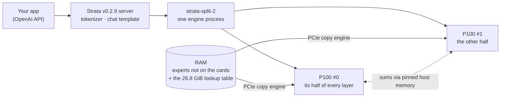

<div align="center">

# 😱 Scream P100

**Big MoE models on two retired Tesla P100s. Loud fans, fast tokens.**

Qwen3.8-Flash-Next and Edge0-145B with a 512k context on a pair of 2016 server cards,<br>
and Thinking Machines' **Inkling 2 Mini** on an engine of its own, `ink2`.<br>
Built and measured for exactly **two Tesla P100 16 GB, each on its own PCIe 3.0 x16 link**.<br>
Flash-Next IQ3_S: **~67 tok/s writing · 110+ tok/s edits · ~1,000 tok/s reading a 38k-token prompt**.<br>
Inkling 2 Mini (`ink2`, exact): **~79 tok/s writing · 100-127 tok/s edits · ~800 tok/s reading · 256k context**.

[](LICENSE)


[Quick start](#-quick-start) · [Speed](#-speed) · [Models](#-models) · [Inkling 2 engine](#-inkling-2-mini-an-engine-of-its-own) · [2× M40 test build](#-test-build-two-tesla-m40-24-gb) · [Hy4 test build](#-test-build-tencent-hy4-flash) · [How it works](#-how-it-works) · [Full guide](docs/GUIDE.md)

</div>

> 🦑 **New: Inkling 2 Mini on the same two P100s**, with an engine of its own (`ink2`): the whole model in VRAM, every sum
> exact, 78.8 tok/s writing with its DSpark drafter, ~800 tok/s reading, up to 256k context; llama.cpp did 13 / 143 on the
> same cards. On branch [`inkling2`](https://github.com/Megla123/Scream-P100/tree/inkling2): [what it is and how to run it](#-inkling-2-mini-an-engine-of-its-own).

> 🧪 **Tencent Hy4 flash on the same two P100s**, with an engine of its own: 27 tok/s writing, 337 tok/s reading (442
> with f16 sums). A test build on branch [`hy4-test`](https://github.com/Megla123/Scream-P100/tree/hy4-test):
> [what it is and how to run it](#-test-build-tencent-hy4-flash).

---

Scream P100 is a port of [Strata](https://github.com/Niko1221/Strata)'s all-cards split engine (`strata-split-2`, from
[sFNX](https://github.com/johnfink8/sfnx)) to the **NVIDIA Tesla P100** (Pascal, sm_60), a card that engine was never
built for. Both cards work on every layer at once, the experts that do not fit in VRAM stream in from RAM over PCIe,
and two drafters (the model's own MTP layer and prompt lookup) let the cards check several tokens per step.

On the same two cards, our previous setup (Strata 0.2.9's layer-split engine with our P100 kernels, where one card
waits while the other works) wrote at 47-55 tok/s and read long prompts at 620-650 tok/s. It writes at **66.5**
and reads at about **1,000**.

> *Why "Scream"?* Under full load, the fans cooling two P100s in a 2U server scream. The tokens come out fast anyway.

## ✨ Highlights

- 🧠 **Big MoE on old iron:** Qwen3.8-Flash-Next (IQ3_S or UD-Q4_K_XL) and Edge0-145B (6.6B active) on two 16 GB cards.
- ⚡ **Fast drafting:** the MTP draft layer plus prompt lookup of up to 15 tokens. On IQ3_S with 96 GB of RAM, code and
  text edits run at over 100 tok/s.
- 🎯 **Exact by default:** each step was checked against the build before it, with the same first-token logits (KL 0)
  and the same answers at temperature 0. A few kernel switches change only rounding. The lossy options
  (`FNX_ROUTE_PRIOR`, the Coder mask and the fast UD-Q4_K_XL profile) are off unless you set them.
- 🔌 **No NVLink, no P2P:** plain PCIe. The cards exchange their sums through pinned host memory.
- 🖼️ **Pictures, a 524,288-token context and an OpenAI-compatible API** through Strata v0.2.9's server.
- 🧰 **Tools for your machine:** `tune/check.py` finds what limits it, and `tune/tune.py` measures the exact switches on it.

## 🚀 Quick start

You need Linux, two Tesla P100 16 GB, 96 GB of RAM and CUDA 12 ([requirements](#-requirements)).
`/data/flash-next` is any folder with about 95 GB free.

```bash
git clone https://github.com/Megla123/Scream-P100.git && cd Scream-P100
bash build.sh                    # the engine, about 20 minutes
bash setup.sh /data/flash-next   # Strata v0.2.9, the model (85 GB), tokenizer, MTP layer, pictures, run config
bash run.sh /data/flash-next     # OpenAI-compatible API on http://127.0.0.1:8080/v1 after about 5 minutes
```

Then measure your machine against ours, on a freshly started engine, once (the expert cache learns, so a second run is
faster):

```bash
python3 bench/bench.py --strata-dir /data/flash-next/strata-v0.2.9 --wait
```

- `setup.sh` can be run again after an interruption (downloads resume), and `--check` only reports what is still to do.
  Set `HF_TOKEN` if Hugging Face asks for one.
- ⚠️ **Never build while the engine is loaded.** It pins most of the RAM, and a build beside it once hung our server.
- **Updating:** stop the server, `git pull`, run `bash build.sh` again, and check the [guide](docs/GUIDE.md) for
  profile changes. `setup.sh` keeps an existing `profile.json`, and an older engine ignores new switches silently.

Building by hand, preparing the files and every option are in the [full guide](docs/GUIDE.md#install).

## 📊 Speed

> **Every number here is from one machine: two Tesla P100 16 GB, each on its own PCIe 3.0 x16 link (11.9 GB/s from
> RAM to each card), one card on each CPU** (see "Our machine" below). Most experts live in RAM and stream over these
> links, so with x8 slots or PCIe Gen2 expect clearly slower reading and somewhat slower writing
> ([Other machines](docs/GUIDE.md#other-machines)).

`bench/bench.py` on our server, tok/s, each a single run on a freshly loaded engine, exact routing (`FNX_ROUTE_PRIOR=0`),
built from this repository's 17 Nov sources (`e56c3f60`, before the 18 Nov switch):

| Model | Context | RAM (most used) | ✍️ Fresh writing | ✏️ Edits (Python / Markdown) | 📖 Cold read, 38,862 tokens |
|---|---:|---:|---:|---:|---:|
| **Flash-Next IQ3_S** (ISTA-DASLab GSQ-RCO) | 512k | 96 GB | **66.5** | **110.7 / 115.8** | **1,012** |
| Flash-Next IQ3_S, 64 GB mode ¹ | 256k | 64 GB (55.6 GiB) | 63.8 | 93.6 / 99.2 | 807 |
| Flash-Next UD-Q4_K_XL (Unsloth) ² | 512k | 96 GB | 52.3 | 60.2 / 63.6 | 963 |
| Flash-Next UD-Q4_K_XL, **64 GB mode** ⁶ | 512k | 64 GB (55.5 GiB) | 37.6 | 38.9 / 42.8 | 429 |
| Flash-Next UD-Q4_K_XL, **Coder** experts ⁷ | 512k | 96 GB | 59.3 | 100.6 / 91.8 | 802 |
| Flash-Next UD-Q4_K_XL, **Coder** experts, **32 GB mode** ⁷ | 512k | 32 GB (22.5 GiB) | 50.1 | 73.6 / 63.4 | 987 |
| Edge0-145B NVFP4 | 512k | 96 GB | 55.0 | 96.6 / 98.9 | 691 |
| ⚠️ Fast UD-Q4_K_XL, **lossy** ⁴ | 512k | 96 GB | 73.9 | 125.1 / 126.4 | 1,007 |
| ⚠️ Fast UD-Q4_K_XL, lossy, **32 GB mode** ⁵ | 512k | 32 GB (22.5 GiB) | 67.1 | 118.5 / 120.2 | 754 |

¹ We have no 64 GB machine: this ran in a 58 GiB memory cgroup on our 96 GB server. In brackets for the low-RAM modes:
the most RAM the engine used in these tests (page-locked and its own memory, not the page cache, which Linux gives back).<br>
² With 18 Nov's switch and settings, our own test chain on 18-19 Nov (not `bench.py`), the same window as the fast
profile; its long read is 36,424 tokens on a freshly loaded engine with the lookup table in the page cache, as it
mostly is in use (a 29,700-token read in our production on the night of 18 Nov: 974 tok/s). `bench.py` on 16 Nov, before the switch:
50.9, 62.5 / 63.7 and 795, its read the first after a load with the page cache emptied, so it waits for the disk.<br>
⁴ Our own test chain on 18-19 Nov, not `bench.py`, in the same window as the exact UD-Q4_K_XL row ².
Answers are worded differently from the exact profile, see [Fast UD-Q4_K_XL](docs/GUIDE.md#fast-ud-q4_k_xl).<br>
⁵ Our own test chain on 19 Nov in a 28 GiB memory cgroup on our 96 GB server (we have no 32 GB machine), the model files
on an SSD, with the low-RAM engine of 19 Nov's evening (the 64 GB mode's; its first build that afternoon: 68.2, 121.3 /
121.7, 770); the same profile with every expert pinned: 69.9, 125.4 / 123.8, 909. See
[32 GB of RAM](docs/GUIDE.md#32-gb-of-ram).<br>
⁶ The exact UD-Q4_K_XL on the low-RAM engine, our own test chain on 19 Nov in a 58 GiB memory cgroup on our 96 GB server,
the model files on our SAS array (about 0.5 GB/s for these reads): the same first-token logits as with 96 GB (KL 0).
The edits' first runs read their prompts from the disk; the second and third ran at 43.0-43.1 / 46.5-46.8. Each new
prompt of more than 144 tokens reads about 13.5 GB from the disk (6,000 characters: 23.6 s, with 96 GB 4.0 s), so the
SSD sets the reading speed. At 510k tokens it read at 368 and wrote at 23.5 tok/s. See
[UD-Q4_K_XL on 64 GB](docs/GUIDE.md#ud-q4_k_xl-on-64-gb).<br>
⁷ The Coder's experts (a different, smaller model than the full one, see [Coder](docs/GUIDE.md#coder)) with exact
routing (λ 0), our own test chain on 21 Nov, both in the same window. The 32 GB mode ran in a 28 GiB memory cgroup on
our 96 GB server, the model files on our SAS array: the same first-token logits as with 96 GB in 150 of 150 requests
(KL 0) and every answer the same to the character. It pins 19.6 GiB of RAM, at most 22.5 GiB with the engine's own
memory. Writing code with reasoning: 73.6 / 54.0 tok/s, edits through an `edit` tool 69.2 / 42.4. A new 6,000-character
prompt right after the long read took 8.9 s (96 GB: 3.1 s): it reads from the disk. See
[32 GB of RAM](docs/GUIDE.md#32-gb-of-ram).

<details>
<summary><b>Our machine</b></summary>

| | |
|---|---|
| Server | HPE ProLiant DL380 Gen10, 2 × Xeon Bronze 3106 (8 cores, 1.7 GHz) |
| RAM | 96 GB DDR4 (Linux sees 91.8 GiB) |
| GPUs | 2 × Tesla P100-PCIE-16GB, each in a PCIe Gen3 x16 slot (11.9 GB/s), power limit 185 W |
| Software | Ubuntu 26.04, NVIDIA 580, CUDA 12.4, Strata v0.2.9's server |

</details>

Every number, including deep contexts, conversation reads and pictures, is in the [full guide](docs/GUIDE.md#our-numbers).

## 🧩 Models

| Model | RAM | Context | Answers | Set up with | Download | Notes |
|---|---|---|---|---|---:|---|
| [ISTA-DASLab GSQ-RCO **IQ3_S**](https://huggingface.co/ISTA-DASLab/Qwen3.8-Flash-Next-GSQ-RCO-GGUF) | 96 GB, or **64 GB** with `--ram 64` | 512k (256k with 64 GB) | exact | `setup.sh /data/flash-next` | 85 GB | The fastest. |
| [Unsloth **UD-Q4_K_XL**](https://huggingface.co/unsloth/Qwen3.8-Flash-Next-GGUF) | 96 GB | 512k | exact | `setup.sh /data/flash-next-q4 --model q4_k_xl` | 112 GB | The larger quantization. Fewer experts fit on the cards, so edits wait for PCIe, and 96 GB of RAM is tight. |
| **UD-Q4_K_XL, 64 GB** | **64 GB** + the model on an SSD (uses up to 55.5 GiB) | 512k | exact | `build.sh --32g`, then `setup.sh /data/flash-next-q4-64 --models /data/flash-next-q4/models --model q4_k_xl --ram 64` | none | The exact UD-Q4_K_XL on a 64 GB machine, on the low-RAM engine of the 32 GB mode: no expert pinned in RAM, the ones the cards do not hold come from a 50 GiB RAM tier and the model files. The same answers as with 96 GB, writing at about 70 % of its speed; each new prompt reads about 13.5 GB from the SSD, so the SSD sets the reading speed. [Details](docs/GUIDE.md#ud-q4_k_xl-on-64-gb). |
| [Edge0 **Edge0-145B NVFP4**](https://huggingface.co/Edge0/Edge0-145B-NVFP4) | 96 GB | 512k | exact | `setup.sh /data/edge0 --model edge0` | 87 GB ³ | Flash-Next with its experts in a latent space (Edge0 Community Model License). Weaker Slovenian in our tests. |
| **Coder** expert mask | as its file | as its file | ⚠️ lossy | `setup.sh /data/flash-next-coder --models /data/flash-next/models --coder` | none | Flash-Next only: the experts ISTA-DASLab's Coder keeps. At λ 0.15, code edits ran 11 % (IQ3_S) to 43 % (UD-Q4_K_XL) faster, but it is worse outside code and ignored instructions in Slovenian. |
| **Coder UD-Q4_K_XL, 32 GB** | **32 GB** + the model on an SSD (uses up to 22.5 GiB) | 512k | the Coder's, exact | `build.sh --32g`, then `setup.sh /data/flash-next-q4-coder-32 --models /data/flash-next-q4/models --model q4_k_xl --coder --ram 32` | none | The Coder mask on UD-Q4_K_XL without the fast profile's lossy switches, on the low-RAM engine: the Coder's answers of 96 GB bit for bit (KL 0). Pins 19.6 GiB, at most 22.5 GiB with the engine's own memory. Writing 50.1 tok/s, code edits 70-75, a 36k read 987; 45 of 45 functions, 26 of 26 edits, 16 of 16 English questions. As the Coder, worse outside code. [Details](docs/GUIDE.md#32-gb-of-ram). |
| ⚠️ **Fast UD-Q4_K_XL** | 96 GB | 512k | ⚠️ lossy | `setup.sh /data/flash-next-q4-fast --models /data/flash-next-q4/models --model q4_k_xl --fast` | none | The UD-Q4_K_XL file with the Coder mask, `FNX_ROUTE_PRIOR=1.0` and `FNX_ONEHOP=2`: 1.4x fresh writing, 2x code edits. **Answers are worded differently** from the exact profile; in our 87 code, edit and English tasks it did about as well (four loads: 0, 0, 2 and 0 failed tasks, the exact profile 1), but it may ignore instructions in other languages and is not repeatable at temperature 0. For code and English. [Details and warning](docs/GUIDE.md#fast-ud-q4_k_xl). |
| ⚠️ **Fast UD-Q4_K_XL, 32 GB** | **32 GB** + the model on an SSD (uses up to 22.5 GiB) | 512k | ⚠️ lossy | `build.sh --32g`, then `setup.sh /data/flash-next-q4-32 --models /data/flash-next-q4/models --model q4_k_xl --fast --ram 32` | none | The fast profile on a 32 GB machine, with an engine of its own (`build-32g/`; the other profiles' engine is not touched): no expert pinned in RAM, the ones the cards do not hold come from the model files through a 17 GiB RAM tier. About as fast as with 96 GB when writing, reads 17 % slower; 45 of 45 functions, 16 of 16 English questions. Pins 19.6 GiB. 1.4x the Coder profile's fresh writing on 32 GB, 1.7-1.9x its code edits. [Details](docs/GUIDE.md#32-gb-of-ram). |

³ 28.8 GB of it is the IQ3_S's second shard: point `--models` at the IQ3_S folder to share it.

One data folder holds one profile, so give each model its own folder (`--models` shares the downloads). Files whose
expert types have no P100 kernels here (Q6_K, Q3_K, Q2_K, ...) run slower than Strata itself, or not at all. On other
cards, use [Strata](https://github.com/Niko1221/Strata).

## 🧪 Test build: two Tesla M40 24 GB

> ⚠️ **Test build, measured on one machine only**, on branch [`m40-2x`](https://github.com/Megla123/Scream-P100/tree/m40-2x)
> ([docs/M40.md](https://github.com/Megla123/Scream-P100/blob/m40-2x/docs/M40.md)). We ran it on our second server until we
> sold it, so we cannot measure it again or test fixes.

The same split engine on two **Tesla M40 24 GB** (Maxwell, sm_52, 2015), with f32 expert kernels of its own (Maxwell has no
f16 arithmetic), on **32 GB of RAM**: ISTA-DASLab's GSQ-RCO IQ3_XXS, 256k context, pictures. On our M40 server (220 W, 1114 MHz):
**45.7 tok/s** fresh writing, **62.9 / 66.7** edits (Python / Markdown), **420 tok/s** reading a 38,862-token prompt. Strata's
layer-split engine did 35.2 tok/s writing and 275 tok/s reading on the same machine. Build with `bash build.sh --m40`, set up
with `setup.sh DATA --model iq3_xxs`. Only the 24 GB M40 was run.

## 🦑 Inkling 2 Mini: an engine of its own

[](https://github.com/Megla123/Scream-P100/blob/inkling2/docs/INKLING2.md)

> ⚠️ **Measured on one machine only**, on branch [`inkling2`](https://github.com/Megla123/Scream-P100/tree/inkling2)
> ([docs/INKLING2.md](https://github.com/Megla123/Scream-P100/blob/inkling2/docs/INKLING2.md)). Written on 21 Nov 2026; nobody else has run it yet. Reports
> are welcome.

Thinking Machines' **Inkling 2 Mini** (26.4B looped MoE: layers 6-17 run three times, 128 experts, NVFP4) on the same two
P100 16 GB with an **engine of its own**, `ink2` (`engine-inkling2/`): both cards on every layer at once, and here the whole
model fits in VRAM (8.9 GB a card), so nothing streams over PCIe. Xylolabs's NVFP4-Q8_0 GGUF with Unsloth's DSpark drafter
(the model's MTP). On our machine, everything exact: **56.6 tok/s** fresh writing without drafts and **78.8** with them,
**~100-127 tok/s** edits, **794 tok/s** reading a 4k prompt (757 at 14k, 646 at 36k), context up to **262,144** (a needle found
at 239k). llama.cpp did 13.0 tok/s writing and 143 reading on the same cards; its greedy outputs match ours. On the test
set of our Flash-Next builds it writes fresh answers at 66.3 tok/s (Flash-Next UD-Q4_K_XL: 59.3 exact, 68.9 lossy) and
edits Markdown at 126.8 (92.2 / 125.6). Tool calls work; greedy only for now, no pictures.

```bash
git clone -b inkling2 https://github.com/Megla123/Scream-P100.git && cd Scream-P100
bash engine-inkling2/build.sh && bash engine-inkling2/setup.sh /data/inkling2 && bash engine-inkling2/run.sh /data/inkling2
```

## 🧪 Test build: Tencent Hy4 flash

[](https://github.com/Megla123/Scream-P100/blob/hy4-test/docs/HY4.md)

> ⚠️ **Test build, measured on one machine only**, on branch [`hy4-test`](https://github.com/Megla123/Scream-P100/tree/hy4-test)
> ([docs/HY4.md](https://github.com/Megla123/Scream-P100/blob/hy4-test/docs/HY4.md)). Written in the two days before
> 21 Nov 2026; nobody else has run it yet. Reports are welcome.

Tencent's **Hy4 flash** on the same two P100 16 GB, with an **engine of its own** (`engine-hy4/`): Strata's split engine does
not know Hy4's Engram tables, indexed sparse attention and latent experts, so we wrote one with the same idea (both cards
on every layer, the experts that do not fit streamed in over PCIe). Xylolabs's IQ3_XXS GGUF, 64k context, tools and
thinking, 96 GB of RAM. On our machine: **27-28 tok/s** fresh writing, **28-35** edits (Python and Markdown files),
**337 tok/s** reading a 14,302-token prompt, or **442 tok/s** with f16 sums (`HY4_PF_F16=7`, on our test sets within one
question of the first build); llama.cpp with Hy4 support did 6-9 tok/s writing on the same cards.

```bash
git clone -b hy4-test https://github.com/Megla123/Scream-P100.git && cd Scream-P100
bash engine-hy4/build.sh && bash engine-hy4/setup.sh /data/hy4 && bash engine-hy4/run.sh /data/hy4
```

## 🔧 How it works



- **Split, not pipelined:** each card holds half of every layer, so both read their weights at the same time.
- **P100 kernels:** the P100 has no `dp4a`, no tensor cores and no `__nanosleep`, and its FP16 is fast only as paired
  `HFMA2`. This port adds FP16 expert kernels for writing and for reading prompts, P100 attention, and a `dp4a` emulation
  (`engine/p100_compat.h`).
- **Experts on demand:** about 60 % of IQ3_S's experts live only in RAM. A copy-engine thread brings the missing ones
  in, with guesses for the next layer, and each expert's blocks wait only for that expert's copy.
- **Drafting:** the MTP layer drafts up to 4 tokens and prompt lookup up to 15, and the full model checks the drafts in
  one pass, which is why edits are so fast.

The build-by-build story, with the gain of each step, is in [docs/HISTORY.md](docs/HISTORY.md).

## 📋 Requirements

- **Linux x86-64.**
- **Two Tesla P100 16 GB (PCIe)**, ideally each in a **Gen3 x16** slot. The engine is built for exactly two cards of
  compute capability 6.0 and refuses other cards. P40 and GTX 10x0 (sm_61) are not supported. Two Tesla M40 24 GB: only
  the [test build](#-test-build-two-tesla-m40-24-gb) on branch `m40-2x`.
- **Above 4G Decoding** on in the BIOS, so each card gets its 16 GiB BAR1. The engine refuses a card without one.
- **96 GB of RAM**, or 64 GB with the IQ3_S 64 GB mode or the exact UD-Q4_K_XL's 64 GB mode (model files on an SSD), or
  32 GB with UD-Q4_K_XL's 32 GB mode, the Coder's experts exact or the fast profile (lossy), model files on an SSD.
- **CUDA 12.x** (CUDA 13 dropped sm_60) with a host compiler it accepts (CUDA 12.4: gcc 13 at most), CMake 3.22+,
  git and Python 3.10+. The driver must support both CUDA 12 and Pascal (the 580 branch is NVIDIA's last for Pascal).
- **Disk:** about 95 GB for IQ3_S, 112 GB of files for UD-Q4_K_XL, and 87 GB for Edge0-145B (less when it shares the
  IQ3_S shard).
- On Intel boards with VT-d, set **`iommu=pt`**: with translation on, our copies to the cards ran at 7.6-8 GB/s instead
  of about 12.

One request at a time (`--batch 1`), no `logprobs`, and the first answers after a load are slower while the expert cache
settles. What has and has not been tested is in [Known limitations](docs/GUIDE.md#known-limitations).

## 📚 Documentation

| | |
|---|---|
| [docs/GUIDE.md](docs/GUIDE.md) | **The full guide:** every measurement, each model in depth, install and run by hand, benchmarking, exact and lossy settings, other machines, known limitations |
| [docs/SWITCHES.md](docs/SWITCHES.md) | Every `FNX_*` engine switch and what each profile sets |
| [docs/HISTORY.md](docs/HISTORY.md) | How the port came about, build by build, plus what was tried and dropped |
| [tune/README.md](tune/README.md) | `check.py` and `tune.py`: diagnose and tune your own machine |
| [Branch `poc-4x-p100`](https://github.com/Megla123/Scream-P100/tree/poc-4x-p100/docs/POC-4X.md) | ⚠️ **Unverified proof of concept**, never run on four cards: a build for four P100 behind one PCIe switch (`build.sh --4x`) |
| [Branch `m40-2x`](https://github.com/Megla123/Scream-P100/blob/m40-2x/docs/M40.md) | ⚠️ **Test build** for two Tesla M40 24 GB (sm_52), measured on one machine only: IQ3_XXS, 256k, 32 GB of RAM (`build.sh --m40`) |
| [Branch `inkling2`](https://github.com/Megla123/Scream-P100/blob/inkling2/docs/INKLING2.md) | Thinking Machines' Inkling 2 Mini on the same two P100, an engine of its own (`ink2`), measured on one machine only: the whole model in VRAM, exact, 78.8 tok/s writing, 794 tok/s reading, 256k context (`engine-inkling2/`) |
| [Branch `hy4-test`](https://github.com/Megla123/Scream-P100/blob/hy4-test/docs/HY4.md) | ⚠️ **Test build** for Tencent Hy4 flash on the same two P100, an engine of its own, measured on one machine only: IQ3_XXS, 64k, 96 GB of RAM, 337 / 442 tok/s reading (`engine-hy4/`) |
| [NOTICE.md](NOTICE.md) · [docs/PROVENANCE.md](docs/PROVENANCE.md) · [docs/upstream-v0.2.10.diff](docs/upstream-v0.2.10.diff) | What is ours and what is Strata's, file by file and line by line |

Our scripts and docs refer to sections as *(README, "Section")*. Those sections are now in [docs/GUIDE.md](docs/GUIDE.md).

## 📰 News

- **21 Nov 2026 (evening):** 🦑 **Inkling 2 Mini with an engine of its own** on branch [`inkling2`](https://github.com/Megla123/Scream-P100/blob/inkling2/docs/INKLING2.md):
  Thinking Machines' 26.4B looped MoE on the same two P100, the whole model in VRAM, every sum exact. 56.6 tok/s fresh
  writing (78.8 with the DSpark drafter and prompt lookup), edits 100-127, reading 794 tok/s at 4k and 646 at 36k, context
  up to 262,144; llama.cpp `690b87d` on the same cards: 13.0 and 143. Its greedy outputs match llama.cpp's. Measured on our
  machine only.
- **21 Nov 2026 (afternoon):** the **Coder on 32 GB of RAM** without lossy speed-ups (`bash build.sh --32g`, then
  `setup.sh ... --model q4_k_xl --coder --ram 32`): the Coder's experts on UD-Q4_K_XL with exact routing (λ 0, no
  `FNX_ONEHOP`), on the 32 GB mode's low-RAM engine. Its answers are the Coder's with 96 GB, bit for bit (KL 0 in 150 of
  150 requests, every answer the same to the character). In a 28 GiB memory cgroup: fresh writing 50.1 tok/s (96 GB:
  59.3), code edits 70-75 (100-101), a 36k read 987 (802); the fast 32 GB profile in the same window: 68.9, 124.0-124.5
  and 987 (lossy). It pins 19.6 GiB of RAM, at most 22.5 GiB with the engine's own memory. There is no Q4 file of the
  Coder on Hugging Face; the mask over Unsloth's file picks the same experts ([details](docs/GUIDE.md#32-gb-of-ram)).
  Nothing to rebuild if your `build-32g/` is from 19 Nov's evening release or later.
- **21 Nov 2026 (morning):** the Hy4 flash test build reads faster: 337 tok/s instead of 294 on a 14,302-token prompt, and
  **442 tok/s** with f16 sums (`HY4_PF_F16=7`, off by default; on our test sets within one question of the first build). The sparse
  attention in one pass straight from the cache, expert kernels that skip empty token columns (the same bits), and f16 sums
  for the dense matrices, the experts and the window attention ([branch `hy4-test`](https://github.com/Megla123/Scream-P100/blob/hy4-test/docs/HY4.md)).
- **21 Nov 2026:** ⚠️ a **test build for Tencent Hy4 flash** on branch [`hy4-test`](https://github.com/Megla123/Scream-P100/blob/hy4-test/docs/HY4.md):
  an engine of its own for Hy4's Engram tables, sparse attention and latent experts, on the same two P100. Xylolabs's
  IQ3_XXS, 64k context, 96 GB of RAM: 27.0 tok/s fresh writing, 28-35 edits, 294 tok/s reading. Measured on
  our machine only.
- **20 Nov 2026:** ⚠️ a **test build for two Tesla M40 24 GB** (Maxwell) on branch [`m40-2x`](https://github.com/Megla123/Scream-P100/blob/m40-2x/docs/M40.md):
  the engine we ran on our second server until we sold it. ISTA-DASLab's IQ3_XXS, 256k context, 32 GB of RAM: 45.7 tok/s
  fresh writing, 62.9 / 66.7 edits, 420 tok/s reading 38.9k tokens. Measured on that one machine only.
- **19 Nov 2026 (evening):** the **exact UD-Q4_K_XL on 64 GB of RAM**, with the full 512k context (`bash build.sh --32g`,
  then `setup.sh ... --model q4_k_xl --ram 64`): the 32 GB mode's low-RAM engine with the profile's own settings, the
  experts the cards do not hold in a RAM tier of up to 25 GiB a card and in the model files. The same answers as with
  96 GB (first-token logits identical, KL 0). In a 58 GiB memory cgroup: fresh writing 37.6 tok/s (96 GB: 53.3), edits
  43-47 (62-65), and every new prompt reads about 13.5 GB from the disk, which our 0.5 GB/s array needs about 23 s for;
  at 510k tokens it still wrote at 23.5 tok/s ([details](docs/GUIDE.md#ud-q4_k_xl-on-64-gb)). The low-RAM engine got
  three changes for it (the tier sized by need, the K/V pool's borrowed slots' experts kept in it, the copies down in two
  parts); the 32 GB mode on it: about the same speed, 45 of 45 functions and 16 of 16 English questions again, in 2 GiB
  less RAM. Rebuild with `bash build.sh --32g`.
- **19 Nov 2026 (afternoon):** ⚠️ the fast UD-Q4_K_XL on **32 GB of RAM** (`bash build.sh --32g`, then
  `setup.sh ... --model q4_k_xl --fast --ram 32`): no expert pinned in RAM; the ones the cards do not hold are read from
  the model files into a 19 GiB RAM tier, which keeps what the cards give up. In a 28 GiB memory cgroup: fresh writing
  68.2 tok/s (69.9 with every expert pinned), code edits 121 (125), a 36k read 770 (909); 45 of 45 functions and 16 of 16
  English questions ([details](docs/GUIDE.md#32-gb-of-ram)). It has an engine of its own (`engine-32g/`'s patches on
  `engine/`, built into `build-32g/`): the engine and profiles you run now do not change.
- **19 Nov 2026:** ⚠️ a **fast, lossy UD-Q4_K_XL profile** (`setup.sh --model q4_k_xl --fast`): the Coder mask, λ 1.0 and
  `FNX_ONEHOP=2` on the same file and engine. Fresh writing 52.3 → 73.9 tok/s, code edits 60.2 → 125.1, writing code
  50.8 → 85.6. Its answers are worded differently from the exact profile; on our own 45 functions with hidden tests,
  26 edits and 16 English questions it did about as well, in four loads. For code and English only ([why](docs/GUIDE.md#fast-ud-q4_k_xl)).
  The task set is in `bench/coding/`. The exact profiles do not change.
- **18 Nov 2026:** UD-Q4_K_XL draft-layer norm per stream (`FNX_MTP_NORM_STREAMS`) and 150 more expert slots per card.
  Fresh writing is 3.3 % faster with the same answers, and writing at a depth of 58.5k is 1.7-4.3 % slower. To get it,
  rebuild and update `profile.json` ([how](docs/GUIDE.md#unsloths-ud-q4_k_xl)).
- **17 Nov 2026:** 96-row prompt jobs for IQ3_S and Edge0-145B, so long reads are 5.3 % and 3.2 % faster.
- **16 Nov 2026:** UD-Q4_K_XL with 96-row jobs and kernel mode 6: a warm 36k read is 33 % faster in our test chain
  (the benchmark's cold read +4 %).
- **14-15 Nov 2026:** Edge0-145B support: its latent experts in NVFP4, with D and U split by group across the cards.
- **13 Nov 2026:** UD-Q4_K_XL kernels (Q4_K, Q5_K, Q5_1, Q8_0), the 64 GB mode and the Coder expert mask.

## 🙏 Credits

Built on **[Strata](https://github.com/Niko1221/Strata)** by Niko1221 and contributors, and on **[sFNX](https://github.com/johnfink8/sfnx)**
by John Fink, the split-every-layer engine Strata ported. It also uses **ggml / llama.cpp** block formats, model files by
**ISTA-DASLab**, **Unsloth** and **Edge0**, and **Qwen**'s Qwen3.8-Flash-Next. Ideas came from KaneQuah/Kmic-68's llama.cpp
fork, DeepInfer, Strata PR #4274 and Strata 0.2.12, JustVugg's Colibri engine notes, and a tester's UD-Q4_K_XL recipe.
Each is credited in the [full guide](docs/GUIDE.md#credits-and-license) and [NOTICE.md](NOTICE.md).

MIT licensed, like Strata: see [LICENSE](LICENSE) and [NOTICE.md](NOTICE.md). The Coder's expert list is Apache-2.0
([third_party/](third_party/)).
