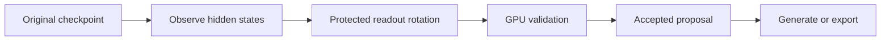

# Laplace’s Scissors

[](LICENSE)
[](Cargo.toml)
[](kernels/ops.py)
[](src/device.rs)
[](https://github.com/Miyamoto-Renya/LaplacesScissors/actions/workflows/tests.yml)

[Source](https://github.com/Miyamoto-Renya/LaplacesScissors) · [Issues](https://github.com/Miyamoto-Renya/LaplacesScissors/issues) · [Discussions](https://github.com/Miyamoto-Renya/LaplacesScissors/discussions)

**원본 LLM의 출력 행렬을 회전해, 맞춘 답은 유지하고 틀린 답의 수정안을 계산합니다.**

**Rotate an LLM’s output matrix so protected answers stay fixed while failed answers are repaired.**

Rust · Triton · CUDA / HIP · Readout rotation

[한국어](#korean) · [English](#english) · [설계 · Design](DESIGN.md) · [작업 규칙 · AGENTS.md](AGENTS.md)



## 명령 · Commands

| 명령 · Command | 하는 일 · Purpose | 결과 · Output |
| --- | --- | --- |
| `fetch`, `inspect` | 모델 확보와 구조 확인<br>Fetch a model and inspect its structure | revision, 파일 해시, 실행 그래프<br>Pinned revision, file hashes, execution graph |
| `probe` | 수치 입력에서 약한 구별 방향을 추적<br>Trace weak discrimination directions | 층별 상쇄, 좌표 기여, 보호 회전<br>Layer cancellation, coordinates, protected rotation |
| `diagnose` | 정답 사례로 출력 회전을 계산<br>Repair outputs from expected answers | GPU로 확인한 후보와 채택 수정안<br>GPU-checked candidates and the accepted proposal |
| `generate` | 원본 또는 수정 모델로 생성<br>Generate with the original or edited model | Greedy 답변<br>Greedy answer |
| `export` | 수정안을 체크포인트로 저장<br>Save an edit as a checkpoint | 수정한 출력 행렬과 모델 파일<br>Edited output matrix and model files |
| `scale` | 같은 수정 정책을 규모별로 적용<br>Apply one edit policy across scales | 손실 곡선, 편차 회복량, 가중치 기여<br>Loss curves, recovered deviation, weight contributions |

## 빠른 시작 · Quick start

Rust toolchain, Triton 3.8을 불러올 수 있는 Python, CUDA 또는 HIP 드라이버를 준비합니다. Python은 Triton 컴파일 연결을 담당하고, 모델 적재·tokenizer·실행·수정안 계산·결과 저장은 Rust가 수행합니다.

Prepare a Rust toolchain, a Python environment that can import Triton 3.8, and a CUDA or HIP driver. Python provides the Triton compilation bridge. Rust handles model loading, tokenization, execution, edit computation, and result storage.

```sh
export LAPLACE_CACHE="${XDG_CACHE_HOME:-$HOME/.cache}/laplaces-scissors"
export LAPLACE_PYTHON=python3
cargo build --release

cargo run --release -- fetch Qwen/Qwen3-0.6B
cargo run --release -- inspect Qwen/Qwen3-0.6B --out "$LAPLACE_CACHE/graph.json"
cargo run --release -- cases --count 12 --seed 7 --out "$LAPLACE_CACHE/cases.jsonl"
cargo run --release -- generate Qwen/Qwen3-0.6B \
  --prompt 'What is 2 + 2? Reply with the number only.'
```

`.cargo/config.toml`은 Cargo 산출물을 프로젝트 밖으로 보냅니다. `LAPLACE_CACHE`에는 모델·커널·실행 결과를 저장합니다. `LAPLACE_BACKEND=auto|cuda|hip`와 `LAPLACE_DEVICE`로 backend와 장치 번호를 고릅니다. 드라이버 경로는 `LAPLACE_DRIVER_LIBRARY`, ROCm SDK 경로는 `ROCM_PATH` 또는 `HIP_PATH`입니다. HIP backend는 선택한 Python 환경의 `rocm-sdk-core` 패키지도 조회합니다. 장치 이름과 실행 대상은 드라이버에서 읽습니다.

`.cargo/config.toml` places Cargo build artifacts outside the project. `LAPLACE_CACHE` stores models, kernels, and run results. Select the backend and device index with `LAPLACE_BACKEND=auto|cuda|hip` and `LAPLACE_DEVICE`. Set `LAPLACE_DRIVER_LIBRARY` for the driver library path, or `ROCM_PATH` / `HIP_PATH` for the ROCm SDK. The HIP backend also checks the selected Python environment for the `rocm-sdk-core` package. Device names and execution targets come from the driver.

모델 입력은 `조직/모델`, `조직/모델@revision`, Hugging Face 모델 URL 또는 safetensors 모델 폴더입니다. Hub 입력은 commit SHA로 고정되며 파일별 SHA256이 기록됩니다. `--revision`으로 revision을 지정하고, 인증은 `HF_TOKEN`을 사용합니다.

Model inputs accept `organization/model`, `organization/model@revision`, a Hugging Face model URL, or a local safetensors model directory. Hub inputs are pinned to a commit SHA, with SHA256 recorded for each file. Use `--revision` to select a revision and `HF_TOKEN` for authentication.

사례 한 줄은 다음 형식입니다. `expected`는 `choices`의 0부터 시작하는 정답 위치입니다.

One case is one JSON line. `expected` is the zero-based index of the correct entry in `choices`.

```json
{"id":"sum","prompt":"What is 2 + 2? Reply with the number only.","choices":["3","4","5"],"expected":1,"oracle":{"sum":4}}
```

<a id="korean"></a>

## 한국어

[수치 진단](#probe-ko) · [정답 수정](#diagnose-ko) · [내보내기](#export-ko) · [규모 분석](#scale-ko) · [검사](#tests-ko)

<details>
<summary>사례 계약</summary>

사용자 사례는 JSONL입니다. `choices`는 정답 문자열을 고르는 입력이고, 모델은 `prompt`에 대한 답변 문자열을 생성합니다. 예제는 [examples/cases.jsonl](examples/cases.jsonl)에 있습니다.

모델의 원본 chat template로 prompt를 만들고, 그 prompt token 접두사를 고정합니다. 정답 문자열을 별도로 인코딩한 뒤 EOS를 붙여 목표 token 열을 만듭니다. 정답 본문은 tokenizer 왕복 결과와 일치해야 합니다. 원본 생성이 EOS로 끝나고 정답 문자열과 정확히 일치하면 해당 생성의 모든 접두사를 보호합니다. 실패 사례는 정답 token과 EOS 각각에 대해 전체 vocabulary의 모든 경쟁 token보다 높은 점수를 요구합니다.

</details>

<details id="probe-ko">
<summary>수치 진단 · <code>probe</code></summary>

`probe`의 입력은 가중치와 실행 그래프입니다. 모델의 embedding 행을 seed로 골라 수치 접두사·기준 벡터·직교 기저를 만듭니다. 기준 벡터와 같은 길이를 가진 두 벡터를 decoder 입구에 직접 공급합니다. 출력 확률 사이의 대칭 KL인 Jeffreys 구별도로 응답을 비교합니다. 약한 방향은 기록한 수치 입력 분포에서 같은 크기의 주입을 출력으로 구별하는 능력이 작은 방향입니다. 모델 확보는 safetensors와 설정을 읽는 경로를 사용합니다.

```sh
cargo run --release -- probe Qwen/Qwen3-0.6B \
  --directions 12 --prefix-length 3 --seed 7 --probe-angle 0.05 \
  --max-angle-degrees 3 --coordinates 12 --intervention-fraction 0.1 \
  --out "$LAPLACE_CACHE/runs/probe"

cargo run --release -- probe Qwen/Qwen3-0.6B \
  --inputs "$LAPLACE_CACHE/runs/probe/inputs.json" \
  --proposal "$LAPLACE_CACHE/runs/probe/proposal.json" \
  --out "$LAPLACE_CACHE/runs/probe-replay"
```

`--directions`는 가중치에서 만들 탐색 기저의 최대 차원입니다. 실제 차원은 hidden 폭과 embedding 차이의 rank에 맞춥니다. `--prefix-length`는 주입 위치 앞의 수치 벡터 수입니다. `--probe-angle`은 두 입력을 만드는 구면 각도이며 단위는 라디안입니다. 작은 응답 Gram의 최소 고유벡터로 방향을 제안하고, 실제 decoder에서 재측정한 구별도를 기존 기저 방향과 비교해 선택합니다.

선택한 두 실행의 잔차 분기를 관측해 층별 부호 기여를 구합니다. 가장 큰 음의 기여가 나온 분기에서 `--coordinates`개 가중치 좌표와 attention 헤드별 합을 계산합니다. `--intervention-fraction`은 해당 좌표의 크기를 양방향으로 바꾸는 진단 개입 비율입니다. 각 개입은 고정한 수치 접두사부터 다시 실행합니다. 부호 기여와 실제 개입 효과를 각각 기록합니다. `--coordinates 0`은 층별 추적을 수행하며, `--intervention-fraction 0`은 구별도 추적과 보호 회전을 수행합니다.

수정은 원본 출력 행렬의 행 Gram, 두 hidden의 중간값, 기준·대조 상태를 보호하는 readout 회전입니다. `--max-angle-degrees`, `--max-edit-norm`, `--tolerance`로 각도·가중치 변화량·보호 출력 오차를 지정합니다. 각도 상한 안의 세 후보에서 실제 구별도가 증가하고 보호 오차를 만족한 수정안을 저장합니다. 후보 평가는 관측한 hidden에 실제 GPU 회전과 readout을 적용합니다. `--inputs`로 저장한 입력을 사용할 수 있으며, `protected_hidden`에 같은 모델의 추가 보호 벡터를 담을 수 있습니다. `--proposal`을 함께 주면 저장한 두 입력을 전체 decoder에서 다시 실행합니다.

결과는 `manifest.json`, `inputs.json`, `trace.json`, `transport.json`, `report.json`, `status.json`과 채택한 `proposal.json`입니다. 재실행은 `replay-frames.json`도 기록합니다. 입력·모델 해시, 실제 장비·정밀도, 구별도, 층·가중치 좌표, 보존 오차, 수치 잔차와 단계별 실행 횟수를 함께 저장합니다. 수정안의 version 3은 구별도 목적과 주입 입력 해시를 담으며, 재적용할 때 가중치와 실행 설정의 해시를 확인합니다.

</details>

<details id="diagnose-ko">
<summary>정답 기반 수정 · <code>diagnose</code></summary>

```sh
cargo run --release -- diagnose Qwen/Qwen3-0.6B \
  --cases "$LAPLACE_CACHE/cases.jsonl" \
  --max-planes 8 --max-angle-degrees 120 --margin 0.05 \
  --max-new-tokens 64 --context 2048 --time-budget 20m \
  --out "$LAPLACE_CACHE/runs/rotation"

cargo run --release -- generate Qwen/Qwen3-0.6B \
  --prompt 'What is 2 + 2? Reply with the number only.' \
  --proposal "$LAPLACE_CACHE/runs/rotation/proposal.json"
```

`--max-planes`는 조사할 회전 평면 수, `--max-angle-degrees`는 회전의 최대 각도, `--margin`은 정답 token과 모든 경쟁 token 사이의 최소 logit 차입니다. `--tolerance`는 보호 출력의 원소별 변화량을 `1 + |원본 logit|`으로 나눈 값의 상한이며 기본값은 `0.00002`입니다. 계산식에는 이 허용 오차와 관측 logit 크기로 구한 여유값을 더합니다. 평면마다 금지 구간을 합쳐 최소 변화량의 각도를 구하고, 변화량 순으로 실제 GPU readout을 확인합니다.

평면 후보의 검사를 마치면 공동 응답 계산으로 여러 목표를 함께 보정합니다. `--joint-steps`는 보정 단계 수이며 기본값은 12입니다. 0을 지정하면 평면 후보를 계산합니다. `--joint-rank`는 공동 회전 기저의 최대 차원이며 기본값은 64입니다. 공동 회전의 최대 주각에도 `--max-angle-degrees`를 적용합니다. `--max-edit-norm`은 출력 가중치 변화의 Frobenius 노름 상한입니다. 채택 조건은 전체 vocabulary margin, 보호 출력 오차, 목표 답변과 EOS, 원본 성공 경로 유지입니다.

공동 탐색은 출력 기저와 비용 Gram을 한 번 계산해 공유하고, 응답 수의 두 배가 회전 차원보다 작으면 그 작은 공간에서 Cayley 연립방정식을 풉니다. 후보 점수는 압축한 출력 기저로 GPU에서 계산합니다. 탐색 후에는 관측 결과를 유지하면서 가중치 변화량을 최소화하는 회전 완성을 구합니다. 원본 GPU readout으로 각도·비용 상한 안의 완성 후보가 모든 접두사의 token 선택과 충족한 margin, 보호 오차를 유지하는지 확인해 적용합니다. `candidates.json`의 `completion`은 완성 전후 비용과 적용 여부를, `report.json`의 `computation`은 압축 출력·원본 검증 호출 수와 계산 구간별 시간을 담습니다.

`--max-new-tokens`는 EOS를 포함한 생성 상한입니다. `--context`는 prompt와 생성 상한을 합한 길이를 수용해야 합니다. `--cases`를 생략하면 `--count`, `--seed`로 기호 문제를 만듭니다. 진단은 thinking을 끈 원본 template를 사용합니다. `generate --thinking`으로 thinking 양식을 선택할 수 있습니다.

시간 예산은 모델 파일 확보 후 적재부터 계산·기여 분석까지 적용합니다. 결과 폴더에는 `manifest.json`, `status.json`, `baseline.json`, `candidates.json`, `report.json`과 채택한 `proposal.json`, `attribution.json`을 저장합니다. 보고서는 모델 revision·입력 token 경로·가중치 자료형·장비·실제 검증값·제곱근과 readout 호출 수를 담습니다. 완료 상태는 `complete`, 예산 종료는 `partial`, 실행 오류는 `failed`입니다.

수정안은 평면의 직교 벡터와 반각 좌표, 또는 공동 회전의 직교 기저와 작은 직교행렬로 표현합니다. 실행 중 최종 내부 벡터에 회전을 적용한 뒤 원본 출력 행렬을 곱합니다. 공유 embedding 모델에서도 회전은 readout 호출에 적용합니다. 정답 사례의 수정안은 재적용할 때 가중치·설정·tokenizer 파일 해시와 출력 연산 계약을 확인합니다. `generate --proposal`은 version 1·2·3 수정안을 읽습니다.

`--attribution-rows`는 기여를 표시할 출력 행 수이며 기본값은 6입니다. 각 행에서 기여가 큰 좌표, 그 행의 수정을 되돌렸을 때의 손실, 전체 기여 합과 적분 오차를 기록합니다. 기여는 명시한 readout 직선 개입 경로에서 계산하며 음수 기여도 보존합니다. 0을 지정하면 생성 수정안과 검증 결과를 저장합니다.

</details>

<details id="export-ko">
<summary>모델 내보내기 · <code>export</code></summary>

`export`는 수정안을 실제 출력 행렬에 반영한 새 checkpoint를 저장합니다. 원본 tensor를 보존하고, 수정한 `lm_head.weight`를 FP32로 기록합니다. embedding과 readout의 공유를 풀고 설정·실행 그래프·shard index를 함께 저장합니다. 출력 행렬은 CPU F64 블록 곱으로 계산하며, 원본 적재와 계약 확인에는 공통 모델 실행기를 사용합니다. 생성된 모델은 폴더 경로로 실행합니다.

```sh
cargo run --release -- export Qwen/Qwen3-1.7B \
  --proposal "$LAPLACE_CACHE/edits/proposal.json" \
  --out "$LAPLACE_CACHE/exports/qwen3-1.7b-edited"
cargo run --release -- generate "$LAPLACE_CACHE/exports/qwen3-1.7b-edited" \
  --prompt 'What is 2 + 2? Reply with the number only.'
```

`materialization.json`은 원본 revision과 해시, 적용한 수정안, 실제 가중치 변화 노름과 FP32 저장 반올림 오차를 담습니다. 설정의 기본 적재 dtype은 FP32이며, decoder tensor의 저장 자료형은 원본을 유지합니다. 모델 실행기는 각 tensor의 저장 자료형을 읽습니다.

</details>

<details id="scale-ko">
<summary>규모 분석 · <code>scale</code></summary>

규모 계열은 JSON manifest로 입력합니다. 아래 모델 경로는 manifest 폴더를 기준으로 해석하며 Hugging Face 모델 id와 `revision`도 지정할 수 있습니다.

```json
{
  "axis": "training_compute",
  "conditions": "같은 모델 계열·학습 데이터·평가 입력; 기록한 자원 축을 변화",
  "reference": "독립 기준 구간에서 구한 손실 감소 지수",
  "exponent": 0.5,
  "max_edit_norm": 10,
  "cases": "repair.jsonl",
  "evaluation": "evaluation.jsonl",
  "checkpoints": [
    {"model": "models/small", "resource": 1},
    {"model": "models/medium", "resource": 2},
    {"model": "models/large", "resource": 4}
  ]
}
```

```sh
cargo run --release -- scale --manifest "$LAPLACE_CACHE/series.json" \
  --context 2048 --max-new-tokens 64 --out "$LAPLACE_CACHE/runs/scale"
```

`exponent`와 처음 두 checkpoint를 고정해 이후 규모의 거듭제곱 곡선 편차를 계산합니다. 자원량은 증가하는 순서로 지정합니다. `max_edit_norm`과 진단 옵션은 모든 checkpoint에 같은 값으로 적용합니다. CLI의 `--max-edit-norm`은 manifest의 예산을 덮어씁니다. `cases`는 수정용 JSONL, `evaluation`은 별도 prompt를 가진 평가용 JSONL입니다. 평가 손실은 EOS를 포함한 정답 문자열의 음의 로그 확률을 정답 UTF-8 바이트 수로 나눈 뒤 사례 평균을 취합니다.

`scale-report.json`은 실제 손실 곡선, 편차 회복량, checkpoint별 출력 가중치 기여와 행 되돌림 효과를 저장합니다. 서로 다른 checkpoint의 좌표에는 각각의 모델과 tensor 행·열 위치를 붙입니다. 수정 좌표는 고정 decoder 뒤의 readout 회전입니다. 시간 예산은 checkpoint별 수정과 평가에 적용합니다.

</details>

<details id="tests-ko">
<summary>구현 범위와 검사</summary>

현재 실행 그래프는 별도 Q/K/V projection, causal grouped-query attention, RMSNorm·LayerNorm, 기본 RoPE, SiLU·GELU·ReLU 계열 gated MLP, 선형 readout을 지원합니다. 저장 가중치는 F32/F16/BF16, 실행 상태는 F32, 평면과 부등식 계산은 F64입니다. 표준 dense decoder 설정으로 그래프를 만들며 `laplace.graph.json`으로 tensor 연결을 명시할 수 있습니다. 그래프에 필요한 연산과 저장 tensor 형상은 적재 시 검증합니다.

| 검사 | 확인 범위 |
| --- | --- |
| 기본 검사 | 회전·부등식·공동 응답·기여·규모 편차의 계산 계약 |
| GPU 통합 검사 | 실제 연산, 수정안 적용, 생성 경로, 수치 주입 |
| 컴파일러 검사 | 수집한 연산 계약의 CUDA code object 생성 |
| Qwen 참조 검사 | 독립 Rust 전체 문맥 계산과 Triton 실행의 일치 |

```sh
cargo fmt --check
cargo test
export LAPLACE_TEST_CACHE="$LAPLACE_CACHE/rotation-tests"
cargo test --test gpu --test model_rotation --test injection -- --ignored --nocapture --test-threads=1
cargo test --test compiler -- --ignored --nocapture
export LAPLACE_TEST_MODEL="$LAPLACE_CACHE/models/Qwen--Qwen3-0.6B/<commit>"
cargo test --release --test qwen_reference -- --ignored --nocapture
```

`<commit>`은 `fetch`가 고정한 commit SHA 폴더 이름입니다. GitHub Actions는 `main` 푸시와 풀 리퀘스트에서 `cargo test --locked`로 기본 검사를 실행합니다. GPU 통합 검사, compiler 검사, Qwen 참조 검사는 위 명령으로 따로 실행합니다. 기본 검사는 열린 구간의 경계·단일점 해, 보호 회전, 공동 응답, 기여 합과 규모 편차, softmax와 RMSNorm·LayerNorm의 유한 차이 항등식을 확인합니다. 전체 모델 GPU 검사는 접두사 검증과 재생성의 일치, 원본 해시, KV 되감기, 공유 readout과 세 합성 checkpoint의 규모 분석을 확인합니다. 수치 주입 검사는 embedding scale을 포함한 토큰 경로와 직접 입력의 일치, 좌표 개입의 분리, 구별도 수정안 저장과 전체 decoder 재실행을 확인합니다. compiler 검사는 수집한 연산 계약으로 CUDA code object를 만듭니다. Qwen 검사는 원본 순전파를 독립 Rust 전체 문맥 계산과 대조합니다. 변경한 연산 범위에 맞는 검사를 실행하며 결과는 외부 검사 캐시에 저장합니다.

</details>

<details>
<summary>기여와 라이선스</summary>

재현 가능한 오류는 [Issues](https://github.com/Miyamoto-Renya/LaplacesScissors/issues), 질문과 연구 아이디어는 [Discussions](https://github.com/Miyamoto-Renya/LaplacesScissors/discussions)에 남깁니다. 실행 문제에는 명령, 모델 revision, 입력 사례, backend, 정밀도와 관련 오류 출력을 포함합니다. 실행 결과에는 입력 prompt와 환경 정보가 들어 있으므로 공유할 내용을 확인합니다.

코드 변경은 [AGENTS.md](AGENTS.md)를 따르고, 영향을 받는 계산 계약과 해당 연산의 검사 결과를 설명합니다. 수치 반례는 작은 회귀 검사로 추가합니다. 빌드 산출물·모델 파일·실행 보고서는 외부 캐시 경로에 저장합니다. PR에는 변경된 동작과 수행한 검사를 적습니다.

[MIT License](LICENSE)로 배포합니다. 모델 checkpoint에는 원래 배포자가 정한 각각의 라이선스가 적용됩니다. 계산 계약과 핵심 수식은 [DESIGN.md](DESIGN.md#korean)에 있습니다.

</details>

<a id="english"></a>

## English

[Numerical probes](#probe-en) · [Answer repair](#diagnose-en) · [Export](#export-en) · [Scaling](#scale-en) · [Tests](#tests-en)

<details>
<summary>Case contract</summary>

Write custom cases as JSONL. `expected` is the zero-based index of the correct entry in `choices`. The choices specify the expected answer; the model generates an answer string for `prompt`. See [examples/cases.jsonl](examples/cases.jsonl).

The original chat template builds the prompt, whose token prefix stays fixed. The expected answer is encoded separately and followed by EOS to form the target token sequence. The answer body survives a tokenizer round trip exactly. When the original generation ends with EOS and exactly matches the expected string, every prefix of that generation is protected. For failed cases, each target answer token and EOS scores above every competing token in the vocabulary.

</details>

<details id="probe-en">
<summary>Numerical probes · <code>probe</code></summary>

`probe` takes model weights and an execution graph. Seeded selections of embedding rows form numerical prefixes, a reference vector, and an orthonormal basis. Two vectors with the same norm as the reference vector are injected directly at the decoder input. Responses are compared with Jeffreys divergence, the symmetric KL divergence between output distributions. A weak direction has low output discrimination between equal-sized injections under the recorded numerical input distribution. Model acquisition for this command loads safetensors and configuration files.

```sh
cargo run --release -- probe Qwen/Qwen3-0.6B \
  --directions 12 --prefix-length 3 --seed 7 --probe-angle 0.05 \
  --max-angle-degrees 3 --coordinates 12 --intervention-fraction 0.1 \
  --out "$LAPLACE_CACHE/runs/probe"

cargo run --release -- probe Qwen/Qwen3-0.6B \
  --inputs "$LAPLACE_CACHE/runs/probe/inputs.json" \
  --proposal "$LAPLACE_CACHE/runs/probe/proposal.json" \
  --out "$LAPLACE_CACHE/runs/probe-replay"
```

`--directions` sets the maximum dimension of the search basis constructed from weights. The actual dimension follows the hidden width and the rank of embedding differences. `--prefix-length` sets the number of numerical vectors before the injection position. `--probe-angle` is the spherical angle used to construct the two inputs, in radians. The minimum eigenvector of a small response Gram matrix proposes a direction; measurements through the actual decoder compare its divergence with that of the existing basis directions.

Residual branches from the selected pair of runs provide signed layer contributions. The branch with the largest negative contribution supplies `--coordinates` weight coordinates and attention-head totals. `--intervention-fraction` controls diagnostic interventions that change each selected coordinate’s magnitude in both directions. Each intervention reruns from the fixed numerical prefix. Signed contributions and measured intervention effects are recorded separately. `--coordinates 0` performs layer tracing; `--intervention-fraction 0` performs divergence tracing and protected rotation.

The edit is a readout rotation that protects the original output matrix’s row Gram matrix, the midpoint of the two hidden states, and reference and control states. `--max-angle-degrees`, `--max-edit-norm`, and `--tolerance` set bounds on angle, weight change, and protected-output error. Among three candidates within the angle bound, the program saves an edit that increases measured divergence and satisfies the protection tolerance. Candidates apply actual GPU rotation and readout to observed hidden states. `--inputs` loads saved inputs; `protected_hidden` can hold additional protected vectors from the same model. Adding `--proposal` reruns the saved input pair through the full decoder.

Probe outputs are `manifest.json`, `inputs.json`, `trace.json`, `transport.json`, `report.json`, `status.json`, and an accepted `proposal.json`. Replay also records `replay-frames.json`. Results include input and model hashes, actual hardware and precision, divergence, layers and weight coordinates, preservation errors, numerical residuals, and execution counts by stage. Proposal version 3 stores the divergence objective and injection-input hash. Reapplication verifies weight and execution-configuration hashes.

</details>

<details id="diagnose-en">
<summary>Answer repair · <code>diagnose</code></summary>

```sh
cargo run --release -- diagnose Qwen/Qwen3-0.6B \
  --cases "$LAPLACE_CACHE/cases.jsonl" \
  --max-planes 8 --max-angle-degrees 120 --margin 0.05 \
  --max-new-tokens 64 --context 2048 --time-budget 20m \
  --out "$LAPLACE_CACHE/runs/rotation"

cargo run --release -- generate Qwen/Qwen3-0.6B \
  --prompt 'What is 2 + 2? Reply with the number only.' \
  --proposal "$LAPLACE_CACHE/runs/rotation/proposal.json"
```

`--max-planes` sets the number of rotation planes to investigate. `--max-angle-degrees` bounds the rotation angle, and `--margin` sets the minimum logit gap between each target token and every competitor. `--tolerance` bounds each protected-output change divided by `1 + |original logit|`; its default is `0.00002`. The inequalities include a numerical allowance derived from this tolerance and the observed logit magnitude. For each plane, merged forbidden intervals yield the angle with the smallest weight change. Candidates are checked with actual GPU readout in order of weight change.

After checking plane candidates, a joint response computation adjusts multiple targets together. `--joint-steps` sets the number of adjustment steps and defaults to 12; setting it to 0 runs the plane candidates. `--joint-rank` sets the maximum joint rotation basis dimension and defaults to 64. `--max-angle-degrees` also bounds the joint rotation’s largest principal angle. `--max-edit-norm` bounds the Frobenius norm of the output-weight change. Acceptance requires the full-vocabulary margin, protected-output tolerance, target answer and EOS, and preservation of originally successful generation paths.

Joint search computes and shares the output basis and cost Gram matrix once. When twice the response count is smaller than the rotation dimension, it solves the Cayley system in that smaller space. Candidate scores use the compressed output basis on the GPU. After search, a rotation completion minimizes weight change while preserving observations. The original GPU readout checks that the completion stays within angle and cost bounds and preserves every prefix’s token choice, satisfied margins, and protected-output tolerance. `completion` in `candidates.json` records costs before and after completion and whether it was applied. `computation` in `report.json` records compressed-output and original-validation call counts and timings by computation stage.

`--max-new-tokens` bounds generated tokens, including EOS. `--context` accommodates the prompt plus that generation allowance. Omitting `--cases` generates symbolic problems using `--count` and `--seed`. Diagnosis uses the original template with thinking disabled. `generate --thinking` selects the thinking format.

The time budget starts with model loading after file acquisition and covers computation and attribution. The output directory contains `manifest.json`, `status.json`, `baseline.json`, `candidates.json`, `report.json`, and accepted `proposal.json` and `attribution.json` files. Reports record the model revision, input token paths, weight dtypes, hardware, measured validation values, and square-root and readout call counts. Status values are `complete` for completion, `partial` for budget expiration, and `failed` for execution errors.

A proposal contains either orthonormal plane vectors and a half-angle coordinate, or an orthonormal joint basis and a small orthogonal matrix. At runtime, the final hidden vector is rotated before multiplication by the original output matrix. In models with shared embeddings, rotation applies at readout calls. Reapplying an answer-repair proposal checks hashes for weights, configuration, and tokenizer files, plus the output-operation contract. `generate --proposal` reads proposal versions 1, 2, and 3.

`--attribution-rows` sets the number of output rows to report and defaults to 6. For each row, results include high-contribution coordinates, the loss after reverting that row’s edit, the total contribution sum, and integration error. Contributions follow the specified straight-line readout intervention path and retain negative values. Setting the option to 0 saves the generation proposal and validation results.

</details>

<details id="export-en">
<summary>Checkpoint export · <code>export</code></summary>

`export` saves a new checkpoint with the proposal applied to the output matrix. It preserves original tensors and writes the edited `lm_head.weight` in FP32. It unties embedding and readout weights and saves configuration, execution graph, and shard index files. The output matrix uses CPU F64 block multiplication; original-model loading and contract checks use the shared model runtime. Run the exported model using its directory path.

```sh
cargo run --release -- export Qwen/Qwen3-1.7B \
  --proposal "$LAPLACE_CACHE/edits/proposal.json" \
  --out "$LAPLACE_CACHE/exports/qwen3-1.7b-edited"
cargo run --release -- generate "$LAPLACE_CACHE/exports/qwen3-1.7b-edited" \
  --prompt 'What is 2 + 2? Reply with the number only.'
```

`materialization.json` records the original revision and hashes, applied proposal, measured weight-change norm, and FP32 storage rounding error. The configuration’s default loading dtype is FP32, while decoder tensors keep their original storage dtypes. The runtime reads each tensor’s stored dtype.

</details>

<details id="scale-en">
<summary>Scaling analysis · <code>scale</code></summary>

Provide a scaling series as a JSON manifest. The model paths below are relative to the manifest directory. Hugging Face model IDs and `revision` fields are also supported.

```json
{
  "axis": "training_compute",
  "conditions": "Same model family, training data, and evaluation inputs; vary the recorded resource axis",
  "reference": "Loss-decay exponent estimated on an independent reference interval",
  "exponent": 0.5,
  "max_edit_norm": 10,
  "cases": "repair.jsonl",
  "evaluation": "evaluation.jsonl",
  "checkpoints": [
    {"model": "models/small", "resource": 1},
    {"model": "models/medium", "resource": 2},
    {"model": "models/large", "resource": 4}
  ]
}
```

```sh
cargo run --release -- scale --manifest "$LAPLACE_CACHE/series.json" \
  --context 2048 --max-new-tokens 64 --out "$LAPLACE_CACHE/runs/scale"
```

The fixed `exponent` and first two checkpoints anchor the power-law curve used to measure deviations at larger scales. List resource values in increasing order. Every checkpoint uses the same `max_edit_norm` and diagnosis options. The CLI’s `--max-edit-norm` overrides the manifest budget. `cases` supplies repair JSONL; `evaluation` supplies evaluation JSONL with separate prompts. Evaluation loss is the negative log probability of the expected answer, including EOS, divided by the answer’s UTF-8 byte count and then averaged across cases.

`scale-report.json` stores measured loss curves, recovered deviation, output-weight contributions by checkpoint, and row-reversion effects. Coordinates from different checkpoints are labeled with their model and tensor row and column. Edits use readout rotations after the fixed decoder. The time budget applies to repair and evaluation for each checkpoint.

</details>

<details id="tests-en">
<summary>Implementation and tests</summary>

The execution graph supports separate Q/K/V projections, causal grouped-query attention, RMSNorm and LayerNorm, basic RoPE, SiLU/GELU/ReLU-family gated MLPs, and linear readout. Stored weights use F32/F16/BF16, execution states use F32, and plane and inequality computations use F64. Standard dense-decoder configuration builds the graph; `laplace.graph.json` can specify tensor connections explicitly. Required operations and stored tensor shapes are validated at loading time.

| Check | Scope |
| --- | --- |
| Default tests | Contracts for rotations, inequalities, joint responses, attribution, and scaling deviations |
| GPU integration tests | Actual operations, proposal application, generation paths, and numerical injection |
| Compiler test | CUDA code objects from collected operation contracts |
| Qwen reference test | Agreement between independent Rust full-context computation and Triton execution |

```sh
cargo fmt --check
cargo test
export LAPLACE_TEST_CACHE="$LAPLACE_CACHE/rotation-tests"
cargo test --test gpu --test model_rotation --test injection -- --ignored --nocapture --test-threads=1
cargo test --test compiler -- --ignored --nocapture
export LAPLACE_TEST_MODEL="$LAPLACE_CACHE/models/Qwen--Qwen3-0.6B/<commit>"
cargo test --release --test qwen_reference -- --ignored --nocapture
```

`<commit>` is the commit SHA directory recorded by `fetch`. GitHub Actions runs `cargo test --locked` on pushes to `main` and on pull requests. The GPU integration tests, the compiler test, and the Qwen reference test stay on the commands above. Default tests check open-interval boundaries and singleton solutions, protected rotations, joint responses, contribution sums and scaling deviations, and finite-difference identities for softmax, RMSNorm, and LayerNorm. Full-model GPU tests check agreement between prefix validation and regeneration, original hashes, KV rewind, shared readout, and scaling analysis over three synthetic checkpoints. Numerical-injection tests check agreement between token and direct-input paths including embedding scaling, separation of coordinate interventions, divergence-proposal storage, and full-decoder replay. The compiler test builds CUDA code objects from collected operation contracts. The Qwen test compares the original forward pass with an independent Rust full-context calculation. Run checks appropriate to the changed operations and store results in an external test cache.

</details>

<details>
<summary>Contributing and license</summary>

Use [Issues](https://github.com/Miyamoto-Renya/LaplacesScissors/issues) for reproducible bugs and [Discussions](https://github.com/Miyamoto-Renya/LaplacesScissors/discussions) for questions and research ideas. For execution issues, include the command, model revision, input case, backend, precision, and relevant error output. Review run artifacts before sharing them; they contain input prompts and environment details.

For code changes, follow [AGENTS.md](AGENTS.md), explain the affected computation contract, and run checks for the changed operations. Add focused regression coverage for numerical counterexamples. Keep build artifacts, model files, and execution reports in external cache directories. Pull requests describe the behavior change and the checks performed.

Released under the [MIT License](LICENSE). Model checkpoints are distributed by their original publishers under their respective licenses. Computation contracts and core equations are in [DESIGN.md](DESIGN.md#english).

</details>
