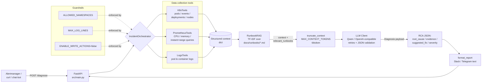

<p align="center">
  <a href="./README.md"><b>🇬🇧 English</b></a> &nbsp;|&nbsp; <a href="./README.ru.md"><b>🇷🇺 Русский </b></a>
</p>

| Interactive Dashboard | API Documentation (Swagger) |
|---|---|
|  |  |

<h1 align="center">K8s Incident Diagnosis AI Agent</h1>

[](https://github.com/Mkft1/ai_agent_DevOps/actions/workflows/ci.yml)


[](./LICENSE)
[](./Dockerfile)
[](https://github.com/astral-sh/ruff)

An LLM-powered SRE agent that diagnoses Kubernetes incidents end-to-end. It ingests alerts via a REST API, correlates live signals — pod status, Kubernetes events, Prometheus metrics, container logs — grounds the analysis with TF-IDF retrieval over local runbooks (RAG), and returns a structured **Root Cause Analysis (RCA)** plus a human-readable report ready for Slack/Telegram.

The agent is strictly **read-only by default**: it never mutates the cluster (`ENABLE_WRITE_ACTIONS=false`), so it is safe to expose to production alert pipelines.

---

## Features

| | |
|---|---|
| 🧠 **LLM RCA** | OpenAI-compatible chat API (Qwen/DashScope by default) with strict JSON output validated by Pydantic; automatic one-shot retry on invalid JSON and an honest fallback diagnosis. |
| 📚 **Hybrid RAG over runbooks** | Local Markdown runbooks (`docs/runbooks/*.md`) ranked by **hybrid search**: `0.5 × TF-IDF` (exact terms) + `0.5 × cosine similarity` of sentence-transformers embeddings (`all-MiniLM-L6-v2`, semantic match). No vector DB, no external service; if the model is unavailable the agent gracefully falls back to pure TF-IDF. Top playbooks are injected into the LLM context as `relevant_runbooks` and drive `suggested_fix`. |
| ☸️ **Kubernetes integration** | Official Python client: pods, events, deployments, nodes, container logs (including pre-restart logs for OOMKilled/CrashLoopBackOff). |
| 📈 **Prometheus integration** | instant & range queries, per-pod CPU/memory usage via `container_*` cAdvisor metrics. |
| 🛡️ **Guardrails** | Namespace allow-list (`ALLOWED_NAMESPACES`), log-size cap (`MAX_LOG_LINES`), context-size cap in tokens (`MAX_CONTEXT_TOKENS`, tiktoken), read-only mode (`ENABLE_WRITE_ACTIONS`), **dangerous-action policy** (fixes mentioning `delete`/`drop`/`rm -rf`/`scale 0` are flagged `requires_approval: true` and routed to a human via Slack), and cluster-level **Policy-as-Code**: least-privilege RBAC + Kyverno ClusterPolicies in `manifests/`. All configurable via `.env`, nothing hardcoded. |
| 🩹 **Graceful degradation** | If any data source fails (K8s API down, Prometheus unreachable, empty logs), the agent records a warning in the report and continues diagnosing with whatever data it has — it never crashes the pipeline. |
| 📊 **Observability** | `/metrics` endpoint (`prometheus-fastapi-instrumentator`) + custom counters/histograms: `diagnose_requests_total`, `diagnose_duration_seconds`, `k8s_api_errors_total`, `llm_fallback_total`. `X-Request-ID` correlation (echoed/generated per request), optional structured JSON logging (`LOG_FORMAT=json`) for Loki/CloudWatch, an append-only audit journal (`AUDIT_LOG_PATH`, JSON Lines) of every diagnosis, and **OpenTelemetry distributed tracing** (auto HTTP spans + manual spans per K8s/Prometheus/logs/RAG/LLM call, OTLP export to Jaeger/Tempo). |
| 🚨 **Alertmanager webhook** | `POST /webhook/alertmanager` accepts the standard Alertmanager payload, diagnoses every `firing` alert (namespace/pod from labels, text from `annotations.summary`/`description`), skips `resolved`, and answers `400` on malformed payloads. |
| 🔁 **Chaos self-test** | `scripts/chaos_test.py` creates an ImagePullBackOff pod, asks the agent to diagnose it, asserts the RCA mentions "image"/"pull", and cleans up. Idempotent. |
| ☸️ **Helm chart** | Production-ready `charts/ai-agent` (v0.1.0): Deployment with probes & non-root securityContext, ClusterIP Service, least-privilege RBAC, ConfigMap/Secret from `values.yaml`, `make helm-lint` / `make helm-install`. |
| 🖥️ **Operator dashboard** | `make dashboard` — Streamlit UI over the audit journal: incident table (Timestamp/Namespace/Severity/Root Cause), severity metrics, and approval cards with `suggested_fix` + "Approve & Apply" for every `requires_approval` incident. |
| 🧪 **Testing & CI/CD** | 273 unit/integration tests with mocked clients (93% coverage, CI gate `--cov-fail-under=85`, SentenceTransformer mocked so tests never download models), plus an offline **evaluation framework** (`make eval`) with a golden dataset and LLM-as-a-judge scoring; | GitHub Actions pipeline: lint → test+coverage → Docker build+smoke → kind-based e2e on `main` (auto-skipped when no LLM secret is configured). |
| 🐳 **Containerized** | Multi-stage `python:3.12-slim` image, non-root user, healthcheck, no secrets baked into the image. |

---

## Architecture



Pipeline in one line:

`Alertmanager → POST /diagnose → IncidentOrchestrator → [K8sTools, PrometheusTools, LogsTools] → RunbookRAG → LLM → RCA → Report`

---
## Architecture Decisions

A few deliberate trade-offs worth knowing about:

1. **Hybrid RAG (TF-IDF + local embeddings) instead of a vector database.** Runbooks are small (a handful of Markdown files), so retrieval runs fully in-process with **zero external infrastructure** — no embeddings API, no Chroma/Qdrant sidecar. Exact-term matching (scikit-learn TF-IDF) is combined with semantic matching (sentence-transformers `all-MiniLM-L6-v2` embeddings, cosine similarity) as `0.5 × tfidf + 0.5 × cosine` — the gold-standard hybrid recipe: synonyms and paraphrases are found even when no keyword overlaps. The index is rebuilt in-process at startup; adding knowledge is just dropping a `.md` file into `docs/runbooks/`. If the embedding model cannot be installed/downloaded, `RunbookRAG` degrades gracefully to pure TF-IDF (`ENABLE_HYBRID_RAG=false` disables the vector branch outright).
2. **FastAPI + pydantic-settings.** FastAPI gives async request handling, automatic OpenAPI docs (`/docs` Swagger UI) and request/response validation out of the box; pydantic models make the incident contract (`Incident`, `Diagnosis`) explicit and testable, and all configuration is env-driven via one `Settings` class.
3. **Strict JSON output validated by Pydantic, with one retry and an honest fallback.** Instead of trusting free-form LLM prose, the system prompt demands a fixed JSON schema; invalid responses trigger a single correction retry, then a deterministic fallback diagnosis (`severity="unknown"`) — the pipeline never returns garbage or crashes because of the model.
4. **Read-only by default + graceful degradation.** The agent suggests fixes rather than executing them (`ENABLE_WRITE_ACTIONS=false`), and any failing data source becomes a warning in the report instead of an exception — safe to wire directly into production alert pipelines.
5. **OpenAI-compatible client over raw HTTP (requests + tenacity).** No heavyweight SDK lock-in: works with Qwen/DashScope, OpenAI, or any self-hosted compatible gateway by changing two env vars (`LLM_BASE_URL`, `LLM_MODEL`).
6. **Multi-stage Docker build (base → builder → runtime).** Security and size: the runtime image is a clean `python:3.12-slim` with only installed packages plus `src/` — no compilers, no pip cache, no repo history, no tests/docs; it runs as non-root `appuser` (UID 10001). Copying `requirements.txt` as its own layer keeps the heavy dependency layer cached across code changes, and `cache-to: type=gha,mode=min` in CI exports only final layers so the cache upload stays small.
7. **CPU-only PyTorch in the image.** The agent embeds runbooks with sentence-transformers — it never trains and never uses a GPU. Installing `torch` from `https://download.pytorch.org/whl/cpu` *before* `requirements.txt` pins the CPU wheel (~200 MB) and stops `sentence-transformers` from pulling the CUDA build (+2 GB of drivers/libs): smaller image, faster CI, identical inference.
8. **Production hardening: async I/O + file-locked audit log.** Slack approval notifications and the Prometheus readiness check (`GET /-/ready`) use `httpx.AsyncClient` with short timeouts (5 s / 3 s) instead of blocking `requests` calls: during an alert storm a synchronous HTTP call would occupy every FastAPI threadpool worker and stall the whole API, while async I/O keeps the event loop free even when Slack/Prometheus is slow or down (the remaining sync clients — Kubernetes, Prometheus queries, LLM — are offloaded via `asyncio.to_thread`, so the event loop never blocks). Every append to the audit journal (`audit.jsonl`) runs under a `filelock` (`FileLock`): concurrent requests across threads/processes (uvicorn workers, FastAPI threadpool) cannot interleave JSON lines — each audit record is atomic and stays machine-readable; a lock timeout (10 s) is logged as an audit error and never fails the HTTP request itself.
---

## Quick Start

> 🎬 **Demo GIF placeholder.** A recorded terminal demo will live at
> `docs/assets/demo.gif` (see [docs/assets/demo_placeholder.md](docs/assets/demo_placeholder.md)
> for how to record it with terminalizer/asciinema). Until then the previews above and
> the real `/diagnose` outputs below show the agent in action.

### 1. Configure environment

```bash
cp .env.example .env
# edit .env: set QWEN_API_KEY (or OPENAI_API_KEY), KUBECONFIG_PATH, PROMETHEUS_URL
```

| Variable | Default | Description |
|---|---|---|
| `KUBECONFIG_PATH` | `~/.kube/config` | Path to the kubeconfig used by K8sTools/LogsTools. |
| `PROMETHEUS_URL` | `http://localhost:9090` | Base URL of your Prometheus instance. |
| `LOG_LEVEL` | `INFO` | Application log level (`DEBUG` also logs prompts/LLM responses, without secrets). |
| `QWEN_API_KEY` / `OPENAI_API_KEY` | — | LLM API key (`QWEN_API_KEY` takes precedence). Never hardcoded, only via env. |
| `LLM_BASE_URL` | DashScope compatible-mode | OpenAI-compatible endpoint (`.../v1` suffix optional). |
| `LLM_MODEL` | `qwen-max` | Chat model name — swap freely (gpt-4o-mini, qwen-plus, ...) without code changes. |
| `CORS_ORIGINS` | `["*"]` | Allowed CORS origins (JSON list, e.g. `["http://localhost:3000"]`). |
| `ALLOWED_NAMESPACES` | `["default"]` | Namespaces the agent may inspect; anything else → HTTP 403. |
| `MAX_LOG_LINES` | `200` | Hard cap on `tail_lines` for log retrieval. |
| `MAX_CONTEXT_TOKENS` | `4000` | Max size of the serialized LLM context **in tokens** (precise tiktoken `cl100k_base` count); longest fields (logs) are truncated with `... [truncated to fit token limit]`. |
| `ENABLE_WRITE_ACTIONS` | `false` | Read-only mode. No write path exists in the codebase today. |
| `LOG_FORMAT` | `text` | `text` (human-readable) or `json` (one JSON object per line for log aggregators). |
| `LLM_OFFLINE` | `false` | Demo/offline mode: without an LLM key `/diagnose` answers with the deterministic `LLMClientStub` instead of an honest `503`. Keep `false` in production. |
| `AUDIT_LOG_PATH` | `audit.jsonl` | Append-only audit journal (JSON Lines): one record per diagnosis / guardrail rejection / webhook batch. |
| `SLACK_WEBHOOK_URL` | — (disabled) | Incoming webhook for human approval of dangerous fixes; unset = WARNING in logs, `requires_approval` still set. |
| `OTEL_EXPORTER_OTLP_ENDPOINT` | — (disabled) | OTLP/gRPC endpoint for trace export, e.g. `http://localhost:4317` (Jaeger). Unset = tracing collects spans in-process, no export. |
| `OTEL_SERVICE_NAME` | `ai-agent-devops` | `service.name` resource attribute shown in Jaeger/Tempo. |
| `ENABLE_HYBRID_RAG` | `true` | Hybrid retrieval (TF-IDF + embeddings). `false` = pure TF-IDF. |
| `EMBEDDING_MODEL` | `all-MiniLM-L6-v2` | sentence-transformers model for the vector branch of hybrid RAG. |

### 2. Run locally

```bash
python -m venv .venv && source .venv/bin/activate
pip install -r requirements.txt
uvicorn src.main:app --reload --host 0.0.0.0 --port 8000
```

Interactive API docs (Swagger UI): **http://localhost:8000/docs**

#### Developer shortcuts with `make`

A `Makefile` in the repo root wraps the most common commands so you don't have to remember them:

```bash
make install       # pip install -r requirements.txt -r requirements-dev.txt
make lint          # ruff check src tests scripts
make test          # pytest --cov=src --cov-report=term-missing tests/
make run           # uvicorn src.main:app --host 0.0.0.0 --port 8000 --reload
make docker-build  # docker build -t ai-agent-devops:local .
make chaos         # python scripts/chaos_test.py (ImagePullBackOff self-test)
make e2e           # bash scripts/run_integration_test.sh (kind cluster, end-to-end)
make eval          # python eval/evaluate.py (LLM-as-a-judge quality gate)
make dashboard     # streamlit run ui/dashboard.py (operator UI on :8501)
make docs-check    # python scripts/check_docs_metrics.py (README vs pytest)
```

The Makefile is a convenience wrapper only — it does not change or replace CI/CD.

#### Real `/diagnose` response (OOMKilled incident)

The agent retrieves the matching runbook (`docs/runbooks/oom_killed.md`) via RAG and grounds the fix on it:

```json
{
  "diagnosis": {
    "root_cause": "Container 'payments-api' is being OOMKilled: working set (~488 MiB) has reached the 512Mi memory limit; the batch allocation at 09:40:55 triggers a cgroup OOM kill (3 restarts, matching Warning events).",
    "evidence": [
      "container_memory_working_set_bytes = 511705088 bytes (~488 MiB) vs limit 512Mi",
      "Pod status shows 5 restarts; last state reason: OOMKilled",
      "K8s Warning event 'OOMKilling' for pod/payments-api-7d9f4b-x2kq",
      "Logs: 'fatal error: runtime: out of memory' right before container exit",
      "Runbook oom_killed.md: raise memory limit or cap batch size"
    ],
    "suggested_fix": "Increase the container memory limit to 1Gi (kubectl patch) and cap the batch buffer size via PAYMENTS_BATCH_MB=128; then roll the deployment and watch restarts drop to zero.",
    "severity": "high",
    "warnings": []
  },
  "report": "🟠 Incident: diagnosis (severity: high)\nNamespace: default, Pod: payments-api-7d9f4b-x2kq\n..."
}
```

### 3. Run with Docker

```bash
docker build -t k8s-incident-agent .
docker run --rm -p 8000:8000 \
  --env-file .env \
  -v "$HOME/.kube/config:/home/appuser/.kube/config:ro" \
  k8s-incident-agent
```

### 4. Run with docker-compose

```bash
docker compose up --build
# app on http://localhost:8000, kubeconfig and .env mounted read-only
```

---

## API

| Method | Path | Description |
|---|---|---|
| `GET` | `/health` | Liveness probe → `{"status": "ok"}`. |
| `GET` | `/ready` | Checks K8s API + Prometheus reachability → `200` or `503`. |
| `POST` | `/diagnose` | Accepts an incident, returns `{diagnosis, report}`. |
| `POST` | `/webhook/alertmanager` | Alertmanager webhook: diagnoses firing alerts, returns `{processed, skipped, diagnoses}`; `400` on invalid JSON/schema. |
| `GET` | `/metrics` | Prometheus exposition format (HTTP + custom metrics). |

All responses carry an `X-Request-ID` header (echoed when provided by the client/LB, generated otherwise); the same id appears in JSON logs (`LOG_FORMAT=json`) for request/log correlation.

### Example: `POST /diagnose`

Request:

```bash
curl -s -X POST http://localhost:8000/diagnose \
  -H 'Content-Type: application/json' \
  -d '{
    "namespace": "default",
    "pod_name": "payments-api-7d9f4b-x2kq",
    "description": "Pod payments-api restarts repeatedly, alert: ContainerOOMKilling"
  }'
```

Response (excerpt — produced by the real orchestrator pipeline; deterministic LLM stand-in used here to avoid spending API tokens):

```json
{
  "diagnosis": {
    "root_cause": "Container 'payments-api' is being OOMKilled: working set (~488 MiB) has reached the 512Mi memory limit; the batch allocation at 09:40:55 triggers a cgroup OOM kill (3 restarts, matching Warning events).",
    "evidence": [
      "container_memory_working_set_bytes = 511705088 bytes (~488 MiB) vs limit 512Mi",
      "Pod status shows 5 restarts; last state reason: OOMKilled",
      "K8s Warning event 'OOMKilling' for pod/payments-api-7d9f4b-x2kq",
      "Logs: 'fatal error: runtime: out of memory' right before container exit",
      "Runbook oom_killed.md: raise memory limit or cap batch size"
    ],
    "suggested_fix": "Increase the container memory limit to 1Gi (kubectl patch) and cap the batch buffer size via PAYMENTS_BATCH_MB=128; then roll the deployment and watch restarts drop to zero.",
    "severity": "high",
    "warnings": []
  },
  "report": "🟠 *Incident: diagnosis* (severity: high)\n*Namespace:* `default`, *Pod:* `payments-api-7d9f4b-x2kq`\n..."
}
```

Note how the last piece of evidence comes from the **RAG-retrieved runbook** (`oom_killed.md`) — retrieved automatically from the pod status + log lines, not hardcoded.

### Example: chaos scenario (ImagePullBackOff)

After running `python scripts/chaos_test.py` against a live cluster + local agent:

```bash
curl -s -X POST http://localhost:8000/diagnose \
  -H 'Content-Type: application/json' \
  -d '{"namespace": "default", "pod_name": "bad-pod", "description": "Pod in ImagePullBackOff"}'
```

```json
{
  "diagnosis": {
    "root_cause": "Image pull failure for pod 'bad-pod': the tag 'definitely-bad-tag-404' does not exist in the registry (ErrImagePull -> backoff).",
    "severity": "medium",
    "suggested_fix": "Fix the image tag in the Deployment spec to an existing tag (e.g. nginx:1.27) and roll the deployment."
  }
}
```

### Alertmanager integration

Point Alertmanager at the agent — every firing alert becomes a full RCA:

```yaml
# alertmanager.yml
route:
  receiver: ai-agent
  group_by: [alertname, namespace]
receivers:
  - name: ai-agent
    webhook_configs:
      - url: http://<agent-host>:8000/webhook/alertmanager
        send_resolved: true   # resolved-алерты агент пропускает (skipped), но аудит получает
```

Behaviour: `labels.namespace` → incident namespace (default `default`), `labels.pod`/`labels.pod_name` → pod, `annotations.summary` (else `annotations.description`, else `alertname`) → description; each diagnosis is written to the audit journal (`AUDIT_LOG_PATH`) and returned in `diagnoses[]` together with the Slack/Telegram-ready `report`. Malformed JSON or schema violations return `400`; a guardrail-rejected namespace skips that alert (`skipped++`) instead of failing the whole batch.

## Security Policies & Approvals

The agent never mutates the cluster — but its *suggestions* can be dangerous.
Before an operator acts on them, a role-based policy gate runs:

1. `src/agent/policies.py::check_policy(suggested_fix)` scans the LLM's recommendation
   for dangerous commands: `delete`, `drop`, `rm -rf`, `scale 0` (case-insensitive).
2. If a dangerous pattern is found while the agent is read-only
   (`ENABLE_WRITE_ACTIONS=false`), the diagnosis is flagged
   **`requires_approval: true`** (visible in `POST /diagnose` and
   `POST /webhook/alertmanager` responses, in the audit journal and as a 🔔 line
   in the Slack/Telegram report).
3. If `SLACK_WEBHOOK_URL` is configured, the agent posts an approval request to an
   incoming webhook:

   ```
   ⚠️ Action Required: Agent suggests dangerous fix: kubectl delete pod bad-pod -n default. Approve or Reject?
   ```

   Without the webhook the agent logs a `WARNING` (approval still required in the
   diagnosis) — it never crashes. A Slack outage also cannot break diagnosis:
   send failures are logged and the response is returned as usual.
4. Every approval request increments the `approval_requests_total` Prometheus metric.

```bash
# .env
SLACK_WEBHOOK_URL=https://hooks.slack.com/services/T000/B000/XXXX
```

Safe recommendations (raise limits, fix image tags, add probes...) skip the gate:
`requires_approval: false`, no Slack message.

### Rate limiting (alert-storm / financial DoS protection)

`POST /diagnose` is limited to **5 requests/minute** per client IP and
`POST /webhook/alertmanager` to **30/minute** (slowapi, in-memory storage by
default; set `RATE_LIMIT_REDIS_URL` to share counters across API replicas).
Exceeding the limit returns **429** with `{"detail": "Rate limit exceeded. Please retry later."}`
and a `Retry-After` header. Liveness/readiness probes (`/health`, `/ready`) are
never limited — Kubernetes must always be able to check the pod.

## Security & Policy-as-Code

Application guardrails (`ALLOWED_NAMESPACES`, read-only mode) are the first line of
defence; the cluster enforces the same rules independently via **least-privilege RBAC**
and **Kyverno Policy-as-Code** — a compromised or misconfigured agent still cannot
touch what it must not touch.

```bash
# 1. Kyverno (if not installed): policy engine that enforces the ClusterPolicies
helm repo add kyverno https://kyverno.github.io/kyverno
helm install kyverno kyverno/kyverno -n kyverno --create-namespace

# 2. Apply RBAC + policies
kubectl apply -f manifests/
```

| Manifest | What it is | Protection |
|---|---|---|
| `manifests/agent-rbac.yaml` | ServiceAccount `ai-agent` + Role (`get/list/watch` only) + RoleBinding in `default` | Least privilege: the agent has **no write verbs at cluster level**, even if `ENABLE_WRITE_ACTIONS` is ever flipped or the app is compromised |
| `manifests/policies/kyverno-block-kube-system.yaml` | ClusterPolicy (Enforce): deny CREATE/UPDATE/DELETE in `kube-system` for every ServiceAccount except system ones (`kube-system`/`kube-public`/`kube-node-lease`) | System components (CoreDNS, kube-proxy, controllers) are untouchable by workloads and the agent |
| `manifests/policies/kyverno-validate-actions.yaml` | ClusterPolicy (Enforce): any write by SA `ai-agent` is denied unless the target namespace has label `agent-managed=true` | Write actions (if ever enabled) work only in explicitly opted-in namespaces |

Verify the enforcement yourself:

```bash
# RBAC: no write verbs for the agent
kubectl auth can-i delete pods -n default --as=system:serviceaccount:default:ai-agent   # -> no
kubectl auth can-i get pods  -n default --as=system:serviceaccount:default:ai-agent   # -> yes

# Kyverno: label-gated writes
kubectl label ns sandbox agent-managed=true   # opted-in namespace for future write paths
```

Policies run in `Enforce` mode (AdmissionReview deny). To observe first without
blocking, set `spec.validationFailureAction: Audit` and watch Kyverno's policy reports.

## Evaluation & Quality Assurance

Prompts, runbooks and models evolve — without a measurement harness every change is
blind. `make eval` runs a **golden dataset** of incidents through the real agent
pipeline (RAG + LLM) and scores the answers with **LLM-as-a-judge**:

```bash
make eval                # or: python eval/evaluate.py --min-score 4.0
```

* **Dataset** — `eval/golden_dataset.json`: 3 cases (OOMKilled, ImagePullBackOff,
  CrashLoopBackOff), each with `incident` (namespace/pod_name/description),
  `expected_root_cause` and `expected_runbook`. Add cases freely — the schema is
  validated at load.
* **No cluster needed** — K8s/Prometheus/logs tools are mocked inside the script with
  realistic per-scenario symptoms (events, log tails, metrics), so the evaluation
  measures what matters: **RAG retrieval + LLM reasoning**, not cluster availability.
* **Judge** — a second LLM call compares expected vs actual root cause semantically:
  «Сравни expected_root_cause: … и actual_root_cause: … Оцени по шкале от 1 до 5,
  где 5 — полное совпадение по смыслу. Верни только цифру.»
* **Metrics** — average judge score (1–5) and **runbook hit-rate** (share of cases where
  RAG retrieved the expected runbook into `relevant_runbooks`).
* **Gate** — exit code 0 only if avg score ≥ `--min-score` (default 4.0) **and**
  hit-rate is 100%; 1 = quality below threshold (use as a regression gate before
  prompt/RAG/model changes), 2 = environment error (missing LLM key, bad dataset).

```
==============================================================================
                 EVALUATION REPORT — LLM-as-a-judge (golden dataset)
==============================================================================
 CASE (runbook)             JUDGE 1-5  RUNBOOK  ACTUAL ROOT CAUSE
------------------------------------------------------------------------------
 oom_killed.md                    5/5  ✅       Container OOMKilled: memory limit…
 image_pull_backoff.md            5/5  ✅       Image pull failure: manifest un…
 crash_loop.md                    4/5  ✅       CrashLoopBackOff: missing DATABASE…
------------------------------------------------------------------------------
 Average judge score : 4.67 / 5  (порог: 4.0)
 Runbook hit-rate    : 100%  (3/3)
 Verdict             : ✅ PASS
==============================================================================
```

Requires an LLM key (`QWEN_API_KEY`/`OPENAI_API_KEY`) — the same model family can be
used for diagnosis and judging, or point `LLM_BASE_URL`/`LLM_MODEL` at a stronger judge.

## Tracing (OpenTelemetry)

The agent emits **distributed traces** so you can see exactly where milliseconds go:
K8s API calls, Prometheus queries, log tails, RAG retrieval or the LLM "thinking" time.

* **Automatic HTTP spans** — every request gets a server span (`GET /health`, `POST /diagnose`, ...) via `FastAPIInstrumentor.instrument_app(app)`.
* **Manual spans** in `IncidentOrchestrator` form a per-incident tree:

```
incident.diagnose            (attrs: incident.namespace, incident.severity, incident.warnings)
├── k8s.get_pods             (k8s.namespace, k8s.pods_found)
├── k8s.get_events           (k8s.namespace, k8s.events_found)
├── prometheus.pod_cpu       (k8s.pod)
├── prometheus.pod_memory    (k8s.pod)
├── logs.pod_tail            (k8s.pod, logs.tail_lines, logs.bytes)
├── rag.search               (rag.top_k, rag.matches)
└── llm.generate             (llm.model, llm.ok, llm.response_chars)
```

* Tool failures are recorded on the span (`record_exception` + `ERROR` status) — a degraded step is visible in the trace, not only in logs.
* Export is **opt-in**: set `OTEL_EXPORTER_OTLP_ENDPOINT` (OTLP/gRPC). Without it spans are collected in-process and nothing is sent anywhere — zero external side effects in CI/offline runs.

### Try it locally with Jaeger

```bash
make jaeger          # or: docker run -d --name jaeger -p 16686:16686 -p 4317:4317 jaegertracing/all-in-one:latest
OTEL_EXPORTER_OTLP_ENDPOINT=http://localhost:4317 uvicorn src.main:app --port 8000
curl -s localhost:8000/health >/dev/null
curl -s -X POST localhost:8000/diagnose -H 'Content-Type: application/json' \
     -d '{"namespace":"default","pod_name":"web-1","description":"pod restarts"}'
```

Open the Jaeger UI at **http://localhost:16686**, pick service `ai-agent-devops`
(override with `OTEL_SERVICE_NAME`) and inspect the `incident.diagnose` trace tree.
The same endpoint works with Tempo/OpenTelemetry Collector — anything speaking OTLP/gRPC.

---

## Security & Guardrails

All limits are configuration-driven (see table above), enforced **before** any cluster call:

1. **Namespace allow-list** — requests for namespaces outside `ALLOWED_NAMESPACES` fail fast with `"Namespace not allowed"` (HTTP 403); no API calls are made.
2. **Read-only by design** — with `ENABLE_WRITE_ACTIONS=false` the agent only reads data and *suggests* fixes. There is no delete/exec/apply code path in the repository; the flag guards future action-proposing features.
3. **Bounded context** — log tails capped by `MAX_LOG_LINES`; the whole LLM context is iteratively trimmed to `MAX_CONTEXT_TOKENS` by precise tiktoken counting (longest values keep their tail — the freshest log lines — and are marked `... [truncated to fit token limit]`), guaranteeing no context-window overflow on any provider.
4. **No secrets anywhere** — API keys come exclusively from `.env` (never committed, excluded from the Docker image via `.dockerignore`); prompt/response logging at DEBUG never includes auth headers.
5. **Graceful degradation** — a failing tool produces a warning in the report ("K8s API unavailable, using only Prometheus metrics"), not a crash; even a missing kubeconfig at startup only degrades K8s/log tools to empty results, and an unconfigured LLM key yields an actionable `503` (or stub mode via `LLM_OFFLINE=true`), never a bare `500`.
6. **Non-root container** — the runtime image runs as `appuser` (UID 10001) with a read-only kubeconfig mount.

---

## Testing

```
tests/
├── test_k8s_tools.py         # K8s client mocking (pods/events/deployments/nodes, ApiException paths)
├── test_prometheus_tools.py  # HTTP mocking: success, timeouts, 5xx, parsing
├── test_logs_tools.py        # read_namespaced_pod_log mocking
├── test_orchestrator.py      # full pipeline w/ mocks, graceful degradation, guardrails
├── test_llm_integration.py   # LLMClient: retries (429/5xx), JSON validation, fallback
├── test_rag.py               # RunbookRAG on fixture md-files + orchestrator integration
├── test_text_utils.py        # truncate_context recursion & guarantees
├── test_chaos_test.py        # chaos script logic (mocked k8s + requests)
├── test_config.py            # Settings validators: fail-fast on bad LOG_LEVEL/LOG_FORMAT/limits
├── test_logger.py            # JSON structured logging + request_id correlation
├── test_webhook_alertmanager.py  # Alertmanager payload parsing, 400s, resolved-skip, audit journal
├── test_tracing.py           # OTel provider, FastAPI auto-spans, manual tool/LLM spans
├── test_policies.py          # dangerous-fix policy, Slack approval flow, no-webhook fallback
├── test_evaluate.py          # eval harness: dataset schema, judge parsing, exit codes
├── test_dashboard.py         # audit journal parsing, table build, approval filter
└── test_api.py               # FastAPI TestClient: /health /ready /diagnose /metrics, CORS, errors, X-Request-ID
```

- **Unit tests**: every external boundary (Kubernetes API, Prometheus HTTP, LLM HTTP) is mocked — the suite runs offline in ~2 seconds.
- **Coverage**: `pytest --cov=src --cov-report=xml --cov-fail-under=85` — currently **~93%** (uploaded as a CI artifact every run; the CI fails if coverage drops below 85%).
- **Docs drift guard**: `make docs-check` (и шаг CI после pytest) сверяет числа
  тестов/покрытия в этом README с реальным прогоном — расхождение роняет CI.
- **Integration (end-to-end)**: `scripts/run_integration_test.sh` spins up a real [kind](https://kind.sigs.k8s.io/) cluster, creates a pod with a bad image tag, runs the agent under uvicorn, sends a real `POST /diagnose`, and asserts the RCA mentions *"image"*/*"pull"* (via `jq`). Idempotent: leftover clusters/pods are removed before each run; cleanup happens even on failure.
- **CI jobs** (GitHub Actions, target 5-6 min): `lint` and `helm` run **in parallel**; `test` (pytest **-n auto** via pytest-xdist, coverage gate ≥85%, docs drift-guard) needs only `lint`; on push to `main`/dispatch, `build` (Docker + smoke, needs [test, helm], BuildKit gha-cache `mode=max` + pip cache-mounts; NOT run on PRs) and `integration-test` (kind e2e, needs only test, runs **parallel to build**, gracefully skipped without `QWEN_API_KEY`/`OPENAI_API_KEY` secret) finish the pipeline. PRs run lint+helm+test+dependency-audit for fast feedback; `[skip ci]` in a commit title skips the run. Security layer: `dependency-audit` (pip-audit, blocking on runtime `requirements.txt`, dev-deps report-only) runs parallel to tests, and `security-scan` (Hadolint + Trivy image scan, `CRITICAL,HIGH` fail-fast, cached Trivy DB) runs after build parallel to e2e; both are skippable via repo variable `SKIP_SECURITY_SCAN=true`.

---

## Kubernetes Deployment

The repo ships a production-ready Helm chart (`charts/ai-agent`, version 0.1.0):

```bash
# 1. Validate the chart
make helm-lint          # helm lint charts/ai-agent

# 2. Install / upgrade (values file is the single source of truth)
make helm-install       # helm upgrade --install ai-agent charts/ai-agent -f charts/ai-agent/values.yaml
# or with your LLM key:
helm upgrade --install ai-agent charts/ai-agent \
  --namespace ai-agent --create-namespace \
  --set secrets.llmApiKey="$QWEN_API_KEY"

# 3. Reach the API
kubectl -n ai-agent port-forward svc/ai-agent 8000:8000
curl -s localhost:8000/health
```

What the chart gives you out of the box:

* **Deployment** with liveness (`/health`) and readiness (`/ready`) probes,
  checksum-annotated ConfigMap/Secret (config changes roll the pods),
  `runAsNonRoot: true` (UID 10001), `readOnlyRootFilesystem`, dropped capabilities,
  resource requests/limits and an emptyDir for the audit journal;
* **Service** (ClusterIP) exposing the API on port 8000;
* **ServiceAccount + Role/RoleBinding** — read-only verbs (`get/list/watch`) only,
  matching the Kyverno policies in `manifests/` (SA name `ai-agent`);
* **ConfigMap** with all non-secret settings from `src/config.py`
  (`PROMETHEUS_URL`, `LOG_LEVEL`, guardrails, RAG, OTel, audit path);
* **Secret** for API keys (`secrets.llmApiKey` → `QWEN_API_KEY`, etc.).
  In production prefer External Secrets/Vault: set `secrets.existingSecret`
  and the chart will not create the Secret itself.

All knobs live in `charts/ai-agent/values.yaml` (replicas, image tag, resources,
env, probes, securityContexts, nodeSelector/tolerations/affinity). CI runs
`helm lint` + `helm template` on every push, so the chart cannot silently rot.

## Interactive Dashboard

A lightweight Streamlit UI for on-call operators (runs **separately** from the FastAPI
service, read-only over the audit journal):

```bash
make dashboard           # or: streamlit run ui/dashboard.py
# open http://localhost:8501
```

What you see there:

* **Headline metrics** — three big tiles: Total Incidents, Critical Incidents
  (`severity=critical`) and Pending Approvals (`requires_approval=true`);
* **Incidents table** — every diagnosis from the audit journal (`AUDIT_LOG_PATH`,
  default `audit.jsonl`, parsed line-by-line with `json`): Time (human-readable,
  `19 Oct, 10:00`), Namespace, Pod, Severity with colour coding
  (🔴 critical / 🟠 high / 🟡 medium / 🟢 low) and Root Cause — newest first;
* **Approval cards** — for each incident with `requires_approval: true`: root cause,
  the dangerous `suggested_fix` in a code block, data-collection warnings and a
  **"✅ Approve & Apply"** button (demo confirmation with 🎈: the dashboard never
  touches the cluster — the human applies the change via kubectl/GitOps after a
  dry-run);
* **🔍 View Raw Audit Log** expander with the parsed JSON events and a sidebar
  Refresh button.

If the audit journal does not exist yet, the dashboard shows a warning with hints
(run the agent and send a few `/diagnose` or Alertmanager requests) instead of crashing.

## Documentation

| Document | For whom | Contents |
|---|---|---|
| [`docs/OPERATIONS.md`](./docs/OPERATIONS.md) | **On-call engineers** | Incident response flow for `severity: critical` and safe-fix verification, handling `warnings` (degraded data sources), adding runbooks, updating the golden dataset, troubleshooting (LLM 429, embedding model load failures) |
| [`docs/runbooks/`](./docs/runbooks/) | SRE knowledge base | 8 peer-reviewed runbooks retrieved by the agent's hybrid RAG |
| [`CONTRIBUTING.md`](./CONTRIBUTING.md) | Developers | Dev environment, tests/lint rules, PR process |
| [`CHANGELOG.md`](./CHANGELOG.md) | Everyone | Keep a Changelog: что вошло в каждый релиз |
| [`.github/pull_request_template.md`](./.github/pull_request_template.md) | Contributors | Чек-лист PR: тесты, линтер, docs, тесты на новую логику |
| [`README.ru.md`](./README.ru.md) | Русскоязычная версия | Полная синхронная версия этого README |

## Contributing

### Dev environment

```bash
python -m venv .venv && source .venv/bin/activate
pip install -r requirements-dev.txt   # runtime deps + ruff, pytest, pytest-cov, httpx
```

### Before opening a PR

```bash
ruff check src tests scripts          # linter (config in pyproject.toml)
pytest --cov=src tests/               # all tests must pass
```

### Project rules

- Follow Git flow in this repo: sync with `main` first (`git fetch origin main && git rebase origin/main`), one feature branch per task, clean diffs.
- Keep the agent **read-only** unless a task explicitly adds guarded write actions.
- New settings go through `src/config.py` (pydantic-settings) + `.env.example` — never hardcode.
- Every new tool method must swallow `ApiException`/HTTP errors and return an empty result + logged warning (graceful degradation principle).

### Adding a new runbook (RAG)

1. Create `docs/runbooks/<your_incident>.md` — use the existing files as templates: `Symptoms`, `Root causes`, `How to fix` (with copy-pasteable `kubectl` commands), `Prevention`.
2. Write naturally — the TF-IDF index is rebuilt at startup, no registration step needed.
3. Sanity-check retrieval:
   ```bash
   python -c "from src.agent.rag import RunbookRAG; print([t.splitlines()[0] for t in RunbookRAG().find_relevant('your sample error text')])"
   ```
4. Optionally add a keyword assertion to `tests/test_rag.py`.

---

## Project structure

```
ai_agent_DevOps/
├── .github/workflows/ci.yml     # lint → test → build → integration-test (kind)
├── Dockerfile                   # multi-stage (base/builder/runtime), CPU-only torch, non-root, healthcheck
├── docker-compose.yml           # local stack: agent + kubeconfig/.env mounts
├── Makefile                     # dev shortcuts: install/lint/test/run/docker-build/chaos/e2e
├── docs/runbooks/               # RAG knowledge base: 8 runbooks (OOMKilled, ImagePullBackOff, CrashLoop, DNS, NodeNotReady, PVCPending, CreateContainerConfigError, Evicted)
├── eval/
│   ├── golden_dataset.json      # golden incidents: expected root cause + runbook
│   └── evaluate.py              # LLM-as-a-judge harness (make eval), no cluster needed
├── manifests/
│   ├── agent-rbac.yaml          # least-privilege SA/Role/RoleBinding (read-only)
│   └── policies/                # Kyverno ClusterPolicies: kube-system lockdown,
│                                # agent-managed=true label gate for writes
├── ui/
│   └── dashboard.py             # Streamlit operator UI over audit.jsonl (make dashboard)
├── scripts/
│   ├── chaos_test.py            # ImagePullBackOff chaos experiment vs /diagnose
│   ├── run_integration_test.sh  # kind-based end-to-end test
│   └── kind/cluster.yaml        # kind cluster config
├── src/
│   ├── main.py                  # FastAPI app: /health /ready /diagnose /metrics /webhook/alertmanager
│   ├── api/models.py            # pydantic contracts: Alertmanager payload -> Incident
│   ├── config.py                # pydantic-settings (.env driven)
│   ├── prompts/sre_system.txt   # system prompt for the LLM (loaded at init, fallback in code)
│   ├── agent/
│   │   ├── orchestrator.py      # IncidentOrchestrator: pipeline, guardrails, degradation, reporting
│   │   ├── policies.py          # dangerous-fix policy (delete/drop/rm -rf/scale 0) -> approval
│   │   ├── llm_client.py        # OpenAI-compatible client: tenacity retries, 30s timeout
│   │   ├── rag.py               # RunbookRAG: hybrid retrieval (TF-IDF + embeddings) over docs/runbooks
│   │   └── tools/               # k8s_tools.py, prometheus_tools.py, logs_tools.py
│   └── utils/
│       ├── audit.py             # append-only audit journal (JSON Lines)
│       ├── logger.py            # stdlib logging setup
│       ├── metrics.py           # custom Prometheus metrics
│       └── text_utils.py        # truncate_context (bounded, JSON-safe)
├── charts/ai-agent/             # production Helm chart (v0.1.0): deployment,
│                                # service, SA/RBAC, configmap, secret, helpers
└── tests/                       # 273 tests, fully mocked externals
```

---

## License

[MIT](./LICENSE)
