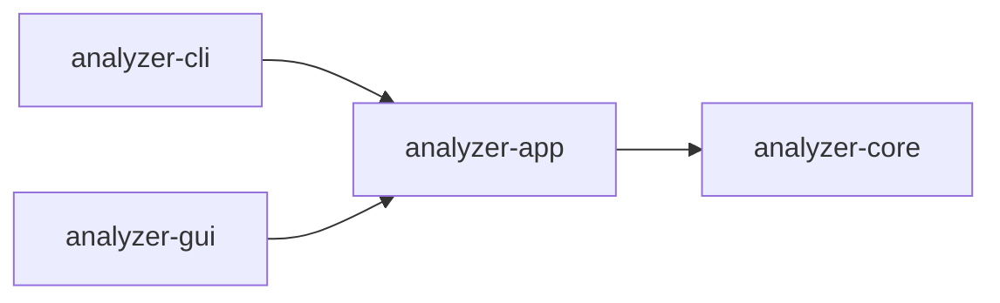

# Easy Analyzer

**简体中文** | [English](README.en.md)

**把日志、进程快照和抓包证据放进一个案件，筛查线索、核对原文、保存分析过程。**

Easy Analyzer 是使用 Rust 开发的跨平台应急响应分析工具，提供命令行 CLI 和桌面 GUI。支持 Windows x64、Linux x64、macOS ARM64，适合离线证据分析、现场排查和多天续办的应急响应工作。

默认在本地完成解析、规则筛查与 IOC 匹配。需要 AI 辅助时，由用户选择证据范围并主动发送到配置的 OpenAI 兼容服务。

[下载安装](https://github.com/MoShouSecurity/Easy_Analyzer/releases) · [快速开始](#快速开始) · [界面截图](#界面截图) · [项目与 IOC 说明](docs/PROJECTS.md) · [更新记录](CHANGELOG.md)

## 能做什么

| 能力     | 当前功能                                                                                                                                |
| -------- | --------------------------------------------------------------------------------------------------------------------------------------- |
| 日志分析 | 导入 Windows EVTX、Linux 登录与 SSH 日志、Apache/Nginx 访问及错误日志、普通文本；支持自定义 Web 日志格式、关键词和正则筛选。            |
| 本地规则 | 筛查重复失败登录、失败后成功登录、账号与权限变更、日志清除、服务与计划任务变更、可疑脚本执行和 Web 攻击请求等线索。                     |
| 进程分析 | 采集本机进程或导入 JSON 快照，查看进程树、路径与命令行，识别编码执行、下载执行、临时目录运行和 Office 启动脚本解释器等特征。            |
| 离线流量 | 导入 PCAP/PCAPNG，查看数据包和双向网络会话，汇总包数、字节数及起止时间；提取部分 HTTP 字段、DNS 查询名，做基础 TLS 识别。               |
| 案件管理 | 每次响应保存为独立 `.eair` 项目，记录客户与响应资料，持续追加证据，保留备注、AI 历史、IOC 清单和筛选条件。                              |
| IOC 匹配 | 从 TXT/CSV、粘贴或手动输入 IPv4/IPv6、域名、HTTP/HTTPS URL，在当前项目中离线扫描，查看命中值、字段位置并跳转证据。                      |
| AI 辅助  | 按全部证据、当前筛选或本地可疑项分析；发送前预览范围与预算，按配置分批及跨批汇总，校验证据引用，保留有效结果和历史。                    |
| 命令速查 | Windows、Linux 各 24 条排查与取证命令，按六类浏览、搜索和复制；附执行环境、权限、适用条件与参数说明。无需打开项目，工具不执行这些命令。 |
| 报告导出 | 导出完整 HTML/JSON 报告，保留证据来源、原始记录和发现引用；界面筛选及分页不会裁剪报告中的完整证据集合。                                 |

## 界面截图

以下截图拍摄于 **2026-10-13**，来自 **1.5.0 的 macOS ARM64 原生 GUI**。项目、日志、进程与抓包均为合成样本，没有使用真实客户案件，也没有调用外部 AI 服务。

**案件概览：汇总证据与待核查发现**


<details>
<summary>日志详情与 IOC 匹配</summary>

**日志证据 · 深色主题：筛选记录并查看保留的原文**


**IOC 匹配 · 浅色主题：定位命中字段与证据**


</details>

<details>
<summary>Windows / Linux 应急命令库</summary>

**Windows 命令 · 浅色主题**


**Linux 命令 · 深色主题：网络排查分类**


</details>

## 下载与安装

从 [GitHub Releases](https://github.com/MoShouSecurity/Easy_Analyzer/releases) 下载对应平台的程序。每次发布同时提供 CLI、GUI 与 `SHA256SUMS`；CLI 与 GUI 可以独立使用。

| 平台        | CLI                                               | GUI                                                                                                                 |
| ----------- | ------------------------------------------------- | ------------------------------------------------------------------------------------------------------------------- |
| Windows x64 | `easy-analyzer-cli-windows-x64.exe`               | 正式版为 `easy-analyzer-gui-windows-x64.exe`；预览版提供 `easy-analyzer-gui-windows-x64-setup.exe`。需要 WebView2。 |
| Linux x64   | `easy-analyzer-cli-linux-x64`                     | `easy-analyzer-gui-linux-x64`。需要 GTK 3 / WebKitGTK 4.1。                                                         |
| macOS ARM64 | `easy-analyzer-cli-macos-arm64`，要求 macOS 11.0+ | `easy-analyzer-gui-macos-arm64.dmg`，要求 macOS 13.0+。打开后将 `Easy Analyzer.app` 拖入“应用程序”。                |

Linux 程序和 macOS CLI 首次运行前需要赋予执行权限，例如：

```sh
chmod +x easy-analyzer-cli-linux-x64 easy-analyzer-gui-linux-x64
```

macOS GUI 当前采用 ad-hoc 签名，未完成公证。不同平台的构建与桌面实机验证范围见项目说明，不以构建通过代替全部交互验证。

## 快速开始

### 桌面 GUI

1. 在首页新建项目，填写客户单位和响应开始时间；同一响应可以持续多天，另一场响应新建项目。
2. 选择或拖入日志、进程快照、PCAP/PCAPNG，开始本地分析。Windows/Linux 可主动加载本机常见日志，也可采集本机进程。
3. 在“分析概览”查看发现，进入日志、进程或网络页面筛选记录，展开详情核对原文与来源。
4. 在“IOC 匹配”追加清单并主动扫描，从命中结果跳转证据。追加证据或修改清单后，按提示重新扫描。
5. 如需 AI，在设置中填写服务地址、模型与密钥，选择证据范围，查看发送预览后启动分析。
6. 点击“保存”写入 `.eair`；按需导出 HTML/JSON 报告。命令速查可随时从左侧“应急响应命令”进入。

项目打开后，可从顶部“编辑资料”或首页“当前项目资料”中的“编辑项目资料”修改名称、客户单位、响应起止时间、地点、服务人员和说明。“应用修改”后点击“保存”写回项目文件。

“日志证据”的“多维查询”支持时间范围、日志级别、客户端 IP、HTTP 状态码、方法、路径、Logger、主机和自定义字段，覆盖 Nginx/Apache、常见 Tomcat/Java 应用日志和系统认证日志；Windows 事件条件单独展开。支持按时间或原始顺序正序、倒序查看，完整集合查询后再分页。无时区日志可明确选择来源的 UTC 偏移，原文不变，条件随项目保存。详见 [日志多维查询](docs/PROJECTS.md#日志多维查询)。

项目、证据、发现、诊断、IOC、AI 历史及引用支持分页和页码跳转；大项目复用筛选结果与分页书签，列表按需加载详情。见 [分页与大型项目](docs/PROJECTS.md#分页与大型项目)。

**项目采用手动保存。** 移动 `.eair` 到另一台机器后，可以继续查看已导入的证据和分析记录，无需原始输入文件或独立数据库服务。从项目列表移除记录会保留项目文件、证据和 IOC。

### 命令行 CLI

下面以 `easy-analyzer` 为命令名；下载后可重命名 CLI，或将示例中的名称替换为实际文件名。Windows PowerShell 使用 `./文件名.exe` 运行。

```sh
# 用本地规则筛查日志
./easy-analyzer logs cases/Security.evtx -s

# 关键词或正则查询
./easy-analyzer logs cases/auth.log -q "192.0.2.10"
./easy-analyzer logs cases/access.log -q 'union.*select|\.env' -r

# 查看本机进程树，或导入已有快照
./easy-analyzer processes -t
./easy-analyzer processes cases/processes.json

# 离线分析抓包并导出完整报告
./easy-analyzer pcap cases/capture.pcapng -H reports/network.html

# 多种证据混合导入
./easy-analyzer analyze cases/auth.log cases/processes.json cases/capture.pcapng

# 查看全部命令与参数
./easy-analyzer -h
```

**创建项目、追加证据与续办：**

```sh
./easy-analyzer project create response.eair --client "演示客户"
./easy-analyzer project import response.eair cases/auth.log cases/capture.pcapng \
  --ioc indicators.csv --ioc-value example.com
./easy-analyzer project note response.eair --record EVIDENCE_ID --text "现场核查备注"
./easy-analyzer project open response.eair -H reports/response.html
./easy-analyzer project list --search "演示客户"
```

项目名称默认使用客户单位，可用 `--name` 指定。`project import` 保存这次追加操作；`project open` 不重新解析或自动调用 AI。`EVIDENCE_ID` 需替换为实际记录编号。详细保存语义及更多示例见 [项目与 IOC 说明](docs/PROJECTS.md)。

**启用 AI：**

```sh
./easy-analyzer config init
# 在当前目录的 config.toml 中填写 base_url、model 和 api_key
./easy-analyzer logs cases/Security.evtx -a -S suspicious
```

新配置按模型上下文预算规划发送；预算需根据实际服务和模型能力调整。`config check` 可主动检查连接，会发送不含项目证据的小请求。

## IOC 格式

TXT 每行一个 IP、域名或完整 URL；CSV 列名为 `type,value`，可选 `note`：

```csv
type,value,note
ip,192.0.2.10,待核查来源
ip,2001:db8::1,示例 IPv6
domain,example.com,示例域名
url,https://example.com/a?q=1,示例 URL
```

域名默认包含子域名，CLI 可用 `--ioc-exact-domain` 改为精确匹配。URL 忽略片段，保留路径与查询参数差异。无效条目提示位置，其余有效条目继续导入；IOC 清单、说明和命中仅属于当前项目。

## 数据与能力边界

- AI 仅在主动启用后发送所选证据，**不会自动脱敏**。PCAP 默认发送解析摘要，原始包与载荷需要额外选择；`.eair` 不保存 AI 密钥。
- `.eair` 是内置 SQLite 管理的独立项目文件，证据数据无损压缩；当前使用第二版项目格式，不读取第一版格式。项目文件本身没有加密，应按案件资料保管。
- 网络能力限于离线抓包分析，不支持实时抓包、TCP 重组或 TLS 解密；TLS 当前仅做基础协议识别。
- IOC 当前支持 IP、域名和 HTTP/HTTPS URL，不支持文件哈希、CIDR、通配符或联网情报查询；不扫描数据包的二进制载荷。
- 本机日志自动加载适用于 Windows/Linux；macOS 可导入离线日志。采集结果受权限和日志留存影响。
- 本地规则、IOC 和 AI 发现用于辅助核查，**不等于确认入侵**。应结合原始证据、实际影响和正常行为解释作出判断。
- 当前为本地文件与手动保存模式，不包含多人协作、云同步或自动保存。

## 开发与构建

工作区分为 CLI、GUI、共享应用层与分析核心，两个前端共用解析和分析能力：



CLI/GUI 负责交互；app 负责分析编排、项目、会话、筛选、后台任务、配置与导出校验；core 负责解析、规则、AI 协议和报告编码。

需要 Rust 1.95+ 与对应平台构建依赖。GUI 另需 Node.js 22.12+；Linux GUI 需要安装 GTK 3 / WebKitGTK 4.1 等开发依赖。

```sh
# CLI
cargo build --release --locked -p easy-analyzer

# GUI：先构建前端资源，再运行桌面程序
npm --prefix crates/analyzer-gui/frontend ci
npm --prefix crates/analyzer-gui/frontend run build
cargo run --locked -p analyzer-gui

# 本地检查
cargo fmt --all -- --check
cargo clippy --locked --workspace --all-targets -- -D warnings
cargo test --locked --workspace
npm --prefix crates/analyzer-gui/frontend test
npm --prefix crates/analyzer-gui/frontend run format:check
```

macOS 打包入口为 `tools/package-macos.sh`（CLI）和 `scripts/package_gui_macos.sh`（GUI）；Windows 安装包入口为 `scripts/package_gui_windows.py`。打包脚本需要 Python 3.11+ 及对应平台工具链，产物位于 `dist/`。

GitHub 工作流负责平台构建、前端检查和打包校验。正式版本标签发布正式 Release，`vX.Y.Z-preview.N` 发布预览版；预览版不替换 Latest，普通源码更新不创建 Release。Rust 格式、Clippy 和工作区测试在推送前本地完成。

## 开源协议

[MIT License](LICENSE) · Copyright © 2026 Easy Analyzer contributors
