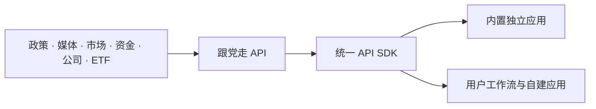

<div align="center">

# 跟党走 Skill

**面向 AI Agent 的 A 股板块政策与市场数据能力**

把政策、权威媒体、市场关注、资金确认，以及板块、公司和 ETF 的可溯源关系，
封装为可以直接查询、组合和二次开发的 Agent Skill。

<br>

[](https://www.python.org/)
[](./LICENSE)
[](https://gendangzou.mobiusquant.ai/)
[](https://docs.mobiusquant.ai/zh/gendangzou/)
[](#支持的-agent-平台)

<br>

[官网](https://gendangzou.mobiusquant.ai/) ·
[快速开始](#快速开始) ·
[API 文档](https://docs.mobiusquant.ai/zh/gendangzou/) ·
[应用开发](./docs/application-development.md) ·
[反馈与建议](#反馈与建议)

</div>

---

> **AI Agent 安装提示**
>
> 当用户要求安装、更新、验证或卸载本 Skill 时，请先完整读取
> [`README_AGENT.md`](./README_AGENT.md)。日常业务调用只读取
> [`SKILL.md`](./SKILL.md) 及其按需引用的应用说明。

---

## 官方社群

欢迎通过 MobiusQuant 官方渠道交流 Skill 使用、API 接入、应用开发和产品建议：

<div align="center">

**微信：MobiusProject**


<sub>添加项目方微信，备注「OpenMobius」申请入群</sub>

<br><br>

[Telegram](https://t.me/+LU3b7IGY6P4xMDU0) ·
[Discord](https://discord.gg/eYR75gBq6Z) ·
[MobiusQuant 官网](https://www.mobiusquant.ai/)

</div>

---

## 支持的 Agent 平台

当前通用 Skill 包支持以下 Agent 平台：

| Agent 平台 | 适配方式 |
|---|---|
| **Claude Code** | 由 Claude Code 按自身的 Skill 或项目扩展机制加载完整目录 |
| **Codex** | 由 Codex 按原生 Skill 机制安装，并通过 `SKILL.md` 按需加载能力 |
| **OpenClaw** | 使用同一通用包，由 OpenClaw 负责本地注册、权限和任务工作区 |
| **Hermes** | 使用同一通用包，由 Hermes 负责安装目录和运行时集成 |
| **WorkBuddy** | 使用同一通用包，由 WorkBuddy 负责注册和会话内能力加载 |

所有平台共享同一份 `SKILL.md`、API SDK、应用目录和
[`README_AGENT.md`](./README_AGENT.md) 安装协议。仓库不探测当前宿主、不维护平台
专属代码分支，也不会修改其他 Agent 的配置；具体安装位置、权限确认和工作区由当前
Agent 按其原生机制处理。

---

## 这个 Skill 做什么

`gendangzou-skill` 是跟党走 A 股板块数据能力的 Agent 封装，也是面向二次建设的
应用开发基座。它区分五分钟发现的实时材料与每日发布的可复现快照，并让每项关键
判断保留来源、日期、稳定 ID 和证据链。

**数据可视化可直接访问官网查看：**
**[https://gendangzou.mobiusquant.ai/](https://gendangzou.mobiusquant.ai/)**

| 能力层 | 提供内容 | 典型用途 |
|---|---|---|
| 实时发现 | 政策、权威媒体和即时市场关注材料 | 追踪新增材料及其板块影响 |
| 稳定研究 | 每日快照、政策热度、市场关注、资金确认、板块异动与历史轨迹 | 回看、比较和复现指定日期的板块状态 |
| 关系审计 | 公司与板块、ETF 与板块的映射及底层依据 | 解释纳入原因、暴露程度和关系变化 |
| 应用编排 | 日报、周报、实时雷达、央视新闻节目解读等独立应用 | 直接生成研究成果或持续监控 |
| 二次开发 | 统一 API SDK、能力契约和应用包规范 | 接入自有工作流、服务和产品 |

> **研究边界**
>
> 结论始终落在板块。公司和 ETF 仅作为映射、暴露或确认依据；政策、媒体、市场
> 关注和资金信号分别解释，不把同期表现写成确定因果，不提供个股或 ETF 推荐、
> 买卖点及收益预测。用户自行拆解、加工或将相关内容用于投资决策的，由此产生的
> 风险与损失由使用者自行承担，本项目不提供任何形式的风险担保或收益保证。

## 快速开始

### 交给 Agent 安装

直接向当前 Agent 提出：

```text
请安装 https://github.com/MobiusQuant/Gendangzou-skill
```

Agent 会使用自身原生的 Skill 安装机制处理目录位置和注册。项目不会探测其他
Agent，也不会要求用户选择宿主类型。

### 安装后直接提问

```text
今天有哪些政策材料形成了板块信号？
分析集成电路板块最近七天的三信号变化。
哪些 ETF 对机器人板块有可溯源暴露？
生成最新的 A 股板块日报。
解读今天的新闻联播并落到相关板块。
```

### 验证安装

在安装后的 Skill 根目录执行：

```bash
python3 scripts/gendangzou.py apps doctor
python3 scripts/gendangzou.py apps list --format agent
python3 scripts/gendangzou.py api bootstrap --force
```

`apps doctor` 应返回 `ok: true`。默认使用匿名 API；只有服务端明确返回
`AUTH_REQUIRED` 时，才需要前往
[Token 申请页面](https://www.mobiusquant.ai/en/apply-token) 注册并配置：

```bash
python3 scripts/gendangzou.py api auth set
```

## 内置应用

每个应用都是独立目录，可以单独安装、更新、禁用或卸载。Agent 只加载与当前请求
匹配的应用说明。

| 应用 | 用途 |
|---|---|
| [实时板块雷达](./apps/realtime-radar/APP.md) | 持续轮询材料实时流，比较滚动窗口内的板块变化 |
| [官网板块日报](./apps/daily-report/APP.md) | 下载指定日期的官网板块日报 PNG |
| [板块周报](./apps/weekly-report/APP.md) | 汇总一周权威政策、三信号、板块异动与联动 |
| [板块异动与关联](./apps/sector-dynamics/APP.md) | 解释板块相对强弱、联动关系和单板块轨迹 |
| [公司板块映射审计](./apps/company-mapping-audit/APP.md) | 核查公司进入板块的事实、传导逻辑和可溯源材料 |
| [ETF 与板块映射](./apps/etf-sector-mapping/APP.md) | 查询境内被动权益 ETF 的板块暴露、证据链和关系变化 |
| [央视新闻节目板块编排](./apps/cctv-news/APP.md) | 解读朝闻天下、新闻 30 分和新闻联播并映射到已有板块 |

## 使用案例

安装后使用自然语言提问，不需要记忆 API 路径或命令。

| 场景 | 示例提问 | Skill 如何处理 |
|---|---|---|
| 实时政策监控 | 查看最近 6 小时新增的政策和权威媒体材料，按板块归并并保留出处 | 查询独立实时流，区分政策、媒体和市场关注，返回来源、日期、链接和关联板块 |
| 板块趋势回看 | 分析机器人板块最近 7 天的政策、关注和资金变化 | 固定历史快照，分别解释三类信号、资金交易日、板块异动和局部关联 |
| 公司映射审计 | 为什么这家公司被纳入具身智能板块？逐条检查映射依据 | 解析公司身份，核查事实、参与方式、传导逻辑、关系分、置信度和底层材料 |
| ETF 暴露查询 | 查询 AI 存储板块关联的境内被动权益 ETF，并说明映射依据 | 根据官方 PCF 篮子和公司板块关系计算暴露，展示篮子日期、调整暴露和证据链 |
| 日报与周报 | 导出指定日期的板块日报，并生成本周政策与板块复盘 | 调用日报应用取得官网图片，或编排快照、政策材料、板块异动和联动生成周报 |
| 央视节目解读 | 分析今天的新闻联播，将产业线索映射到已有板块 | 获取官方节目文本，分段研判，固定板块目录并补充公司、ETF 和可溯源依据 |
| 接入自有应用 | 为我搭建一个关注指定板块的新政策提醒服务 | Agent 查询机器能力契约，通过统一 API SDK 接入用户自己的服务 |
| 开发新应用 | 新增一个按月生成板块政策专题研究的应用 | 按应用规范创建独立应用包，复用鉴权、快照、证据、状态、测试和发布基础设施 |

## 能力架构



运行时保持三层单向依赖：

```text
apps -> api_sdk -> platform_core
  \--------------------^
```

| 层次 | 职责 |
|---|---|
| `platform_core` | 鉴权、本地状态、公告、更新、反馈和应用生命周期 |
| `api_sdk` | 只读 API 传输、在线能力契约和共享工作流 |
| `apps` | 按需加载、相互独立的研究应用 |

## 文档与二次开发

| 文档 | 面向对象 | 内容 |
|---|---|---|
| [跟党走 API 文档](https://docs.mobiusquant.ai/zh/gendangzou/) | 开发者 | 实时数据、板块、公司、ETF 和证据能力 |
| [Agent 文档索引](https://docs.mobiusquant.ai/zh/gendangzou/llms.txt) | AI Agent | 可机器发现的文档入口 |
| [机器能力契约](https://docs.mobiusquant.ai/zh/gendangzou/agent-manifest.json) | AI Agent / 工具 | 在线能力、参数和返回契约 |
| [架构说明](./docs/architecture.md) | 维护者 | 分层、应用包、发布和渐进式加载设计 |
| [应用开发规范](./docs/application-development.md) | 应用开发者 | 新应用的目录、清单、运行、测试和发布要求 |

## 安装说明

### 环境要求

- Python 3.10 或更高版本。
- 可以通过 HTTPS 访问 GitHub 和 `api.mobiusquant.ai`。
- 日报图片导出是可选应用，仅在实际使用时需要 Playwright 和 Chromium。

核心查询使用 Python 标准库，不要求预先安装第三方依赖。

<details>
<summary><strong>查看手动安装与 Git Tag 说明</strong></summary>

<br>

稳定版本使用仓库中严格符合 `vX.Y.Z` 的 Git Tag。安装时先解析 Tag 对应的完整
Commit SHA，再下载该 Commit 的 GitHub 源码归档，或直接克隆指定 Tag：

```bash
git clone --depth 1 \
  --branch vX.Y.Z \
  https://github.com/MobiusQuant/Gendangzou-skill.git \
  gendangzou-skill
```

仓库没有稳定 Tag 时，视为尚未发布稳定版本，不自动使用 `main` 替代。安装内容中的
`VERSION` 必须与 Tag 一致，并保留整个目录结构，不能只复制 `SKILL.md`。详细安装、
更新、验证和失败处理规则见 [`README_AGENT.md`](./README_AGENT.md)。

</details>

## 更新

Skill 每天第一次调用时直接检查 GitHub 仓库的稳定 Tags，并在本地缓存检查日期、
ETag、Tag 和 Commit SHA。该过程不经过跟党走业务 API，也不会自动下载或覆盖文件。
显式检查：

```bash
python3 scripts/gendangzou.py update check --force
```

只有用户明确同意后，Agent 才能按 Commit SHA 下载源码归档，并使用自身原生机制
更新。仓库没有稳定 Tag、GitHub 暂时不可用或查询受限时，不影响现有功能。

## 反馈与建议

功能建议、信源补充、数据缺失、板块分类、公司或 ETF 映射、文档、性能及其他使用
问题，都可以通过以下渠道反馈：

| 渠道 | 适合内容 |
|---|---|
| [提交 GitHub Issue](https://github.com/MobiusQuant/OpenMobius-skill/issues/new) | 可公开、需要持续跟踪的问题和建议 |
| [官网“反馈与建议”](https://gendangzou.mobiusquant.ai/) | 在官网直接提交功能、数据或使用问题 |
| [官方社群](#官方社群) | 使用交流、问题咨询和补充说明 |

提交时请尽量附上问题日期、相关板块或信源、页面或功能名称、预期结果和可公开的复现
信息。请勿提交 Token、Cookie、个人资料或其他敏感信息。

## 源码开发

以下命令仅用于 GitHub 源码仓库，不属于安装后的运行验证：

```bash
python3 tools/validate_skill.py
python3 tools/run_tests.py
python3 tools/build_release.py --output-dir dist
```

---

<div align="center">
  <sub>公开资料与历史统计观察，不构成证券投资咨询、买卖建议或收益预测。</sub>
</div>
