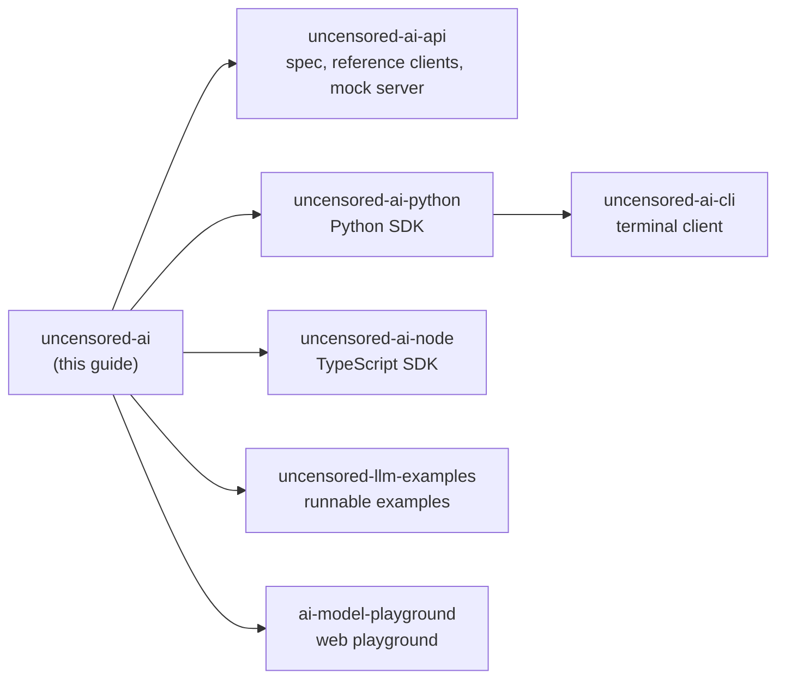

# uncensored-ai

[](https://github.com/Moloch-AI/uncensored-ai/actions/workflows/ci.yml)
[](LICENSE)

A developer's reference for uncensored (less-restricted) language models: what they are, how they get that way, how to run or call them, and how to build and debug applications on them.

## Overview

"Uncensored" is what people search for; "refusal-reduced" is what it means. This guide explains the concepts without the marketing, compares running open-weight models yourself with calling a hosted OpenAI-compatible API, and gives working setup, code and troubleshooting for both. It is written for developers who want to understand the trade-offs before they build, and to find the cause when something breaks.

It is maintained by MolochAI, which runs a hosted API for five refusal-reduced open-weight models, so the API-specific parts describe that API. Product details live at [molochai.dev](https://molochai.dev/?utm_source=github&utm_medium=oss&utm_campaign=uncensored-ai); code lives in the sibling repositories. Everything here that is not MolochAI-specific (the concepts, self-hosting, the comparison tool) applies to any OpenAI-compatible endpoint.



| Guide | What it covers |
| --- | --- |
| [Concepts](docs/concepts.md) | Where refusals come from, abliteration, fine-tuning, prompting, and what reducing refusals does not change |
| [Deployment options](docs/deployment-options.md) | Self-hosted runtimes and a hosted API side by side: memory, operations, data control, cost, tool calling |
| [Models](docs/models.md) | The five MolochAI models, their base model cards, choosing one, testing one on your own prompts |
| [Setup](docs/setup.md) | Account and key, first requests, the SDKs, and Open WebUI, SillyTavern, LibreChat and coding agents |
| [Building applications](docs/building-applications.md) | System prompts, moderation, streaming, reasoning, tools, JSON without a JSON mode, context limits, retries, and what LangChain, LiteLLM and the Vercel AI SDK change |
| [Troubleshooting](docs/troubleshooting.md) | Symptom, cause and fix, and every HTTP status |
| [FAQ](docs/faq.md) | Short answers with links |
| [Responsible use](docs/responsible-use.md) | The Acceptable Use Policy, legitimate uses, and what apps for other people need |
| [Glossary](docs/glossary.md) | Terms used across the guide |

## What "uncensored" means, and what it does not

An uncensored or less-restricted model is a language model whose learned habit of declining requests has been reduced. Chat models learn to refuse during instruction and preference training, and that habit over-generalizes: models decline harmless requests because they resemble harmful ones ([XSTest](https://arxiv.org/abs/2308.01263) measures this). A refusal-reduced model declines less often.

It does **not** mean:

- **that it never declines.** Reduced is not removed.
- **that it is more accurate.** It changes what a model attempts, not what it knows. The abliteration paper found general benchmarks close to the originals and a consistent drop on TruthfulQA.
- **that anything is allowed.** The law still applies, and on MolochAI the [Acceptable Use Policy](https://molochai.dev/acceptable-use?utm_source=github&utm_medium=oss&utm_campaign=uncensored-ai) applies to every request.
- **that your application is safe for the public.** Apps that face end users need their own rules and moderation, because the model will not reliably provide them.

## How models get there

| Method | What it does | Lasts | Cost |
| --- | --- | --- | --- |
| Abliteration (refusal-direction ablation) | Finds the direction in a model's activations that mediates refusal ([Arditi et al., 2024](https://arxiv.org/abs/2406.11717)) and removes it from the weights | Permanent | Small on most benchmarks in the paper, with a consistent TruthfulQA drop |
| Fine-tuning | Further training on conversations where the assistant answers | Permanent | Data and compute; style and knowledge can shift |
| Prompting and jailbreaks | Instructions or tricks per request | One request, until patched | Unreliable; output drifts toward the persona |

Every refusal-reduced model is a modified open-weight model, not published or endorsed by the base model's developer. Details in [concepts](docs/concepts.md).

## Deployment approaches

| | Self-hosted (llama.cpp, Ollama, LM Studio, vLLM) | Hosted OpenAI-compatible API (MolochAI) |
| --- | --- | --- |
| Hardware | Memory for weights plus KV cache: roughly 35 GB at 4-bit for a 70B model, before context | None |
| Operations | Yours: install, update, monitor, be on call | None; handle the API's errors and limits |
| Data control | Prompts stay on your hardware | Prompts pass through the gateway and inference servers; see the [Privacy Policy](https://molochai.dev/privacy?utm_source=github&utm_medium=oss&utm_campaign=uncensored-ai) |
| Cost model | Hardware or rental, paid busy or idle | Prepaid credit per request, or a plan with a token quota ([pricing](https://molochai.dev/pricing?utm_source=github&utm_medium=oss&utm_campaign=uncensored-ai)) |
| Model choice | Any build you can find and fit | Five served ids; no version pinning |
| Configuration | Everything: sampling, reasoning, context, quantization | Reasoning fixed per model, output capped per plan, some parameters ignored |
| Tool calling | Depends on the model's chat template and your runtime's parser | Passed through; plain-text tool calls repaired by the gateway; quality varies by server |
| Beyond chat | Embeddings, completions, constrained output, depending on the runtime | Chat completions and the model list only |

Both speak the Chat Completions format, so the choice can change later without rewriting your client. Full comparison, memory table and cost checklist: [deployment options](docs/deployment-options.md).

## The MolochAI models

> Catalog as published at [molochai.dev/models](https://molochai.dev/models?utm_source=github&utm_medium=oss&utm_campaign=uncensored-ai), checked on 2026-11-07; base-model facts read from each card on 2026-11-13. In code, get the list from `GET /models`, never from this table.

| API id | Base model (developer, license) | Reasoning (set by the gateway) | Input, per card | Context, per card |
| --- | --- | --- | --- | --- |
| `glm-5.3-flash` | [GLM-5.3-Flash](https://huggingface.co/zai-org/GLM-5.3-Flash) (Z.ai, MIT) | On, high effort | Text, images | Not stated |
| `glm-4.7-flash-uncensored` | [GLM-4.7-Flash](https://huggingface.co/zai-org/GLM-4.7-Flash) (Z.ai, MIT) | On, medium | Text | Not stated |
| `gemma4-26b-a4b-qat` | [Gemma 4 26B A4B](https://huggingface.co/google/gemma-4-26B-A4B-it) (Google DeepMind, Apache 2.0) | On, medium | Text, images | 256K |
| `qwen3.8-27b-uncensored` | [Qwen3.8-27B](https://huggingface.co/Qwen/Qwen3.8-27B) (Qwen Team, Apache 2.0) | On, medium | Text, images, video (not documented through this API) | 262,144 |
| `llama-3.3-70b-instruct-abliterated` | [Llama-3.3-70B-Instruct](https://huggingface.co/meta-llama/Llama-3.3-70B-Instruct) (Meta, Llama 3.3 Community License) | Off | Text | 128K |

All five are refusal-reduced builds that the base developers do not publish or endorse; facts on the cards describe the base models. Your actual context window is set by your plan (65,536 to 200,704 tokens; 401,408 on Enterprise+) or the serving server, whichever is lower, and replies are capped at 9,000 tokens (30,000 on Enterprise+). There are no benchmark scores or rankings here. [Models](docs/models.md) has the card facts, per-model notes and how to choose.

## Quickstart (5 minutes)

### Requirements

- A MolochAI account with credit or a plan, and an API key from [Account → API keys](https://dash.molochai.dev/account?utm_source=github&utm_medium=oss&utm_campaign=uncensored-ai). Or, with no account, the [mock server](docs/setup.md#developing-offline-against-the-mock-server).
- `curl`; Python 3.10+ with `pip install openai`; or Node 20+ with `npm install openai`.

```bash
export MOLOCHAI_API_KEY=your-api-key
export MOLOCHAI_BASE_URL=https://api.molochai.dev/api/v1
```

### curl

```bash
curl -N "$MOLOCHAI_BASE_URL/chat/completions" \
  -H "Authorization: Bearer $MOLOCHAI_API_KEY" \
  -H "Content-Type: application/json" \
  -d '{"model": "glm-5.3-flash", "stream": true, "messages": [{"role": "user", "content": "Explain SSE in two sentences."}]}'
```

### Python (official `openai` package)

```python
import os

from openai import OpenAI

client = OpenAI(
    base_url=os.environ.get("MOLOCHAI_BASE_URL", "https://api.molochai.dev/api/v1"),
    api_key=os.environ["MOLOCHAI_API_KEY"],
)

stream = client.chat.completions.create(
    model="glm-5.3-flash",
    messages=[{"role": "user", "content": "Explain SSE in two sentences."}],
    stream=True,
)
for chunk in stream:
    if chunk.choices and chunk.choices[0].delta.content:  # the last chunk has usage, no choices
        print(chunk.choices[0].delta.content, end="", flush=True)
print()
```

### JavaScript (official `openai` package, as an ES module)

```javascript
import OpenAI from "openai";

const client = new OpenAI({
  baseURL: process.env.MOLOCHAI_BASE_URL ?? "https://api.molochai.dev/api/v1",
  apiKey: process.env.MOLOCHAI_API_KEY,
});

const stream = await client.chat.completions.create({
  model: "glm-5.3-flash",
  messages: [{ role: "user", content: "Explain SSE in two sentences." }],
  stream: true,
});
for await (const chunk of stream) {
  process.stdout.write(chunk.choices[0]?.delta?.content ?? "");
}
```

Streaming is the default to reach for: Cloudflare in front of the API gives up on a non-streamed response after about 100 seconds. Next: [setup](docs/setup.md) for non-streamed requests, tools such as Open WebUI and SillyTavern, and the SDKs; [building applications](docs/building-applications.md) for everything after the first request.

### MolochAI SDKs

The OpenAI SDKs work and are a fine choice. The [Python](https://github.com/Moloch-AI/uncensored-ai-python) and [TypeScript](https://github.com/Moloch-AI/uncensored-ai-node) SDKs add typed errors for the API's three error shapes (with `resets_at`, `context_cap`, `bound_by`), queue progress from stream comments, `/auth/me` for per-model context limits, and handling of in-stream errors and the cap notice. Registry packages are not published yet; install from GitHub:

```bash
pip install "git+https://github.com/Moloch-AI/uncensored-ai-python@v0.1.2"
npm install github:Moloch-AI/uncensored-ai-node#v0.1.1
pipx install "git+https://github.com/Moloch-AI/uncensored-ai-cli@v0.1.0"
```

## Comparing models on your own prompts

[`tools/compare_models.py`](tools/README.md) sends each prompt in a text or JSONL file to several models on any OpenAI-compatible endpoint and writes a Markdown or CSV table: model, finish reason, latency, time to first output, tokens and an answer excerpt. It is standard-library Python 3.10+, streams every request, paces itself under 60 requests a minute, and handles the API's error shapes and rate limits.

```bash
python tools/compare_models.py --list-models
python tools/compare_models.py tools/prompts.example.txt --output results.md
python tools/compare_models.py tools/prompts.example.jsonl -m glm-5.3-flash,llama-3.3-70b-instruct-abliterated -o results.csv
```

## Configuration

| Variable | Required | Default | Used by |
| --- | --- | --- | --- |
| `MOLOCHAI_API_KEY` | Yes | | The examples, the SDKs and CLI, `compare_models.py`. Use `mock-key` with the mock server. |
| `MOLOCHAI_BASE_URL` | No | `https://api.molochai.dev/api/v1` | The same. `http://127.0.0.1:4010/api/v1` for the mock server, or a local runtime's base. |
| `MOLOCHAI_MOCK_BASE_URL` | No | | Enables this repository's integration tests against the mock server. |
| `OPENAI_BASE_URL`, `OPENAI_API_KEY` | No | | Read by the official OpenAI SDKs, so existing code can switch with configuration plus a model id. |

[`.env.example`](.env.example) lists them.

## Troubleshooting

The most common problems, from [troubleshooting](docs/troubleshooting.md):

| Symptom | Cause | Fix |
| --- | --- | --- |
| `401` | Key missing, mistyped or revoked | Check the `Authorization: Bearer` header; create a new key |
| `402 no_active_plan`, even on `GET /models` | No plan and no credit | Add credit or buy a plan; a new key does not help |
| `422` invalid model | An id the API does not serve, often an OpenAI name or a tool's default | Use an id from `GET /models` |
| `503 model_unavailable` | No server is serving that model now; nothing was rerouted | Retry later or choose another model |
| `413 context_length_exceeded` | Prompt over your window (`bound_by` says plan or server) | Trim or summarize history; set tools about 10% under the limit |
| `429 Too Many Attempts.` | Over 60 requests a minute | Wait `Retry-After`; pace below the limit |
| `429 quota_exceeded` / `session_quota_exceeded` | Quota or 5-hour session cap used | Wait for `resets_at`; never auto-retry |
| `524` HTML page | Non-streamed reply ran past the edge timeout | Stream |
| `max_tokens`, `stop`, `seed` or `response_format` ignored | Dropped without an error | Ask in the prompt, trim in code, validate JSON yourself |
| `<think>` block in `content` | Non-streamed reply from a server that leaves reasoning inline | Stream, or strip it |

## FAQ

Short versions; the [FAQ](docs/faq.md) has the rest.

- **Is an uncensored model smarter?** No. It declines less; it does not know more, and it can hedge less.
- **Will it answer anything?** No. It still declines sometimes, and the Acceptable Use Policy applies regardless.
- **Do the OpenAI SDKs work?** Yes, with the base URL changed. There is no JSON mode, some parameters are ignored and the output cap is per plan.
- **Can I pin a version or set a seed?** No. Keep your own tests for behavior you depend on.
- **Can I run these models myself?** The base models, yes; refusal-reduced builds are published by third parties. MolochAI's exact builds are not published.
- **Is there a free tier?** No. Use the mock server for development; the smallest credit top-up covers every model.

## Responsible use

Refusal-reduced models are used for legitimate work that mainstream assistants obstruct: fiction with dark themes, character apps for adults, trust-and-safety labeling and red-teaming of your own systems, authorized security research, and reading sensitive documents without silent sanitizing. Reduced refusal behavior does not widen what is allowed: the [Acceptable Use Policy](https://molochai.dev/acceptable-use?utm_source=github&utm_medium=oss&utm_campaign=uncensored-ai) applies to every request, including everything your users send through your account. If other people use your application, write your rules into the system message, check input and output, add age assurance where your product has adult content, and give users a way to report output. [Responsible use](docs/responsible-use.md) has the details and a checklist.

## Security considerations

- API keys are not scoped: a key can read account details and create invoices. Keep keys on a server, never in a browser or mobile app, and use one key per application so you can revoke one alone.
- Keep credentials and secrets out of prompts, tool arguments and file paths. The [Privacy Policy](https://molochai.dev/privacy?utm_source=github&utm_medium=oss&utm_campaign=uncensored-ai) says what the API records.
- The tools you give a model are your security boundary. Validate tool arguments and require a person's approval for anything destructive.
- `compare_models.py` reads the key from the environment and sends it only to the base URL you configure.
- Report vulnerabilities in this repository as described in [SECURITY.md](SECURITY.md). Problems with the hosted API go to [molochai.dev/contact](https://molochai.dev/contact?utm_source=github&utm_medium=oss&utm_campaign=uncensored-ai). Never post API keys in issues.

## Repositories

| Repository | What it is |
| --- | --- |
| [uncensored-ai](https://github.com/Moloch-AI/uncensored-ai) | This reference guide |
| [uncensored-ai-api](https://github.com/Moloch-AI/uncensored-ai-api) | The HTTP contract: OpenAPI spec, curl examples, dependency-free reference clients, and the mock server |
| [uncensored-ai-python](https://github.com/Moloch-AI/uncensored-ai-python) | Typed Python SDK, sync and async |
| [uncensored-ai-node](https://github.com/Moloch-AI/uncensored-ai-node) | TypeScript SDK for Node, ESM, no runtime dependencies |
| [uncensored-ai-cli](https://github.com/Moloch-AI/uncensored-ai-cli) | Terminal chat client built on the Python SDK |
| [uncensored-llm-examples](https://github.com/Moloch-AI/uncensored-llm-examples) | Task-oriented runnable examples in Python, JavaScript and TypeScript |
| [ai-model-playground](https://github.com/Moloch-AI/ai-model-playground) | Web playground with a small proxy that keeps the key server-side |

MolochAI: [website](https://molochai.dev/?utm_source=github&utm_medium=oss&utm_campaign=uncensored-ai), [API docs](https://molochai.dev/docs?utm_source=github&utm_medium=oss&utm_campaign=uncensored-ai), [dashboard](https://dash.molochai.dev/?utm_source=github&utm_medium=oss&utm_campaign=uncensored-ai), [support](https://molochai.dev/contact?utm_source=github&utm_medium=oss&utm_campaign=uncensored-ai).

## Contributing

Corrections are welcome, especially with a source. Every model fact needs a link to the model's own card, and every general claim a link to its source. See [CONTRIBUTING.md](CONTRIBUTING.md) for the sourcing rule and the commands CI runs.

## License

[MIT](LICENSE), for the code and for the documentation text alike, so you can copy snippets and passages into your own projects and docs with the copyright notice.
