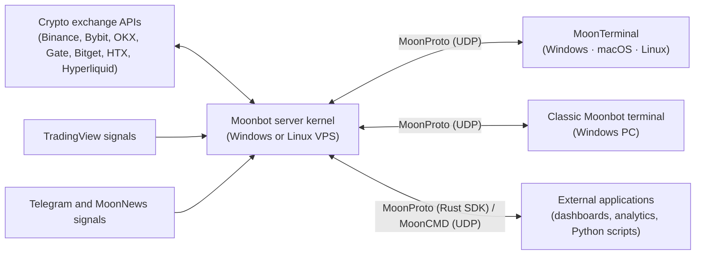

<p align="center">
  <a href="https://moonbot.pro">
    
  </a>
</p>

<h2 align="center">Professional terminal for cryptocurrency scalping and algorithmic trading</h2>

<p align="center">
  Tick chart &middot; Graphical order book &middot; 20+ trading strategies &middot; 480+ configuration parameters &middot; Open Rust SDK (<a href="https://github.com/Moonbot-Tech/MoonProto">MoonProto</a>)
</p>

<p align="center">
  <a href="https://moonbot.pro"></a>
  <a href="https://github.com/Moonbot-Tech/MoonTerminal"></a>
  <a href="https://moonbot.pro/news/releases"></a>
  <a href="https://moonbot.pro/moonbot-pro"></a>
  <a href="https://t.me/MoonBotNews"></a>
  <a href="LICENSE"></a>
</p>

<p align="center">
  <a href="https://moonbot.pro">moonbot.pro</a> &middot;
  <a href="https://moonbot.pro/documentation">Documentation</a> &middot;
  <a href="https://moonbot.pro/education">MoonAcademy</a> &middot;
  <a href="https://stat.moonbot.pro">Trading statistics</a>
</p>

<p align="center">
  <a href="https://moonbot.pro">
    
  </a>
</p>

**Moonbot** is a crypto scalper's workstation and an automated trading platform, developed since 2017 together with a community of practicing traders. The terminal combines fast manual trading from the chart with full algorithmic strategies in one interface.

Unlike classic bots that run on lagging candle indicators, Moonbot analyzes the live trade feed and the order book in real time: it tracks every trade on the tick chart, sees large order clusters and walls in the order book, finds abnormal volume surges and instantly acts on sharp price spikes.

The terminal connects directly via API to **Binance, Bybit, OKX, Gate.io, Bitget, HTX and the Hyperliquid DEX** (spot, futures, tokenized assets and prediction markets). All API keys, strategies and trading history are stored locally on your computer or dedicated VPS server, with no third-party cloud intermediaries.

---

## Where to start

| Your goal | Where to go |
| :--- | :--- |
| **Learn the interface and try the terminal in action** | [Download Moonbot](https://moonbot.pro) &rarr; go through [Getting Started](https://moonbot.pro/begin) &rarr; turn on **Emulation mode**, where trades are simulated on the real market feed without sending orders to the exchange |
| **Understand the logic of scalping, detects and autotrading** | Go to [Trading algorithms and terminal mechanics (`concepts/`)](#part-1-trading-algorithms-and-terminal-mechanics-concepts) — from reading the order book and selecting coins to configuring strategies and controlling risk |
| **Study ready-made strategy configurations** | Open the [Strategy examples (`examples/strategies/`)](#part-2-ready-made-strategy-templates-examplesstrategies) library with configurations for manual, semi-automatic and automatic trading |
| **Use the parameter reference or connect an AI** | Use the [Technical reference (`reference/`)](#part-3-technical-reference-of-parameters-and-protocols-reference) and the ready-made context for configuring strategies with AI assistants |
| **Configure the kernel or build settings controls with MoonProto** | Open the [settings reference](reference/settings/README.md) for trading effects, units, dependencies and the correct API for each setting |
| **Install a Linux kernel on a VPS** | [Download and installation guide](reference/linux-installation.md): Windows wizard, MoonTerminal and manual SSH setup |

---

## Moonbot in numbers

| Volume and practice | Speed and flexibility | Markets and history |
| :--- | :--- | :--- |
| **`$165,000,000,000+`**<br><sub>total user trading volume since 2019 (~$20 billion per year)</sub> | **`Native code`**<br><sub>an execution core with no garbage collector or virtual machines: response to a signal or a click without runtime pauses; trade speed is set by the ping to the exchange (<a href="concepts/07-kernel-vps-and-infrastructure.md">chapter 07</a>)</sub> | **`Since 2017`**<br><sub>continuous development and weekly terminal updates</sub> |
| **`205,000,000+`**<br><sub>filled orders (an average of `70,000+` per day since 2019)</sub> | **`23 strategy types · 480+ parameters`**<br><sub>flexible filters, formulas and strategy links via triggers</sub> | **`7 crypto exchanges`**<br><sub>Binance, Bybit, OKX, Gate, Bitget, HTX, Hyperliquid</sub> |

## User results by month

<!-- STATS:START -->
### October 2026 (October 1–31)

| Value | Metric |
| :--- | :--- |
| **$1 019 796 952** | trading volume in USDT equivalent |
| **1 561 931** | filled orders on 234 active markets |
| **+$707 716** | total net result of rating participants over 31 days |
| **23 / 8** | positive days / negative days |
| **+$152 884** | best day, October 16 |
| **−$50 528** | worst day, October 27 |

<p align="center">
  
</p>

<sub>Daily net result of public statistics participants, $, October 1–31, 2026. Source: <a href="https://stat.moonbot.pro/">stat.moonbot.pro</a> (voluntary anonymized telemetry from terminals with statistics sending enabled). Full daily table: <a href="stats/2026-10.md"><code>stats/2026-10.md</code></a>.</sub>

<details>
<summary><b>Volume and trades over the last 6 completed months (total since March 2019: $165.1 billion+ · 205.6 million+ orders)</b></summary>

| Month | Trading volume, $ | Filled orders |
| :--- | ---: | ---: |
| October 2026 | $1 019 796 952 | 1 561 931 |
| September 2026 | $1 378 946 958 | 1 803 380 |
| August 2026 | $1 418 669 807 | 1 589 519 |
| July 2026 | $870 851 340 | 1 733 426 |
| June 2026 | $1 390 033 760 | 1 775 917 |
| May 2026 | $1 013 695 489 | 1 678 354 |

<sub>Full archive since March 2019: <a href="stats/README.md"><code>stats/README.md</code></a> and <a href="https://stat.moonbot.pro/">stat.moonbot.pro</a>.</sub>
</details>
<!-- STATS:END -->

### Live trades in Telegram

Traders share closed trades in the public channel [`t.me/MoonBot_Profit`](https://t.me/MoonBot_Profit) with one button right from the terminal (`Ctrl+F10`): the tick chart screenshot shows the structure of the price move, the entry points, the order re-placements and the take-profit close.

<!-- LIVE_TRADE:START -->
<p align="center">
  <a href="https://t.me/s/MoonBot_Profit">
    
  </a>
</p>

> **[@MoonBot_Profit](https://t.me/s/MoonBot_Profit)** — a stream of real trades by Moonbot users on the spot and futures markets of Binance, Bybit, OKX, Gate, Bitget, HTX and Hyperliquid.
<!-- LIVE_TRADE:END -->

---

## Documentation structure

The knowledge base in this repository is split into two complementary parts:
1. **Conceptual description of the trading algorithms and terminal mechanics (`concepts/` and `examples/`)** — explains the ideas behind the scalping tools, market activity detects, the coin filtering system and the automated trading strategies.
2. **Technical reference of parameters, formulas and protocols (`reference/`)** — contains exact specifications of all settings, calculation rules and the order in which modules interact. This layer is the precise foundation for experienced traders and for AI assistants when building and checking strategies.

### Part 1. Trading algorithms and terminal mechanics (`concepts/`)

| Chapter | What this chapter covers |
| :--- | :--- |
| [**`01. Coin selection and market filtering`**](concepts/01-market-selection-and-filters.md) | How to find active coins for scalping and cut off dangerous or illiquid markets: analysis of volatility (price deltas) and trading volumes, accounting for Bitcoin movement and the overall market context, protection against price anomalies and filter diagnostics on the chart |
| [**`02. Market activity detects and external signals`**](concepts/02-detect-pipeline-and-signals.md) | How the terminal scans hundreds of trading pairs in real time and finds entry points: detects of volume surges, upward and downward impulses, buy/sell imbalance, spread widening and market-maker activity, plus receiving signals from TradingView and Telegram |
| [**`03. Spike hunting and impulse moves`**](concepts/03-spike-hunting-mechanics.md) | How the key fast-scalping strategies work: pre-placed limit trap orders in `MoonShot`, entry on the pullback after a sharp spike in `MoonHook`, semi-automatic manual hooks for trading from the order book, and the instant breakout algorithm `MoonStrike` |
| [**`04. Strategy links via triggers and session management`**](concepts/04-triggers-and-master-slave.md) | How to combine separate strategies into a complete trading system (`Master → Slave`): launching live strategies on a detect signal, automatically stopping trading during a market sell-off, tracking the accumulated result per coin (`Session`) and changing the order size dynamically |
| [**`05. CustomEMA formulas and cross-exchange arbitrage`**](concepts/05-ema-geometry-and-formulas.md) | How to build your own entry and exit conditions from chart geometry: comparing average prices over seconds, minutes and hours, finding breakouts of local highs and lows, estimating volume acceleration and comparing the coin's price on other exchanges and venues (Binance, Bybit, OKX, Gate, Bitget, HTX, Hyperliquid, UpBit — spot and futures) |
| [**`06. Orders, averaging grids, take-profits and stop losses`**](concepts/06-orders-exits-and-stops-cascade.md) | The full position management cycle and risk management: virtual pending orders, order grids (`MultiOrders`), take-profit tracking (`SellLevel` relative to a recent high, dynamic `SellShot`, `SellSpread`), a cascade of three stop losses, moving to breakeven and the trailing stop |
| [**`07. Server-side Moon Kernel, VPS and working with exchanges`**](concepts/07-kernel-vps-and-infrastructure.md) | Setting up round-the-clock trading with minimal ping to the exchange: splitting into the server kernel (`Moon Kernel`) on a VPS and the client interface on a PC, accelerated chart delivery with `Moon Streamer` for manual trading, the control bot and staying within API limits on different exchanges |
| [**`08. Testing and debugging strategies: Filters on charts, the Pencil, Emulator, BackTest and reports`**](concepts/08-testing-debugging-and-analytics.md) | How to test and refine strategies: checking in Emulation mode on the live market, modeling price movement with the Pencil (draw only in the global Emulation mode, otherwise live strategies will respond to the drawing with real orders), running on historical tick data in `BackTest` and analyzing execution delays from the logs |

### Part 2. Ready-made strategy templates (`examples/strategies/`)

A collection of working configurations in the standard Moonbot import format (`##Begin_Strategy ... ##End_Strategy`). A block is pasted into the strategies window with `Ctrl+V`; blocks with several strategies start with the line `##MultiSelection` so that the terminal pastes all of them. Each example comes with a breakdown of the trading idea, the key parameters and a “Checking the result” block:

| Strategy template | Trading task and how it works | What you need to run it |
| :--- | :--- | :--- |
| [**`01. Filter diagnostics and trade statistics collection`**](examples/strategies/01-ema-rulers-and-data-collector.md) | Visual check of `CustomEMA` levels right on the chart and automatic recording of market metrics to the report at the moment of each trade | PRO and the Autotrading module (or the terminal's global Emulation mode) |
| [**`02. Tiered MoonShot strategy pack`**](examples/strategies/02-moonshot-tiered-pack.md) | Two tiers of limit trap orders (an order `1.7%` and `3.8%` below the price) with the order automatically moved deeper as volatility rises | Free; the statistics collector and sessions require the Autotrading module |
| [**`03. Automatic MoonHook and semi-automatic trading`**](examples/strategies/03-moonhook-and-manual-combo.md) | Catching the pullback after a vertical spike, and a hybrid mode: the trader clicks in the order book and the algorithm keeps the order in a dynamic corridor | PRO and MoonBonus |
| [**`04. Master → Slave links: scouting, cascade and adding to the position`**](examples/strategies/04-master-slave-scout-and-ladders.md) | An emulator “scout” launches a real order only on an active coin, saving exchange API limits, plus a scheme for building a position in stages | PRO and the Autotrading module |
| [**`05. Protection against Bitcoin sell-offs and delistings`**](examples/strategies/05-btc-dump-shield-and-delist-guard.md) | Protection that cancels buy orders and pauses long strategies on a sharp BTC drop, closes positions on a strong drop and blocks a coin on delisting news (a safety net on top of the filters) | PRO and the Autotrading module |
| [**`06. Bounce from the global low and monitoring large players`**](examples/strategies/06-deep-bounce-and-hl-watcher.md) | Finding the reversal point after a deep drop in an asset, and tracking the trades of large wallets on the Hyperliquid blockchain (`Watcher`) | 06A — PRO and the Autotrading module; 06B — Hyperliquid, PRO or MoonBonus (the trigger key requires the module) |

> Links via trigger keys, `CustomEMA` / `SellByCustomEMA` formulas, strategy sessions and MoonShot repeat entries are checked by the terminal only with the [Autotrading](https://moonbot.pro/moonbot-pro/modules/autotrading) module or in the global Emulator mode. Without it, the slave strategy does not wait for the master's signal and can enter without this restriction, and a filter formula does not restrict entry. The `Free` edition places real orders (up to 30 active), it is not an emulator; it runs `TopMarket`, `PumpsDetection`, `MoonShot`, `Delta`, `Manual`, `Alerts`, and `Watcher` on Hyperliquid with MoonBonus active.

### Part 3. Technical reference of parameters and protocols (`reference/`)

| Reference section | Contents |
| :--- | :--- |
| [**Install the Linux kernel**](reference/linux-installation.md) | Full release download, VPS requirements, installation wizards, manual setup and connection checks |
| [**Linux kernel commands**](reference/linux-kernel-commands.md) | Monitor a trading VPS, read logs, start/stop the service, configure MoonProto and update the kernel over SSH |
| [**Kernel settings and MoonProto integration**](reference/settings/README.md) | Order sizing, leverage, loss stops, charts and service settings: meanings, units, dependencies and editing APIs; [539-field index](reference/settings/index.tsv) |
| [**`strategy-selection-guide.md`**](reference/strategy-selection-guide.md) | **Choosing an algorithm for a trading task:** the table “Trading task &rarr; Which `SignalType` to choose &rarr; Meaning · Parameters · Template” and an overview of all 23 strategy types |
| [**`parameters-by-lifecycle.md`**](reference/parameters-by-lifecycle.md) and [**`params/01..08.md`**](reference/params/) | The complete reference of 484 strategy parameters, split into 8 compact thematic sections by terminal tab and trade stage (with a [quick index `params/index.tsv`](reference/params/index.tsv)) |
| [**`AI_GUIDE.md`**](reference/AI_GUIDE.md) | **Guide to generating and checking strategies:** base default parameter values, mandatory config formatting rules and a pre-launch checklist |
| [**`filter-execution-order.md`**](reference/filter-execution-order.md) | The order in which market, volume, delta and session filters are checked during coin selection and before placing an order |
| [**`silent-killers-and-traps.md`**](reference/silent-killers-and-traps.md) | Common configuration mistakes that stop a strategy from placing orders or make it behave unexpectedly, and how to fix them quickly |
| [**`exchange-errors-and-logs.md`**](reference/exchange-errors-and-logs.md) | Decoding `logs/LOG_YYYY-MM-DD.log` log entries, exchange API error codes and the terminal's built-in diagnostic warnings |
| [**`mooncmd-udp-protocol.md`**](reference/mooncmd-udp-protocol.md) | Specification of the `MoonCMD` remote control protocol (UDP) and a [ready-made Python client](examples/integrations/mooncmd-python-client/) for automation and telemetry collection |

---

## Building your own tools on top of the Moonbot kernel

[**MoonProto**](https://github.com/Moonbot-Tech/MoonProto) is an open client SDK in Rust (`Apache-2.0`) for connecting external applications to a running Moonbot kernel. The kernel on the server handles the exchange connections, order management, strategy execution and risk control, while `MoonProto` synchronizes market data and commands with your application over a fast UDP bus.

| What `MoonProto` provides | What you can build with it |
| :--- | :--- |
| A secure UDP connection, authorization and automatic reconnection | Your own specialized trader interface or a compact control panel |
| A real-time data stream: quotes, tick trades, order books, candles, balances, orders and strategies | A single dashboard for monitoring several VPS servers, an activity screener or a risk control system |
| Control commands: placing, moving and cancelling orders, changing strategy parameters on the fly | Telegram control bots, gateways for external trading signals and analytics systems |

```bash
git clone https://github.com/Moonbot-Tech/MoonProto.git
cd MoonProto

# Get the list of active markets from a running Moonbot kernel
cargo run --example list_markets -- "<MOONBOT_KEY>" 127.0.0.1:3500

# Subscribe to the best Bid/Ask and the order book spread for the selected coin
cargo run --example order_book_top -- "<MOONBOT_KEY>" 127.0.0.1:3500 BTCUSDT

# Receive the real-time tick trade stream
cargo run --example trades_stream -- "<MOONBOT_KEY>" 127.0.0.1:3500 BTCUSDT
```

To build a settings panel, use the [kernel settings reference](reference/settings/README.md) for field meanings and dependencies, and [choosing the settings API](reference/settings/10-settings-apis.md) for reading, saving and checking the result.

### MoonTerminal: a cross-platform interface built on MoonProto

[**MoonTerminal**](https://github.com/Moonbot-Tech/MoonTerminal) is a new graphical terminal (in active development) written in Rust (`GPUI`) on top of the `MoonProto` protocol. It builds natively for **Windows, macOS and Linux**, renders tick charts and order books on the GPU (`DirectX 11`, `Metal`, `wgpu`) and lets you manage **several remote Moonbot kernels from one window**. The classic, production-ready **Moonbot** terminal runs on **Windows** (and on **Linux via Wine**).

<p align="center">
  <a href="https://github.com/Moonbot-Tech/MoonTerminal">
    
  </a>
</p>

## How the Moonbot ecosystem is organized



---

## Speed engineering

The Moonbot server kernel for Linux is built with our open [MoonCompiler](https://github.com/Moonbot-Tech/MoonCompiler). [Three applied comparisons](engineering/README.md): processing almost a million trades, a large exchange instrument list and calculating a buy from the order book. Results on Intel and AMD, example sources and materials for verification.

---

## Configuring and analyzing strategies with AI

You can connect this knowledge base to your AI assistant (ChatGPT, Claude, Gemini, Cursor) to quickly build strategies for your trading idea, turn filtering rules into `CustomEMA` formulas and find out why a strategy did not enter a trade. For targeted navigation, the repository root contains the index file [**`llms.txt`**](llms.txt):

```text
You are an expert in configuring the Moonbot trading terminal (v7.71, FVersion=12). Before answering or building a strategy, read the documentation map and go only to the thematic sections you need:
1. https://raw.githubusercontent.com/Moonbot-Tech/MoonDoc/main/llms.txt — the knowledge base map (choosing a strategy type, parameter reference by tab, ready-made templates)
2. https://raw.githubusercontent.com/Moonbot-Tech/MoonDoc/main/reference/AI_GUIDE.md — mandatory rules for forming the ##Begin_Strategy ... ##End_Strategy block and the default values
3. https://raw.githubusercontent.com/Moonbot-Tech/MoonDoc/main/reference/strategy-selection-guide.md — choosing a strategy type for a trading task

My task: [describe your trading idea, attach the strategy text or a question]
```

---

## Moonbot open-source repositories

| Repository | Purpose | Language and license |
| :--- | :--- | :--- |
| [**Moonbot-Tech/MoonTerminal**](https://github.com/Moonbot-Tech/MoonTerminal) | Native cross-platform trading terminal (in development) with GPU chart rendering for Windows, macOS and Linux | Rust |
| [**Moonbot-Tech/MoonProto**](https://github.com/Moonbot-Tech/MoonProto) | Client Rust SDK for building terminals, dashboards and control tools on top of the Moonbot kernel | Rust &middot; Apache-2.0 |
| [**Moonbot-Tech/MoonUI**](https://github.com/Moonbot-Tech/MoonUI) | GPUI-based UI component library for MoonTerminal | Rust &middot; Apache-2.0 |
| [**Moonbot-Tech/MoonCompiler**](https://github.com/Moonbot-Tech/MoonCompiler) | Compiler toolchain for Linux server builds | Pascal &middot; GPL-2.0+ (compiler) / LGPL-2.1+ with static linking exception (RTL/packages, see [`doc/LICENSING.md`](https://github.com/Moonbot-Tech/MoonCompiler/blob/main/doc/LICENSING.md)) |

## Official resources and community

* [**Official website and terminal download**](https://moonbot.pro) &middot; [**Documentation**](https://moonbot.pro/documentation) &middot; [**MoonAcademy training**](https://moonbot.pro/education)
* [**News and updates channel (`@MoonBotNews`)**](https://t.me/MoonBotNews) &middot; [**User trades (`@MoonBot_Profit`)**](https://t.me/MoonBot_Profit) &middot; [**Public statistics (`stat.moonbot.pro`)**](https://stat.moonbot.pro)

---

<p align="center">
  <strong>Moonbot</strong> &middot; Professional cryptocurrency trading terminal &middot; <a href="https://moonbot.pro">moonbot.pro</a>
</p>
