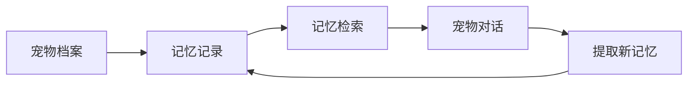

# 爪印档案

面向宠物主人的 AI 关系档案 Web App：把共同经历整理为可检索、可回顾、可对话的长期记忆。

| 项目字段 | 说明 |
| --- | --- |
| 项目类型 | 个人 AI 产品原型 |
| 目标用户 | 希望记录、回顾与宠物相处经历的宠物主人 |
| 核心能力 | 宠物档案、记忆管理、基于记忆的对话、像素场景互动 |
| 当前交付 | 前后端源码、环境配置示例、自动化测试代码；本仓库未提供公开体验地址 |

## 产品流程

建立宠物档案 → 记录共同经历 → 整理与检索记忆 → 带着相关记忆进行对话 → 回顾记忆详情。



## 关键设计与实现证据

- **长期记忆与聊天记录分开管理**：通过结构化记忆保存事件、标签与关系意义，检索相关记忆后再组织对话上下文。参见 [记忆服务](backend/app/services/memory_service.py) 与 [对话服务](backend/app/services/chat_service.py)。
- **对话能够回查引用**：对话接口返回相关记忆引用，前端提供记忆详情页面。参见 [对话接口](backend/app/api/chat.py) 与 [记忆详情组件](frontend/components/MemoryDetail.tsx)。
- **验证围绕实际行为**：仓库包含 API、记忆解析和对话服务测试，便于核对数据与流程。参见 [测试目录](backend/tests)。测试代码的存在不代表真实模型效果或线上可用性已经验证。

## 当前边界

这是持续迭代中的原型。模型调用依赖自行配置的服务；本页不声明用户规模、商业结果或模型准确率。真实用户数据、照片、密钥和内部开发文档不作为公开交付物。

## 技术栈

- 后端：Python 3.11 + FastAPI + SQLAlchemy（SQLite）+ Chroma（本地向量）
- 前端：Next.js + TypeScript + Tailwind CSS
- 模型：DeepSeek `deepseek-chat`

## 目录结构

```
backend/    FastAPI 后端（API、LLM、RAG、数据持久化）
frontend/   Next.js 前端
data/       本地数据库、照片、向量（已 gitignore）
```

## 环境准备

1. 安装 Python 3.11（本项目用 uv 管理）：
   ```bash
   curl -LsSf https://astral.sh/uv/install.sh | sh
   uv python install 3.11
   ```
2. 安装 Node.js（活跃 LTS，自带 npm）。

## 启动后端

```bash
cd backend
# 首次：创建虚拟环境并安装依赖
uv venv --python 3.11
uv pip install --python .venv/bin/python -r requirements.txt

# 在项目根目录 .env 中填入 DEEPSEEK_API_KEY 后启动
uv run --python .venv/bin/python -m uvicorn app.main:app --host 0.0.0.0 --port 8000
```

后端地址：`http://localhost:8000`，接口文档：`http://localhost:8000/docs`。

## 启动前端

```bash
cd frontend
npm install
npm run dev -- -p 3001
```

前端地址：`http://localhost:3001`（3000 端口已被占用，故用 3001）。

## 运行测试

```bash
cd backend
.venv/bin/python -m pytest -v
```

测试隔离数据目录（不污染 `data/`），LLM 与向量已 mock，离线可跑。

## 环境变量（.env）

| 变量 | 说明 |
|---|---|
| `DEEPSEEK_API_KEY` | 必填，DeepSeek API Key |
| `DEEPSEEK_BASE_URL` | 默认 `https://api.deepseek.com` |
| `DEEPSEEK_MODEL` | 默认 `deepseek-chat` |
| `BACKEND_PORT` | 后端端口，默认 8000 |
| `ENFORCE_AVATAR_EDIT_LIMIT` | MVP 默认 `false`；正式上线设为 `true` |
| `AVATAR_EDIT_LIMIT` | 头像确认后的可更换次数，默认 1 |
| `ENFORCE_INVITE_AUTH` | 封闭内测环境设为 `true` |
| `INVITE_CODES` | 内测邀请码，多个用英文逗号分隔 |
| `SESSION_SECRET` | 签名登录 Cookie 的服务端随机密钥，至少 24 位 |
| `SESSION_COOKIE_SECURE` | HTTPS 生产环境设为 `true` |
| `PAWPRINT_DATA_DIR` | SQLite、照片和向量数据的持久化目录 |
| `ENV` | `dev`（本地）/ `prod`（线上：数据默认写 `/tmp/data`） |
| `DATABASE_URL` | 线上显式指定数据库，如 `sqlite:////tmp/data/app.db` |
| `STORAGE_PROVIDER` | `local`（本地）/ `s3`（火山引擎 TOS） |
| `S3_ENDPOINT` / `S3_ACCESS_KEY` / `S3_SECRET_KEY` / `S3_BUCKET` | TOS 对象存储配置 |
| `S3_REGION` | TOS 地域，默认 `cn-beijing` |
| `BACKUP_INTERVAL_SECONDS` | 数据库备份间隔（秒），默认 300 |
| `SENTRY_DSN` | 可选，配置后自动上报未处理异常 |

## 上线部署

- 路线：火山引擎函数服务 veFaaS + API 网关。
- 后端启动命令：`python -m uvicorn app.main:app --host 0.0.0.0 --port 8000`；前端 `next build` 后 `node server.js`（`output: standalone`）。
- 生产必配环境变量：`ENV=prod`、`ENFORCE_INVITE_AUTH=true`、`INVITE_CODES=...`、`SESSION_SECRET=...`（至少 24 位）、`DATABASE_URL=sqlite:////tmp/data/app.db`、`STORAGE_PROVIDER=s3` 及 S3 系列。
- 登录：邀请码登录（邀请码预置在 `INVITE_CODES`），登录后 Cookie 会话，用户数据按邀请码隔离。
