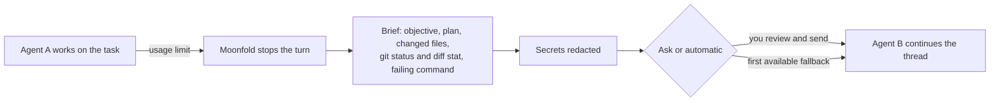

<p align="center">
  
</p>

# Moonfold

<p align="center">
  
</p>

<p align="center"><sub>Recorded in the app, sped up during agent work. Codex starts a bug fix; the user moves the
thread to Claude, reads the brief, and Claude fixes it with every edit approved. When an agent hits its
usage limit, Moonfold offers the same step on its own. <a href="docs/assets/demo-handoff.mp4">MP4</a> ·
<a href="docs/assets/moonfold-launch.mp4">40-second launch video</a></sub></p>

Moonfold is an open-source workspace for the coding agents you already use. It runs Codex,
Claude Code, Cursor, Grok Build, OpenCode, Antigravity and other agent CLIs on your own machine,
with your own logins, and gives them one desktop and web interface: projects, parallel threads,
git worktrees, diff review, pull requests, scheduled tasks, and remote access from another device.

The goal that sets Moonfold apart is **provider handoff**: when one agent hits its usage limit
mid-task, the same task continues in another agent with the plan, the diff and the open problems
carried over. Moonfold builds a redacted brief of where the task stands, shows it to you, and sends
it to the next agent; see [Provider handoff](./docs/user/provider-handoff.md).

- **Keep going when an agent runs out.** Hand a task to another agent at its usage limit, with a
  brief you can read before it is sent and secrets redacted.
- **Your agents, your logins.** Moonfold runs each agent as your own local CLI. It never proxies,
  pools or stores provider accounts, and collects no usage data by default.
- **One place for parallel work.** Projects, threads in git worktrees, diff review, pull
  requests, scheduled tasks and a browser pane, on the desktop or from a browser on another device.

Moonfold is a fork of [T3 Code](https://github.com/pingdotgg/t3code) and keeps its MIT license.
See [NOTICE](./NOTICE) for attribution.

## How handoff works



The brief and the earlier conversation go to the next agent in its first turn; the thread shows a
divider with the reason, and **View brief** shows exactly what was sent. Settings → Handoff sets
the fallback order and which agents are allowed. Details: [Provider handoff](./docs/user/provider-handoff.md).

## More demos

Recorded in the app; hostnames and local paths are blurred.

| Browser pane and scheduled tasks                                                                                                                                 | Plugins and memories                                                                                                                                      |
| ---------------------------------------------------------------------------------------------------------------------------------------------------------------- | --------------------------------------------------------------------------------------------------------------------------------------------------------- |
|  |  |

## Status

Moonfold is in beta. [v0.1.0-beta.1](https://github.com/Mr-Dark-debug/Moonfold/releases/tag/v0.1.0-beta.1)
has installers for macOS, Windows and Linux; they are not code-signed yet.

| Area                                                  | State                          |
| ----------------------------------------------------- | ------------------------------ |
| Multi-provider threads, worktrees, diff and PR flow   | Works (inherited from T3 Code) |
| Rebrand, local-first defaults, no hosted services     | Done                           |
| Codex-app parity features (goals, review, hooks, ...) | Works                          |
| Provider handoff on usage limits                      | Works                          |
| Installers for macOS, Windows and Linux               | Beta, unsigned                 |

## Install

Download the desktop app for your system from
[Releases](https://github.com/Mr-Dark-debug/Moonfold/releases): `.dmg` for macOS, `.exe` for
Windows, `.AppImage` or `.deb` for Linux. Because the beta is unsigned, the first launch needs one
extra step; [Install and first run](./docs/user/install.md#opening-an-unsigned-build) shows how.

Or install the `moonfold` command, which serves the same app to your browser:

```bash
curl -fsSL https://raw.githubusercontent.com/Mr-Dark-debug/Moonfold/main/scripts/install.sh | sh
```

On Windows, in PowerShell:

```powershell
irm https://raw.githubusercontent.com/Mr-Dark-debug/Moonfold/main/scripts/install.ps1 | iex
```

## Requirements

Install and sign in to at least one provider CLI with your own account:

- Codex: install the [Codex CLI](https://developers.openai.com/codex/cli) and run `codex login`
- Claude Code: install [Claude Code](https://claude.com/product/claude-code) and run `claude auth login`
- Cursor: install the [Cursor CLI](https://cursor.com/cli) and run `agent login`
- Grok Build: install the [Grok Build CLI](https://x.ai/cli) and run `grok login`
- OpenCode: install [OpenCode](https://opencode.ai) and run `opencode auth login`
- Antigravity: enable it in Settings, then use **Install Antigravity** and **Sign in with Google**

Moonfold never proxies, pools or shares provider logins. Each agent runs as your own local CLI.

### Provider matrix

<!-- provider-matrix:start -->

| Provider                   | Status       | CLI checked                 | Install | Sign-in | Models | Turn | Limit signal | Handoff | Where, when                |
| -------------------------- | ------------ | --------------------------- | ------- | ------- | ------ | ---- | ------------ | ------- | -------------------------- |
| **Codex**                  | Verified     | codex-cli 0.163.0           | ✅      | ✅      | ✅     | ✅   | ✅           | ✅      | Windows 11 x64, 2026-10-20 |
| **Claude Code**            | Verified     | 2.1.303                     | ✅      | ✅      | ✅     | ✅   | ✅           | ✅      | Windows 11 x64, 2026-10-20 |
| **Gemini CLI (ACP)**       | Not verified | 0.43.0                      | ✅      | ❌      | —      | —    | tests        | —       | Windows 11 x64, 2026-10-20 |
| **Antigravity**            | Not verified | agy 1.3.5 (CLI only)        | ❌      | —       | —      | —    | tests        | —       | Windows 11 x64, 2026-10-20 |
| **Cursor**                 | Not verified | not installed               | —       | —       | —      | —    | none         | —       | Windows 11 x64, 2026-10-20 |
| **OpenCode**               | Not verified | not installed               | —       | —       | —      | —    | none         | —       | Windows 11 x64, 2026-10-20 |
| **Grok Build**             | Not verified | not installed               | —       | —       | —      | —    | tests        | —       | Windows 11 x64, 2026-10-20 |
| **DeepSeek Harness (ACP)** | Not verified | @deepseek-ai/dsh 0.2.1-rc.2 | ✅      | —       | ✅     | ✅   | tests        | —       | Windows 11 x64, 2026-10-28 |
| **Pi + local Ollama**      | Not verified | pi 1.4.0, Ollama 0.30.11    | ✅      | —       | ✅     | ✅   | —            | —       | Windows 11 x64, 2026-10-28 |

Generated from [docs/provider-checks.json](./docs/provider-checks.json), which records only
checks that ran on a real install. Notes for each provider are in that file.

<!-- provider-matrix:end -->

## How it compares

As of October 2026, from each product's public documentation. Corrections are welcome in an issue.

|                                                          | Moonfold     | [T3 Code](https://github.com/pingdotgg/t3code) | [Codex app](https://developers.openai.com/codex) | [Cursor](https://cursor.com)                 |
| -------------------------------------------------------- | ------------ | ---------------------------------------------- | ------------------------------------------------ | -------------------------------------------- |
| License                                                  | MIT          | MIT                                            | Proprietary app (the Codex CLI is Apache-2.0)    | Proprietary                                  |
| Runs agents from different vendors                       | Yes, as CLIs | Yes, as CLIs                                   | Codex                                            | Several models, through Cursor's own service |
| Uses your own provider logins                            | Yes          | Yes                                            | Your ChatGPT or OpenAI account                   | Your Cursor account                          |
| Switch agent mid-thread                                  | Yes          | Yes                                            | No                                               | Switch model                                 |
| Continue in another agent at a usage limit, with a brief | Yes          | No                                             | No                                               | No                                           |

Moonfold exists because of T3 Code; if you do not need handoff, T3 Code is the original.

## FAQ

**Does Moonfold need its own account or API key?** No. Each agent signs in with its own CLI, as
it would in a terminal.

**Does it send my code anywhere?** Only to the agents you run, as those agents normally would.
A handoff brief goes to the next agent you chose, after you see it (or after you turn on
automatic mode).

**Why are the installers unsigned?** Signing needs paid Apple and Windows certificates, which the
beta does not have yet. [Install and first run](./docs/user/install.md#opening-an-unsigned-build)
shows how to open them.

**Which agents are verified?** See the provider table above; it is generated from checks that ran
on real installs.

## Build from source

You need Node.js 24 and the Vite+ `vp` command.

```bash
curl -fsSL https://vite.plus | bash
```

On Windows, in PowerShell:

```powershell
irm https://vite.plus/ps1 | iex
```

Then:

```bash
git clone https://github.com/Mr-Dark-debug/Moonfold
cd Moonfold
vp i
vp run dev
```

Open the pairing URL that the dev runner prints. `vp run dev:desktop` starts the Electron app.
More detail, including Windows notes, is in [docs/DEV.md](./docs/DEV.md).

## Privacy

Moonfold is local-first. It collects no usage data by default and talks only to the services your
agents and integrations need. See [docs/legal/privacy.md](./docs/legal/privacy.md) and
[docs/user/telemetry.md](./docs/user/telemetry.md).

## Documentation

The user guides are also published at [mr-dark-debug.github.io/Moonfold](https://mr-dark-debug.github.io/Moonfold/).

- [Install and first run](./docs/user/install.md)
- [Permission modes](./docs/user/permission-modes.md)
- [Keyboard shortcuts](./docs/user/keybindings.md)
- [Project settings](./docs/user/project-settings.md)
- [Remote access from another machine](./docs/user/remote-access.md)
- [Connect outside agents over MCP](./docs/user/outside-agents.md)
- [Source control integrations](./docs/user/source-control.md)
- [Codex](./docs/user/providers-codex.md), [Claude](./docs/user/providers-claude.md) and
  [Gemini CLI](./docs/user/providers-gemini.md) accounts
- [Provider handoff](./docs/user/provider-handoff.md)

Architecture: [docs/internals/overview.md](./docs/internals/overview.md).

## Contributing

Contributions are welcome. Read [CONTRIBUTING.md](./CONTRIBUTING.md) first. Feature ideas go to
[Discussions](https://github.com/Mr-Dark-debug/Moonfold/discussions/categories/ideas). Report
security problems privately as described in [SECURITY.md](./.github/SECURITY.md).

## License and trademarks

MIT. See [LICENSE](./LICENSE) and [NOTICE](./NOTICE).

Moonfold is an independent project. It is not affiliated with or endorsed by OpenAI, Anthropic,
Google, Cursor (Anysphere), xAI, OpenCode, or T3 Tools. Product names are used only to describe
compatibility.
