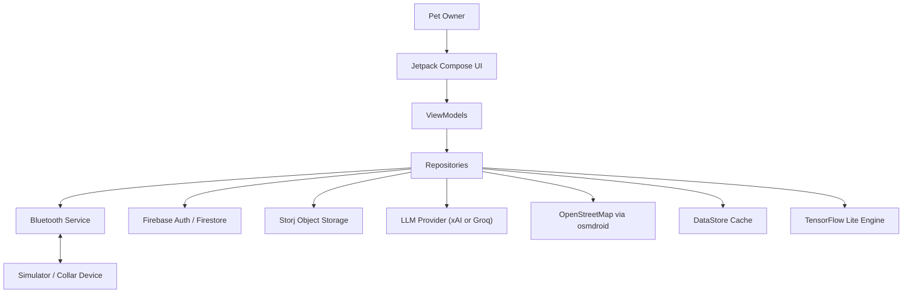
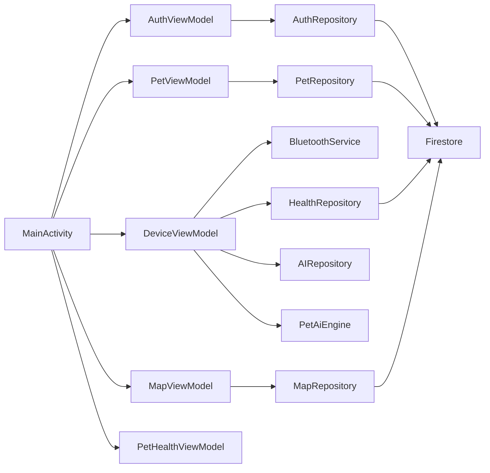
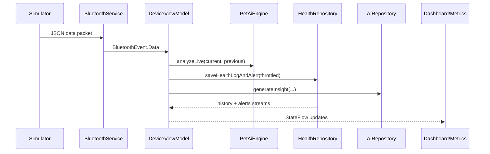
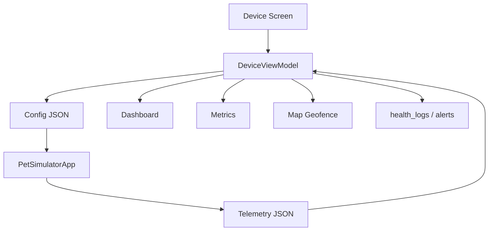
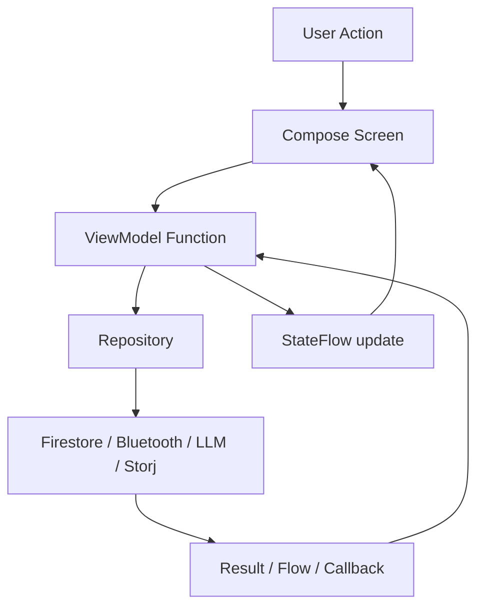
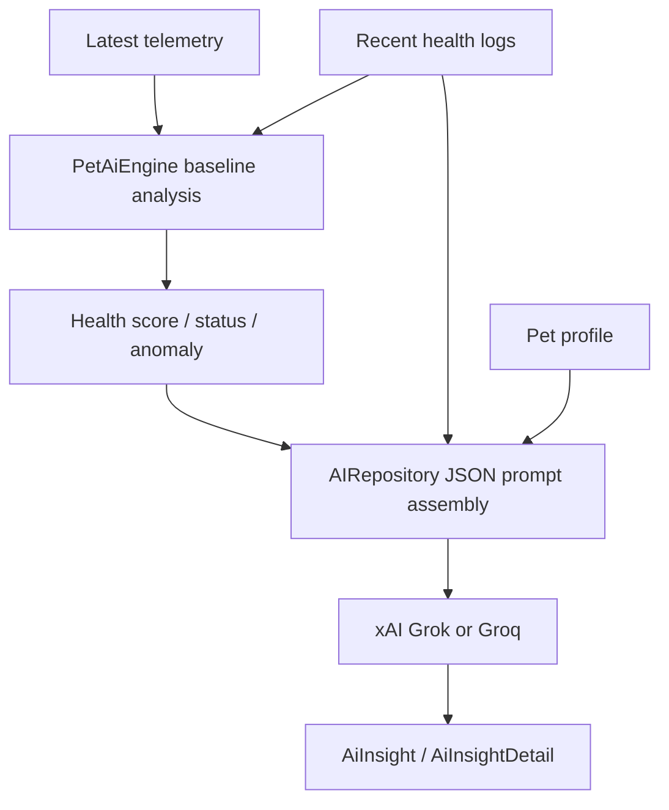
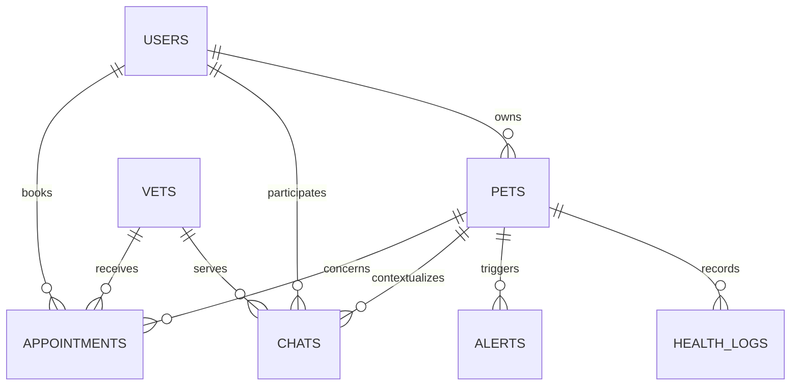
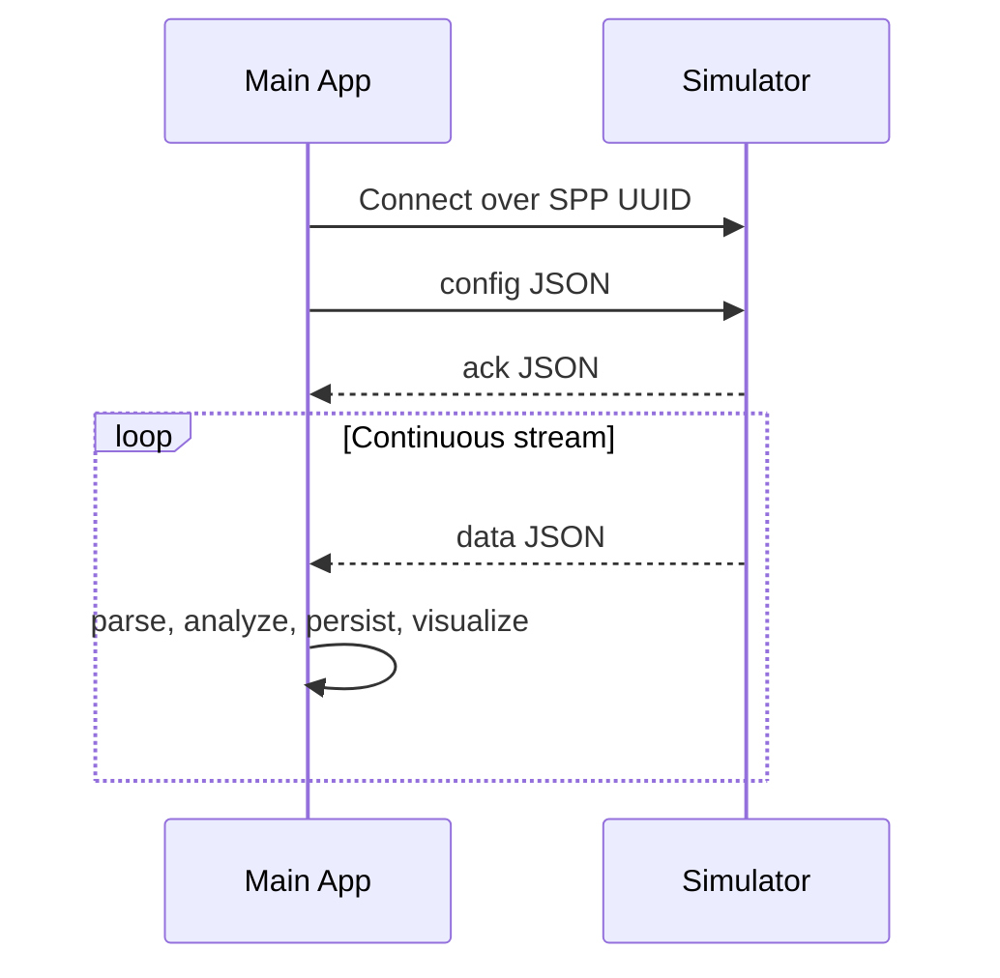

# PetHealthApp

> AI-assisted pet health monitoring, geofencing, and connected care for Android.


## Table of Contents

- [Project Overview](#project-overview)
- [Key Features](#key-features)
- [Complete Tech Stack](#complete-tech-stack)
- [System Architecture](#system-architecture)
- [Folder Structure](#folder-structure)
- [Installation Guide](#installation-guide)
- [Environment Variables](#environment-variables)
- [Application Workflow](#application-workflow)
- [API Documentation](#api-documentation)
- [Database Design](#database-design)
- [Simulator Integration](#simulator-integration)
- [AI and ML Section](#ai-and-ml-section)
- [Screenshots](#screenshots)
- [Configuration Guide](#configuration-guide)
- [Deployment](#deployment)
- [Performance Optimizations](#performance-optimizations)
- [Security Measures](#security-measures)
- [Error Handling](#error-handling)
- [Troubleshooting](#troubleshooting)
- [Future Improvements](#future-improvements)
- [Contributing Guide](#contributing-guide)
- [License](#license)
- [Authors--contributors](#authors--contributors)
- [Acknowledgements](#acknowledgements)

---

## Project Overview

PetHealthApp is the production-facing Android application in this workspace. It combines wearable telemetry ingestion, pet profile management, AI-assisted health interpretation, map-based safety features, and care coordination workflows into a single Jetpack Compose app.

### What the system does

- Authenticates pet owners with Firebase Authentication and Google Sign-In.
- Stores owner profiles, pets, telemetry history, alerts, chats, appointments, and vet metadata in Cloud Firestore.
- Connects to a nearby simulator or collar-like device over Bluetooth Classic RFCOMM.
- Parses newline-delimited JSON telemetry packets containing vitals, activity, steps, battery, and GPS data.
- Persists sampled telemetry and derived alerts to Firestore.
- Uses a local TensorFlow Lite model plus remote LLM-based analysis to generate health insights.
- Visualizes pet status across dashboard, metrics, map, device, and profile workflows.
- Supports geofence alerts, SOS assistance, vet discovery, health report export, and owner profile customization.

### Why it exists

The app addresses a practical gap in pet care: owners rarely have continuous visibility into health, activity, and location signals in a way that is understandable, actionable, and connected to escalation workflows.

### Main objectives

- Turn raw telemetry into readable pet-owner insights.
- Create a closed loop from sensing to alerting to care action.
- Provide a demo-ready, recruiter-friendly Android product architecture.
- Support simulator-driven testing without requiring production hardware.

### Real-world use case

An owner pairs the app with a simulator or smart collar, selects their active pet, monitors live vitals, receives anomaly summaries, checks whether the pet has moved outside a safe zone, exports a health report, and escalates to vet support when needed.

### Problem statement

Raw sensor streams are noisy and not directly useful to pet owners. Most monitoring concepts also fail without onboarding, persistence, map safety, and downstream care workflows.

### Solution approach

PetHealthApp uses a layered Android MVVM design:

- Compose UI for product-facing flows
- ViewModels for orchestration and session-aware state
- Repository layer for Firebase, Bluetooth, storage, and AI integrations
- Local rule engine and TFLite model for baseline-aware health scoring
- Remote LLM summary generation for owner-friendly explanations

---

## Key Features

| Feature | Description | Status | Related Module |
|---|---|---:|---|
| Email/password authentication | Firebase Auth login and signup with protected navigation | Implemented | `AuthRepository`, `AuthViewModel`, `LoginScreen`, `SignupScreen` |
| Google Sign-In | Uses Play Services and Firebase credentials for social auth | Implemented | `AuthRepository`, `AuthViewModel` |
| Splash auth gate | Routes users to login or dashboard based on live auth session | Implemented | `SplashScreen`, `MainActivity` |
| Owner profile management | Stores owner name, city, avatar, emergency contact, vet number, notifications, SOS preferences | Implemented | `ProfileScreen`, `AuthRepository` |
| Pet creation and editing | Add/edit pet profile with metadata and image | Implemented | `AddPetScreen`, `PetRepository`, `PetViewModel` |
| Active pet selection | Shared active pet context powers dashboard, map, device, and AI flows | Implemented | `PetViewModel`, `MainActivity` |
| Storj-backed image storage | Attempts object upload to Storj with fallback behavior | Implemented | `StorjImageRepository`, `PetRepository`, `AuthRepository` |
| Bluetooth pairing and connection | Lists bonded devices and connects over Bluetooth Classic SPP | Implemented | `BluetoothService`, `DeviceViewModel` |
| Simulator config sync | Sends control payloads back to simulator for interval, accuracy, issue injection, and activity overrides | Implemented | `SimulatorConfig`, `BluetoothService`, `DeviceViewModel` |
| Live telemetry parsing | Parses `data` and `ack` packets safely from JSON | Implemented | `PetHealthData`, `BluetoothEvent`, `BluetoothService` |
| Dashboard monitoring | Shows recent vitals, alerts, AI summary, and geofence awareness | Implemented | `DashboardScreen`, `DeviceViewModel` |
| Metrics history | Displays log trends and historical summaries | Implemented | `MetricsScreen`, `HealthRepository` |
| AI detailed insight windows | Generates detail summaries over selectable time windows | Implemented | `AIRepository`, `AiInsightScreen` |
| TFLite anomaly intelligence | Computes baseline-aware health score and anomaly flags on-device | Implemented | `PetAiEngine` |
| LLM health narrative | Uses xAI Grok or Groq chat completions for owner-readable health guidance | Implemented | `AIRepository` |
| Health log persistence | Batches telemetry and alerts into Firestore collections | Implemented | `HealthRepository` |
| PDF health report export | Generates branded PDF reports and shares them via FileProvider | Implemented | `HealthReportExporter`, `MetricsScreen` |
| Geofencing | Persists home location and radius, detects out-of-zone conditions | Implemented | `MapRepository`, `MapViewModel`, `MapScreen` |
| OSM map view | Displays map and live location using osmdroid/OpenStreetMap | Implemented | `MapScreen`, `MapViewModel` |
| SOS assistance | Presents emergency workflow with owner-defined defaults and contact paths | Implemented | `MapScreen`, `MapViewModel` |
| Nearby vet placeholders | Exposes nearest-vet list and emergency support workflow | Implemented | `MapViewModel`, `VetRepository`, `VetDiscoveryScreen` |
| Vet discovery | Reads vet catalog and sorts by distance | Implemented | `VetRepository`, `VetViewModel` |
| Real-time chat | Creates or reuses pet/vet/user-specific chat documents | Implemented | `ChatRepository`, `ChatViewModel`, `ChatScreen` |
| Appointment booking | Creates appointment records and observes appointment history | Implemented | `AppointmentRepository`, `AppointmentViewModel`, `AppointmentScreen` |
| Feature gate for empty state | Prevents access to core health flows until a pet is added | Implemented | `MainActivity`, `PetFeatureGate` |

---

## Complete Tech Stack

### Frontend

| Category | Technology | Notes |
|---|---|---|
| Language | Kotlin | Android source language |
| UI | Jetpack Compose | Main UI toolkit |
| Design system | Material 3 | Themed Compose surfaces and controls |
| Navigation | Navigation Compose | Route-driven navigation graph |
| Image loading | Coil Compose | Remote and inline image rendering |

### Backend and Cloud Services

| Category | Technology | Notes |
|---|---|---|
| Authentication | Firebase Authentication | Email/password and Google Sign-In |
| Database | Cloud Firestore | Stores user, pet, logs, alerts, chats, appointments, vets |
| File storage | Storj S3-compatible object storage | Pet and owner image upload target |

### Database

| Category | Technology | Notes |
|---|---|---|
| Primary cloud DB | Firestore | Realtime document database |
| Local cache | Android DataStore Preferences | Location cache persistence |

### AI / ML

| Category | Technology | Notes |
|---|---|---|
| On-device inference | TensorFlow Lite | `pet_model.tflite` packaged in assets |
| Rule engine | Custom Kotlin heuristics | Severity scoring and baseline drift protection |
| Remote LLM | xAI Grok or Groq | Chat-completions style JSON output |

### APIs and Integration Points

| Category | Technology | Notes |
|---|---|---|
| Bluetooth transport | RFCOMM / SPP | Newline-delimited JSON packets |
| Maps | osmdroid + OpenStreetMap | Live map tiles and overlays |
| HTTP client | OkHttp | LLM requests and Storj upload signing/request flow |
| Share/export | Android Intent + FileProvider | PDF sharing |

### Authentication

| Category | Technology | Notes |
|---|---|---|
| Identity provider | Firebase Auth | Session state and credential lifecycle |
| Social login | Google Sign-In | Requires `GOOGLE_WEB_CLIENT_ID` |

### Simulator Components

| Category | Technology | Notes |
|---|---|---|
| External peer | `simulator` Android app | Sends telemetry and accepts config messages |
| Protocol | Pet Simulator Bluetooth Protocol v2.1 | Includes vitals, steps, temperature, issue injection |

### Deployment

| Category | Technology | Notes |
|---|---|---|
| Build system | Gradle Kotlin DSL | Android app build |
| Packaging | APK | Release APK artifacts already exist in workspace |
| Distribution target | Android devices | No server deployment layer in repo |

### Dev Tools

| Category | Technology | Notes |
|---|---|---|
| Build language | Kotlin DSL (`.gradle.kts`) | Build configuration |
| JDK target | Java 17 | Compile/runtime compatibility |
| Android SDK | Compile/target SDK 34 | Modern Android target |
| Testing baseline | JUnit / Espresso / Compose UI test deps | Present in Gradle, limited test code currently checked in |

---

## System Architecture

### High-level architecture



### Main runtime modules



### Telemetry-to-insight flow



### Main-app and simulator interaction



### Architectural notes

- The app is effectively client-centric: there is no custom backend service in this repository.
- Firestore functions as the shared cloud persistence layer.
- Bluetooth is used only for local device-to-app telemetry/control exchange.
- AI is hybrid: local TFLite for scoring, remote LLM for explanation.

---

## Folder Structure

### Complete tree

```text
main app/
├── app/
│   ├── build.gradle.kts
│   ├── google-services.json
│   ├── proguard-rules.pro
│   └── src/
│       └── main/
│           ├── AndroidManifest.xml
│           ├── assets/
│           │   └── pet_model.tflite
│           ├── java/com/pethealthapp/
│           │   ├── MainActivity.kt
│           │   ├── data/
│           │   ├── domain/
│           │   ├── ui/
│           │   │   ├── components/
│           │   │   ├── navigation/
│           │   │   ├── screens/
│           │   │   └── theme/
│           │   └── viewmodel/
│           └── res/
│               ├── drawable/
│               ├── mipmap*/
│               ├── values/
│               └── xml/
├── gradle/
│   └── wrapper/
├── build.gradle.kts
├── design.md
├── gradle.properties
├── gradlew
├── gradlew.bat
├── local.properties
├── project_documentation.md
└── settings.gradle.kts
```

### Important folders explained

| Folder | Purpose | Important Files |
|---|---|---|
| `app/src/main/java/com/pethealthapp` | App entry and source root | `MainActivity.kt` |
| `data` | External integration and persistence layer | `AuthRepository.kt`, `PetRepository.kt`, `HealthRepository.kt`, `BluetoothService.kt`, `AIRepository.kt`, `StorjImageRepository.kt`, `HealthReportExporter.kt` |
| `domain` | Shared models, state carriers, AI result structures | `PetHealthData.kt`, `SimulatorConfig.kt`, `HealthLog.kt`, `AiInsight.kt`, `Appointment.kt` |
| `viewmodel` | Screen/application orchestration layer | `AuthViewModel.kt`, `PetViewModel.kt`, `DeviceViewModel.kt`, `MapViewModel.kt` |
| `ui/screens` | Product-facing screens | `DashboardScreen.kt`, `MetricsScreen.kt`, `MapScreen.kt`, `DeviceScreen.kt`, `ProfileScreen.kt`, `AiInsightScreen.kt` |
| `ui/components` | Reusable Compose pieces | `ScreenScaffold.kt`, `MetricCard.kt`, `PetBottomNavigationBar.kt`, `PetListCard.kt` |
| `ui/navigation` | Route definitions and destination metadata | `AppRoute.kt`, `AppDestination.kt` |
| `ui/theme` | App styling | `Color.kt`, `Theme.kt`, `Type.kt` |
| `assets` | Packaged ML assets | `pet_model.tflite` |
| `res/xml` | Android provider/path config | `file_paths.xml` |
| `gradle/wrapper` | Gradle bootstrap | `gradle-wrapper.jar`, `gradle-wrapper.properties` |

---

## Installation Guide

> This module is an Android client application. It does not include a custom backend server, but it does require Firebase configuration and optional AI/storage credentials for full functionality.

### Prerequisites

| Requirement | Recommended Version | Notes |
|---|---|---|
| Android Studio | Hedgehog or newer | For Compose + SDK 34 workflows |
| JDK | 17 | Matches project compile target |
| Android SDK | 34 | Required by Gradle config |
| Physical Android device | Recommended | Needed for Bluetooth pairing and real map/location testing |
| Firebase project | Required for auth/database | Must supply valid `google-services.json` |
| Optional LLM API key | xAI or Groq | Enables AI summaries |
| Optional Storj credentials | S3-compatible | Enables image uploads instead of fallback |

### Clone or open the workspace

```bash
git clone <your-repository-url>
cd "<repo-root>/main app"
```

### Open in Android Studio

Open the `main app` folder as a Gradle project.

### Dependency installation

Dependencies are resolved automatically by Gradle. From terminal:

```bash
./gradlew assembleDebug
```

On Windows:

```powershell
.\gradlew.bat assembleDebug
```

### Environment setup

1. Place a valid Firebase configuration file at:
   - `app/google-services.json`
2. Add required keys to `local.properties`.
3. Sync Gradle.

### Database setup

Create or configure a Firebase project with:

- Authentication enabled
- Firestore enabled
- Matching package name: `com.pethealthapp`

Suggested Firestore collections used by the app:

- `users`
- `pets`
- `health_logs`
- `alerts`
- `vets`
- `chats`
- `appointments`

### Simulator setup

1. Install and run the companion app in `../simulator`.
2. Start the simulator server.
3. Pair the two Android devices if needed.
4. Use the Device screen in PetHealthApp to connect to a bonded simulator device.

### App setup

Typical first-run flow:

1. Launch app.
2. Sign up or log in.
3. Complete owner profile.
4. Add at least one pet.
5. Select the active pet.
6. Open Device screen and connect to simulator.

### Build steps

Debug build:

```bash
./gradlew assembleDebug
```

Release build:

```bash
./gradlew assembleRelease
```

### Production readiness checklist

- Replace placeholder Firebase config
- Verify Firestore rules
- Provide real Google web client ID
- Configure one AI provider key
- Configure Storj if image upload is required
- Test Bluetooth permissions on Android 12+
- Validate map/location permissions on physical devices

---

## Environment Variables

This project reads secrets from `local.properties` and injects them into `BuildConfig`.

| Variable | Purpose | Required | Example |
|---|---|---:|---|
| `GROQ_API_KEY` | Enables Groq-based LLM summary generation | No | `gsk_...` |
| `GROK_API_KEY` | Enables xAI Grok-based LLM summary generation | No | `xai-...` |
| `GROK_BASE_URL` | Overrides Grok endpoint | No | `https://api.x.ai/v1/chat/completions` |
| `GROK_MODEL` | Selects xAI model | No | `grok-3-mini` |
| `GOOGLE_WEB_CLIENT_ID` | Required for Google Sign-In credential exchange | Yes for Google login | `123456.apps.googleusercontent.com` |
| `STORJ_ENDPOINT` | Storj S3-compatible endpoint | No | `https://gateway.storjshare.io` |
| `STORJ_BUCKET` | Storj bucket for image assets | No | `pethealth-assets` |
| `STORJ_ACCESS_KEY` | Storj access key | No | `ACCESS_KEY` |
| `STORJ_SECRET_KEY` | Storj secret key | No | `SECRET_KEY` |
| `STORJ_PUBLIC_BASE_URL` | Public URL prefix for uploaded assets | No | `https://link.storjshare.io/raw/...` |
| `STORJ_REGION` | S3 signing region | No | `us-east-1` |

### Example `local.properties` snippet

```properties
sdk.dir=C\:\\Users\\you\\AppData\\Local\\Android\\Sdk
GOOGLE_WEB_CLIENT_ID=1234567890-abcdef.apps.googleusercontent.com
GROK_API_KEY=
GROQ_API_KEY=gsk_example
GROK_BASE_URL=https://api.x.ai/v1/chat/completions
GROK_MODEL=grok-3-mini
STORJ_ENDPOINT=https://gateway.storjshare.io
STORJ_BUCKET=pethealth-assets
STORJ_ACCESS_KEY=example_access_key
STORJ_SECRET_KEY=example_secret_key
STORJ_PUBLIC_BASE_URL=
STORJ_REGION=us-east-1
```

---

## Application Workflow

### Startup flow

1. `MainActivity` configures osmdroid and starts Compose.
2. `SplashScreen` appears.
3. `AuthViewModel.observeAuthState()` decides authenticated vs unauthenticated route.
4. If authenticated, `PetViewModel.observePets(userId)` begins streaming pet records.
5. Active pet ID is pushed into `DeviceViewModel` and `MapViewModel`.

### Request and state lifecycle



### Telemetry execution lifecycle

1. User selects bonded device in Device screen.
2. `BluetoothService.connect()` opens RFCOMM socket with UUID `00001101-0000-1000-8000-00805F9B34FB`.
3. `listenForEvents()` reads newline-delimited JSON.
4. `PetHealthData.fromJsonObjectOrNull()` validates packet.
5. `DeviceViewModel` updates UI state.
6. TFLite analysis computes score/anomaly.
7. Firestore logging is throttled and batch-written.
8. AI insight is requested on dashboard open or anomaly trigger.

### Backend communication

There is no custom application server. Communication paths are:

- Firebase Auth for identity
- Firestore for cloud persistence
- LLM HTTP APIs for summaries
- Storj-compatible HTTP requests for object upload

### AI pipeline



### Data handling pipeline

- Live packet enters `DeviceViewModel`
- Previous packet is used for delta features
- Log persistence is throttled to reduce write volume
- History and alerts are streamed back from Firestore
- Metrics screen can export selected time-window data into PDF

---

## API Documentation

This repository does not expose REST endpoints. Its operational APIs are:

1. Bluetooth protocol between app and simulator
2. Firebase data contract
3. LLM request contract

### Bluetooth protocol: outgoing config from main app

| Method | Endpoint / Channel | Purpose | Request | Response |
|---|---|---|---|---|
| `Bluetooth write` | RFCOMM JSON line | Set simulator behavior | `{"type":"config","health_mode":"normal","interval":5,"location_interval":2,"accuracy":"balanced","override_activity":false,"forced_activity":"rest","simulate_issue":"none"}` | `{"type":"ack","status":"applied"}` or `ignored` |

### Bluetooth protocol: incoming telemetry to main app

| Method | Endpoint / Channel | Purpose | Request | Response |
|---|---|---|---|---|
| `Bluetooth read` | RFCOMM JSON line | Receive simulated device data | N/A | `{"type":"data","heart_rate":92,"spo2":97,"activity":"walking","temperature":38.4,"steps":1450,"battery_percentage":84,"latitude":12.9716,"longitude":77.5946,"accuracy":6.8,"timestamp":1713960000000}` |

### Firestore collection contracts

| Collection | Purpose | Key Fields |
|---|---|---|
| `users` | Owner profile and preferences | `email`, `ownerName`, `city`, `emergencyContact`, `preferredVetNumber`, `activePetId`, `homeLocation`, `radius`, `isUserWithPet` |
| `pets` | Pet profiles | `userId`, `name`, `type`, `breed`, `dob`, `weight`, `imageUrl`, `imageBase64`, `createdAt` |
| `health_logs` | Historical telemetry | `petId`, `heart_rate`, `spo2`, `activity`, `temperature`, `steps`, `battery_percentage`, `accuracy`, `latitude`, `longitude`, `timestamp` |
| `alerts` | Derived risk events | `petId`, `message`, `severity`, `timestamp` |
| `vets` | Vet catalog | `name`, `phone`, `latitude`, `longitude`, `address`, metadata |
| `chats` | Chat threads | `userId`, `petId`, `vetId`, `messages` |
| `appointments` | Vet booking records | `userId`, `petId`, `vetId`, `date`, `time`, `status` |

### External LLM API contract

| Method | Provider | Purpose | Request | Response |
|---|---|---|---|---|
| `POST` | xAI / Groq chat completions | Generate summary insight | JSON prompt with pet data, baseline, history, AI analysis | Strict JSON object with summary/severity/recommendation/confidence |
| `POST` | xAI / Groq chat completions | Generate detailed insight | Windowed telemetry sample and AI summary | Strict JSON object with health insight, plan, recommendations, severity, confidence |

---

## Database Design

### Firestore entity map



### Model notes

| Model | Explanation |
|---|---|
| `users` | Core identity extension record for Firebase user session |
| `pets` | Primary business entity representing monitored animals |
| `health_logs` | Time-series telemetry snapshots used by metrics and AI |
| `alerts` | Short-lived or historical anomaly/geofence event records |
| `vets` | Directory data used for discovery and escalation |
| `chats` | Thread-level communication documents between owner and vet context |
| `appointments` | Scheduling artifacts tied to user, pet, and vet |

### Data access pattern

- Reads are mostly listener-based with `callbackFlow`.
- Writes are direct or batched.
- The app often sorts in memory after snapshot retrieval.
- Active pet selection acts as the main routing key for downstream features.

---

## Simulator Integration

The production app is designed to operate with the sibling `simulator` module in this repository.

### Integration purpose

- Drive realistic live demo flows without custom hardware
- Validate Bluetooth connectivity, parsing, and control messages
- Exercise AI, alerting, and geofence logic using synthetic events

### Main control fields sent to simulator

| Field | Meaning |
|---|---|
| `health_mode` | Baseline physiology mode: `normal`, `stress`, `rest` |
| `interval` | Non-location simulation interval |
| `location_interval` | GPS update/transmit interval |
| `accuracy` | Location priority mode |
| `override_activity` | Whether app should force the simulator’s activity state |
| `forced_activity` | Forced state when override is enabled |
| `simulate_issue` | Injected issue: `none`, `fever`, `lethargy`, `hyperactivity` |

### Integration sequence



---

## AI and ML Section

### Models used

| Layer | Technology | Purpose |
|---|---|---|
| On-device model | TensorFlow Lite (`pet_model.tflite`) | Baseline-aware classification and health scoring |
| Heuristic fallback | Kotlin feature scoring | Backup if interpreter inference fails |
| LLM narrative | xAI Grok or Groq | Human-friendly explanation and recommendations |

### Feature engineering in `PetAiEngine`

The local model computes normalized features from:

- Heart rate
- SpO2
- Temperature
- Activity level
- Heart-rate delta
- Temperature delta
- SpO2 delta
- Stress ratio

### Inference flow

1. Build or retrieve rolling baseline for active pet.
2. Convert latest telemetry and previous telemetry into model features.
3. Normalize values using packaged mean/std arrays.
4. Run TFLite interpreter if available, otherwise use heuristic probabilities.
5. Map class to `Normal`, `Warning`, or `Critical`.
6. Compute health score and top contributing factors.
7. Protect baseline from drifting during anomalies.

### LLM output expectations

The remote AI layer is explicitly instructed to return strict JSON only. The app then sanitizes:

- severity
- confidence
- structured recommendations

### AI output usage in product

- Dashboard summary card
- Detailed AI insight screen
- PDF report narrative
- Alert context and owner guidance

---

## Screenshots

## Dashboard

(Add screenshot here)

## Metrics History

(Add screenshot here)

## Device Pairing

(Add screenshot here)

## Map and Geofence

(Add screenshot here)

## AI Insights

(Add screenshot here)

## Profile and Pet Management

(Add screenshot here)

---

## Configuration Guide

### Key configuration files

| File | Purpose |
|---|---|
| `build.gradle.kts` | Root Android build configuration |
| `app/build.gradle.kts` | Main module dependencies, SDK versions, BuildConfig keys |
| `settings.gradle.kts` | Includes `:app` module |
| `local.properties` | Local SDK path and secrets |
| `app/google-services.json` | Firebase project binding |
| `app/src/main/AndroidManifest.xml` | Permissions, FileProvider, app metadata |
| `app/src/main/res/xml/file_paths.xml` | FileProvider export paths |

### Runtime configs

| Config | Current Value / Behavior |
|---|---|
| `compileSdk` | 34 |
| `targetSdk` | 34 |
| `minSdk` | 24 |
| Compose compiler extension | `1.5.14` |
| LLM cache duration | 5 minutes |
| Bluetooth protocol | SPP UUID `00001101-0000-1000-8000-00805F9B34FB` |
| Log observation window | Default 60 days for history reads |

### Editable settings developers may tune

- AI provider selection via API keys
- Storj endpoint and bucket
- Bluetooth simulator config defaults
- Map geofence radius persistence
- PDF report generation behavior

---

## Deployment

### Local deployment

1. Configure Firebase and `local.properties`
2. Build `assembleDebug`
3. Install on Android device or emulator

### Production deployment

This repo does not deploy a server. Production deployment means shipping the Android client with valid cloud services attached.

Typical steps:

1. Create release keystore
2. Configure signing in Gradle or Android Studio
3. Build `assembleRelease`
4. Upload APK/AAB to your distribution channel

### Docker deployment

Not applicable in the current repository. No Dockerfiles were found and there is no backend service container to deploy.

### Cloud deployment

Cloud responsibilities are limited to managed services:

- Firebase project setup
- Firestore rules/indexing
- Authentication providers
- Optional Storj bucket provisioning
- Optional xAI or Groq API access

---

## Performance Optimizations

| Area | Optimization |
|---|---|
| AI requests | Short-term cache for quick insight and detailed insight generation |
| Bluetooth stream | Lightweight JSON line parsing and reconnect attempts |
| Firestore writes | Throttled telemetry persistence and batched log/alert writes |
| Baseline model | Incremental per-pet baseline update instead of full recomputation |
| History analysis | Window-based sampling for large telemetry sets |
| UI rendering | StateFlow-driven Compose updates and reusable screen scaffolds |
| Local persistence | DataStore cache for lightweight location reuse |

---

## Security Measures

| Area | Current Measure |
|---|---|
| Authentication | Firebase Authentication session handling |
| Secret injection | Secrets loaded from local properties into `BuildConfig` |
| File sharing | `FileProvider` used for PDF URIs instead of raw file paths |
| Validation | JSON parsing and field coercion for incoming Bluetooth data |
| Access control | Firestore-backed ownership logic by `userId` and `petId` |
| Input handling | Friendly validation in auth and pet flows |

### Security gaps to note

- No end-to-end encrypted Bluetooth payload layer
- Firestore security rule definitions are not included in this folder
- Secrets are client-side for demo/prototype convenience

---

## Error Handling

### Strategies used in code

- Safe JSON parsing with null/fallback behavior
- Reconnect attempts for Bluetooth disconnects
- Friendly error mapping in ViewModels
- Fallback AI summaries when remote AI fails
- Storj fallback paths when upload fails
- Empty-state gating when pets are missing
- Defensive handling for missing permissions and disabled Bluetooth

### Logging/debugging approach

- Android `Log` statements in Bluetooth, AI, and simulator integration paths
- User-facing messages stored in UI state
- Runtime fallback rather than hard crash for most external failures

---

## Troubleshooting

| Problem | Cause | Solution |
|---|---|---|
| Google Sign-In fails | Missing or incorrect `GOOGLE_WEB_CLIENT_ID` | Add the correct web client ID to `local.properties` and verify Firebase setup |
| Login works but Firestore features fail | Firestore disabled or rules blocking access | Enable Firestore API and review Firestore rules |
| App opens but dashboard is locked | No pet has been added yet | Create a pet profile in Profile or Add Pet flow |
| Pet images do not upload | Storj credentials missing or endpoint invalid | Configure Storj keys or allow fallback behavior |
| Bluetooth device list is empty | No bonded simulator device | Pair the simulator device in Android system Bluetooth settings |
| Bluetooth connect fails immediately | Simulator not started or wrong device selected | Start simulator first and connect to the correct bonded device |
| Telemetry never appears after connection | Simulator not streaming or JSON invalid | Verify simulator is connected and watch simulator logs |
| AI insight unavailable | No `GROK_API_KEY` or `GROQ_API_KEY` configured | Add one provider key to `local.properties` |
| AI insight feels stale | Cache still active | Wait for cache expiry or trigger a different detailed window |
| Map loads but pet marker does not move | No incoming location packets yet | Confirm simulator location permissions and live stream |
| Geofence alerts do not fire | `isUserWithPet` enabled or home location not set | Disable companion mode and set home location/radius |
| PDF export fails | FileProvider issue or no report data | Confirm logs exist and app manifest/file paths are intact |
| Owner avatar not saved | Storage upload failure or Firestore write failure | Verify Storj settings and Firestore permissions |
| Appointments screen is empty | No appointment records exist for active pet | Book an appointment after selecting a pet |
| Vet list is empty | `vets` collection not populated yet | Seed or add vet records in Firestore |

---

## Future Improvements

| Roadmap Item | Value | Priority |
|---|---|---:|
| Dedicated backend service | Move secrets and business logic off-device | High |
| Background telemetry ingestion | Support foreground service or WorkManager-like syncing | High |
| Better Firestore query/index strategy | Reduce in-memory sorting and client-side filtering | High |
| Breed-aware baselines | Improve anomaly accuracy per animal profile | High |
| Real nearby-vet API | Replace placeholder vet proximity data | Medium |
| Scalable chat schema | Move from document-array messages to subcollections | Medium |
| Rich charting | Improve analytics visuals in Metrics | Medium |
| Push notifications | Alert owners when severe events occur | Medium |
| Multi-pet comparative dashboard | Better support households with several pets | Medium |
| Wearable hardware integration | Replace simulator dependency with production device firmware | High |
| Rule engine tuning console | Expose threshold tuning for demo or clinical scenarios | Low |

---

## Contributing Guide

### Suggested branch naming

- `feature/<short-description>`
- `fix/<short-description>`
- `docs/<short-description>`
- `refactor/<short-description>`

### Pull request workflow

1. Create a branch from the main integration branch.
2. Keep changes scoped to one feature or fix.
3. Test auth, pet selection, and affected feature flows.
4. Include screenshots for UI changes.
5. Document any new `local.properties` variables or Firestore fields.

### Coding standards

- Follow Kotlin and Compose idioms already present in the project.
- Keep business logic in repositories/ViewModels, not screens.
- Prefer domain models and typed state over raw map access in UI.
- Preserve safe parsing and fallback behaviors around external systems.

### Testing expectations

- Manual validation on physical Android devices for Bluetooth/location flows
- Regression testing for auth routing, pet gating, and dashboard state
- Simulator pairing and telemetry confirmation for device-related changes

---

## License

No explicit license file was found in this module. Treat the codebase as proprietary or internal until a project license is added.

---

## Authors / Contributors

- Product / Mobile Engineering: Mudit Sharma
- AI / Data Intelligence: Mudit Sharma
- Simulator / Protocol Engineering: Mudit Sharma
- UX / Visual Design: Mudit Sharma

## Acknowledgements

- Android and Jetpack Compose ecosystem
- Firebase Authentication and Cloud Firestore
- TensorFlow Lite for embedded inference
- OpenStreetMap and osmdroid for open map rendering
- Storj for S3-compatible asset storage
- xAI and Groq for structured LLM summaries
- The companion `simulator` module for repeatable integration testing
