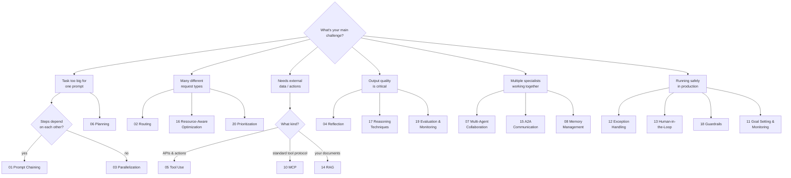

# Agentic Design Patterns — بالمصري 🇪🇬

**The 21 agentic AI design patterns from Antonio Gulli's book, explained in Egyptian Arabic — with framework-free, runnable Python examples.**


Every pattern gets: a plain-Arabic explanation built on analogies, a Mermaid diagram of the mechanism, when-to-use guidance and trade-offs verified against the book, and a **self-contained Python example** that demonstrates the real mechanism with nothing but the OpenAI SDK — no LangChain, no CrewAI, no magic.

<div dir="rtl">

**ليه بالمصري؟** لأن أنماط تصميم الـ AI Agents هي أساس أي نظام ذكي حقيقي، والمحتوى العربي التقني الجاد فيها شبه معدوم. الريبو ده شرح كامل للـ 21 pattern من كتاب Antonio Gulli بلغة بسيطة وأمثلة كود تشتغل فعلاً.

</div>

## Quick Start

```bash
git clone https://github.com/Muhannad-Khaled/agentic-design-patterns.git
cd agentic-design-patterns
pip install -r requirements.txt
cp .env.example .env   # add your API key (OpenAI, Groq, Ollama — anything OpenAI-compatible)
python examples/01_prompt_chaining.py
```

## The Patterns

| # | Pattern | TL;DR | Guide | Code |
|---|---------|-------|:-----:|:----:|
| 1 | **Prompt Chaining** | Split a complex task into a pipeline of focused, validated LLM calls | [📖](patterns/01-prompt-chaining.md) | [🐍](examples/01_prompt_chaining.py) |
| 2 | **Routing** | Classify each request and dispatch it to the right specialist | [📖](patterns/02-routing.md) | [🐍](examples/02_routing.py) |
| 3 | **Parallelization** | Run independent sub-tasks concurrently and merge the results | [📖](patterns/03-parallelization.md) | [🐍](examples/03_parallelization.py) |
| 4 | **Reflection** | Producer/critic loop — draft, critique, refine until quality passes | [📖](patterns/04-reflection.md) | [🐍](examples/04_reflection.py) |
| 5 | **Tool Use** | Let the model call external functions and APIs to act on the world | [📖](patterns/05-tool-use.md) | [🐍](examples/05_tool_use.py) |
| 6 | **Planning** | Generate a step-by-step plan before executing, adapt as things change | [📖](patterns/06-planning.md) | [🐍](examples/06_planning.py) |
| 7 | **Multi-Agent Collaboration** | A team of specialized agents coordinated by an orchestrator | [📖](patterns/07-multi-agent-collaboration.md) | [🐍](examples/07_multi_agent_collaboration.py) |
| 8 | **Memory Management** | Short-term vs long-term memory — what to store, compress, and recall | [📖](patterns/08-memory-management.md) | [🐍](examples/08_memory_management.py) |
| 9 | **Learning & Adaptation** | Improve behavior over time from feedback and outcomes | [📖](patterns/09-learning-and-adaptation.md) | [🐍](examples/09_learning_and_adaptation.py) |
| 10 | **Model Context Protocol (MCP)** | The open standard for discovering and calling external tools | [📖](patterns/10-model-context-protocol.md) | [🐍](examples/10_model_context_protocol.py) |
| 11 | **Goal Setting & Monitoring** | Define measurable goals (KPIs) and self-correct on drift | [📖](patterns/11-goal-setting-and-monitoring.md) | [🐍](examples/11_goal_setting_and_monitoring.py) |
| 12 | **Exception Handling & Recovery** | Classify failures, retry with backoff, fall back, escalate | [📖](patterns/12-exception-handling-and-recovery.md) | [🐍](examples/12_exception_handling_and_recovery.py) |
| 13 | **Human-in-the-Loop** | Pause for human approval on high-stakes or ambiguous decisions | [📖](patterns/13-human-in-the-loop.md) | [🐍](examples/13_human_in_the_loop.py) |
| 14 | **Knowledge Retrieval (RAG)** | Ground answers in your own documents via retrieval | [📖](patterns/14-knowledge-retrieval-rag.md) | [🐍](examples/14_knowledge_retrieval_rag.py) |
| 15 | **Inter-Agent Communication (A2A)** | Structured messaging protocols between agents | [📖](patterns/15-inter-agent-communication-a2a.md) | [🐍](examples/15_inter_agent_communication_a2a.py) |
| 16 | **Resource-Aware Optimization** | Route easy tasks to cheap models, hard ones to strong models | [📖](patterns/16-resource-aware-optimization.md) | [🐍](examples/16_resource_aware_optimization.py) |
| 17 | **Reasoning Techniques** | CoT, ToT, self-correction, debate — structured thinking before answering | [📖](patterns/17-reasoning-techniques.md) | [🐍](examples/17_reasoning_techniques.py) |
| 18 | **Guardrails / Safety Patterns** | Screen inputs and outputs for harm, PII leaks, and prompt injection | [📖](patterns/18-guardrails-safety-patterns.md) | [🐍](examples/18_guardrails_safety_patterns.py) |
| 19 | **Evaluation & Monitoring** | Golden test sets, quality gates, and drift detection in production | [📖](patterns/19-evaluation-and-monitoring.md) | [🐍](examples/19_evaluation_and_monitoring.py) |
| 20 | **Prioritization** | Score and order tasks by value, urgency, effort, and dependencies | [📖](patterns/20-prioritization.md) | [🐍](examples/20_prioritization.py) |
| 21 | **Exploration & Discovery** | Open-ended research — explore, cluster, dig deeper, synthesize | [📖](patterns/21-exploration-and-discovery.md) | [🐍](examples/21_exploration_and_discovery.py) |

## Which Pattern Do I Need?



**Cross-cutting patterns** you'll layer on top: **09 Learning & Adaptation** (systems that improve with feedback) and **21 Exploration & Discovery** (open-ended research agents).

## Appendices

| | Appendix | About |
|---|----------|-------|
| A | [Advanced Prompting Techniques](appendices/a-advanced-prompting.md) | The prompting toolbox underneath every pattern |
| B | [From GUI to Real-World Environments](appendices/b-gui-to-real-world.md) | Agents that see screens and act in the physical world |
| C | [Overview of Agentic Frameworks](appendices/c-agentic-frameworks.md) | LangChain, LangGraph, CrewAI, Google ADK & friends |
| D | [Building an Agent with AgentSpace](appendices/d-agentspace.md) | UI-based agent building |
| E | [AI Agents on the CLI](appendices/e-cli-agents.md) | Claude Code, Gemini CLI & terminal-native agents |
| F | [Under the Hood: Reasoning Engines](appendices/f-under-the-hood.md) | How the thinking actually happens |
| G | [Coding Agents](appendices/g-coding-agents.md) | Agents that write software |

## Repo Structure

```
├── patterns/      # 21 pattern guides (Egyptian Arabic, one per book chapter)
├── appendices/    # 7 appendix summaries
├── examples/      # 21 runnable Python scripts — plain OpenAI SDK, no frameworks
├── requirements.txt
└── .env.example   # works with OpenAI, Groq, Ollama, or any OpenAI-compatible API
```

## About the Source

This repository is an original Egyptian-Arabic study guide of:

> **Antonio Gulli** — *Agentic Design Patterns: A Hands-On Guide to Building Intelligent Systems*, Springer, 2025.
> 📚 [Springer edition](https://link.springer.com/book/10.1007/978-3-032-01402-3) · [Free official version (Google Docs)](https://docs.google.com/document/d/1rsaK53T3Lg5KoGwvf8ukOUvbELRtH-V0LnOIFDxBryE/) · 100% of the author's royalties go to [Save the Children](https://www.savethechildren.org/)

It summarizes and explains the book's concepts in a different language and style — it does not reproduce the book's text. All example code here is written from scratch. If this material helps you, please support the original book.

## License

- **Code** (`examples/`): [MIT](LICENSE)
- **Content** (`patterns/`, `appendices/`, this README): [CC BY 4.0](LICENSE-CONTENT.md)

---

Built by [Muhannad Khaled](https://github.com/Muhannad-Khaled) · Contributions and corrections are welcome — open an issue or PR.
