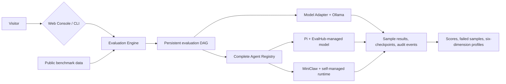

<h1 align="center">EvalHub</h1>

<p align="center"><strong>Local-first Benchmark evaluation for LLMs and coding agents.</strong></p>

<p align="center">
  Public datasets, local models, persistent workflows, sample-level evidence, and six-dimension capability reports on one reproducible evaluation path.
</p>

<p align="center"><strong>English</strong> · <a href="README_ZH.md">简体中文</a></p>

<p align="center">
  
  
  
</p>

<p align="center">
  <a href="#features">Features</a> ·
  <a href="#quick-start">Quick Start</a> ·
  <a href="#screenshots">Screenshots</a> ·
  <a href="#model-benchmark-report">Model Report</a> ·
  <a href="#agent-benchmark-report">Agent Report</a> ·
  <a href="#miniclaw-agent-evaluation-report">MiniClaw Report</a> ·
  <a href="#how-it-works">How It Works</a> ·
  <a href="#benchmarks">Benchmarks</a> ·
  <a href="#documentation">Documentation</a>
</p>

EvalHub is a unified evaluation platform for local LLM development. It runs real public benchmarks
and also puts complete coding agents such as Pi and MiniClaw through the same tasks and the same
hidden verifier. Every run keeps sample results, node states, resource metrics, and audit evidence —
not just a final score.

<a href="https://raw.githubusercontent.com/NEDONION/evalhub/main/docs/assets/screenshots/model-evaluation-setup.png">
  
</a>

<p align="center"><sub>Pick the benchmark, model, and sample range from one console, and follow the whole evaluation. Click the image for the full-size version.</sub></p>

## Features

| Capability | What EvalHub does today |
| --- | --- |
| **Model benchmarks** | Run real public datasets, call local models through Ollama, and keep sample-level results alongside aggregate scores |
| **Agent evaluation** | Run complete agents — Pi CLI or MiniClaw — through a controlled registry, sharing Coding Mini and the hidden verifier |
| **Reproducible workflows** | Record node states, checkpoints, retries, resource metrics, and audit events in a persistent DAG |
| **Six-dimension profiles** | Report knowledge, instruction following, math, reasoning, code, and safety separately, without scoring unevaluated dimensions as 0 |

## Quick Start

### Prerequisites

- Python 3.11+
- Node.js 20+ and npm
- [Ollama](https://ollama.com/) for local model inference
- Docker Desktop for code benchmarks such as HumanEval and MBPP

```bash
git clone https://github.com/NEDONION/evalhub.git
cd evalhub
python3 -m venv .venv
.venv/bin/python -m pip install -e ".[dev]"
npm --prefix frontend install
./scripts/start_local.sh
```

Then open [http://127.0.0.1:8000](http://127.0.0.1:8000). The script builds the React console,
prepares the pinned benchmark runtime, and connects to or starts Ollama when it is available locally.
For full installation, Agent Runtime, CLI, and troubleshooting details, see the
[local setup guide](docs/getting-started/20260804_本地运行指南.md).

To evaluate a MiniClaw checkout outside the adjacent directory, point EvalHub at the project root
before starting. EvalHub never reads or stores MiniClaw API keys — models, providers, tools,
policies, and memory stay under MiniClaw's own control:

```bash
export EVALHUB_MINICLAW_ROOT=/absolute/path/to/miniclaw
./scripts/start_local.sh
```

Headless evaluation grants one-time approval only for `write_file` / `edit_file` calls that already
passed MiniClaw's policy check and that EvalHub re-confirms are inside the current temporary sample
workspace. Commands, network access, memory, and anything outside the workspace continue to follow
MiniClaw's own approval boundary.

## Screenshots

<table>
  <tr>
    <td width="50%" valign="top">
      <strong>Model benchmark workflow</strong><br />
      <sub>Inspect the task DAG, node progress, resource metrics, and execution audit.</sub><br /><br />
      <a href="https://raw.githubusercontent.com/NEDONION/evalhub/main/docs/assets/screenshots/model-benchmark-workflow.png">
        
      </a>
    </td>
    <td width="50%" valign="top">
      <strong>Agent failure audit</strong><br />
      <sub>Replay agent messages, tool calls, file changes, and failure classification.</sub><br /><br />
      <a href="https://raw.githubusercontent.com/NEDONION/evalhub/main/docs/assets/screenshots/agent-failure-audit.png">
        
      </a>
    </td>
  </tr>
  <tr>
    <td width="50%" valign="top">
      <strong>Agent six-dimension result</strong><br />
      <sub>Read the capability profile by planning, comprehension, implementation, tool use, verification, and robustness.</sub><br /><br />
      <a href="https://raw.githubusercontent.com/NEDONION/evalhub/main/docs/assets/screenshots/agent-six-dimension-result.png">
        
      </a>
    </td>
    <td width="50%" valign="top">
      <strong>Model and dataset assets</strong><br />
      <sub>Manage Ollama model downloads and the cache of real benchmark data.</sub><br /><br />
      <a href="https://raw.githubusercontent.com/NEDONION/evalhub/main/docs/assets/screenshots/model-dataset-assets.png">
        
      </a>
    </td>
  </tr>
</table>

## Model Benchmark Report

The results below are a measured snapshot taken on 2026-08-05 on the same pinned
`evalhub-hexagon-v1` `1.2.0` suite: 9 local Ollama models and 2 hosted DeepSeek models each
completed 30/30 samples, for 330 model evaluations in total. The overall score is passed samples
divided by 30; each dimension holds 5 samples, so a single question moves that dimension by 20
points.

| Rank | Model | Runtime | Passed | Overall |
| ---: | --- | --- | ---: | ---: |
| 1 | `deepseek-v4-pro` | DeepSeek API | 25 / 30 | **83.33%** |
| 2 | `gemma4:12b` | Ollama | 21 / 30 | **70.00%** |
| 3 | `granite4.1:3b` | Ollama | 20 / 30 | **66.67%** |
| 3 | `qwen3:14b` | Ollama | 20 / 30 | **66.67%** |
| 3 | `deepseek-v4-flash` | DeepSeek API | 20 / 30 | **66.67%** |
| 6 | `granite3.3:8b` | Ollama | 16 / 30 | **53.33%** |
| 7 | `qwen2.5-coder:7b` | Ollama | 15 / 30 | **50.00%** |
| 8 | `qwen2.5:1.5b` | Ollama | 12 / 30 | **40.00%** |
| 9 | `deepseek-r1:1.5b` | Ollama | 10 / 30 | **33.33%** |
| 10 | `qwen2.5:0.5b` | Ollama | 8 / 30 | **26.67%** |
| 11 | `qwen3:4b` | Ollama | 6 / 30 | **20.00%** |

<a href="https://raw.githubusercontent.com/NEDONION/evalhub/main/docs/assets/hexagon-model-comparison.svg">
  
</a>

Every hexagon uses the same 0–100 scale, with the axis order matching the EvalHub console:
knowledge, instruction following, math, reasoning, code, safety. Each capability polygon is a closed
path, so shapes and weak spots can be compared directly.

| Model | Knowledge | Instruction | Math | Reasoning | Code | Safety |
| --- | ---: | ---: | ---: | ---: | ---: | ---: |
| `deepseek-v4-pro` | 60 | 100 | 80 | 80 | 80 | 100 |
| `gemma4:12b` | 60 | 100 | 100 | 40 | 20 | 100 |
| `granite4.1:3b` | 20 | 100 | 60 | 80 | 40 | 100 |
| `qwen3:14b` | 40 | 100 | 100 | 40 | 20 | 100 |
| `deepseek-v4-flash` | 80 | 100 | 0 | 40 | 100 | 80 |
| `granite3.3:8b` | 60 | 100 | 80 | 0 | 0 | 80 |
| `qwen2.5-coder:7b` | 40 | 80 | 60 | 20 | 40 | 60 |
| `qwen2.5:1.5b` | 40 | 60 | 60 | 20 | 0 | 60 |
| `deepseek-r1:1.5b` | 20 | 40 | 60 | 0 | 20 | 60 |
| `qwen2.5:0.5b` | 20 | 20 | 40 | 20 | 0 | 60 |
| `qwen3:4b` | 20 | 40 | 20 | 0 | 0 | 40 |

In this round `deepseek-v4-pro` has both the highest total and the most complete shape; among local
models `gemma4:12b` scores highest. `deepseek-v4-flash` shows a clear strong-code, weak-math profile.
Instruction following is already saturated on most mid-size and larger models, while code and
reasoning separate them more clearly.

> [!NOTE]
> This is a Mini Suite capability profile, not a complete official score on the upstream benchmarks.
> Plain Ollama, thinking models with an explicit `think=false`, and the OpenAI-compatible DeepSeek
> API form three generation-protocol groups; they share the same samples and graders, but rankings
> across protocol groups are observational only. Generation temperature is 0 throughout, and the
> maximum generation budgets for MMLU/IFEval/GSM8K/BBH/HumanEval/TruthfulQA/BBQ are
> 256/1024/512/512/1024/256/256 tokens respectively. HumanEval runs its hidden tests in a pinned
> Docker image. The baseline commit for this round is `4e9107c`.

## Agent Benchmark Report

The results below are a measured snapshot taken on 2026-08-05 on the same `coding-mini-v3` suite:
the Pi agent shell is fixed and only the underlying model is swapped. 4 API models and 6 local
Ollama models each completed 6/6 official samples, for 60 agent tasks in total. Across official
questions there were 23 passes, 311 tool calls, and 60 tool errors. The protocol pre-check runs
separately and counts toward neither the pass rate nor the tool-call totals.

| Rank | Model | Runtime | Pre-check | Passed | Tool calls | Tool errors | Avg time/task |
| ---: | --- | --- | --- | ---: | ---: | ---: | ---: |
| 1 | `deepseek-v4-pro` | DeepSeek API | compatible | 6 / 6 | 64 | 10 | 61.78 s |
| 2 | `moonshotai/Kimi-K2.7-Code` | SiliconFlow API | compatible | 5 / 6 | 59 | 11 | 83.00 s |
| 2 | `zai-org/GLM-5.2` | SiliconFlow API | compatible | 5 / 6 | 62 | 9 | 122.41 s |
| 2 | `deepseek-ai/DeepSeek-V4-Flash` | SiliconFlow API | compatible | 5 / 6 | 75 | 19 | 133.97 s |
| 5 | `qwen3:14b` | Ollama | compatible | 1 / 6 | 7 | 2 | 175.23 s |
| 5 | `qwen3:4b` | Ollama | compatible | 1 / 6 | 13 | 1 | 169.05 s |
| 7 | `gemma4:12b` | Ollama | compatible | 0 / 6 | 19 | 0 | 155.52 s |
| 7 | `granite4.1:3b` | Ollama | compatible | 0 / 6 | 12 | 8 | 11.73 s |
| 7 | `granite3.3:8b` | Ollama | incompatible | 0 / 6 | 0 | 0 | 17.42 s |
| 7 | `deepseek-r1:1.5b` | Ollama | incompatible | 0 / 6 | 0 | 0 | 30.11 s |

<a href="https://raw.githubusercontent.com/NEDONION/evalhub/main/docs/assets/agent-model-comparison.svg">
  
</a>

The hexagons share a 0–100 scale, with the axis order planning, code comprehension, implementation
correctness, tool use, verification, robustness; every capability path is a closed polygon. Click the
image to open the original SVG from the repository and zoom in.

| Model | Planning | Comprehension | Implementation | Tool use | Verification | Robustness |
| --- | ---: | ---: | ---: | ---: | ---: | ---: |
| `deepseek-v4-pro` | 100 | 100 | 100 | 100 | 100 | 100 |
| `moonshotai/Kimi-K2.7-Code` | 85 | 82 | 81 | 88 | 83 | 82 |
| `zai-org/GLM-5.2` | 85 | 82 | 81 | 88 | 83 | 82 |
| `deepseek-ai/DeepSeek-V4-Flash` | 60 | 64 | 81 | 100 | 100 | 100 |
| `qwen3:14b` | 0 | 0 | 0 | 35 | 33 | 36 |
| `qwen3:4b` | 15 | 9 | 19 | 18 | 22 | 18 |
| `gemma4:12b` | 0 | 0 | 0 | 0 | 0 | 0 |
| `granite4.1:3b` | 0 | 0 | 0 | 0 | 0 | 0 |
| `granite3.3:8b` | 0 | 0 | 0 | 0 | 0 | 0 |
| `deepseek-r1:1.5b` | 0 | 0 | 0 | 0 | 0 | 0 |

Process evidence explains why identical zeros have different causes: `gemma4:12b` and
`granite4.1:3b` passed the protocol pre-check and did call tools, but their final workspace failed
hidden verification; `granite3.3:8b` and `deepseek-r1:1.5b` never completed the structured tool
protocol and were marked `incompatible`. Both `qwen3:14b` and `qwen3:4b` are `compatible`, so their
low scores are not a protocol misclassification.

> [!NOTE]
> This is a 6-task everyday diagnostic set, not an official SWE-bench score. All runs use Pi CLI
> `0.74.1`, scaffold `d8a7cbaf0d432018`, and hidden workspace verification; API latency and local
> Ollama timing depend on hardware and network, so elapsed time should not be read directly as model
> inference speed. The separate 6-task SWE-bench Verified Mini will only publish scores once the gold
> patch reaches 6/6 in the official Docker harness — this round does not pad with zeros or mix
> unready results into the ranking.

## MiniClaw Agent Evaluation Report

The following are auditable results for the complete MiniClaw agent on the same `coding-mini-v3`
suite. For each model only the first official job that completed all 6 tasks without a task-level
infrastructure failure is used; there is no score-driven rerun or best-of selection. Models,
providers, tool calls, and the reasoning loop are managed by MiniClaw — EvalHub only supplies the
identical sample workspace, the write-approval boundary, and the hidden verifier.

| Model | Runtime | Pre-check | Passed | Failed | Tool calls / errors | Avg time/task |
| --- | --- | --- | ---: | --- | ---: | ---: |
| `deepseek-v4-pro` | DeepSeek API | compatible | **6 / 6** | — | 37 / 0 | 45.21 s |
| `deepseek-ai/DeepSeek-V4-Flash` | SiliconFlow API | incompatible (60 s pre-check timeout) | **5 / 6** | `async_worker_cleanup` | 40 / 0 | 46.03 s |
| `qwen3:4b` | Ollama | compatible | **0 / 6** | all 6 tasks | 2 / 0 | 100.55 s |

The official Flash job keeps the original failure in `async_worker_cleanup` caused by one upstream
protocol exception; the later targeted retest with the limit relaxed to 180 seconds only confirms
that the tool loop can finish and does not replace the official 5/6 result. `qwen3:4b` passed the
protocol pre-check, but left the workspace untouched on 5 tasks and timed out on 1, modifying 0 files
in total — so 0/6 is this round's official capability result, not a compatibility misclassification.

### Six-dimension results

The table converts persisted 0–1 scores to 0–100; the axis order matches the EvalHub Agent report.

| Model | Planning | Comprehension | Implementation | Tool use | Verification | Robustness |
| --- | ---: | ---: | ---: | ---: | ---: | ---: |
| `deepseek-v4-pro` | 100 | 100 | 100 | 100 | 100 | 100 |
| `deepseek-ai/DeepSeek-V4-Flash` | 85 | 81.82 | 80.95 | 88.24 | 83.33 | 81.82 |
| `qwen3:4b` | 0 | 0 | 0 | 0 | 0 | 0 |

### Pi vs. MiniClaw on the same models

The Pi figures come from the frozen 2026-08-05 matrix; the MiniClaw figures come from the single
official jobs above. Both sides share `coding-mini-v3`, the same scaffold, and the same hidden
verifier, but the agents differ in prompts, tool policy, and loop implementation.

| Model | Pi passed | MiniClaw passed | Pi tool calls | MiniClaw tool calls | Pi avg time/task | MiniClaw avg time/task |
| --- | ---: | ---: | ---: | ---: | ---: | ---: |
| `deepseek-v4-pro` | 6 / 6 | 6 / 6 | 64 | 37 | 61.78 s | 45.21 s |
| `deepseek-ai/DeepSeek-V4-Flash` | 5 / 6 | 5 / 6 | 75 | 40 | 133.97 s | 46.03 s |
| `qwen3:4b` | **1 / 6** | **0 / 6** | 13 | 2 | 169.05 s | 100.55 s |

These three single 6-task runs give no sign that MiniClaw can lift `qwen3:4b` from Pi's 1/6 to 5/6 —
here it passed one fewer task. Pro and Flash match Pi's pass counts while MiniClaw uses fewer tool
calls and less time per task. Such differences are useful for locating agent behavior, but a single
small-sample run is not enough to infer a general causal advantage of the shell itself.

### Excluded runs

| Job ID | Model | Observed | Reason for exclusion |
| --- | --- | ---: | --- |
| `job_4507d33dac62` | `deepseek-ai/DeepSeek-V4-Flash` | 0 / 6 | Before the fix, the provider parser rejected continuation chunks with an empty `function.name` in SiliconFlow SSE; the pre-check was `incompatible` and every official sample failed as a provider request error, so it does not count toward capability results |

After the compatibility fix, the first valid official job for the same model is `job_08aa057bf2db`
(5/6). The excluded run is kept only as protocol-boundary evidence and does not enter official
results or rankings.

> [!NOTE]
> All official jobs use MiniClaw `0.1.0`, `coding-mini-v3`, and scaffold `d8a7cbaf0d432018`; no extra
> permissions were granted for commands, network, memory, or writes outside the workspace. The hidden
> verifier determines pass counts and six-dimension scores, while the protocol pre-check only
> provides diagnostic evidence. This suite is a 6-task everyday agent diagnostic, not an official
> SWE-bench ranking; model responses, keys, and workspace contents are not written into this report.

## How It Works



The web console and the CLI reuse the same Python evaluation core. Model jobs and agent jobs enter
the same persistent job center: progress and resources are visible while running, and node evidence
can be replayed once finished. Model evaluations aggregate by model; agent evaluations aggregate by
complete candidate, such as `Pi · qwen` and `MiniClaw` — the two are never ranked together.

## Benchmarks

| Entry point | Current scope | Main output |
| --- | --- | --- |
| **Individual model benchmarks** | Registered public evaluations such as MMLU, GSM8K, IFEval, HumanEval, and MBPP | Official or pinned metrics, sample results, failed samples |
| **Hexagon Mini Suite** | `evalhub-hexagon-v1` `1.2.0`, a fixed 30 model calls covering six capability dimensions | Six-dimension profile, coverage, and reproducibility metadata |
| **Coding Mini Agent** | `coding-mini-v3` with Pi CLI / MiniClaw, 6 graded coding tasks, protocol pre-check, and a hidden verifier | Pass rate, difficulty report, agent six-dimension profile, process metrics |
| **SWE-bench Verified Mini** | 6 pinned official instances; opens only after the gold patch reaches 6/6 in the official Docker harness | A separate official task report, never mixed with Coding Mini |

> [!IMPORTANT]
> The Hexagon Mini Suite is a local capability profile, not a complete official score on the seven
> upstream benchmarks, and must not be restated as a paper or leaderboard result. Code evaluation
> requires Docker; the current Ollama adapter lacks prompt logprobs, so some individual official
> protocols block explicitly rather than producing fake scores through a generative approximation.

Hexagon 1.2 freezes model transport and answer grading separately: registered thinking models use a
top-level `think=false` on Ollama `/api/generate`, and the seven benchmarks use multiple-choice,
verbatim IFEval rules, numeric, BBH subtask, and HumanEval code protocols respectively. An empty
final answer blocks the node instead of being stored as a zero; a non-empty but wrong answer is still
scored zero under the same standard.

## Project Status

EvalHub is currently a **Local MVP**: the React console, Python service, SQLite-persisted jobs,
public dataset cache, and local Ollama inference are all in place. It suits local development and
reproducible experiments, but is not yet positioned as a multi-tenant production evaluation service.

## Documentation

| Document | Contents |
| --- | --- |
| [Documentation index](docs/README.md) | Entry point for all usage, architecture, product, and development docs |
| [Local setup guide](docs/getting-started/20260804_本地运行指南.md) | Installation, web, CLI, Agent Runtime, and troubleshooting |
| [System architecture](docs/architecture/20260804_系统架构.md) | Module boundaries, data flow, and extension principles |
| [Agent evaluation roadmap](docs/product/20260804_Agent评测路线图.md) | Current boundaries and direction of the Agent benchmark |
| [Hexagon suite retrospective](docs/development/20260804_专业六边形评测集建设与交付复盘.md) | Dataset pinning, grading safety, recovery, and verification lessons |

> Note: the documents linked above are currently written in Chinese.

## Contributing

Issues and suggestions are welcome through [Issues](https://github.com/NEDONION/evalhub/issues), as
are small, focused pull requests. Before submitting, please run:

```bash
.venv/bin/python -m ruff check .
.venv/bin/python -m pytest
```

Development constraints and common commands are documented in [AGENTS.md](AGENTS.md).
