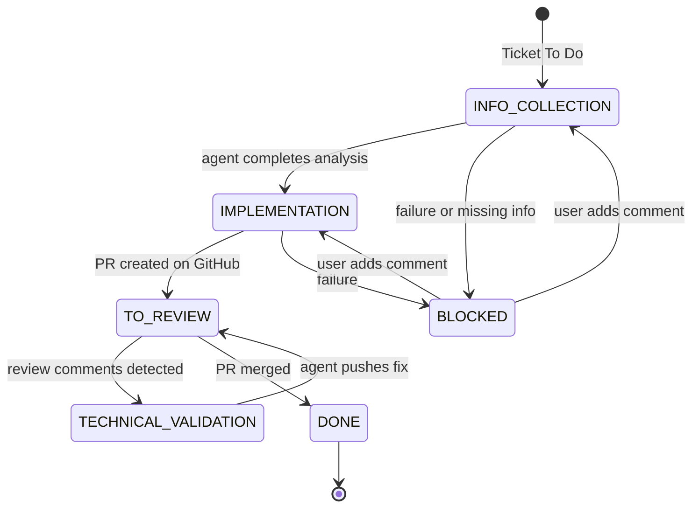

# Project Automation & Delivery Assistant (PANDA)

<p align="center">
  
</p>

<p align="center">
  <a href="https://github.com/Naofel-eal/PANDA/actions/workflows/ci.yml">
    
  </a>
  <a href="https://github.com/Naofel-eal/PANDA/stargazers">
    
  </a>
</p>

PANDA is an autonomous coding orchestrator for Jira and GitHub. Drop a ticket in Jira, and an AI agent ([OpenCode](https://opencode.ai)) picks it up, reads the checked-out repositories, implements the change, opens or reuses pull requests, and follows up on review and validation feedback.

There is no database and no durable queue. PANDA persists workflows to disk as JSON files and re-discovers Jira and GitHub state on every poll cycle.

## What the agent actually does

PANDA works in explicit workflow phases:

1. `INFORMATION_COLLECTION`
   The agent explores the local workspace in read-only mode, validates its understanding of the ticket, and asks for clarification only when it is genuinely blocked.
2. `IMPLEMENTATION`
   The agent modifies the code, runs relevant validation commands, and signals that the local work is complete. The orchestrator then creates branches, commits, pushes, and opens or reuses pull requests.
3. `TECHNICAL_VALIDATION`
   New human comments on an open PANDA pull request trigger a focused run on the reviewed branch so the agent can address review feedback.
4. `BUSINESS_VALIDATION`
   New Jira feedback on a ticket in "To Validate" triggers a follow-up run so business feedback can be implemented and published back to review.

The orchestrator also handles the surrounding workflow:

- Ineligible "To Do" tickets are moved to "Blocked" with a Jira comment describing what is missing.
- Merged PANDA pull requests automatically move the ticket from "To Review" to "To Validate".
- Review feedback is deduplicated by comparing comment timestamps with the latest commit on the branch.
- Blocked and validation tickets can resume either from a new Jira comment or from a ticket update that happened after the last PANDA comment.
- Orphaned tickets (stuck in non-terminal statuses without an active workflow) are recovered to "To Do" at startup.

## Quick start

See [docs/setup.md](docs/setup.md) for step-by-step instructions.

```bash
cp .env.example .env
# Fill in required values (see setup guide)
docker compose up --build
```

The orchestrator listens on `http://localhost:8080`. Useful endpoints:

- Swagger UI: `http://localhost:8080/q/swagger-ui`
- Health checks: `http://localhost:8080/q/health`

## Configuration

All configuration lives in `.env`. See [`.env.example`](.env.example) for the canonical list.

### Required variables

These are the minimum variables needed to run PANDA:

| Variable | Description |
|----------|-------------|
| `JIRA_BASE_URL` | Atlassian instance URL (e.g. `https://your-instance.atlassian.net`) |
| `JIRA_API_TOKEN` | Jira API token (Bearer) |
| `JIRA_PROJECT_KEY` | Jira project key to poll (e.g. `SCRUM`) |
| `JIRA_SERVICE_ACCOUNT_ID` | Jira account ID used by PANDA |
| `GITHUB_TOKEN` **or** `GITHUB_APP_*` | PAT or GitHub App credentials (see [setup guide](docs/setup.md)) |
| `PANDA_GITHUB_REPOSITORIES_0_NAME` | First repository slug (e.g. `my-org/api`) |
| `OPENCODE_MODEL` | Primary model (e.g. `github-copilot/claude-sonnet-4.6`) |
| `OPENCODE_SMALL_MODEL` | Smaller model for lighter tasks |
| Provider API key | One of: `COPILOT_GITHUB_TOKEN`, `ANTHROPIC_API_KEY`, `OPENAI_API_KEY`, or `GEMINI_API_KEY` |

### Optional variables

| Variable | Default | Description |
|----------|---------|-------------|
| **Jira** | | |
| `JIRA_BACKLOG_STATUS` | `Backlog` | Backlog status name |
| `JIRA_TODO_STATUS` | `To Do` | Intake status for new tickets |
| `JIRA_IN_PROGRESS_STATUS` | `In Progress` | Status when an agent run starts |
| `JIRA_BLOCKED_STATUS` | `Blocked` | Status when ticket needs clarification |
| `JIRA_REVIEW_STATUS` | `To Review` | Status when PRs are ready for review |
| `JIRA_VALIDATE_STATUS` | `To Validate` | Status after PRs are merged |
| `JIRA_DONE_STATUS` | `Done` | Final status |
| `JIRA_POLL_INTERVAL_MINUTES` | `1` | Jira poll frequency (minutes) |
| `JIRA_POLL_MAX_RESULTS` | `50` | Max tickets per poll |
| **GitHub** | | |
| `GITHUB_API_URL` | `https://api.github.com` | GitHub API base URL |
| `GITHUB_DEFAULT_BASE_BRANCH` | `main` | Fallback base branch for PRs |
| `PANDA_GITHUB_REPOSITORIES_N_BASE_BRANCH` | `GITHUB_DEFAULT_BASE_BRANCH` | Base branch override for a specific repo |
| `GITHUB_POLL_INTERVAL_MINUTES` | `1` | GitHub poll frequency (minutes) |
| `GITHUB_COMMIT_USER_NAME` | `PANDA Bot` | Git commit author name |
| `GITHUB_COMMIT_USER_EMAIL` | `panda@example.local` | Git commit author email |
| **Agent** | | |
| `AGENT_MAX_RUN_DURATION_MINUTES` | `15` | Hard timeout per agent run |
| `AGENT_STALE_TIMEOUT_BUFFER_MINUTES` | `5` | Orchestrator backup timeout buffer |

## Architecture overview

```
┌──────────────┐   poll    ┌───────┐
│ Orchestrator │ ───────── │  Jira │
│  (Quarkus)   │ ───────── │GitHub │
│              │   poll    └───────┘
│              │
│              │   HTTP    ┌───────┐
│              │ ────────> │ Agent │
│              │ <──────── │(OpenCode)
└──────────────┘  events   └───────┘
       │                       │
       └───── /workspace/runs ─┘
              (shared volume)
```

- The orchestrator owns Jira and GitHub credentials, prepares the shared workspace, and performs every Git publish operation.
- The agent runtime receives only the model-provider credentials needed for the current run. It never receives Jira credentials or the orchestrator GitHub token.
- Both containers share `/workspace/runs`, where repositories are checked out for the agent to inspect or modify locally.
- Workflows are persisted as JSON files under the workspace root, enabling recovery after restarts.

## Workflow State Machine



## Security

PANDA runs an AI agent with shell access, so the architecture is built around one rule: the agent never handles business-system secrets directly.

### Credential isolation

The agent container does not receive Jira credentials or the orchestrator GitHub token. The only credentials passed to the agent runtime are the ones required for model inference (`COPILOT_GITHUB_TOKEN`, `OPENAI_API_KEY`, `ANTHROPIC_API_KEY`, or `GEMINI_API_KEY`, depending on the selected model).

All Git operations (clone, fetch, push) are executed by the orchestrator, which injects authentication per command with `git -c http.extraHeader`. Nothing is written to `.git/config`.

### Network segmentation

The Docker Compose setup uses two networks:

- `control` (internal): orchestrator-to-agent communication only
- `egress`: outbound access for Jira, GitHub, and model providers

The runtime also blocks common direct network helpers such as `curl`, `wget`, and `gh` during agent runs.

### Agent guardrails

- All agent callbacks are matched against the active `agentRunId`.
- Repository writes are constrained to the shared workspace root.
- Published branches must start with `panda/`.
- The agent is instructed not to start applications and to limit validations to compile, lint, and test commands.
- The runtime enforces a hard timeout, then the orchestrator applies stale-run cancellation as a backup.
- Zombie runs from previous executions are detected and force-killed on startup.

### Request validation

Incoming agent events are validated with Bean Validation (`@Valid`, `@NotNull`, `@NotBlank`) before they reach the application layer.

## Detailed documentation

- [Setup guide](docs/setup.md) - step-by-step installation and configuration
- [Architecture](docs/architecture.md) - hexagonal design, workflow holder, polling, timeout and security boundaries
- [Architecture diagrams](docs/architecture-diagrams.md) - Mermaid diagrams: system, sequence, auth, timeouts
- [Workflow](docs/workflow.md) - end-to-end flow diagram and Jira transitions
- [Scenarios](docs/scenarios.md) - concrete scenarios handled by the current implementation
- [Agent callbacks](docs/agent-callbacks.md) - HTTP contract between the agent runtime and the orchestrator
- [Event catalog](docs/events.md) - command and event payloads used by the system

## License

PANDA is released under the [PolyForm Noncommercial License 1.0.0](LICENSE).

- **Noncommercial use** (personal projects, research, education, charitable / public-interest organizations) is permitted free of charge.
- **Commercial use by a company or for-profit activity** requires a separate commercial license. Contact **naofel.eal@gmail.com** to obtain one.

See the [LICENSE](LICENSE) file for the full terms.
