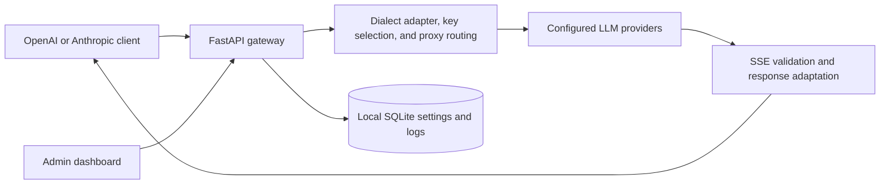

# Mugen Routes | Self-Hosted LLM API Gateway

Mugen Routes is a self-hosted LLM API gateway for OpenAI Chat Completions,
OpenAI Responses, and Anthropic Messages. Connect clients to one FastAPI
service and manage upstream providers, API key rotation, proxy routing, and
streaming from a web dashboard.

## Features

- **Multi-dialect routing.** Translate requests and responses between supported
  OpenAI and Anthropic formats, including tool calls. Configure upstream
  endpoints in priority order with per-endpoint models and fallback rules.
- **Key rotation.** Set a daily reset time in IST for exhausted upstream keys.
  Use a separate gateway key for client authentication.
- **Webshare single-proxy recovery.** Upstream HTTP errors leave the exit
  available. Five consecutive transport failures trigger a 30-second cooldown
  with automatic recovery. Enable auto-switch to keep one upstream key per
  Webshare exit IP on each endpoint. The gateway requests a provider
  replacement only on a key switch that needs a distinct exit.
- **Streaming.** Route server-sent events (SSE), validate completion before
  relaying buffered attempts, and keep the client connection alive while an
  upstream request runs.
- **Local Hindi-to-Hinglish transliteration.** Opt in to Devanagari-to-Latin
  transliteration on supported request and response paths. This feature runs
  inside the gateway.

## Architecture



## Quick start

Clone the repository and choose Docker Compose or Python.

```sh
git clone https://github.com/Naruto859/MugenRoutes.git
cd MugenRoutes
```

### Docker Compose

Create a local `.env` file with `ADMIN_PASSWORD` and `GATEWAY_KEY`. Use a
strong admin password of at least 16 ASCII characters and a separate, randomly
generated client key. The Compose configuration binds the gateway to loopback
and persists its database under `./data`.

```sh
docker compose up --build -d
curl --fail http://127.0.0.1:8787/health
```

### Python

Use Python 3.11 or newer. Set `ADMIN_PASSWORD` and `GATEWAY_KEY` in your shell
environment before seeding the database.

```sh
python3 -m venv .venv
. .venv/bin/activate
python -m pip install -r requirements.txt
python seed.py
python -m uvicorn app.main:app --host 127.0.0.1 --port 8787
```

### Connect an SDK

Open `http://127.0.0.1:8787`, sign in, and add an upstream endpoint with its
API mode, provider key, and proxy preferences. Use a gateway key in your
client and reserve the provider key for the endpoint configuration.

| Client | Base URL | Gateway route |
| --- | --- | --- |
| OpenAI Chat Completions | `http://127.0.0.1:8787/v1` | `/v1/chat/completions` |
| OpenAI Responses | `http://127.0.0.1:8787/v1` | `/v1/responses` |
| Anthropic Messages | `http://127.0.0.1:8787` | `/v1/messages` |

## Configuration

| Setting | Location | Purpose |
| --- | --- | --- |
| `ADMIN_PASSWORD` | Environment | Initial dashboard password |
| `GATEWAY_KEY` | Environment | Initial client authentication key |
| `GATEWAY_DATA_DIR` | Environment | Directory for SQLite data, defaulting to `./data` |
| Endpoint URL, API mode, and keys | Dashboard | Upstream connection, primary and spare API keys, and optional model override |
| Daily Key Reset Time | Dashboard | Local time in IST when exhausted endpoint keys become eligible again |
| Proxy priority and fallback | Dashboard | Direct routing, configured proxies, or optional proxy-pool fallback |
| Use Webshare Proxy | Dashboard | Opt in to Webshare inventory for an endpoint |
| Auto-switch Webshare proxy on API key switch | Dashboard | Require distinct Webshare exits for upstream keys |
| Hindi-to-Hinglish transliteration | Dashboard | Enable local transliteration per endpoint |
| `github_fetcher_enabled` | Gateway settings | Opt in to fetching public proxies, disabled by default |

## Security and privacy

- Keep the admin dashboard on loopback or a trusted network. Use HTTPS and
  restrict administrative access when deploying behind a reverse proxy.
- Keep `.env` files, SQLite data, proxy credentials, and provider keys out of
  version control. Protect backups and request logs as runtime data.
- Use trusted upstreams and proxies. Public proxy fetching is opt-in.
  Verify your routing preferences before sending sensitive requests.
- Request logs show masked key previews. Logs can contain request data,
  so control who can read or export them.

## Tests

Install `pytest` and `pytest-asyncio` in the virtual environment. Install
Node.js for dashboard JavaScript checks. Run the Webshare, routing, and key
reset regressions with a temporary database.

```sh
test_data_dir="$(mktemp -d)"
GATEWAY_DATA_DIR="$test_data_dir" python -m pytest -q \
  test_gateway_proxy_sse_webshare.py test_gateway_fix_batch.py \
  test_endpoint_key_guard.py test_direct_fallback_routing.py
```

## License

Mugen Routes is released under the [MIT License](LICENSE).
