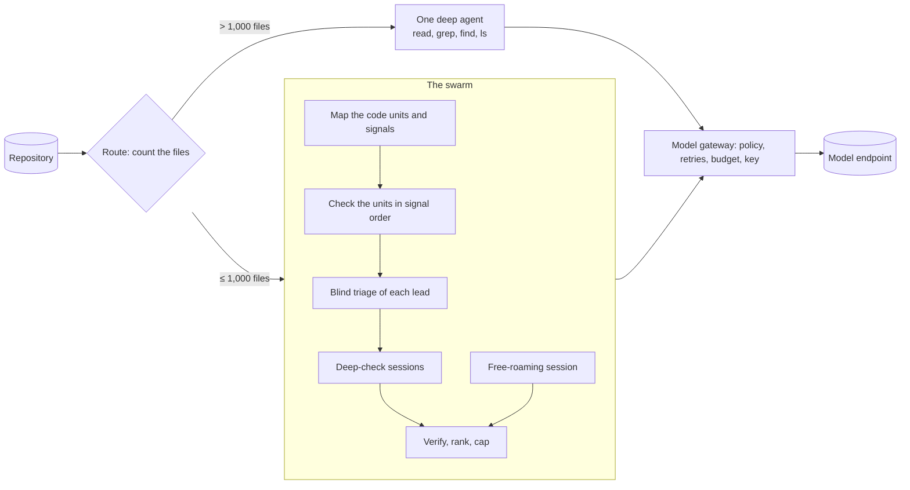

<picture>
  <source media="(prefers-color-scheme: dark)" srcset="docs/assets/header-dark.png">
  
</picture>

<p align="center">
  <b>Put a swarm of AI sentries on your code.</b><br>
  SentryTower reads your repository the way an attacker would and reports each vulnerability<br>
  with the file, the line, the CWE and the evidence.
</p>

<p align="center">
  <a href="CHANGELOG.md"></a>
  <a href="#results"></a>
  <a href="#license"></a>
  <a href="pyproject.toml"></a>
  <a href="pyproject.toml"></a>
  <a href="docs/output-format.md"></a>
</p>

<p align="center">
  <a href="#quick-start"><b>Quick start</b></a> &nbsp;·&nbsp;
  <a href="#results"><b>Results</b></a> &nbsp;·&nbsp;
  <a href="#how-it-works"><b>How it works</b></a> &nbsp;·&nbsp;
  <a href="#run-it-in-ci"><b>CI</b></a> &nbsp;·&nbsp;
  <a href="docs/configuration.md"><b>Docs</b></a>
</p>

<p align="center">
  
</p>
<p align="center"><sub>
  A real session of SentryTower 0.1.0, recorded with <a href="scripts/demo/record-readme.sh"><code>scripts/demo/record-readme.sh</code></a>:
  the setup, then a 43-minute audit of <a href="https://github.com/digininja/DVWA">DVWA</a>, a PHP application that is vulnerable on purpose,
  with DeepSeek V4.1 Flash on OpenRouter for $1.91. Nothing is staged; the audit plays 107 times faster.
</sub></p>

## Why SentryTower

<table>
<tr>
<td width="50%" valign="top">

**🎯 Top detection in our own test**<br>
On 123 advisories published after the model's training cutoff, an earlier
internal build of SentryTower detected 29.1% and led each of seven open-source harnesses with the same
model, budget and sandbox; against two of them, the lead is within the margin
of error. We ran this test ourselves. [See the results →](#results)

</td>
<td width="50%" valign="top">

**💸 A budget in dollars**<br>
Each audit has a cost cap of $2 by default, and the gateway stops new calls
at it. A larger cap buys a deeper audit (a preview). Every report states the
spend, why the run stopped and how much of the code it checked.

</td>
</tr>
<tr>
<td width="50%" valign="top">

**🏰 A swarm that follows the signals**<br>
An inventory maps every code unit and its security signals. The swarm
checks the units in the order of their signals until the queue or the
budget ends, traces the strongest leads in deep agent sessions and verifies
their findings blind. The report says how many units it checked. Above
1,000 files, one deep agent takes the watch.

</td>
<td width="50%" valign="top">

**🔌 Bring any model**<br>
OpenRouter, any OpenAI-compatible endpoint, or a model server on your own
machine: Ollama, LM Studio, vLLM or llama.cpp. Run one model everywhere, or
a fast model for the checks and a strong one for the agents.

</td>
</tr>
<tr>
<td width="50%" valign="top">

**⚙️ Built for CI**<br>
SARIF 2.1.0 for GitHub code scanning, JSON for your own tools, and a web
page and a Markdown report for people. Exit codes for release gates, and a
GitHub Action that does the upload for you.

</td>
<td width="50%" valign="top">

**🛡️ Safe with untrusted code**<br>
The agents get four read-only tools that cannot leave the repository. No
program from the repository ever runs, and your key never leaves the parent
process. [Security →](#security)

</td>
</tr>
</table>

## Quick start

You need a key for [OpenRouter](https://openrouter.ai/keys) or any
OpenAI-compatible endpoint. A model server on your own machine needs no key.
There are three ways to install SentryTower.

**From a clone**, on macOS or Linux. `install.sh` installs the
`sentrytower` command with uv, gets Python 3.11+, Node.js, the Pi agent,
ripgrep and fd where it can without administrator rights, prints the
command for each tool that it cannot get, then starts the guided setup:

```sh
git clone https://github.com/National-Compute/sentrytower && cd sentrytower && ./install.sh
```

**With Docker**, with nothing else to install. The image
`ghcr.io/national-compute/sentrytower:0.1.1` (linux/amd64 and linux/arm64)
holds Python, Node.js, the Pi agent, ripgrep and fd:

```sh
export SENTRYTOWER_API_KEY=...        # your key; it reaches the container only in its environment
mkdir -p ~/sentrytower-results
docker run --rm -e SENTRYTOWER_API_KEY --user "$(id -u):$(id -g)" \
  --read-only --tmpfs "/home/dev:uid=$(id -u),gid=$(id -g)" --tmpfs /tmp \
  -v "$PWD:/workspace/repo:ro" -v ~/sentrytower-results:/workspace/out \
  ghcr.io/national-compute/sentrytower:0.1.1 audit /workspace/repo --out /workspace/out
```

This audits the current folder. Keep `--user`: the output folder must
belong to the user of the run.

**With uv**, for the guided setup and the interactive terminal. You need
Python 3.11+, Node.js 22.19+, the Pi agent, ripgrep and fd:

```sh
uv tool install git+https://github.com/National-Compute/sentrytower@v0.1.1    # or: pipx install git+https://...@v0.1.1
npm install -g @earendil-works/pi-coding-agent@0.84.1                        # the agent runtime
brew install ripgrep fd                                                      # or: apt install ripgrep fd-find

sentrytower setup
```

The guided setup takes about a minute:

1. **Name your agent** and give it a colour. Juno in Sand is the default.
2. **Connect your models:** OpenRouter, your own endpoint, or a model server
   that the setup finds on your machine. The key is checked before anything
   is saved.
3. **Choose one model or more** from a searchable list with the context
   window, the price and the tool support of each. The default model,
   DeepSeek V4.1 Flash, carries a ★.
4. **Choose the depth** of an audit: quick ($0.50), standard ($2, the
   measured run, proposed), deep ($10) or max ($50), another amount, or no
   cap. Deep and max are a preview: more checks, with an effect on the
   findings that is not yet measured. Then a time limit. A model without
   prices gets no cap and the standard 20M tokens.
5. **Run your first audit** straight from the setup.

From then on:

```sh
sentrytower                        # home: audit, settings, the last report
sentrytower audit path/to/repo     # audit a repository
sentrytower last                   # reopen the results of the last audit
sentrytower doctor                 # check the tools, the key and the endpoint
```

Your key stays in your environment (`SENTRYTOWER_API_KEY` or
`OPENROUTER_API_KEY`) or, when you ask for it, in the macOS Keychain or the
Linux keyring. It is never written to a file.

## What you get

<p align="center">
  
</p>
<p align="center"><sub>The six findings of the recorded audit, shown again by <code>sentrytower last</code>.</sub></p>

Every audit writes five files to its results folder, and in a terminal it
opens `report.html` in your browser when it ends (`--no-open` turns this off):

| File | What it holds |
| --- | --- |
| `report.html` | The report as one web page: the findings by severity, each with its location, explanation and CWE link |
| `findings.json` | Each finding with its title, severity, CWE, locations, evidence and exploit conditions ([schema](docs/output-format.md)) |
| `findings.sarif` | SARIF 2.1.0 for GitHub code scanning and any SARIF viewer |
| `report.md` | A readable report to share or attach to a ticket |
| `run.json` | The result of the run (its status, why it stopped, the spend and the checked units), the route, the models, the tokens and the timings |

Each report starts with the result: the spend against the cap, why the run
stopped, and how many units it checked. Exit code 0 means a complete run;
with `--fail-on high`, a high or critical finding gives exit code 1. Exit
code 4 means that the run failed or is incomplete, for example because the
provider refused the key; the outputs are still written. In CI, in a pipe or
with `--plain`, SentryTower prints plain log lines instead of the live view.

## Results

> [!IMPORTANT]
> **Our own benchmark, not an independent test.** We designed, ran and
> scored this comparison ourselves, and we also ran each of the other
> harnesses. The numbers are for an earlier internal build of SentryTower
> with GLM 5.3 Flash, not for this release and its default model.

In a pre-registered comparison on 123 security advisories published after
the model's training cutoff, an earlier internal build of SentryTower detected more vulnerabilities
than each of the seven open-source harnesses it was compared with. Against
Clearwing and Visa VVAH, the lead is within the margin of error, and
Piolium, 0 and OpenHack had fewer false alarms. Every harness ran with the
same mid-size model, the same token and time budget and the same offline
sandbox.

<picture>
  <source media="(prefers-color-scheme: dark)" srcset="docs/assets/results-dark.svg">
  
</picture>

<picture>
  <source media="(prefers-color-scheme: dark)" srcset="docs/assets/cost-dark.svg">
  
</picture>

| Harness | Detection | False alarms | Cost a run | Lead of SentryTower [90% CI] |
| --- | --- | --- | --- | --- |
| **SentryTower (internal build)** | **29.1%** [21.8, 36.5] | 11.1% | $0.30 | baseline |
| Piolium | 11.1% | 9.4% | $0.10 | +17.9 pp [+10.4, +25.4] |
| Vercel deepsec | 17.9% | 21.4% | $0.25 | +11.1 pp [+1.8, +20.0] |
| 0 (0sec) | 6.8% | 6.8% | $0.06 | +22.2 pp [+15.7, +28.8] |
| OpenHack | 16.8% (113 fixtures) | 6.2% | $0.21 | +12.4 pp [+5.3, +19.8] |
| Codex Security | 10.3% (29 fixtures) | 17.2% | $0.40 | +20.7 pp [+6.7, +35.7] |
| Clearwing | 24.5% (53 fixtures) | 39.6% | $0.54 | +7.5 pp [−3.8, +19.2] |
| Visa VVAH | 28.0% (50 fixtures) | 26.0% | $1.02 | +6.0 pp [−4.0, +16.0] |

Each lead is measured on the fixtures that harness completed; an interval
that crosses zero is not a separated result. [docs/benchmarks.md](docs/benchmarks.md)
has the method, the sensitivity views and every limit: one model
(`z-ai/glm-5.3-flash`, the default model of the internal builds), answer
keys drafted by models, and about 7 in 10 vulnerabilities that no harness
found.

## How it works



1. **Route.** SentryTower counts the files once, before any model call. The
   count (rule `size-route-v2`) leaves out the folders that hold no code of
   the project: version control (`.git` and similar), installed
   dependencies and caches (`node_modules`, `.venv`, `__pycache__` and
   similar), vendored, generated and build output (`vendor`, `dist`,
   `build`, `target` and similar) and virtual environments. Up to 1,000
   files go to the swarm; larger repositories go to one deep agent. The
   threshold was fixed before the benchmark.
2. **The swarm.** A deterministic inventory maps the code units and the
   security signals with ripgrep. The model checks the units in the order
   of their signals until the queue or the budget ends, a blind triage
   tests each lead, and the strongest leads get a deep-check agent session
   while a free-roaming session explores the whole repository. Each
   deep-check finding is verified blind, then the findings are ranked and
   capped: at most 6 findings, 2 per file. A deeper run adds a second tier
   of findings after them, under the preview label. The report says how
   many units the run checked.
3. **One deep agent.** For large repositories: the
   [Pi coding agent](https://www.npmjs.com/package/@earendil-works/pi-coding-agent)
   with four read-only tools, an audit method, a token reserve and one
   final turn.
4. **The gateway.** Every model call goes through a local gateway. It holds
   the key, applies the request policy of the model, retries transient
   failures and enforces the cost cap and the token ceiling. A call that
   fits under the cap only after the calls in flight end waits for them,
   up to 10 minutes. When dollars end the run (a cap above $2, or a cap that
   buys fewer than the 20M tokens of the standard run), no new work starts
   at 85% of the cap, and the running agent sessions finish. When the
   provider refuses the key, the account or the route (HTTP 401, 402, 403
   or 404), the gateway sends no more calls and the run fails with exit
   code 4.

[docs/architecture.md](docs/architecture.md) describes each phase and the
records of a run.

## Run it in CI

**GitHub Action.** It runs the published image of its version, with the
repository mounted read-only:

```yaml
permissions:
  contents: read
  security-events: write
steps:
  - uses: actions/checkout@v7
    with:
      persist-credentials: false
  - uses: National-Compute/sentrytower@v0.1.1
    with:
      api-key: ${{ secrets.OPENROUTER_API_KEY }}
      # fail-on: high
      # depth: deep
```

What the Action shows depends on who can read the repository:

- A private or internal repository gets the findings in the job summary,
  in the workflow artifact and in code scanning.
- On a public repository (or when the visibility is unknown), every reader
  can see the job summary, the annotations and the log, and can download
  the artifacts. So the Action shows counts only, and the artifact holds
  `run.json` only. With `upload-sarif: auto` (the default) it uploads the
  findings to code scanning only for a run of the default branch that is
  not a pull request run, for example a scheduled run: GitHub shows the
  alerts of a pull request to every reader, and the alert list only to
  people with write access. `public-findings: "true"` shows the findings
  to every reader.
- Exit code 4 (a failed or incomplete run, for example a key that the
  provider refuses) fails the step with the reason of the run, whatever
  `fail-on` says. A usage error (2) and an environment problem (3) also
  fail it, and exit code 1 fails it when `fail-on` is set.

**Container.** In another CI system, run the image of the
[quick start](#quick-start). Each published image has an SBOM and a build
provenance attestation; pin the digest that the check shows for an image
that cannot change:

```sh
gh attestation verify oci://ghcr.io/national-compute/sentrytower:0.1.1 --repo National-Compute/sentrytower
```

`docker build -f docker/Dockerfile .` still builds the image from a clone.
[docs/deployment.md](docs/deployment.md) covers Docker Compose with an
egress allowlist, GitLab CI and a Kubernetes Job.

## Configuration

`sentrytower setup` writes
`~/.config/sentrytower/config.toml`, and `sentrytower settings` shows what
is in use and where each value comes from. Profiles keep other setups apart
(`sentrytower setup --profile work`, then `sentrytower --profile work`).
`SENTRYTOWER_*` variables and command-line options override the file.

One model runs every role by default: `deepseek/deepseek-v4.1-flash-1017`.
Give the many short checks a fast model and the agent sessions a strong
one:

```sh
sentrytower audit . --fast-model z-ai/glm-5.3-flash --agent-model deepseek/deepseek-v4.1-flash-1017
```

or set a model for each role in the settings:

```toml
[models]
default = "deepseek/deepseek-v4.1-flash-1017"
unit_check = "vendor/small-model"
deep_check = "vendor/agentic-model"
```

The budget is in dollars. Each audit has a cost cap of $2 by default, when
each model of the route has prices. With the built-in models, $2 is the
standard run: the measured plan of 20M tokens with its measured pacing, and
the cap is an upper limit only (on the agent route, the agent also writes
its answer at 85% of the cap). A larger cap (`--max-cost-usd 10`,
`--depth deep`, or the setup) buys a deeper audit of the same repository:
more unit checks and deep checks, deeper ones, three blind verifications of
each finding, focus sessions on one weakness family each, and on a large
repository one agent session for each slice of the code. Each depth above
the standard run carries the label "preview: more checks; effect on
findings not yet measured", and its further findings come after the
standard ones, in a second tier.

- `0` means no cap (`--max-cost-usd 0`, `max_cost_usd = 0` or
  `SENTRYTOWER_MAX_COST_USD=0`): the run then has 20M tokens.
- A cap needs prices. A model without prices runs without a cap and with
  20M tokens, and a cap that you give for it is a usage error (exit code
  2): add its prices to its `[policies."<model>"]` table, or give `0`.
- `--max-tokens` sets an upper limit of the tokens.

[docs/configuration.md](docs/configuration.md) lists every key, variable and
option, and [`examples/`](examples/) has single-model, multi-model and local
endpoint setups, GitHub Actions and GitLab CI.

## Security

The audited code is untrusted input for the model, so SentryTower:

- gives the agents four read-only tools and keeps them inside the audited
  repository; a path outside it, also through a symbolic link, gets an
  error;
- keeps the provider key in the parent process; the engines only get a
  random credential for a local gateway;
- never reads a configuration file from the audited repository and never
  runs a program from it;
- gives the engines, the agent sessions and their tools only the absolute
  PATH entries outside the audited repository, so no program of the
  repository runs in place of `node`, `rg` or `fd`;
- writes the outputs only into an output folder that is not a symbolic
  link, has no link on its path inside the audited repository and belongs
  to the user of the run (else exit code 2); each file goes to a new
  private file first and is renamed in one step, so a link at an output
  name is replaced, never followed;
- writes each control character of model text, of file names of the
  repository and of error messages as `?` in the terminal;
- asks OpenRouter, on the built-in routes, for endpoints that do not store
  or train on the data ([where your code goes](#where-your-code-goes)).

Run audits in the container with the repository mounted read-only and
network access only to the model endpoint
([hardening](docs/deployment.md#hardening)). Each finding is a claim of a
language model: confirm it in the code before you act on it. Report a
vulnerability in SentryTower privately ([SECURITY.md](SECURITY.md)).

## Where your code goes

An audit sends the code of the repository to one place: the model endpoint
that you configure.

1. The engines read the repository. The funnel puts code units into its
   model calls, and the agent sessions read files with their four
   read-only tools; what they read goes into their model calls.
2. Each model call goes to the local gateway on `127.0.0.1`, in the parent
   process. The gateway holds the key, rewrites the request with the
   policy of the model and sends it to the configured endpoint:
   `https://openrouter.ai/api/v1` by default, or your `--base-url`, through
   the proxy of `HTTPS_PROXY` when you set one. Each request also carries
   the headers `X-Title: SentryTower` and `HTTP-Referer` with the project
   URL (a `[provider.headers]` table replaces them).
3. On the built-in routes (DeepSeek V4.1 Flash and GLM 5.3 Flash on
   OpenRouter), each request names an allowlist of providers and sets
   `"data_collection": "deny"`: OpenRouter then uses only the endpoints of
   the list that do not store or train on the data. When no endpoint of
   the list serves the model under this policy, OpenRouter answers HTTP 404
   and the run fails with exit code 4. Another model gets no provider
   object unless you give it one, and a `provider` table in
   `[policies."<model>"]` replaces the whole route, this field too.
4. The outputs stay on your disk: the five files of the output folder (the
   findings quote code; `run.json` holds numbers, codes, model IDs and
   paths, no prompt and no answer text) and the run state in a private
   temporary folder, which holds the agent sessions with code. A complete
   run deletes its run state, unless you give `--keep-state`; a run that is
   not complete keeps it.

SentryTower sends nothing else: no telemetry, no update check and no crash
report. Each agent session runs Pi with `PI_OFFLINE=1`, which turns off the
update checks and the install telemetry of Pi. Other requests come only
from commands that you start: `sentrytower doctor` sends one short request
without code to the endpoint (`--offline` sends none), and
`sentrytower setup` reads the model list of the endpoint, checks the key
and looks for model servers on the usual ports of `127.0.0.1`. In a
terminal, a short `--model` name (`deepseek`) reads the model list of the
endpoint too. The GitHub Action uploads the outputs to GitHub as its inputs
say (the SARIF file to code scanning, the files as a workflow artifact),
and it asks the GitHub API for the visibility of the repository when the
event does not give it.

## Contributing and citation

[CONTRIBUTING.md](CONTRIBUTING.md), [CODE_OF_CONDUCT.md](CODE_OF_CONDUCT.md),
[CHANGELOG.md](CHANGELOG.md). Questions: [docs/faq.md](docs/faq.md).

```bibtex
@software{sentrytower_2026,
  title   = {SentryTower: size-routed LLM security audits of source repositories},
  author  = {{The SentryTower Authors}},
  year    = {2026},
  version = {0.1.1},
  url     = {https://github.com/National-Compute/sentrytower},
  license = {Apache-2.0 OR MIT}
}
```

## License

SentryTower is licensed under either of

- the Apache License 2.0 ([LICENSE-APACHE](LICENSE-APACHE)), or
- the MIT License ([LICENSE-MIT](LICENSE-MIT)),

at your option. [NOTICE](NOTICE) lists the third-party software: the Pi
coding agent, ripgrep, fd and others.

Unless you state otherwise, each contribution that you submit for inclusion
in SentryTower is licensed under both, as defined in the Apache License 2.0,
without additional terms or conditions.
