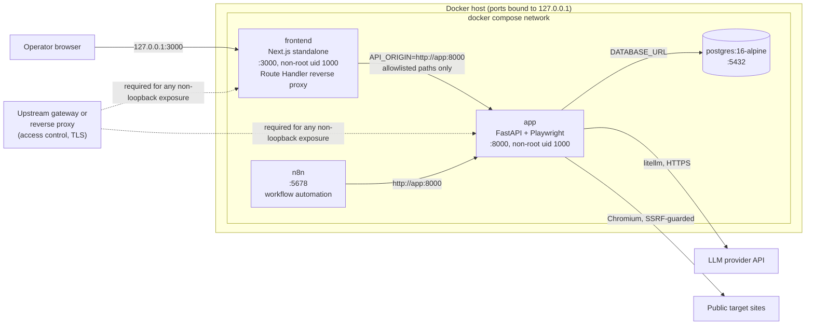
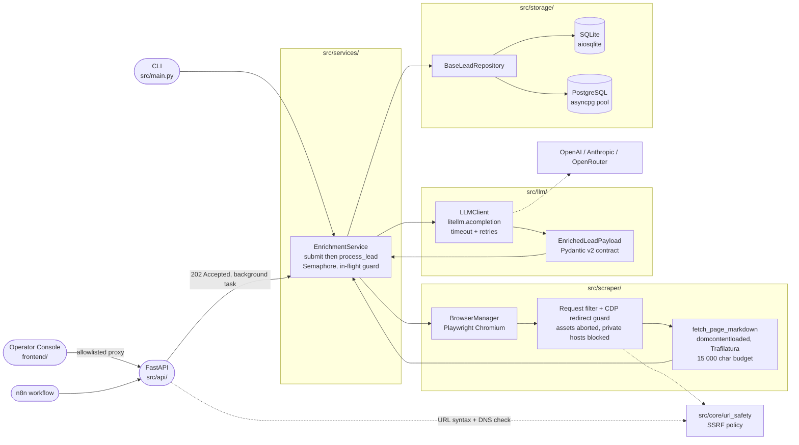

# B2B Lead Enrichment & Scoring Agent

[](https://github.com/Nazar-Plokhuta/lead-enrichment-agent/releases/latest)
[](https://github.com/Nazar-Plokhuta/lead-enrichment-agent/actions/workflows/ci.yml)
[](https://www.python.org/downloads/)
[](https://github.com/Nazar-Plokhuta/lead-enrichment-agent/actions/workflows/ci.yml)

**Turn a company URL into a scored, evidence-grounded, outreach-ready lead in seconds.**

Give it a domain. It reads the site with a guarded headless browser, scores the company against a four-dimension ICP rubric, and returns a validated record: what the company does, who it sells to, a 0–100 fit score with the arithmetic shown, and an icebreaker built from a detail on the page. Run it as a **CLI**, a **REST API**, a web **Operator Console**, or from an **n8n** workflow.


*The Operator Console: submit a URL, watch the lead resolve from `PENDING`, then inspect the rubric breakdown and the ready-to-send outreach.*

- **Business value**: about 9 s and under $0.002 of LLM spend per company, against 15–20 minutes of manual prospecting (illustrative figures, [derivation below](#what-problem-does-it-solve)).
- **Engineering rigor**: SSRF defence that vets every browser request and redirect hop, a strict Pydantic contract with zero raw JSON parsing, and 212 offline tests that need no network, no browser and no API key.
- **Production topology**: one `docker compose up` starts the API, PostgreSQL, the console and n8n, all healthchecked and bound to loopback, with the application containers running as non-root.

**Jump to**: [What it solves](#what-problem-does-it-solve) · [See it work](#see-it-work) · [Accuracy](#how-accurate-is-the-scoring) · [Security](#safe-to-point-at-the-open-internet) · [Topology](#production-topology) · [Quickstart](#quickstart) · [REST API](#rest-api) · [Architecture](#architecture) · [Testing](#testing-and-verification) · [Limits](#known-limits-and-roadmap)

---

## What problem does it solve?

Outbound teams qualify accounts by hand: open the site, work out what the company does and who it sells to, decide whether it fits the ideal customer profile (ICP), then write an opener. It is slow, it varies between reps, and it does not scale to a list of hundreds. This agent performs that pass automatically and records its reasoning, so a rep starts from a scored, explained lead instead of a blank tab.

| | Manual SDR research | This agent |
|---|---|---|
| Time per company | 15–20 min | ~9 s end to end |
| LLM cost per company | n/a (labour) | < $0.002 |
| Qualification | Varies by rep and by day | One versioned rubric (v2.0), four fixed score bands, sub-scores recorded in the rationale |
| Non-targets (B2C, retail, NGO) | Spotted after the research is done | Disqualified automatically: IKEA scores 0 |
| Outreach | Opener written by hand | Icebreaker and suggested angle drawn from the page |
| Throughput | One rep | Concurrent pipelines (default 3), idempotent re-submission |

> **How these figures were derived.** They are illustrative, not a benchmark.
> - *15–20 min* is a planning assumption for manual prospecting, not something measured here.
> - *~9 s* was observed for `linear.app` (scrape plus LLM). The bounded worst case per lead is a 20 s navigation timeout plus up to 135 s of LLM time.
> - *< $0.002* is an estimate at `gpt-4o-mini` list price ($0.15 / $0.60 per million input / output tokens, from LiteLLM's bundled price map) for a worst-case page: the 15,000-character budget (about 3,750 tokens), roughly 2,700 tokens of prompt and response schema, and up to 900 output tokens, which comes to about $0.0015. Real cost depends on the model, the page and the provider.

**What you get for every company**

- `company_name` and an **analysis**: industry, target audience, value proposition and up to three pain points taken from the page.
- A **score** from 0 to 100, a tier (`Tier 1 (High)`, `Tier 2 (Medium)`, `Tier 3 (Low)` or `Disqualified`), a rationale ending in the sub-score arithmetic, and `missing_information` listing what the page did not reveal.
- **Outreach**: an icebreaker and a suggested angle, ready to paste into a sequence.

**Four ways to run it**

| Interface | Use it for |
|---|---|
| **CLI** (`python -m src.main`) | Batch a list of URLs from a terminal and get a results table. |
| **REST API** (FastAPI) | Integrate with a CRM or internal tool: `202 Accepted`, then poll. |
| **Operator Console** (Next.js) | Submit, watch and inspect leads in a browser. |
| **n8n workflow** | Webhook in, enrichment, qualified-or-nurture routing out. |

---

## See it work

The recording at the top shows the whole loop. The console is a thin client of the REST API: it adds no backend behaviour and reaches FastAPI only through an allowlisted proxy.

- **Submit** a URL or bare domain (`company.com` becomes `https://company.com`), with a `force` toggle for re-runs. The **Try** menu offers live targets and a set of SSRF probes (`169.254.169.254`, `localhost`, ...) so you can watch the guard reject them.
- **Watch** leads resolve without a reload. One global activity query polls every 3 s while anything is `PENDING` and every 15 s otherwise; the table refetches only when the pending set changes. A lead stuck in `PENDING` for more than five minutes is flagged `STALLED`.
- **Filter** by tier and status. The view lives in the URL (`?tier=`, `?status=`, `?page=`, `?lead=`), so it is linkable and survives a reload.
- **Inspect** a lead in a docked 540 px pane (1280 px and wider) or a modal sheet below that: score bars for the four rubric dimensions, an integrity check (sub-score over its cap, sub-scores that do not sum to the total, a tier outside its band), outreach with copy buttons, gaps, company analysis and the raw JSON.
- **Keyboard**: `/` focuses the input, `j`/`k` move the selection, `Enter` opens a lead, `[` and `]` step through leads, `Esc` closes, `?` lists the shortcuts.
- **Safe rendering**: every LLM string comes from scraped web content, so it is rendered as plain text and only `http(s)` links are followed.

### Four companies, four tiers

| Company | Industry (as labelled by the model) | A Model /35 | B ICP /25 | C Comm /20 | D Proof /20 | Score | Tier |
|---|---|---:|---:|---:|---:|---:|---|
| [Linear](https://linear.app) | B2B SaaS – Product Development Tools | 30 | 25 | 20 | 10 | **85** | Tier 1 (High) |
| [thoughtbot](https://thoughtbot.com) | B2B SaaS – Software Development Services | 25 | 20 | 12 | 9 | **66** | Tier 2 (Medium) |
| [Buy Me a Coffee](https://buymeacoffee.com) | Creator Economy Platform | 15 | 10 | 12 | 5 | **42** | Tier 3 (Low) |
| [IKEA](https://ikea.com) | Retail – Furniture and Home Goods | 0 | 0 | 0 | 0 | **0** | Disqualified |

These are real runs from 22 October 2026 (`LLM_MODEL=openrouter/openai/gpt-4o-mini`), the same leads shown in the recording. Each score is the sum of its four sub-scores, taken from the arithmetic line in the stored rationale. thoughtbot's row is its last successful run: a later re-run failed with `Page could not be loaded`, and by design a failed or pending re-run keeps the previous result until a new success overwrites it ([architecture.md §5](docs/internal/architecture.md#5-api-contract)).

---

## How accurate is the scoring?

The scoring is **rubric-based and contract-verified**. Here is exactly what that does and does not guarantee.

### The rubric

| Dimension | Max | What earns points |
|---|---:|---|
| **A** Business model and value proposition | 35 | Pure B2B SaaS 30–35; tech-enabled B2B service 15–25; incompatible model 0 |
| **B** Target market and ICP relevance | 25 | Teams, SMB or mid-market 20–25; ambiguous audience 10–15; consumer or mega-enterprise 0–5 |
| **C** Commercial clarity and pricing | 20 | Public tiers or self-serve 15–20; demo or contact-sales only 8–12; no commercial intent 0–5 |
| **D** Technical and social proof | 20 | Named case studies, API or quantified ROI 15–20; generic proof 8–14; none 0–5 |

| Score | Tier | Interpretation |
|---|---|---|
| 75 – 100 | Tier 1 (High) | Strong ICP fit; prioritise for immediate outreach. |
| 50 – 74 | Tier 2 (Medium) | Partial fit; engage with qualification questions. |
| 25 – 49 | Tier 3 (Low) | Weak fit; defer or monitor. |
| 0 – 24 | Disqualified | Does not meet ICP criteria (B2C, NGO, staffing agency, parked domain, ...). |

The model writes a fact-based rationale first, then the total; `fit_score` is that total and `fit_tier` follows from the bands above. Missing data is recorded in `missing_information` and lowers only the dimension it affects (employee count lowers B, missing pricing lowers C), so a well-evidenced SaaS page that only omits headcount can still score 65–70.

### What is guaranteed, and what is not

| Layer | Status | How |
|---|---|---|
| Output shape: fields, types, 0–100 range, four tier labels | **Enforced at runtime** | `EnrichedLeadPayload` (Pydantic v2) is sent as the structured-output schema and the reply is parsed once with `model_validate_json`. A mismatch becomes a typed failure and is never stored. |
| Rubric definition: bands, ceilings, prompt/oracle parity | **Verified on every push** | The offline suite parses the tier bands out of the prompt and requires them to equal its oracle, checks the eight inclusive edges (0, 24, 25, 49, 50, 74, 75, 100) and that each integer from 0 to 100 sits in exactly one band. |
| Arithmetic and evidence grounding | **Verified on golden fixtures** | Three hand-authored pages (Tier 1: 92, Tier 2: 54, Disqualified: 11). Sub-scores stay within the ceilings 35 / 25 / 20 / 20 and sum to `fit_score`; the company name, pain points and the icebreaker's cited detail must appear in the page. |
| Tier agrees with score, arithmetic line present, icebreaker cites a detail | **Instructed, not enforced** | These are prompt rules. A live reply that breaks them validates and is stored as returned; the console flags tier and arithmetic mismatches for display only. A validator is on the [roadmap](#known-limits-and-roadmap). |
| The score a live model returns for a given page | **Model judgment** | Temperature is 0.1, so free-text fields vary between runs. There is no human-labelled benchmark, so no precision or recall is claimed. |

**What "deterministic" means here.** The *evaluation* is deterministic: the regression suite's verdict is a pure function of fixture files, the prompt text and the DTO definitions, so a moved band, a renamed field or a rationale whose sub-scores do not add up fails CI before a single token is spent. Live scoring is model output. The tier is a fixed function of the score, but the score itself is the model's judgment against the rubric.

<details>
<summary>Full stored payload for Linear (real snapshot, the <code>enriched_data</code> column)</summary>

```json
{
  "company_name": "Linear",
  "analysis": {
    "industry": "B2B SaaS – Product Development Tools",
    "target_audience": "Modern product teams and tech companies (10–500 employees)",
    "value_proposition": "Linear is a purpose-built product development system designed for modern teams with AI workflows at its core, enabling faster app launches and streamlined planning.",
    "pain_points": [
      "Inefficient planning and building processes for product teams.",
      "Difficulty in aligning teams with product initiatives and strategic roadmaps.",
      "Challenges in managing customer feedback and turning it into actionable tasks."
    ]
  },
  "scoring": {
    "fit_tier": "Tier 1 (High)",
    "fit_score": 85,
    "scoring_rationale": "A=30, B=25, C=20, D=10 → total=85. The company offers a pure B2B SaaS product with a clear subscription model, targets modern product teams within the ideal employee range, has a transparent pricing structure, and provides some technical proof signals through its product features and integrations.",
    "missing_information": []
  },
  "outreach": {
    "icebreaker": "I noticed that Linear is designed for modern teams with AI workflows at its core, which aligns perfectly with the current trends in product development.",
    "suggested_angle": "Given Linear's focus on streamlining product planning and building, our solution could enhance your AI capabilities further, helping teams manage customer feedback and automate workflows even more efficiently."
  }
}
```

The score arithmetic adds up (30 + 25 + 20 + 10 = 85) and 85 falls in the Tier 1 band. Note that the model placed the arithmetic line first, where the prompt asks for it last. That is the kind of drift the console's integrity check exists to catch: it parses the line wherever it sits and verifies the sum.

</details>

---

## Safe to point at the open internet

The service drives a real browser at caller-supplied URLs and returns stored failure text to callers, so it defends two things: **where the browser may connect** (SSRF) and **what failures reveal**.

| Layer | Where | What it stops |
|---|---|---|
| 1. Syntax | Request validator, no I/O | Non-http(s) schemes, whitespace, control characters and backslash tricks (`http://127.0.0.1\@example.com`), `localhost`, `*.internal`, `*.local`, `*.home.arpa`, private or reserved IP literals |
| 2. Resolution | API route, DNS | Any hostname that resolves to a non-public address, including obfuscated forms (`2130706433`, `0x7f.1`); every resolved address must be public |
| 3. Per request | Playwright route filter | Every navigation and sub-resource request to a non-public destination is aborted, never fulfilled |
| 4. Redirects | CDP `Fetch` interceptor | A public URL that answers `302` to `169.254.169.254`: the `Location` is vetted and the request failed before Chromium follows it |
| 5. Output | `public_reason` | Using error text to map the internal network |
| 6. Deployment | Compose and Dockerfile | LAN exposure of the unauthenticated API; root inside the browser container |

- **Fail closed.** A failed lookup, a crashing guard or an error in the redirect handler denies the request.
- **Sanitised errors.** Only a fixed `public_reason` is stored on the lead and returned over HTTP, for example `Page could not be loaded`, `URL blocked: destination is not a public address` or `LLM provider request failed (RateLimitError)`. Raw Playwright, provider and driver text (internal hostnames, key fragments, DSNs) goes to server logs only.
- **Credential scoping.** The provider is resolved from `LLM_MODEL` against an allowlist (`openai`, `anthropic`, `openrouter`) and only the matching key is sent. `OPENAI_BASE_URL` applies to OpenAI models only, so a proxy URL can never receive another vendor's key. Keys and `DATABASE_URL` are `SecretStr`, and provider and HTTP loggers are pinned to `WARNING` so `LOG_LEVEL=DEBUG` never dumps request headers.
- **Console boundary.** The browser reaches FastAPI only through a same-origin Route Handler with a default-deny allowlist (five routes, digits-only lead ids, four query parameters, one forwarded header), so FastAPI needs no CORS configuration. LLM-derived text is never rendered as HTML.

**Residual limits, stated rather than hidden.** Chromium re-resolves a hostname when it connects, so DNS rebinding between our lookup and the browser's is not closed; popups and cross-site iframes run in targets without the redirect interceptor; and neither the API nor the console has authentication of its own. The guard is defence in depth, and egress filtering on the scraper host remains the backstop (see [Known limits](#known-limits-and-roadmap)). The full design is in [architecture.md §7](docs/internal/architecture.md#7-security-architecture).

---

## Production topology



| Service | Address (host) | Notes |
|---|---|---|
| `app` | `127.0.0.1:8000` | FastAPI + Playwright Chromium, non-root user, `init: true` to reap zombie browsers, `shm_size: 1gb` against Chromium crashes, healthcheck on `/health`. |
| `postgres` | `127.0.0.1:5432` | `postgres:16-alpine`, data in the `postgres_data` volume; `app` starts only once it is healthy. |
| `frontend` | `127.0.0.1:3000` | Next.js operator console (standalone build, non-root uid 1000); starts after `app` is healthy and proxies to it as `http://app:8000`. |
| `n8n` | `127.0.0.1:5678` | Self-hosted automation; starts after `app` is healthy and reaches it as `http://app:8000`. |

- **Reproducible builds.** The backend image is a multi-stage `uv` build (`uv sync --frozen`), and Chromium is installed from the same locked Playwright package, so the browser revision always matches. The console image is a three-stage `pnpm install --frozen-lockfile` build. Both dependency sets are pinned by lockfile (`uv.lock`, `pnpm-lock.yaml`).
- **Ordered startup.** Healthchecks gate the chain: `postgres` → `app` → `frontend` and `n8n`. `GET /health` returns `503` when the database is unreachable, which fails the container healthcheck.
- **Two parallel CI jobs** on every push to `main` and every pull request: backend (`ruff`, `pytest`) and frontend (`tsc`, `eslint`, `vitest`, `next build`).
- **Honest caveat.** The `uv` and `n8n` base images use `latest`, and `postgres` and `node` follow tags rather than digests. Pin digests before a regulated deployment.

---

## Quickstart

### Option A: Docker Compose (fastest)

```bash
git clone https://github.com/Nazar-Plokhuta/lead-enrichment-agent.git
cd lead-enrichment-agent
cp .env.example .env          # set LLM_MODEL and the one API key that matches it
docker compose up -d --build
```

| Open | Address |
|---|---|
| Operator Console | <http://127.0.0.1:3000> |
| API docs (OpenAPI) | <http://127.0.0.1:8000/docs> |
| n8n editor | <http://127.0.0.1:5678> |

Check the stack with `curl -s http://127.0.0.1:8000/health`, which answers `{"status":"healthy","database":"ok"}`.

### Option B: Local with uv

**Prerequisites**: Python 3.11+, [uv](https://docs.astral.sh/uv/), an API key for one supported LLM provider, and (only for the console) Node 20+ with Corepack for `pnpm`.

```bash
git clone https://github.com/Nazar-Plokhuta/lead-enrichment-agent.git
cd lead-enrichment-agent
uv sync
uv run playwright install chromium   # a browser binary, not a Python package
cp .env.example .env                 # set LLM_MODEL and the matching key
```

### Choose a provider

`LLM_MODEL` selects the provider, and you set only the matching key. Any other prefix (`gemini/`, `azure/`, ...) is rejected at startup, and a missing key fails fast with a clear message.

| Provider | Example `LLM_MODEL` | Key |
|---|---|---|
| OpenAI | `gpt-4o-mini`, `openai/gpt-4o` | `OPENAI_API_KEY` |
| Anthropic | `claude-3-5-sonnet-latest` | `ANTHROPIC_API_KEY` |
| OpenRouter | `openrouter/anthropic/claude-3.5-sonnet` | `OPENROUTER_API_KEY` |

The full variable list is in the [configuration reference](#reference).

### CLI


*This recording showcases backend startup and the API flow, recorded from [`demo.tape`](demo.tape) with VHS: the 147-test backend suite, API startup and the health check, an SSRF probe (`169.254.169.254`) rejected before any browser starts, a queued enrichment and its structured result, and a multi-lead listing across tiers.*

```bash
uv run python -m src.main https://linear.app https://vercel.com

# Re-enrich URLs that were already processed
uv run python -m src.main https://linear.app --force
```

| Argument | Description |
|---|---|
| `URL [URL ...]` | One or more fully-qualified company URLs to enrich. |
| `--force` | Re-enrich URLs already in `PROCESSED` state; without it they are skipped. |

The CLI renders Rich output: coloured, structured logs on stderr, and on completion a run summary panel (submitted / enriched / failed / skipped) plus a per-URL table of company, score, tier and status on stdout, so results can be piped.

### API and console

```bash
uv run uvicorn src.api.app:app --host 127.0.0.1 --port 8000   # terminal 1
cd frontend && pnpm install && pnpm dev                        # terminal 2
```

Interactive docs are at <http://127.0.0.1:8000/docs> and the console at <http://127.0.0.1:3000>.

### Query the results directly

```bash
# SQLite
sqlite3 leads.db "SELECT url, company_name, fit_score, fit_tier, status FROM leads ORDER BY fit_score DESC;"

# PostgreSQL (Compose stack)
docker compose exec postgres psql -U postgres -d leads_db \
  -c "SELECT url, company_name, fit_score, fit_tier, status FROM leads ORDER BY fit_score DESC NULLS LAST;"
```

---

## REST API

Enrichment is asynchronous: `POST` returns as soon as the lead exists, and the client polls for the outcome.

| Method and path | Success | Errors |
|---|---|---|
| `POST /api/v1/enrich` | `202` queued, or `200` if the URL is already `PROCESSED` and `force` is false | `422` unsafe, malformed or unresolvable URL |
| `GET /api/v1/leads/{lead_id}` | `200` lead with its `status` and `enriched_data` | `404` unknown id |
| `GET /api/v1/leads` | `200` paginated list, newest first. Query: `page` (≥ 1), `page_size` (1 to 100, default 50), `fit_tier`, `status` | `422` invalid query |
| `GET /health` | `200` `{"status":"healthy","database":"ok"}` | `503` when the database is unreachable |

**Submit a URL**

```bash
curl -s -X POST http://127.0.0.1:8000/api/v1/enrich \
  -H 'Content-Type: application/json' \
  -d '{"url": "https://linear.app", "force": false}'
```

```json
{"lead_id": 4, "url": "https://linear.app", "status": "PENDING", "message": "Enrichment queued."}
```

**Poll until `status` is `PROCESSED` or `FAILED`**

```bash
curl -s http://127.0.0.1:8000/api/v1/leads/4
```

```json
{
  "id": 4,
  "url": "https://linear.app",
  "status": "PROCESSED",
  "company_name": "Linear",
  "fit_score": 85,
  "fit_tier": "Tier 1 (High)",
  "enriched_data": { "company_name": "Linear", "analysis": {}, "scoring": {}, "outreach": {} },
  "error_message": null,
  "created_at": "2026-10-22T08:56:30",
  "updated_at": "2026-10-22T08:56:37"
}
```

(`enriched_data` holds the full payload shown [above](#how-accurate-is-the-scoring); it is abbreviated here.)

**List the best leads**

```bash
curl -s --get http://127.0.0.1:8000/api/v1/leads \
  --data-urlencode 'fit_tier=Tier 1 (High)' \
  --data-urlencode 'status=PROCESSED' \
  --data-urlencode 'page_size=20'
```

Status values are `PENDING`, `PROCESSED` and `FAILED`. A `FAILED` lead carries a fixed, sanitised `error_message`; the full detail is in the server logs. Re-submitting a `FAILED` URL, or a `PROCESSED` one with `"force": true`, resets it to `PENDING` and queues a new run.

**Three things every client should tolerate** (the console and the n8n workflow already do; details in [architecture.md §5](docs/internal/architecture.md#client-facing-caveats)):

1. `422` has two body shapes: FastAPI's validation array for syntax-level rejections, and `{"detail": "<message>"}` for rejections after DNS resolution.
2. Timestamps differ by driver: SQLite serialises UTC without an offset, PostgreSQL with one.
3. A re-run keeps its previous result: `status`, not the presence of `enriched_data`, is the lifecycle signal.

---

## Operator Console and n8n

### Operator Console

A Next.js 16 (App Router, TypeScript strict, Tailwind 4, shadcn/ui) console in [`frontend/`](frontend/README.md) sits on top of the REST API. The browser only talks to the Next.js origin; a Route Handler (`frontend/app/api/[...path]/route.ts`) forwards an explicit allowlist of paths to FastAPI and returns `502 Bad Gateway` to the UI when the backend is down.

```
 Browser ──HTTP──▶ Next.js :3000 ──────────▶ FastAPI :8000 ──▶ SQLite / PostgreSQL
 (console)         app/api/[...path]         (src/api/)
                   allowlisted proxy         API_ORIGIN
                   /health  /openapi.json
                   /api/v1/enrich
                   /api/v1/leads[/{id}]
```

Run it locally against an API on `127.0.0.1:8000` as shown in the [Quickstart](#api-and-console). The proxy targets `http://127.0.0.1:8000` unless `API_ORIGIN` is set; Compose wires it to `http://app:8000`. Frontend checks: `pnpm tsc --noEmit`, `pnpm lint`, `pnpm test`, `pnpm build`.

### n8n automation

[`automation/n8n/`](automation/n8n/README.md) contains an importable workflow that drives the API end to end:

```
Webhook ─► Enrich Lead ─► Wait (10s) ─► Poll Lead Status ─► Check Status
                             ▲                                  │
                             └────────── PENDING (≤ 11 polls) ──┤
                                                                ├─ PROCESSED ─► Is ICP Qualified? ─┬─ yes ─► Format Sales Notification
                                                                │                                  └─ no  ─► Route to Nurture
                                                                ├─ FAILED ────► Report Failure
                                                                └─ timeout ───► Report Timeout
```

A lead counts as qualified when `fit_tier` starts with `Tier 1` or `fit_score >= 75`. The notification, nurture and alert nodes are mock actions to replace with Slack, Telegram or CRM nodes, and the webhook is unauthenticated by default, so add Header Auth before exposing it beyond localhost.

```bash
curl -X POST http://localhost:5678/webhook/lead-enrichment \
  -H 'Content-Type: application/json' \
  -d '{"url": "https://linear.app"}'
```

---

## Architecture



```
CLI args / POST /api/v1/enrich
  └──► URL safety checks            (syntax, DNS; 422 if unsafe)
        └──► submit                  (idempotency check, PENDING row)         ─► 202 + lead_id
              └──► asyncio.Semaphore (concurrency gate)
                    └──► Playwright Chromium  (headless, asset-blocked, SSRF-guarded)
                          └──► Trafilatura     (HTML → clean Markdown, 15 000 char budget)
                                └──► LiteLLM   (Markdown → EnrichedLeadPayload, schema-constrained)
                                      └──► SQLite or PostgreSQL  (PROCESSED, or FAILED + safe reason)
GET /api/v1/leads/{lead_id}  ◄── client polls until PROCESSED or FAILED
```

### Non-negotiable invariants

1. **AsyncIO first.** Every network, browser and database call is `async`/`await`. No `time.sleep`, `requests` or blocking I/O.
2. **Decoupled modules.** The scraper never imports storage or the LLM layer; the LLM layer never touches the database or the scraped sites; `src/core/` is a leaf that imports nothing from `src`.
3. **Strict contracts, zero raw JSON parsing.** LLM output is parsed only by `EnrichedLeadPayload.model_validate_json`; there is no `json.loads()` in the codebase.
4. **Defensive scraping.** `wait_until="domcontentloaded"` plus route interception that aborts image, media, font and stylesheet requests. Never `networkidle`.
5. **Idempotency and bounded concurrency.** One `asyncio.Semaphore` gates pipelines; inserts are insert-if-absent plus read-back (`INSERT OR IGNORE` + `SELECT id`, or `ON CONFLICT DO NOTHING RETURNING`).
6. **No silent failures.** No bare `except:` and no `except Exception: pass`; every caught exception is logged with structure before it is converted.
7. **Public/private error split, fail-closed SSRF.** Callers only ever see a `public_reason`; an error in the guard denies the request.
8. **One service, two transports; one repository contract.** Pipeline semantics live in `EnrichmentService`, and the service, CLI and API depend on `BaseLeadRepository` only.
9. **Offline tests.** The suite makes no network connection and no DNS lookup.
10. **Console rules.** The backend is never changed for the console, the browser reaches the API only through the allowlisted proxy, and LLM text is never rendered as HTML.

### Decision log (D-01 to D-14)

Each decision, with its rationale, trade-offs and honest limits, is recorded in [`docs/internal/state.md`](docs/internal/state.md); the full system design, with sequence and state diagrams, is in [`docs/internal/architecture.md`](docs/internal/architecture.md).

| ID | Decision |
|---|---|
| D-01 | `domcontentloaded` over `networkidle`, so analytics beacons and SSE streams can never hang a scrape. |
| D-02 | Schema-constrained structured outputs over raw JSON parsing (mechanism superseded by D-07). |
| D-03 | `INSERT OR IGNORE` plus `SELECT id` for race-free idempotency (re-expressed for PostgreSQL in D-08). |
| D-04 | One SQLite connection per repository call, avoiding a shared-connection lock. |
| D-05 | Denormalised `company_name`, `fit_score` and `fit_tier` columns beside the `enriched_data` JSON. |
| D-06 | Deterministic offline regression suite for the structured-output contract and rubric tiers. |
| D-07 | LiteLLM as the provider-agnostic LLM layer: allowlist, fail-fast keys, bounded waits, no startup network call. |
| D-08 | PostgreSQL alongside SQLite behind one `BaseLeadRepository` contract. |
| D-09 | Two-layer SSRF guard, including CDP redirect interception, failing closed. |
| D-10 | Sanitised `public_reason` for anything stored or served; full detail only in logs. |
| D-11 | `uv` for environments, locking and CI. |
| D-12 | Transport-agnostic `EnrichmentService` and a `202 Accepted` async API. |
| D-13 | The Operator Console as a separate client behind an allowlisted same-origin reverse proxy. |
| D-14 | Client-side polling and a derived, display-only `STALLED` state. |

---

## Testing and verification

```bash
uv run pytest                      # 147 backend tests, offline
uv run ruff check src/             # lint
uv run ruff format --check src/    # formatting

cd frontend
pnpm test                          # 65 frontend tests (Vitest)
pnpm tsc --noEmit && pnpm lint && pnpm build
```

**Current verification status**: 212 tests passing (147 backend + 65 frontend). `ruff check src/`, `ruff format --check src/`, `pnpm tsc --noEmit` and `pnpm lint` are clean.

**The suites are strictly offline.** An autouse fixture in `tests/conftest.py` makes `socket.create_connection`, `socket.socket.connect` and `socket.getaddrinfo` raise, so any backend test that opens a connection or resolves a name fails. The API tests inject a fake LLM client, a fake scraper and a fake host resolver, so a green run needs no provider key, no Chromium and no network, and spends no tokens. The frontend suite runs pure functions in Vitest's Node environment, with no DOM and no backend.

| Backend file | Tests | What it locks |
|---|---:|---|
| `test_api.py` | 42 | Endpoint status codes (200, 202, 404, 422, 503), idempotent and `force` submission, failures recorded without driver or vendor detail, pagination and filters, URL-safety helpers. |
| `test_browser.py` | 39 | Request filter and fail-closed destination policy, CDP redirect guard, guard attachment on every page, teardown under launch failure, body exceptions and cancellation, sanitised navigation errors. |
| `test_llm_client.py` | 38 | Provider and key resolution, rejection of unsupported models, retry and timeout forwarding, base-URL scoping, generic public errors, empty and malformed responses, logger pinning. |
| `test_scoring_regression.py` | 19 | Golden fixtures, inclusive band edges, out-of-contract bodies, schema and prompt-band invariants. |
| `test_logging.py` | 4 | Log-level application and fail-fast on an unknown level. |
| `test_enrichment_service.py` | 3 | `submit` and `reset_to_pending` semantics. |
| `test_schemas.py` | 2 | DTO smoke checks. |
| **Backend total** | **147** | |

| Frontend file | Tests | What it locks |
|---|---:|---|
| `format.test.ts` | 13 | Submit-URL preparation (SSRF probes passed through untouched), `STALLED` derivation, time formatting, filter parsing. |
| `inspector.test.ts` | 10 | Formula stripping, `http(s)`-only links, rubric segment clamping, integrity evaluation. |
| `parser.test.ts` | 27 | Score-formula parsing (arrow variants, last match wins, cap, sum and total checks), tier-band integrity. |
| `utils.test.ts` | 15 | Both `422` body shapes, timestamp normalisation, operator error hints, payload validation. |
| **Frontend total** | **65** | |

<details>
<summary>The deterministic offline regression suite in detail</summary>

`tests/test_scoring_regression.py` validates ICP rubric scoring and the structured-output contract on local data. Golden Markdown pages in `tests/fixtures/eval/` stand in for Trafilatura output, each paired with an expected `EnrichedLeadPayload` label. The suite checks:

- **Schema acceptance** through `EnrichedLeadPayload.model_validate` (the contract the production path enforces with `model_validate_json`), plus a JSON round-trip (`model_dump_json` → `model_validate_json`).
- **Tier consistency** against the inclusive bands (Tier 1: 75–100, Tier 2: 50–74, Tier 3: 25–49, Disqualified: 0–24), including the eight boundary scores 0, 24, 25, 49, 50, 74, 75 and 100, and that every integer from 0 to 100 belongs to exactly one band.
- **Rubric arithmetic.** `scoring_rationale` must contain exactly one `A=…, B=…, C=…, D=… → total=…` line. Sub-scores stay inside the dimension ceilings (35 / 25 / 20 / 20), sum to `fit_score`, and fall in the business-model band for that archetype. A Disqualified label awards 0 on dimension A.
- **Evidence grounding.** Company name, pain points, evidence anchors, and the detail cited by `icebreaker` must appear in the fixture page.
- **Negative schema assertions.** `fit_score` below 0, `fit_score` above 100, and tier labels outside the `Literal` (`Tier 4 (Ultra)`, `high`) raise `ValidationError` with the expected Pydantic error type.
- **Prompt drift.** The tier bands are parsed out of `SYSTEM_PROMPT_TEMPLATE` and must equal the in-suite oracle.

A fixture registry test requires the `*.md` files on disk and the registered cases to be the same set, so an unregistered page or a missing file fails the suite.

</details>

**Not covered offline**: the PostgreSQL driver (exercised through the Compose stack), a real Chromium launch, live provider calls, and, on the frontend, the Route Handler proxy, the polling and URL-state hooks, and every component. CI reaches those only through `tsc`, `eslint` and `next build`. The live `linear.app` enrichment remains the end-to-end behavioural check.

---

## Known limits and roadmap

These are deliberate, documented boundaries, not hidden behaviour. Each row names today's mitigation and the intended next step; the source is [`docs/internal/state.md` §9](docs/internal/state.md#9-known-limits-and-next-steps).

| Area | Limit | Mitigation today | Next step |
|---|---|---|---|
| **Access** | No authentication on the API or the console. | Compose binds every published port to `127.0.0.1`; the proxy keeps the API off the browser's origin but is not an auth layer. | Gateway-enforced auth, or API-key middleware. |
| **SSRF** | DNS rebinding between our lookup and Chromium's; popups and cross-site iframes lack the redirect guard. | Defence in depth; loopback binding. | Egress filtering on the scraper host. |
| **Supply chain** | `uv` and `n8n` images use `latest`; `postgres` and `node` follow tags, not digests. | `uv.lock` and `pnpm-lock.yaml` pin application dependencies. | Pin image digests. |
| **Background jobs** | Jobs are in-process FastAPI tasks; a restart mid-job leaves the lead `PENDING`. | Re-submit the URL (it resets and re-queues). | Durable queue and a stale-`PENDING` sweeper. |
| **Concurrency state** | The semaphore and in-flight guard are per-process. | Run a single API worker. | Shared queue or lock. |
| **LLM routing** | Retries only, no fallback model or provider; a sustained outage marks leads `FAILED`. | `LLM_MAX_RETRIES`, `LLM_TIMEOUT_S`; failed leads are safe to re-submit. | `litellm.Router` with an ordered fallback list. |
| **PostgreSQL** | No offline tests and no migration tool (`CREATE ... IF NOT EXISTS` only). | Verified through the Compose stack. | Containerised integration test; Alembic or similar. |
| **Scoring enforcement** | Tier-versus-score agreement, the arithmetic line and icebreaker specificity are prompt-only. `LeadScoring` validates just the tier literal and the 0–100 range, and the prompt's claim that a mismatch "will fail schema validation" is inaccurate, so a mismatched payload is stored as returned. | Golden fixtures verify the rules offline; the console flags band and arithmetic mismatches for display only. | A `model_validator` on `LeadScoring` plus a post-parse arithmetic check, with the prompt wording corrected in the same change. |
| **Schema descriptions** | The `Field(description=...)` strings sent to the provider are a v1-era copy: `fit_score` still says to score 0 for sole traders and to deduct for employee-count gaps, contradicting the v2.0 rubric. No test compares them with the prompt. | None. | Rewrite for v2.0 and add a parity test; this changes live scoring, so follow it with a live run. |
| **Accuracy evidence** | Three hand-authored golden pages and no human-labelled set, so no precision or recall can be quoted. | The offline suite locks the contract and the rubric arithmetic, not model judgment. | A labelled evaluation set scored against live runs. |
| **CI** | No backend `ruff format --check` and no Docker image build; Chromium is installed although the offline suite never launches it. | Formatting verified locally; the frontend job runs `tsc`, `lint`, `test` and `build`. | Add the format check and a `docker build` job for both images; drop the unused Chromium install. |
| **Console proxy tests** | The allowlist in `route.ts` is a security boundary with no automated test; hooks and components are untested (the 65 tests cover `lib/` only). | `tsc`, `lint` and `build` in CI; review. | Vitest tests for the handler with a mocked `fetch`: method and path allowlist, digits-only ids, query allowlist, `404`, `502`. |
| **No-HTML rule** | `dangerouslySetInnerHTML` is banned by convention only: `eslint-config-next` does not enable `react/no-danger`. | Review; there are no occurrences today. | Enable `react/no-danger` in `eslint.config.mjs`. |
| **`STALLED` is display-only** | A five-minute constant on the browser clock; a lead queued behind a backlog can cross it, and the database and API still report `PENDING`. | Operators re-run from the console. | Server-side sweeper or durable queue, or a server-reported stale flag. |
| **Activity view cap** | The console's in-flight view reads at most 100 rows (the backend page-size cap). | None needed at current volumes. | Page through the `PENDING` list, or add a count endpoint. |

---

## Reference

<details>
<summary>Configuration reference</summary>

| Variable | Default | Description |
|---|---|---|
| `LLM_MODEL` | `gpt-4o-mini` | Model identifier; its prefix selects the provider. |
| `OPENAI_API_KEY` | – | Required for `gpt-*`, `o1`/`o3`/`o4` and `openai/<model>`. |
| `ANTHROPIC_API_KEY` | – | Required for `claude-*` and `anthropic/<model>`. |
| `OPENROUTER_API_KEY` | – | Required for `openrouter/<vendor>/<model>`. |
| `OPENAI_BASE_URL` | – | OpenAI-compatible endpoint override. OpenAI models only; ignored with a warning for other providers. |
| `LLM_TIMEOUT_S` | `45` | Per-attempt provider timeout, in seconds. |
| `LLM_MAX_RETRIES` | `2` | Retries on transient provider errors (0 to 5). A call holds a concurrency slot for at most `(retries + 1) × timeout`, which is 135 s with the defaults. |
| `DATABASE_URL` | – | PostgreSQL DSN (`postgresql://user:pw@host:5432/db`). When set it replaces SQLite. |
| `DATABASE_PATH` | `leads.db` | SQLite file, used when `DATABASE_URL` is unset. |
| `MAX_CONCURRENT_SCRAPES` | `3` | Semaphore bound for concurrent pipelines (each holds one Chromium). |
| `PAGE_TIMEOUT_MS` | `20000` | Playwright navigation timeout. |
| `LOG_LEVEL` | `INFO` | Application logging level. |
| `API_ORIGIN` | `http://127.0.0.1:8000` | Console only: where the Route Handler proxy forwards to (Compose sets `http://app:8000`). |

> **Upgrading from v1.x**: `OPENAI_MODEL` was renamed to `LLM_MODEL`. An old `.env` that still sets `OPENAI_MODEL` is silently ignored and the default model is used, so rename it. `requirements.txt` is gone; use `uv sync`.

</details>

<details>
<summary>Project structure</summary>

```
lead-enrichment-agent/
├── src/
│   ├── config.py              # Settings (pydantic-settings), get_repository()
│   ├── main.py                # Async CLI (argument parsing, Rich output)
│   ├── api/
│   │   ├── app.py             # create_app() factory, lifespan, API_VERSION
│   │   ├── routes.py          # /api/v1/enrich, /api/v1/leads, /health
│   │   ├── schemas.py         # Request and response DTOs
│   │   └── security.py        # API-facing re-export of core.url_safety
│   ├── services/
│   │   └── enrichment.py      # EnrichmentService: submit / process_lead (CLI + API)
│   ├── core/
│   │   ├── exceptions.py      # Exception hierarchy, reason / public_reason split
│   │   ├── url_safety.py      # SSRF primitives shared by API and scraper
│   │   └── log_config.py      # Logging bootstrap for the API process
│   ├── scraper/
│   │   ├── browser.py         # Chromium lifecycle, request filter, CDP redirect guard
│   │   ├── fetcher.py         # Navigation, wait strategy, error mapping
│   │   └── cleaner.py         # HTML → Markdown via trafilatura
│   ├── llm/
│   │   ├── schemas.py         # Pydantic v2 DTOs (structured-output contract)
│   │   ├── prompts.py         # Versioned ICP rubric & prompt templates
│   │   └── client.py          # LiteLLM wrapper: provider/key resolution, retries
│   └── storage/
│       ├── base.py            # BaseLeadRepository (ABC)
│       ├── database.py        # SQLite schema DDL and connection manager
│       ├── repository.py      # SQLite driver
│       └── postgres.py        # PostgreSQL driver (asyncpg pool)
├── tests/                     # 147 offline backend tests
│   ├── fixtures/eval/         # Golden Markdown pages for offline rubric regression
│   ├── conftest.py            # Autouse guard: no sockets, no DNS
│   └── test_*.py              # api, browser, llm_client, scoring_regression, ...
├── frontend/                  # Next.js Operator Console (see frontend/README.md)
│   ├── app/                   # Route Handler proxy, page, layout, providers
│   ├── components/            # Console shell, table, inspector, rubric bars, shadcn/ui
│   ├── hooks/                 # TanStack Query hooks, pending-set sync, URL state
│   ├── lib/                   # API client, Zod mirror, score parser; lib/__tests__ has the 65 tests
│   └── Dockerfile             # Three-stage standalone build, non-root runtime
├── automation/n8n/            # Importable n8n workflow that drives the API
├── assets/                    # ui-demo.gif (console) and cli-demo.gif (backend walkthrough)
├── demo.tape                  # VHS script that records assets/cli-demo.gif
├── docs/internal/
│   ├── architecture.md        # System design, contracts, security topology
│   └── state.md               # Implementation state & decision log (D-01 … D-14)
├── .github/workflows/ci.yml   # backend (ruff, pytest) and frontend (tsc, lint, vitest, build) jobs
├── Dockerfile                 # Multi-stage uv build, non-root runtime
├── docker-compose.yml         # app + PostgreSQL + frontend + n8n
├── pyproject.toml             # Dependencies and uv settings
├── uv.lock                    # Locked dependency set
├── .env.example               # Environment variable reference
└── pytest.ini                 # Pytest discovery (`pythonpath`, `testpaths`)
```

</details>

<details>
<summary>Technology stack</summary>

**Backend**

| Layer | Library | Version |
|---|---|---|
| Async runtime | `asyncio` (stdlib) | Python 3.11+ |
| Web scraping | `playwright` | ≥ 1.44.0 |
| HTML normalisation | `trafilatura` | ≥ 2.0.0 |
| LLM gateway | `litellm` | ≥ 1.105.0 |
| LLM exception types | `openai` | ≥ 1.30.0 (exception hierarchy only) |
| REST API | `fastapi` + `uvicorn[standard]` | ≥ 0.143.0 / ≥ 0.54.0 |
| Schema validation | `pydantic` | ≥ 2.7.0 |
| Settings | `pydantic-settings` | ≥ 2.3.0 |
| Persistence (default) | `aiosqlite` | ≥ 0.20.0 |
| Persistence (server) | `asyncpg` (PostgreSQL 16 in Compose) | ≥ 0.32.0 |
| CLI & formatting | `rich` | ≥ 13.7.0 |
| Tooling | `uv`, `ruff` ≥ 0.4.0, `pytest` ≥ 8.0.0, `pytest-asyncio` ≥ 0.23.0, `httpx` ≥ 0.28.1 (tests) | locked in `uv.lock` |

**Operator Console** (`frontend/`)

| Layer | Library | Version |
|---|---|---|
| Framework | Next.js (App Router) + React | Next.js 16, React 19 |
| Language | TypeScript, strict mode | Node 20+ locally, Node 22 in CI and the image |
| Styling and components | Tailwind CSS, shadcn/ui on Radix | Tailwind 4 |
| Server state | TanStack Query | 5 |
| Runtime validation | Zod (mirrors `EnrichedLeadPayload`) | 4 |
| Tests | Vitest | 5 |
| Package manager | `pnpm` through Corepack | pinned by `packageManager`, locked in `pnpm-lock.yaml` |

</details>

<details>
<summary>Documentation map</summary>

| Document | What it covers |
|---|---|
| [`docs/internal/architecture.md`](docs/internal/architecture.md) | System design, sequence and state diagrams, data and API contracts, storage schemas, security architecture, deployment topology, evaluation architecture, console specification. |
| [`docs/internal/state.md`](docs/internal/state.md) | Module-by-module implementation state, the decision log (D-01 … D-14) and the known-limits table. |
| [`frontend/README.md`](frontend/README.md) | Operator Console commands, proxy allowlist, layout and rules. |
| [`automation/n8n/README.md`](automation/n8n/README.md) | Importing and tuning the n8n workflow. |
| [`CLAUDE.md`](CLAUDE.md) | Developer conventions and the architectural invariants. |

</details>

---

## License

Released under the [MIT License](LICENSE). Copyright (c) 2026 Nazar-Plokhuta.
