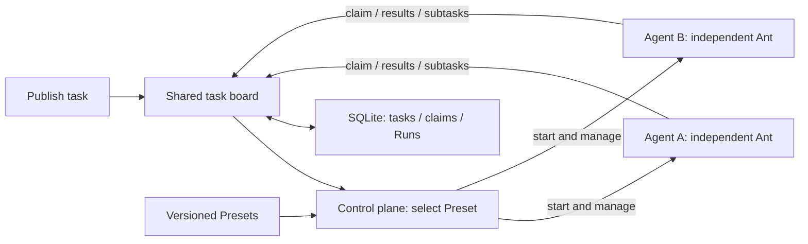

<p align="center">
  
</p>

# Ant³

**Small agents. Shared work.**

An ant-inspired platform for peer AI agents, built in Rust. Publish a task with acceptance criteria; agents claim work from a shared task board, split it into focused tasks, and leave results for the next participant. Human review closes the loop.

Like ants coordinating through changes to their environment, agents coordinate through durable shared work. The control plane selects Presets, provisions instances, and enforces capacity; each agent runs the same model/tool loop with its own specialization. Planning and integration are tasks ordinary peers can take on.

[简体中文](README.zh-CN.md) · [Documentation](docs/README.md) · [Architecture](docs/managed-agents.zh-CN.md) · [Current status](docs/status.zh-CN.md) · [Contributing](CONTRIBUTING.md)

## How the colony works

| Colony principle | Ant³ mechanism |
| --- | --- |
| Shared traces | A persistent task board holds work, claims, progress, and results. |
| Local action | Each agent claims a task and executes within its assigned scope. |
| Division of labor | Versioned Presets supply different models, instructions, and tools. |
| Collective progress | Subtasks return to the board; a peer integrates completed contributions. |
| Feedback | Humans accept a root result or request another round with review comments. |

The shared board is inspired by **stigmergy**: coordination through a shared environment. Ant³ uses explicit records and a bounded control plane; it does not implement pheromone simulation or ant-colony optimization.

## Start locally

Requires **Rust 1.99+ (latest stable recommended)**. The first start opens an empty workspace. Configure a model provider and publish your own Preset before running tasks; Cargo downloads dependencies on the first build.

```sh
git clone https://github.com/NeoPanic/Ant3.git
cd Ant3
cargo run --locked -p ant3-cli -- up
```

Open [localhost:7333](http://127.0.0.1:7333) and sign in with the contents of `.ant3/token`. Local state is stored in `.ant3/`.

1. Configure a model provider and publish a Preset in **母体 Presets**, then publish work and acceptance criteria in **任务板** (Task Board).
2. Follow Preset selection, instance startup, and the Agent's claim and execution.
3. Inspect any subtasks returned to the board and their results in **Agent 工作现场**.

Startup does not create sample Presets, instances or tasks. The [task-board guide](docs/task-board.zh-CN.md) describes routing, claiming, splitting, and current limits.

For real models, configure one of **OpenAI-compatible Chat Completions**, **OpenAI Responses**, or **Anthropic Messages**. See the [getting-started guide](docs/getting-started.zh-CN.md) for configuration, CLI/API/MCP usage, and trusted local process plugins.

## Local console

The first start opens an empty task board. Configure a model and publish a Preset, then create your first task.


## What you can use

| Area | Available behavior |
| --- | --- |
| Agent definitions | Versioned Presets, pinned inheritance, parameters, model and plugin bindings. |
| Lifecycle | Independent instances; Agent pools for provisioning, scaling, retirement, and TTL. |
| Shared task board | Publish unassigned tasks; select Presets, provision instances, claim work atomically, and return subtasks. |
| Explicit workflows | Existing Goal graphs, candidate-based claiming, bounded delegation, and research templates. |
| Collaboration | Direct messages, Goal channels, explicit membership, subscribed wake-ups, shared context. |
| Deliverables | Private workspaces, immutable text/file/JSON snapshots, peer evidence handoffs. |
| Review | Independent verification, evidence-linked repair, review rounds, human acceptance. |
| Extension | Prompt packages and local process Tool plugins with pinned versions and health checks. |
| Access | Desktop Web, HTTP API, CLI, and outward MCP stdio share persistent local state. |

Agent pools manage resources from one Preset. Task-board work starts from a published task and provisions its own participants. Completed root results await human review: accept to archive, or request changes to resume work with feedback. Goal channels, file artifacts, and independent verification are not yet integrated into the board.

<details>
<summary>Historical console examples: workstation, collaboration, and artifacts</summary>

These screenshots predate the Ant³ identity and use historical sample data.


Crew animations reflect recorded execution states: working, waiting, or sleeping. Open **Agent 工作现场** to inspect participants and task dependencies.

**Team collaboration.** Members, subscriptions, and discussion records remain inspectable after the team retires.


**Workspace evidence.** Shared immutable snapshots retain their source Agent and Run; private instance files are listed separately.


</details>

This is a **pre-1.0 local platform for trusted environments**. Local defaults include 256 instances, 8 execution slots, and 64 tasks per Goal; these are configured limits, not measured capacity claims. Distributed scheduling, hosted deployment, strong multi-tenant isolation, and remote MCP plugin loading are not provided. See [current status](docs/status.zh-CN.md) and the [capability/source index](docs/capabilities.zh-CN.md) for precise boundaries.

## Architecture



The control plane manages capacity, Preset selection, and lifecycle. Agents share the claim and split protocol; planning and integration are work that ordinary instances can perform. Task ancestry records dependencies and provenance, without giving an Agent authority over its peers. The independent Ant owns model/tool execution, policies, session checkpoints, cancellation, and execution receipts. Checkpoints do not guarantee exactly-once external effects: tools must supply their own idempotency or transaction contract. See [runtime contracts](docs/runtime.md) and the [target architecture](docs/managed-agents.zh-CN.md).

## Use the runtime independently

```sh
cargo run --locked --example quickstart
```

The [offline example](examples/quickstart.rs) runs a model → tool → model cycle, then redelivers the same event to demonstrate session deduplication.

```toml
[dependencies]
ant3 = { git = "https://github.com/NeoPanic/Ant3.git", branch = "main" }
```

```rust
use ant3::{Ant, Limits, Registry};

let agent = Ant::new(Registry::default(), Limits::default());
```

Register capabilities as shown in the complete example. Pin a Git revision for reproducible builds. API reference: `cargo doc --locked --workspace --no-deps --open`.

## Why Ant³?

An ant can do a small piece of work; a colony combines many local actions into a shared outcome. **³** expresses that composition across three connected steps: **claim → contribute → continue**. It describes the collaboration loop, with capacity and permissions enforced by the platform.

The display name is **Ant³**, the repository is **Ant3**, and technical identifiers use `ant3`: the CLI, Cargo packages, protocol names, and `.ant3/` data directory. See the [upgrade guide](docs/upgrade-ant3.zh-CN.md) when moving an existing workspace. [Brand assets and usage](docs/brand/README.md).

## Contribute

See [development checks](CONTRIBUTING.md), [security reporting](SECURITY.md), and the [code of conduct](CODE_OF_CONDUCT.md). The [documentation index](docs/README.md) links setup, design goals, current capabilities, and workflow contracts.

[MIT license](LICENSE).
