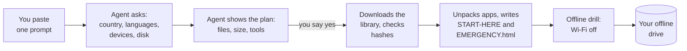

<picture>
  <source media="(prefers-color-scheme: dark)" srcset="docs/img/hero-dark.png">
  
</picture>

<p align="center">
  <a href="LICENSE.md"></a>
  <a href="LICENSE.md"></a>
  
  
  
  
</p>

<p align="center">
  <b>Give your AI coding agent one Markdown file. It builds an offline library for your part of Europe.</b><br>
  During an outage, your household can still open local maps, search Wikipedia and read official preparedness guides.
</p>

<p align="center">
  <a href="#start">Start</a> ·
  <a href="#how-it-works">How it works</a> ·
  <a href="#what-opens-offline">What opens offline</a> ·
  <a href="#what-you-need">What you need</a> ·
  <a href="#downloads-and-checks">Trust</a> ·
  <a href="neotopia-offline.md">Read the guide</a> ·
  <a href="README.pl.md">Polski</a>
</p>

A test release from the Neotopia Foundation.

<!-- DEMO: 20-second GIF. Agent shows the plan and waits for "yes". Cut: "After the build". Wi-Fi off. A Kiwix article and an OsmAnd map open. -->

## Start

**1. Download the guide and check it.** Use a released version. Compare the checksum with the one in the [release notes](https://github.com/neotopia-foundation/offline/releases).

```sh
# macOS and Linux
curl -LO https://github.com/neotopia-foundation/offline/releases/download/v0.1.0/neotopia-offline.md
shasum -a 256 neotopia-offline.md
```

```powershell
# Windows PowerShell
curl.exe -LO https://github.com/neotopia-foundation/offline/releases/download/v0.1.0/neotopia-offline.md
Get-FileHash neotopia-offline.md
```

**2. Open your agent in that folder.** Claude Code, Codex, Gemini CLI or another agent that can run commands.

**3. Paste this prompt.**

```text
Read my local neotopia-offline.md.
Ask me the setup questions.
Show the target folder, the files and the estimated size.
List any tools you need to install.
Wait for my approval before you install tools or download the library.
Then build the drive and help me test it offline.
```

The agent asks about your country, languages, devices, free space and data cap. A hosted agent sends your answers to its provider. Keep private medical details out of that chat.

## How it works



The library downloads only after your "yes". Before that, the agent may look up current file names and sizes. The guide sends nothing to the foundation.

## What opens offline

- **Maps.** Find a street in OsmAnd on your phone. Look up water points, pharmacies and hospitals that OpenStreetMap contributors have mapped.
- **Wikipedia and manuals.** Search Wikipedia, medical articles and repair guides in Kiwix. One laptop can share them with phones over local Wi-Fi.
- **Preparedness guides.** National advice where it exists, first-aid references and the EU guidance on at least 72 hours of self-sufficiency.
- **Local AI chat.** Copy a passage from Kiwix and paste it into the chat for an explanation. The model runs on your computer and can make mistakes. For first aid, medicines and water, follow the source guide.
- **Start pages.** `START-HERE.html` and `EMERGENCY.html` in your household languages, with launchers and step-by-step runbooks.
- **Print pack.** Emergency card, family plan and local map. Paper works without power.

<table>
  <tr>
    <td width="50%"></td>
    <td width="50%"></td>
  </tr>
  <tr>
    <td><sub><b>START-HERE.html</b> on the reference drive. One page, three languages, fifteen tasks.</sub></td>
    <td><sub><b>EMERGENCY.html</b>. Every number links to the page of the official guide on the drive.</sub></td>
  </tr>
</table>

<picture>
  <source media="(prefers-color-scheme: dark)" srcset="docs/img/coverage-dark.png">
  
</picture>

Coverage: EU-27, EEA and EFTA, the United Kingdom, the Western Balkans, Ukraine, Moldova, Turkey and the South Caucasus. Available guides and Wikipedia editions differ by country and language. [Maps by country](neotopia-offline.md#14-country-map-table) · [Languages](neotopia-offline.md#15-language-packs) · [National guides](neotopia-offline.md#16-national-preparedness-guides)

## What you need

- Internet access while you build. The drive works offline after that.
- Bash, `curl` and `shasum` or `sha256sum`. macOS and Linux have them. On Windows, the agent needs a Bash environment such as WSL. We have not tested a Windows build yet.
- A drive or target folder with enough free space. exFAT works on macOS, Windows and Linux.
- Time. Download time depends on your connection. A full checksum pass over 114 GB took about one hour on a USB 3 drive.
- Costs: the drive, data charges and the fees of your coding agent, if any. The guide itself is free.

| Drive | Typical contents |
|---|---|
| **32 GB** | Apps, a small AI model, medical and practical encyclopedias, short Wikipedia, phone maps, guides. Target: 25 GB |
| **128 GB** | Plus a larger AI model, full Wikipedia without images, repair libraries, terrain, addresses |
| **256 GB** | Plus science textbooks, neighbour-country maps, books and audiobooks |
| **512 GB and more** | Plus Wikipedia with images, large book collections, several countries |

Plan to leave 10 % of the drive free. The agent picks the AI model by the memory of your computer. [Size profiles](neotopia-offline.md#3-size-tiers)

## Downloads and checks

- **No account, no telemetry.** You need no Neotopia account. The guide sends nothing to the foundation.
- **Sources.** The manifest lists every source. Most files come from their publishers. Some come from mirrors or, for large Kiwix archives, from BitTorrent peers.
- **BitTorrent.** With `aria2c` installed, Kiwix archives of 1 GB or more go over BitTorrent. This spares the free Kiwix mirrors. Your client uploads pieces to other peers while it downloads. Without `aria2c`, everything goes over HTTP.
- **Checksums.** The downloader checks the publisher's hash for Kiwix archives. The agent checks other files against published hashes where they exist. At the end it writes `SHA256SUMS.txt` for the whole drive.
- **Failures.** A finished run can still have failed items. Read `_log/failed.tsv`. Compare the drive with `MANIFEST.tsv`. [Downloader details](neotopia-offline.md#121-fetchsh-resumable-downloader)

<details>
<summary>Commands that deserve a closer look</summary>

The Mac chat launcher removes the macOS quarantine flag from the downloaded AI runtime, so that it can start. The optional Ventoy boot-stick installer erases its target USB stick. The guide tells the agent to name the stick and wait for your confirmation. [Launchers](neotopia-offline.md#315-launcher-templates) · [Disk safety](neotopia-offline.md#3010-disk-security-and-phones)

</details>

## Test the drive

1. Turn off Wi-Fi, mobile data and Bluetooth. Open a map, a Wikipedia article and a national guide on the weakest device in the house.
2. Unplug the router's internet cable and keep local Wi-Fi on. Open a Kiwix article on a second device.

The agent writes the results to `_log/drill.txt`. Every task that you chose must pass. [Full offline drill](neotopia-offline.md#274-offline-drill)

## Reference build

<picture>
  <source media="(prefers-color-scheme: dark)" srcset="docs/img/drive-dark.png">
  
</picture>

In November 2026 we built a drive for Poland and Bulgaria. Its core held 309 files and 139 GB. Five PDF downloads failed because their servers returned 403 or 404. After the build, all core files passed a full check against the drive's own checksum list. The AI model also matched the publisher's hash.

On a Mac with Apple silicon and 16 GB of memory, the small AI model started from the USB drive in about four minutes. One careful answer took about five minutes. [Lessons from the build](neotopia-offline.md#17-lessons-from-the-reference-build)

## Sharing

Downloaded material keeps its own licence. Before you copy a drive for other people, check each item and leave personal files out. If the terms are unclear, share a link or ask the publisher. [Sharing rules](neotopia-offline.md#13-licences-and-law)

## Contributing

Build reports help most, with the real size and the offline test results. New national guides and broken links come next. [CONTRIBUTING.md](CONTRIBUTING.md)

## Related projects

[Kiwix](https://kiwix.org) makes the offline reader that this guide uses. [Internet-in-a-Box](https://internet-in-a-box.org/) offers a shared Wi-Fi library on a small server. [Lastbook](https://github.com/Immortal-Protocols/lastbook) is a desktop app for the United States whose chat searches its own collection. It inspired this independent European project. Neotopia Offline is not an official Lastbook edition.

## Licence

Text: CC BY 4.0. Code: MIT. Neotopia Foundation. Details: [LICENSE.md](LICENSE.md) · [CREDITS.md](CREDITS.md) · [SECURITY.md](SECURITY.md)

Map data: Natural Earth (public domain), borders as seen from Poland.
