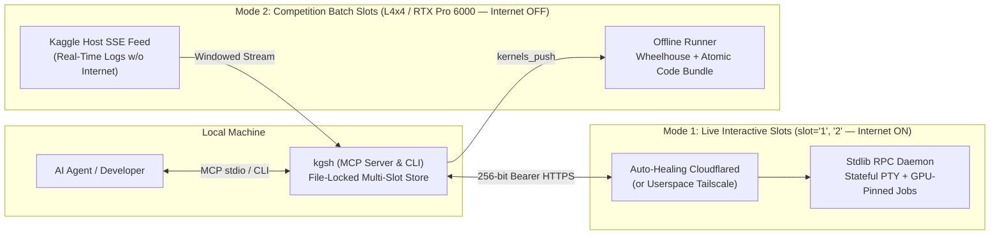

# kaggle-shell-mcp (`kgsh`) ⚡

**Turn free 12h Kaggle GPUs into multi-slot live remote terminals & offline competition runners for AI Agents via MCP.**

[](https://pypi.org/project/kaggle-shell-mcp/)
[](https://github.com/NguyenQuocDat06-AI/kaggle-shell-mcp/actions/workflows/ci.yml)
[](./LICENSE)
[](https://www.python.org/)
[](https://modelcontextprotocol.io/)

[**Tiếng Việt (Vietnamese Guide)**](./docs/README.vi.md) · [**Architecture**](./ARCHITECTURE.md) · [**Changelog**](./CHANGELOG.md) · [**Contributing**](./CONTRIBUTING.md)

---

## Why `kaggle-shell-mcp`?

Kaggle provides ~30 hours/week of free GPU compute, yet its official API (`kaggle kernels push`) only runs fire-and-forget batch scripts, while community SSH notebooks require manual browser clicks, `ngrok` accounts, and manual `CUDA` environment repairs.

**`kaggle-shell-mcp`** (CLI: **`kgsh`**) gives AI Agents and developers a unified compute bridge:

- **One-Line Zero-Setup**: Install directly from PyPI (`pip install kaggle-shell-mcp` or `uvx`). Uses **only** `KAGGLE_USERNAME` and `KAGGLE_KEY` (`KGAT_...` bearer token, legacy key, or existing `~/.kaggle/kaggle.json`). No `ngrok` account or local VPN client needed.
- **Dual Concurrent GPU VMs (`4 × Tesla T4 = 60 GB VRAM`)**: Provision up to **2 parallel Kaggle GPU sessions** (`slot="1,2"`) and pin individual jobs via `gpu_ids="0"` / `"1"` to run **4 isolated GPU experiments simultaneously**.
- **Full Hardware & Hub Support**: Target `NvidiaTeslaT4` (`2×15 GB`), `NvidiaL4`, `NvidiaL4x4` (`96 GB`), `NvidiaRtxPro6000` (`96 GB`), `NvidiaH100`, `TpuV5E8` / `TpuV6E8`, or `cpu`, with native `competition_sources` and zero-copy Kaggle Hub `model_sources` mounts.
- **Offline Competition Mode + Live Host SSE Logs**: When high-end competition hardware (`L4x4`, `RTX Pro 6000`) forces `enable_internet=False`, `kgsh` bundles Linux wheels (`kaggle_wheelhouse`) + local code (`kaggle_batch_run`) and streams real-time logs via Kaggle's Host SSE feed (`kaggle_batch_logs`) without opening a browser.
- **100% Native CUDA + Safe-Drain Watchdogs**:
  - Pure-stdlib Python PTY & job daemon runs inside the Kernel runtime—preserving Conda, PyTorch, `PATH`, and `LD_LIBRARY_PATH` automatically, while compacting `\r` `tqdm` progress bars.
  - Sends `SIGTERM` at `11h35m` (`8h35m` on TPU) to flush checkpoints and exits cleanly (`exit 0`) at `11h40m` (`8h40m` on TPU) so Kaggle commits your `/kaggle/working` (20 GB) output snapshot before the hard reaper hits.

---

## Architecture Overview



See [**ARCHITECTURE.md**](./ARCHITECTURE.md) for deep-dive internals on slot isolation, PTY sentinel framing, and bounded SSE streaming.

---

## Quickstart (30 Seconds)

### Option A: Zero-Install MCP via `uvx` (Recommended for Agents)

Add directly to your **Claude Desktop / Cursor / Windsurf / Antigravity** `mcp_config.json`—no manual virtual environment required:

```json
{
  "mcpServers": {
    "kgsh": {
      "command": "uvx",
      "args": ["--from", "kaggle-shell-mcp", "kgsh"],
      "env": {
        "KAGGLE_USERNAME": "your_kaggle_username",
        "KAGGLE_KEY": "KGAT_your_api_token_here"
      }
    }
  }
}
```

Or register in **Claude Code CLI** in one line:
```bash
claude mcp add kgsh -e KAGGLE_USERNAME=your_user -e KAGGLE_KEY=KGAT_your_token -- uvx --from kaggle-shell-mcp kgsh
```

### Option B: Install `kgsh` Globally via `pip` / `uv`

```bash
pip install kaggle-shell-mcp
# or isolated CLI install:
uv tool install kaggle-shell-mcp
```

Credentials are discovered automatically from any of:
1. `KAGGLE_USERNAME` + `KAGGLE_KEY` environment variables,
2. `.env` in your current working directory or `~/.kaggle_mcp/.env`, or
3. Your existing `~/.kaggle/kaggle.json` file.

*(Generate an API token at [kaggle.com/settings](https://www.kaggle.com/settings) → **API** → **Generate New Token**. Phone verification is required on Kaggle to unlock GPU accelerators.)*

---

## MCP Tools Reference (12 Tools)

| Tool | Purpose |
| :--- | :--- |
| `kaggle_up` | Boot 1 or 2 parallel headless workers (`slot="1"`, `"2"`, or `"1,2"`, `accelerator`, `competition`, `mount_datasets`, `mount_models`, opt-in `idle_timeout_min`) |
| `kaggle_status` | Inspect live GPU/VRAM telemetry, RAM, disk, and kernel states across `slot="all"` or a specific slot (auto-cleans stale sessions) |
| `kaggle_down` | Gracefully stop `slot="1"`, `"2"`, or `"all"` (`exit 0`) immediately to save GPU quota; optionally pull `/kaggle/working` |
| `term_exec` | Run bash commands in a persistent stateful PTY on `slot` (`cwd`, exports, and virtualenvs persist across calls) |
| `job_spawn` | Launch detached background jobs on `slot` with optional `gpu_ids` (`CUDA_VISIBLE_DEVICES="0"` or `"1"`) |
| `job_list` | List active and finished background jobs on `slot` with PID, GPU assignment, runtime, and log size |
| `job_logs` | Read tail lines of a background job log on `slot` (with regex `grep` and automatic `tqdm` `\r` cleanup) |
| `job_kill` | Send `SIGTERM` or `SIGKILL` to a background job's process group on `slot` and release VRAM |
| `fs_sync` | `push` local folders (auto-skipping `.git`, `.venv`, `__pycache__`) or `pull` remote checkpoints/logs on `slot` |
| `kaggle_wheelhouse` | Download Linux `manylinux_x86_64` binary `.whl` packages and publish a private Dataset for no-internet runs |
| `kaggle_batch_run` | Submit an offline/competition batch job (`NvidiaL4x4`, `NvidiaRtxPro6000`, `TpuV5E8`, `enable_internet=False`) with automatic code bundling |
| `kaggle_batch_logs` | Stream live or completed logs via Kaggle's Host SSE endpoint—even when container internet is disabled |

---

## Standalone CLI Usage (`kgsh`)

### Workflow 1: Single or Dual-VM Interactive GPU Shell

```bash
# Boot BOTH Kaggle Dual-T4 VMs in parallel (4x T4 = 60 GB total VRAM)
kgsh up -s 1,2

# Interactive shell commands on specific slots
kgsh exec -s 1 "nvidia-smi"
kgsh push ./my_project /kaggle/working -s 1
kgsh push ./my_project /kaggle/working -s 2

# Run 4 independent GPU experiments simultaneously across 2 VMs x 2 GPUs
kgsh spawn -s 1 --gpus 0 "python my_project/train.py --lr 1e-4" --name exp1
kgsh spawn -s 1 --gpus 1 "python my_project/train.py --lr 3e-4" --name exp2
kgsh spawn -s 2 --gpus 0 "python my_project/train.py --lr 5e-4" --name exp3
kgsh spawn -s 2 --gpus 1 "python my_project/train.py --lr 1e-3" --name exp4

# Monitor status & shut down all GPU VMs when finished
kgsh status
kgsh down -s all
```

### Workflow 2: Offline Kaggle Competition (`L4x4` / `RTX Pro 6000` with Internet OFF)

```bash
# 1. (Once) Build an offline Linux wheelhouse dataset
kgsh wheels peft accelerate bitsandbytes --slug lora-deps --py 312

# 2. Bundle local project & launch offline on competition hardware
kgsh batch-run "torchrun --nproc_per_node=4 solve.py" \
  --path ./comp_solution \
  -a l4x4 \
  --comp arc-prize-2026 \
  --wheels your_username/kgsh-wheels-lora-deps \
  --model qwen-lm/qwen2.5/transformers/7b-instruct/1

# 3. Stream live logs from Host SSE without opening a browser
kgsh batch-logs -s batch-1 --tail 80
```

---

## Chaining Runs Longer Than 12 Hours

1. Save periodic checkpoints into `/kaggle/working/checkpoints/` inside your training script (and handle `SIGTERM` for the `11h35m` drain signal).
2. After Session 1 exits cleanly at `11h40m`, start Session 2 with `chain_previous_output=True` (`kgsh up --chain`). Kaggle mounts Session 1's output directly under `/kaggle/input/` at internal datacenter speeds.

---

## Responsible Use

`kaggle-shell-mcp` is built for legitimate machine learning experimentation, model training, and competition workflows on your own Kaggle account. Respect [Kaggle's Terms of Service](https://www.kaggle.com/terms): do not use Kaggle notebooks for crypto-mining, public web hosting, or network proxying, and shut down active slots (`kgsh down -s all`) when finished. Note that running 2 concurrent GPU slots deducts 2 hours of GPU quota per wall-clock hour.

## License

Released under the [MIT License](./LICENSE).
