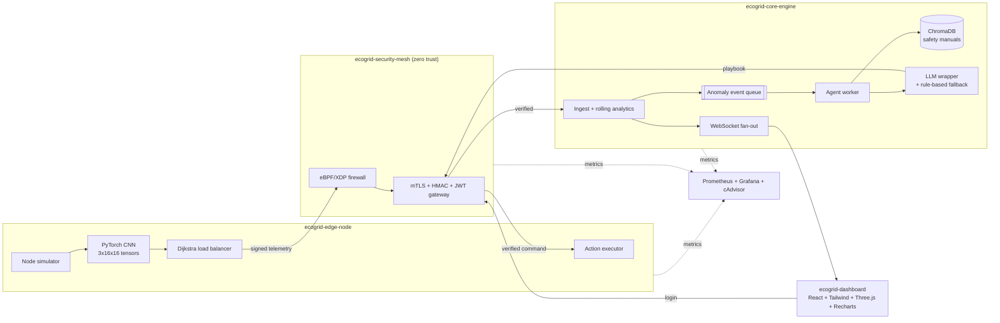

<p align="center"></p>

# EcoGrid-AI: Self-Healing Decentralized Microgrid Sentinel

A containerized cyber-physical simulation. Simulated microgrid nodes run an **edge CNN** to spot overheating, overload and intrusion. A **zero-trust mesh** guards every internal call. A **core engine** scores anomalies and runs an **event-driven agentic RAG** loop that writes a recovery playbook from safety manuals and sends it back to the edge. A **3D digital twin** shows it all live, and **Prometheus + Grafana** watch the platform itself.

**Live demo (GitHub Pages):** `https://<your-username>.github.io/<repo-name>/` runs the dashboard with an in-browser simulator. The full stack needs Docker.

## Designed and Developed by 
# **NIKHIL CHARY SRIRAMOJU**
BTech CSE (Final Year)

- GitHub: [Nikhil-creat](https://github.com/Nikhil-creat)
- LinkedIn: [nikhil-chary-sriramoju](https://in.linkedin.com/in/nikhil-chary-sriramoju-95041b38a)
- Email: sriramojunikhil66@gmail.com
- Instagram: [@nikhil__sriramoju](https://www.instagram.com/nikhil__sriramoju)
- Facebook: [Profile](https://www.facebook.com/profile.php?id=100079201124141)

## Quick start

```bash
cp .env.example .env        # then edit the secrets
docker compose up --build
```

| Service | URL | Notes |
|---|---|---|
| Dashboard | http://localhost:3000 | 3D twin, charts, fault injection |
| Core engine API | http://localhost:8000/docs | JWT required for `/api/*` |
| Security mesh | http://localhost:8080/healthz | Login at `/auth/login` |
| Prometheus | http://localhost:9090 | Scrapes all services + cAdvisor |
| Grafana | http://localhost:3001 | `admin` / `GRAFANA_PASSWORD`; dashboard "EcoGrid-AI Operations" |

The edge node trains its small CNN on synthetic data on first start (about 10 to 30 seconds), then caches the weights in a volume. Open the dashboard, pick a node, click **Overheat**, and watch the playbook appear.

## Architecture



**Self-healing loop:** telemetry (1 Hz) → CNN class + confidence → rolling z-score analytics → if critical (confidence ≥ 0.8, per-node cooldown) an event is queued → worker retrieves manual excerpts from ChromaDB → LLM (or fallback rules) drafts a JSON playbook → validated against an action whitelist → signed and routed through the mesh to the edge → edge applies `cooldown`, `throttle`, `reroute`, `rotate_credentials`, `isolate` or `restore`.

## Security threat model

Trust boundaries: operator ↔ mesh, edge ↔ mesh, mesh ↔ core, core ↔ LLM provider.

| Threat (STRIDE) | Mitigation in this repo |
|---|---|
| **Spoofing** a node or service | Per-service mock mTLS fingerprint + short-lived service JWT whose `sub` must match the claimed service |
| **Tampering** with telemetry or commands | HMAC-SHA256 over timestamp + body on every internal hop |
| **Replay** of captured payloads | 30 s timestamp window + seen-signature cache |
| **Repudiation** | Rejections counted by reason (`ecogrid_rejected_payloads_total`) and graphed in Grafana |
| **Information disclosure** | Secrets from env only; `.env` is git-ignored; LLM sees only anomaly summaries and manual text |
| **Denial of service** | Firewall drops unauthenticated requests before app logic; `/metrics` shows drop rates |
| **Elevation of privilege** | Operator JWT role required for fault injection; services accept only named peers |
| **Prompt injection into the playbook** | LLM output is parsed as JSON, actions are whitelisted, at most 3 steps, node forced to the flagged one |

**Honest limitations.** mTLS is mocked with fingerprints (use SPIFFE/SPIRE or a service mesh in production). The eBPF guard inspects only the first data segment of an HTTP request and protects the mesh's own interface. Default `EBPF_MODE=simulate` applies the same rule in userspace; `ebpf` needs a Linux host, privileges and `INSTALL_BCC=1`. The CNN is trained on synthetic patterns, not real hardware data. Tokens use a shared HS256 secret.

## Configuration (`.env.example`)

| Variable | Purpose |
|---|---|
| `MESH_HMAC_SECRET`, `JWT_SECRET` | Signing secrets. Change both. |
| `OPERATOR_PASSWORD` | Dashboard login (baked into the demo dashboard build; do not reuse a real password) |
| `ANTHROPIC_API_KEY`, `LLM_MODEL` | Optional. Without a key, the rule-based synthesizer writes playbooks. |
| `NODE_COUNT`, `CRITICAL_CONFIDENCE`, `PLAYBOOK_COOLDOWN` | Simulation tuning |
| `EBPF_MODE`, `INSTALL_BCC` | `simulate` (default) or `ebpf` |
| `GRAFANA_PASSWORD`, `DASHBOARD_ORIGIN` | Grafana admin password, CORS origin |

## Repository layout

```
docker-compose.yml   .env.example
shared/ecogrid_common/security.py        HMAC, JWT, mock mTLS, replay guard
services/edge-node/                      cnn.py, main.py (simulator, Dijkstra, actions)
services/core-engine/                    main.py, analytics.py, rag.py, manuals/*.md
services/security-mesh/                  main.py, firewall.py, ebpf/xdp_guard.c
dashboard/                               Vite + React + Tailwind + Three.js
observability/                           prometheus.yml, Grafana provisioning + dashboard
.github/workflows/pages.yml              builds the demo dashboard for GitHub Pages
```

## Custom metrics

`edge_cnn_inference_seconds`, `edge_detections_total`, `core_http_request_seconds`, `ecogrid_anomalies_total`, `ecogrid_anomaly_score`, `ecogrid_playbooks_total`, `ecogrid_agent_queue_depth`, `ecogrid_rag_seconds`, `ecogrid_rejected_payloads_total`, `ecogrid_ebpf_dropped_packets`, plus container CPU from cAdvisor.

## Publish to GitHub and GitHub Pages

1. Create an empty repo on github.com (no README), e.g. `ecogrid-ai`.
2. From this folder:
   ```bash
   git init && git add . && git commit -m "EcoGrid-AI initial commit"
   git branch -M main
   git remote add origin https://github.com/<your-username>/ecogrid-ai.git
   git push -u origin main
   ```
3. In the repo go to **Settings → Pages → Build and deployment → Source: GitHub Actions**.
4. The **Deploy dashboard to GitHub Pages** workflow runs on every push to `main`. When it turns green (Actions tab), open `https://<your-username>.github.io/ecogrid-ai/`.

GitHub Pages hosts static files only, so the Pages site runs the browser simulator. To show the real backend, run `docker compose up --build` locally.

## Credits

**DESIGNED & DEVELOPED BY NIKHIL CHARY SRIRAMOJU** · [GitHub](https://github.com/Nikhil-creat) · [LinkedIn](https://in.linkedin.com/in/nikhil-chary-sriramoju-95041b38a) · [Email](mailto:sriramojunikhil66@gmail.com)
