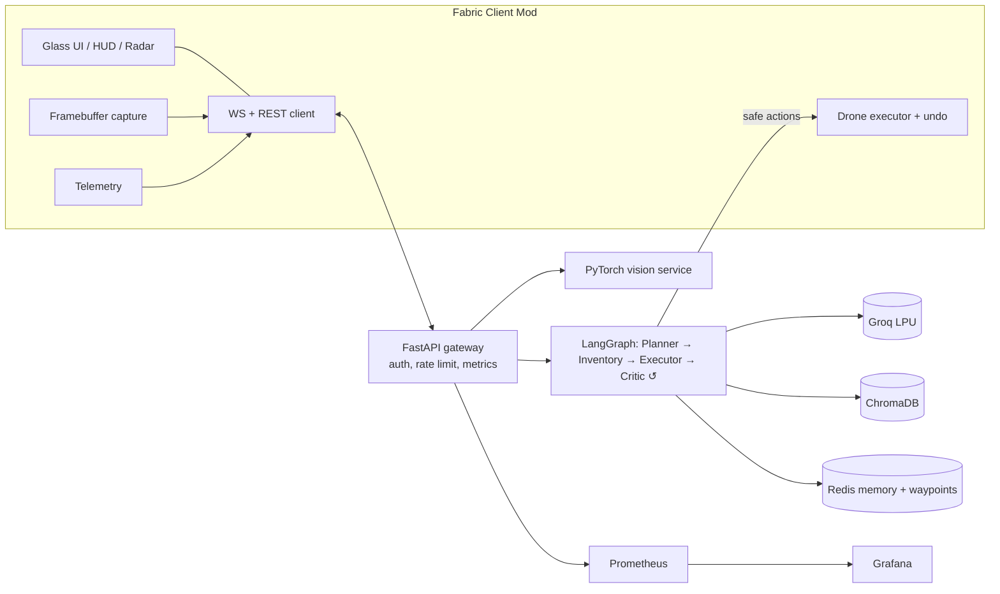

<div align="center">

# ⬢ NEXUS — Agentic AI Minecraft Ecosystem

### Self-correcting multi-agent AI · RAG knowledge · CNN vision · Autonomous building drone

      

[🌐 Live Demo](https://nikhil-creat.github.io/minecraft-ai-ecosystem/) · [🚀 Quick Start](#-quick-start) · [🧠 Agentic AI](#-agentic-ai-deep-dive) · [🏛 Architecture](#-architecture) · [🔌 API](#-api-reference) · [🗺 Roadmap](#-roadmap)

**Designed & Developed by [NIKHIL CHARY SRIRAMOJU](https://github.com/Nikhil-creat)**

</div>

---

## 📑 Table of Contents
[Overview](#-overview) · [Features](#-features) · [Agentic AI](#-agentic-ai-deep-dive) · [Architecture](#-architecture) · [Tech Stack](#-tech-stack) · [Structure](#-project-structure) · [Quick Start](#-quick-start) · [Commands](#-in-game-controls) · [Config](#-configuration) · [API](#-api-reference) · [Observability](#-observability) · [Testing](#-testing) · [Security](#-security) · [Limitations](#-known-limitations) · [Roadmap](#-roadmap) · [Author](#-about-the-author)

## 📖 Overview
NEXUS puts an autonomous AI crew inside Minecraft. A Fabric mod streams player telemetry and screen frames to a dockerized backend.
There a LangGraph pipeline — **Planner → Inventory → Executor → Critic** — running on Groq turns natural language into safe,
validated world actions, grounded by a ChromaDB knowledge base and a PyTorch CNN. The Autonomous Drone then builds or mines in-world, and `/ai undo` reverts it.

## ✨ Features
| Area | Highlights |
|---|---|
| 🧠 Agents | Planner (llama-3.3-70b) · Executor with tool-calling loop (llama-3.1-8b) · Inventory agent · Safety critic · **self-correction loop** · model fallback · token budget |
| 🗺 Memory | Redis conversation memory · spatial trail · **named waypoints** ("remember this as my base") |
| 📚 RAG | ChromaDB + all-MiniLM-L6-v2 · seeded knowledge · ingest `.txt/.md/.json` wiki dumps from `backend/knowledge/` |
| 👁 Vision | MobileNetV3 tile classifier · HUD bounding boxes · threat levels · trainable mob head |
| 🎮 In-game | Glass-UI terminal · HUD · **threat radar** · `/ai` commands · **drone undo** · config file · keybinds |
| 🛡 Platform | API-key auth · rate limiting · request IDs · non-root containers · Prometheus + Grafana · CI/CD · GitHub Pages |

## 🧠 Agentic AI Deep Dive
| Stage | Model | Job |
|---|---|---|
| **Planner** | llama-3.3-70b-versatile | Decomposes the goal with RAG context, saved waypoints and telemetry; decides if world actions are needed; saves waypoints on request |
| **Inventory** | deterministic + RAG | Compares required items with the inventory (skipped in creative) and attaches crafting hints for what's missing |
| **Executor** | llama-3.1-8b-instant | Tool-calling loop: `lookup_knowledge`, `check_inventory`, `recall_waypoints`, `submit_actions` |
| **Critic** | rule-based safety review | Rejects plans that would bury the player or exceed the block budget; deny-lists dangerous blocks |
| **Reflection** | loop (max `MAX_ATTEMPTS`) | If no safe actions survive, the critic feeds the failure reason back to the Executor to retry; a built-in blueprint is the last resort |

Every response reports `warnings`, `retries`, `confidence`, `latency_ms` and the models used, so behaviour is auditable.

## 🏛 Architecture


## 🧰 Tech Stack
Java 17 · Fabric API · Gson · Java-WebSocket · Python 3.11 · FastAPI · LangGraph · Groq · ChromaDB · PyTorch / TorchVision · Redis · Docker Compose · Prometheus · Grafana · GitHub Actions · GitHub Pages

## 📂 Project Structure
```
backend/    main.py agent.py actions.py rag_engine.py cnn_vision.py vision_service.py train_head.py tests/ Dockerfile
mod/        Fabric 1.20.1 mod (com.nikhil.aimod) + assets, recipes, textures
monitoring/ Prometheus config + provisioned Grafana dashboard
docs/       GitHub Pages site + REPO_SETUP.md (About text, topics, security cleanup)
.github/    CI, Pages deploy, issue/PR templates, CODEOWNERS
deploy.sh   guarded push script (refuses to run outside this folder)
```

## 🚀 Quick Start
**Prerequisites:** Docker + Compose, JDK 17+, a [Groq API key](https://console.groq.com).
```bash
cp .env.example .env          # set GROQ_API_KEY (optionally API_KEY)
docker compose up --build     # api :8000 · vision :8002 · chroma :8001 · prometheus :9090 · grafana :3000
curl localhost:8000/health
cd mod && gradle wrapper --gradle-version 8.8 && ./gradlew runClient
```
In a singleplayer world: `/give @s custom_item_mod:quantum_communicator` (also `autonomous_drone`, `vision_monocle`).

## 🎮 In-Game Controls
| Command / key | Action |
|---|---|
| `G` or `/ai` | Open the assistant terminal |
| `/ai <prompt>` | Ask the agents, e.g. `build a 5x5 survival shelter` or `remember this as my base` |
| `/rag <q>` (in terminal) | Search the knowledge base |
| `/ai undo` · `/ai cancel` | Revert drone changes · discard the pending plan |
| `/ai vision` · `/ai status` · `/ai clear` | Toggle vision · show status · clear the log |
| `H` | Toggle HUD (radar, metrics, boxes) |

## ⚙️ Configuration
`config/custom_item_mod.json`: `backendUrl`, `apiKey`, `visionIntervalTicks`, `showRadar`, `radarRange`.
Backend `.env`: `GROQ_API_KEY`, `API_KEY`, `RATE_LIMIT_PER_MIN`, `PLANNER_MODEL`, `EXECUTOR_MODEL`, `TOKEN_BUDGET`, `MAX_ATTEMPTS`, `LOG_LEVEL`.

## 🔌 API Reference
`POST /agent/execute` · `POST /chat` · `POST /rag/query` · `POST /vision/predict` · `WS /ws` · `GET /waypoints /telemetry/summary /health /metrics /docs`.
Send `X-API-Key` when `API_KEY` is set. Interactive docs at `http://localhost:8000/docs`.

## 📈 Observability
Prometheus scrapes `/metrics`; Grafana (`:3000`) ships a provisioned dashboard: request rate, p95 latency, agent runs, actions generated, websocket connections, vision throughput.

## 🧪 Testing
```bash
pip install -r backend/requirements-dev.txt && pytest backend/tests
```
Manual: `/rag where do diamonds spawn` · `/ai build a 5x5 survival shelter` then right-click the drone · `/ai undo` · right-click the monocle near lava.

## 🔒 Security
See [SECURITY.md](SECURITY.md). Never commit `.env` or your home folder: use `./deploy.sh`, which refuses to push from the wrong directory. Set `API_KEY` before exposing the backend.

## ⚠️ Known Limitations
- Vision uses a colour heuristic (lava, water, foliage, caves) until you train a mob head. Frames are sampled ~2/s, not 30 FPS.
- The drone edits the integrated server, so it works in singleplayer or as a LAN host; it is a block executor with particles, not an entity.
- The Monocle works while carried in the inventory (custom armour textures are not included).

## 🗺 Roadmap
Voice commands (Whisper on Groq) · streaming agent responses · trained mob head release · multiplayer server mod · physical drone entity · GraphRAG · Helm chart.

## 🤝 Contributing · 📜 License · 📚 Cite
[CONTRIBUTING.md](CONTRIBUTING.md) · [CODE_OF_CONDUCT.md](CODE_OF_CONDUCT.md) · [CHANGELOG.md](CHANGELOG.md) · [MIT License](LICENSE) · [CITATION.cff](CITATION.cff)

## 👤 About the Author
**NIKHIL CHARY SRIRAMOJU** — final-year B.Tech Computer Science & Engineering student building production-style AI systems:
agentic multi-agent architectures, RAG, computer vision, distributed systems, DevOps and full-stack engineering.
NEXUS was designed and developed end to end by him: system architecture, Fabric mod, AI backend, observability, CI/CD and documentation.
Other work includes APEX-AI, VigilAI Engine Mesh, PharmAi Vision, StreamGuard, a Raft key-value store and EcoGrid-AI.

[GitHub](https://github.com/Nikhil-creat) · [LinkedIn](https://in.linkedin.com/in/nikhil-chary-sriramoju-95041b38a) · [Email](mailto:sriramojunikhil66@gmail.com)

---
<div align="center">

**⬢ NEXUS v2.1.0 · Designed & Developed by NIKHIL CHARY SRIRAMOJU · © 2026 · MIT**
<sub>Not affiliated with Mojang Studios or Microsoft. Minecraft is a trademark of Mojang Studios.</sub>

</div>
